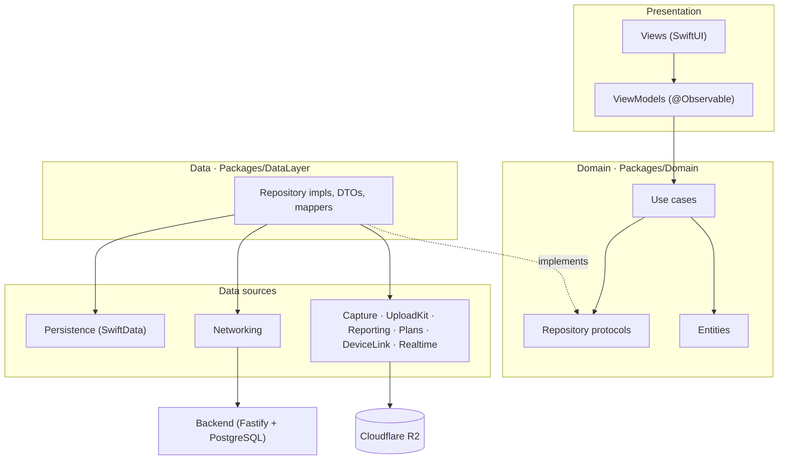
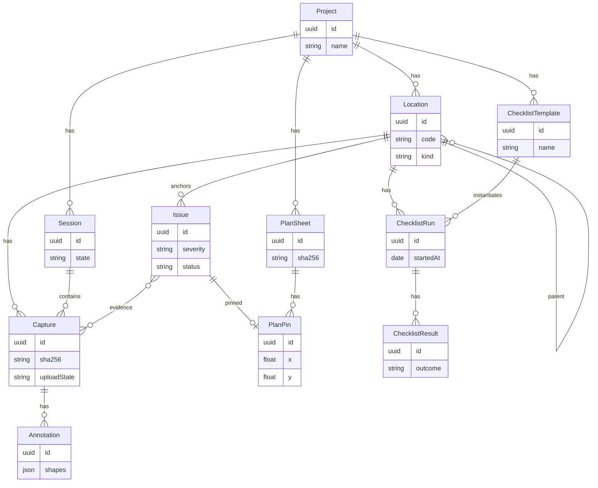

# SiteLog

| | |
|---|---|
| Overview | Offline-first iOS app for site supervisors to record construction site conditions and export a signed PDF inspection report |
| Last edit | 2026-09-30 |
| Author | Dam Hong Duc |
| Docs | [docs/index.md](docs/index.md) · build order in [ROADMAP.md](ROADMAP.md) |

## Store links

| Platform | Link |
|---|---|
| App Store | Not published |

## App IDs

| ID | Value |
|---|---|
| iOS bundle ID | `app.dd.site.log` |

## Tech stack

| Category | Technology | Version |
|---|---|---|
| Framework | SwiftUI | iOS 18.6 deployment target |
| Language | Swift | 6 (strict concurrency) |
| State management | Observation (`@Observable` view models) | iOS 17+ API |
| Dependency injection | [Factory](https://github.com/hmlongco/Factory) (`FactoryKit`) | 3.x |
| Local DB | SwiftData | iOS 18 |
| Upload | Hand-written background `URLSession` engine (`UploadKit`) → Cloudflare R2 | — |
| Realtime | `URLSessionWebSocketTask` (`Realtime`) | — |
| Remote images | [Kingfisher](https://github.com/onevcat/Kingfisher) | 8.x |
| Auth / crash | Firebase Auth, Firebase Crashlytics | firebase-ios-sdk 12.x |
| Backend | Node.js, TypeScript, Fastify, PostgreSQL, hand-written sync engine | Node 22, PostgreSQL 16 |
| Tests | Swift Testing, [swift-snapshot-testing](https://github.com/pointfreeco/swift-snapshot-testing), `FactoryTesting`, XCUITest | 1.x |
| Tooling | XcodeGen, SwiftLint, swift-format, Fastlane, GitHub Actions | — |
| Dev only | [Inject](https://github.com/krzysztofzablocki/Inject) (hot reload, Debug) | 1.6.0 |

Why each choice: [docs/adr](docs/adr/README.md).

## Project architecture

| | |
|---|---|
| Architecture | Clean Architecture (Presentation · Domain · Data), MVVM in Presentation, SPM packages per layer |
| Dependency injection | Factory registrations in `SiteLog/AppDependencies.swift` only |
| Encryption | Data Protection `.completeUnlessOpen` for media, AES-GCM for export bundles, HMAC-SHA256 audit chain, Keychain for keys and tokens |

```
site-log-ios/
├── SiteLog/              # app: composition root + Presentation (MVVM) + Resources
├── Packages/
│   ├── Domain/           # entities, use cases, repository protocols
│   ├── DataLayer/        # repository impls, DTOs, mappers
│   ├── Networking/       # backend HTTP client
│   └── DesignSystem/     # tokens and shared components
├── SiteLogTests/ SiteLogUITests/
├── docs/                 # feature-docs, adr, design, dev-docs, testing.md
└── project.yml           # XcodeGen
```

Data-source packages (`Persistence`, `Capture`, `UploadKit`, `Reporting`, `Plans`, `DeviceLink`,
`Realtime`) and `Backend/` are added as their milestones start ([ROADMAP.md](ROADMAP.md)); the full
layout is in [00-overview.md](docs/feature-docs/00-overview.md#41-repo-layout).

## Getting started

1. Install tools:

   ```bash
   brew install xcodegen swiftlint
   ```

2. Generate the project, then open `SiteLog.xcodeproj`:

   ```bash
   xcodegen generate
   ```

3. Run the `SiteLog` scheme (⌘R) on an iOS 18.6+ simulator; run tests with ⌘U.



## Local database

Planned SwiftData schema from [00-overview.md](docs/feature-docs/00-overview.md#3-data-model).


