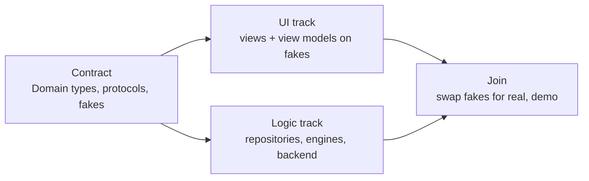
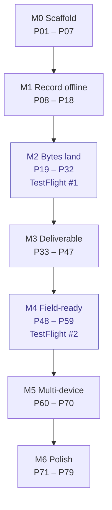

# Roadmap

- Milestones run in order; a milestone is done when its demo runs on a real device.
- Inside a milestone, UI and Logic run in parallel on two tracks.
- Specs: [docs/feature-docs](docs/feature-docs/); step-by-step guides: [docs/milestone-guide](docs/milestone-guide/).

## Contents

1. [How work is split](#how-work-is-split)
2. [Summary](#summary)
3. [M0 — Scaffold](#m0--scaffold--32h)
4. [M1 — Record offline](#m1--record-offline--56h)
5. [M2 — Bytes land](#m2--bytes-land--testflight-1--92h)
6. [M3 — Deliverable](#m3--deliverable--91h)
7. [M4 — Field-ready](#m4--field-ready--testflight-2--68h)
8. [M5 — Multi-device](#m5--multi-device--63h)
9. [M6 — Polish](#m6--polish--50h)
10. [Tracks](#tracks)
11. [Rules](#rules)

## How work is split

- Format: `PXX - [docs-number] - [track] - [context] - [est hours] - description`.
- `[docs-number]` is the spec in `docs/feature-docs/` (`-` if none).
- `[track]` is `Contract`, `UI`, `Logic` or `Join`.
- `[Backend]` parts are Node.js work in `Backend/`; every other context is the iOS app.

- Estimates: dev-hours for one developer new to Swift and SwiftUI, learning included; time the first
  parts, then scale the rest.

## Summary

| | |
|---|---|
| Total | 78 open parts ≈ 452 hours (`P01` done) — UI 116h, Logic 279h |
| Key milestone | `M2`: everything before it is setup, everything after it is addition |
| Goal | App Store release with the full scope in `M0`–`M6`; no milestone is dropped |

## M0 — Scaffold · 32h

- Demo: every package builds on its own, CI is green, zero warnings; DesignSystem and the access flow run on fakes.
- Guide: [docs/milestone-guide/m0-scaffold.md](docs/milestone-guide/m0-scaffold.md)

**Logic**

- [x] **P01** - [-] - [Logic] - [Tooling] - [done] - Xcode project, XcodeGen, SwiftLint, hot reload, tooling
- [ ] **P02** - [00] - [Logic] - [Domain] - [6h] - Clean Architecture skeleton: `Domain`, `DataLayer`, `DesignSystem` packages (`Networking` is created in M2); Factory DI in `AppDependencies`; injected `AppClock`; test libraries (swift-snapshot-testing, `FactoryTesting`)
- [ ] **P03** - [17] - [Logic] - [CI] - [5h] - Fastlane `test` lane and GitHub Actions PR checks
- [ ] **P04** - [17] - [Logic] - [CI] - [4h] - CI guards: packages build standalone with warnings as errors, no `print(`, secret scan

**UI**

- [ ] **P05** - [-] - [UI] - [DesignSystem] - [5h] - Tokens from the Foundations board: colours (light + dark), type scale, spacing, radius
- [ ] **P06** - [-] - [UI] - [DesignSystem] - [6h] - Components: buttons, list rows, chips, badges, empty state; previews for every state
- [ ] **P07** - [07,08] - [UI] - [Access] - [6h] - Access UI on fakes: A2 sign in, A1 Face ID lock, A3 passcode, privacy overlay, `RootView` flow

## M1 — Record offline · 56h

- Demo: project → 80 locations → photo captured and hashed, **in airplane mode**.
- Guide: [docs/milestone-guide/m1-record-offline.md](docs/milestone-guide/m1-record-offline.md)

**Contract**

- [ ] **P08** - [00,01,02] - [Contract] - [Domain] - [5h] - Entities (`Project`, `Session`, `Location`, `Capture`), repository protocols, use cases, in-memory fakes and preview data

**Logic**

- [ ] **P09** - [00] - [Logic] - [Persistence] - [7h] - SwiftData schema and repository implementations
- [ ] **P10** - [00] - [Logic] - [Persistence] - [8h] - Schema versioning, migrations, store tests
- [ ] **P11** - [01] - [Logic] - [Locations] - [3h] - Bulk-generate and import 80 locations offline (use cases + tests)
- [ ] **P12** - [02] - [Logic] - [Capture] - [6h] - Camera session and permissions behind `CaptureSessionControlling`
- [ ] **P13** - [02] - [Logic] - [Capture] - [5h] - Write to disk and SHA-256 hash

**UI**

- [ ] **P14** - [01] - [UI] - [Projects] - [4h] - P1 project list, P2 new project sheet
- [ ] **P15** - [01] - [UI] - [Projects] - [4h] - P3 project overview, P4 start session
- [ ] **P16** - [01] - [UI] - [Sessions] - [6h] - P5 walkthrough rooms, P6 generate locations, P7 room
- [ ] **P17** - [02] - [UI] - [Capture] - [4h] - C1 camera screen on a fake capture session

**Join**

- [ ] **P18** - [02] - [Join] - [Capture] - [4h] - Real repositories and capture behind the screens; metadata linked to a location; airplane-mode demo

## M2 — Bytes land · TestFlight #1 · 92h

- Demo: 200 files reach storage and survive app kill and airplane mode.
- Guide: [docs/milestone-guide/m2-bytes-land.md](docs/milestone-guide/m2-bytes-land.md)

**Contract**

- [ ] **P19** - [04] - [Contract] - [UploadKit] - [3h] - `UploadKit` public API: job, states, `UploadStore` protocol, fake store

**Logic**

- [ ] **P20** - [14] - [Logic] - [Backend] - [6h] - Backend skeleton and first migrations
- [ ] **P21** - [14] - [Logic] - [Backend] - [5h] - Presigned upload endpoint and object storage
- [ ] **P22** - [14] - [Logic] - [Backend] - [4h] - Refresh, complete and abort endpoints
- [ ] **P23** - [04] - [Logic] - [UploadKit] - [6h] - `UploadKit`: job model and local store
- [ ] **P24** - [04] - [Logic] - [UploadKit] - [10h] - `UploadKit`: single PUT through a background `URLSession`
- [ ] **P25** - [04] - [Logic] - [UploadKit] - [6h] - `UploadKit`: state machine, retry, backoff
- [ ] **P26** - [04] - [Logic] - [UploadKit] - [14h] - `UploadKit`: multipart and resume
- [ ] **P27** - [04] - [Logic] - [UploadKit] - [10h] - `UploadKit`: kill and relaunch reconciliation
- [ ] **P28** - [04] - [Logic] - [UploadKit] - [6h] - Network policy (Wi-Fi only) and upload-URL refresh

**UI**

- [ ] **P29** - [09] - [UI] - [Diagnostics] - [5h] - S10 upload status screen on the fake store
- [ ] **P30** - [04] - [UI] - [Uploads] - [4h] - Sync tab: queue summary, per-capture upload badge, Wi-Fi only setting

**Join**

- [ ] **P31** - [04] - [Join] - [UploadKit] - [3h] - `UploadKit` behind the screens; 200-file demo
- [ ] **P32** - [17] - [Join] - [Release] - [10h] - Signing, App Store Connect API key, first TestFlight build

## M3 — Deliverable · 91h

- Demo: an issue logged and re-checked as a before/after pair; a signed, branded PDF and a CSV from a real session; app lock live.
- Guide: [docs/milestone-guide/m3-deliverable.md](docs/milestone-guide/m3-deliverable.md)

**Contract**

- [ ] **P33** - [03,05,07,12] - [Contract] - [Domain] - [4h] - `Issue`, `Annotation`, `Report`, `AuditEntry`, app-lock settings; protocols and fakes

**Logic**

- [ ] **P34** - [03] - [Logic] - [Issues] - [6h] - Issue CRUD, carry-over of open issues, pairing and closure by verification photo
- [ ] **P35** - [03] - [Logic] - [Issues] - [6h] - Phrase library, on-device dictation, voice notes
- [ ] **P36** - [07] - [Logic] - [Security] - [8h] - App lock: Face ID (`LAContext`), PBKDF2 passcode in Keychain, lockout, Lock after; replaces the M0 fake
- [ ] **P37** - [07] - [Logic] - [Security] - [5h] - Audit chain
- [ ] **P38** - [12] - [Logic] - [Annotation] - [6h] - Annotation model and rendering
- [ ] **P39** - [12] - [Logic] - [Annotation] - [8h] - Trusted time and the stamped derivative
- [ ] **P40** - [05] - [Logic] - [Reporting] - [5h] - Report data model and CSV export
- [ ] **P41** - [05] - [Logic] - [Reporting] - [12h] - PDF renderer

**UI**

- [ ] **P42** - [03] - [UI] - [Issues] - [6h] - C2 log issue sheet, C5 issue list, open-issues banner
- [ ] **P43** - [03] - [UI] - [Issues] - [5h] - C3 re-check ghost overlay, C4 outcome picker
- [ ] **P44** - [07] - [UI] - [Settings] - [5h] - S4 app lock settings, S5 set passcode, forgot-passcode flow
- [ ] **P45** - [12] - [UI] - [Annotation] - [5h] - Markup editor (arrow, box, circle, text), stamped image preview
- [ ] **P46** - [05] - [UI] - [Reporting] - [6h] - Report builder, branding settings, signature pad, PDF preview and share sheet

**Join**

- [ ] **P47** - [03,05,07] - [Join] - [Reporting] - [4h] - Real logic behind issues, lock and reports; PDF and CSV exported from a real session

## M4 — Field-ready · TestFlight #2 · 68h

- Demo: pins on a real floor plan, checklists, BLE mock, diagnostics.
- Guide: [docs/milestone-guide/m4-field-ready.md](docs/milestone-guide/m4-field-ready.md)

**Contract**

- [ ] **P48** - [06,09,11,13] - [Contract] - [Domain] - [3h] - `PlanSheet`, `Pin`, checklist template and run, `DeviceLink` protocol, diagnostics snapshot; fakes

**Logic**

- [ ] **P49** - [11] - [Logic] - [Plans] - [6h] - Floor plan import and storage
- [ ] **P50** - [11] - [Logic] - [Plans] - [4h] - Pin coordinates and persistence
- [ ] **P51** - [13] - [Logic] - [Checklists] - [5h] - Seeded checklist templates, run results
- [ ] **P52** - [06] - [Logic] - [DeviceLink] - [14h] - DeviceLink protocol and BLE mock
- [ ] **P53** - [09] - [Logic] - [Diagnostics] - [6h] - Storage breakdown, cleanup, diagnostic bundle
- [ ] **P54** - [09] - [Logic] - [Diagnostics] - [3h] - Firebase Crashlytics

**UI**

- [ ] **P55** - [11] - [UI] - [Plans] - [8h] - Plan list, plan viewer with pins and clusters, pin preview, plan import
- [ ] **P56** - [13] - [UI] - [Checklists] - [6h] - Template picker, K2 checklist run
- [ ] **P57** - [06] - [UI] - [DeviceLink] - [4h] - Measurement overlay and device status dot on C1; device pairing in Settings
- [ ] **P58** - [09] - [UI] - [Diagnostics] - [3h] - Storage screen and diagnostic bundle export

**Join**

- [ ] **P59** - [09,19] - [Join] - [Release] - [6h] - Real logic behind the screens, first Instruments pass, TestFlight build

## M5 — Multi-device · 63h

- Demo: a second device sees the same data and deletes propagate.
- Guide: [docs/milestone-guide/m5-multi-device.md](docs/milestone-guide/m5-multi-device.md)

**Contract**

- [ ] **P60** - [08] - [Contract] - [Domain] - [2h] - Auth and sync protocols, fakes

**Logic**

- [ ] **P61** - [08] - [Logic] - [Auth] - [7h] - Firebase Auth (Apple, email) and ID-token handling (server-side check is in the backend skeleton)
- [ ] **P62** - [14] - [Logic] - [Backend] - [6h] - Backend pull and push endpoints
- [ ] **P63** - [08] - [Logic] - [Sync] - [8h] - Sync engine: pull
- [ ] **P64** - [08] - [Logic] - [Sync] - [12h] - Sync engine: push and conflict rules
- [ ] **P65** - [08] - [Logic] - [Sync] - [6h] - Deletes propagate (tombstones)
- [ ] **P66** - [08] - [Logic] - [Sync] - [8h] - Two-device convergence test

**UI**

- [ ] **P67** - [08] - [UI] - [Auth] - [4h] - A2 real buttons: Sign in with Apple, email sign-in screens
- [ ] **P68** - [08] - [UI] - [Settings] - [4h] - Account: profile, sign out, delete account
- [ ] **P69** - [08] - [UI] - [Sync] - [3h] - Sync status in the Sync tab: last synced, errors

**Join**

- [ ] **P70** - [08] - [Join] - [Sync] - [3h] - Real auth and sync behind the screens; two-device demo

## M6 — Polish · 50h

- Demo: realtime state, push, deep links, accessibility, ready for submission.
- Guide: [docs/milestone-guide/m6-polish.md](docs/milestone-guide/m6-polish.md)

**Logic**

- [ ] **P71** - [10] - [Logic] - [Realtime] - [6h] - Realtime client: connect, auth, ping, reconnect
- [ ] **P72** - [10] - [Logic] - [Realtime] - [6h] - Realtime events reconciled into the upload store
- [ ] **P73** - [14] - [Logic] - [Backend] - [6h] - Verification worker
- [ ] **P74** - [18] - [Logic] - [Push] - [6h] - Push notifications
- [ ] **P75** - [18] - [Logic] - [DeepLinks] - [3h] - Deep links

**UI**

- [ ] **P76** - [10] - [UI] - [Realtime] - [3h] - Live server state on the upload screen
- [ ] **P77** - [18] - [UI] - [Push] - [2h] - Notification permission prompt and settings
- [ ] **P78** - [-] - [UI] - [Accessibility] - [8h] - Accessibility pass (Dynamic Type, VoiceOver, contrast)

**Join**

- [ ] **P79** - [19,17] - [Join] - [Release] - [10h] - Instruments budgets, TestFlight feedback closed, submission prep

## Tracks

| Track | Builds | Never |
|---|---|---|
| Contract | `Domain` entities, repository and use-case protocols, in-memory fakes, preview data | UI, persistence, network |
| UI | Views and view models against the fakes; previews for every state; snapshot tests | Real persistence, network, Keychain, camera |
| Logic | Repositories, data sources, engines, backend; unit tests | SwiftUI |
| Join | Swaps the fake registrations in `AppDependencies` for the real ones; runs the demo | New features |

## Rules

1. A part ends with something runnable or a passing test, never "half a screen".
2. Each milestone opens with its `Contract` part. UI and Logic both build against it only, so they
   never wait on each other. A contract change updates the protocol and the fake in the same commit.
3. The UI track may run up to one milestone ahead on fakes; the Logic track never waits for UI.
4. A milestone ends with its `Join` part; its demo runs on real logic, never on fakes.
5. A part estimated above 8h (`P24`, `P26`, `P27`, `P32`, `P41`, `P52`, `P64`, `P79`) is split when you start it. If any
   part runs long, split it and renumber; do not let it swallow the next one.
6. Tick the box in the same commit that finishes the part.
7. Order is by dependency: `P32` needs `P20`–`P31`, `P41` needs `P39`, `P71` needs `P61`–`P70`.
