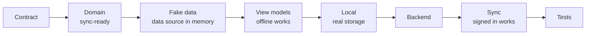
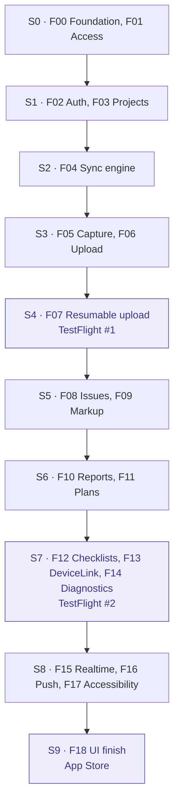

# Roadmap

<dl><dd>

- Work runs **by sprint**: 2 weeks each, 1 developer, ~60h. Inside a sprint, a feature's app and backend work go together; the backend is built in [site-log-be](https://github.com/DAMHONGDUC/site-log-be) and its rows here link to its guides.
- Specs: [docs/feature-docs](docs/feature-docs/); guides: [docs/feature-guide](docs/feature-guide/README.md), one folder per sprint, one guide per feature.
- This file owns the ticks. Each sprint's `README.md` holds its overview; each guide holds the steps.

</dd></dl>

## Contents

<dl><dd>

1. [How work is split](#how-work-is-split)
2. [Summary](#summary)
3. [S0 — Foundation and access](#s0--foundation-and-access--54h)
4. [S1 — Auth and projects](#s1--auth-and-projects--56h)
5. [S2 — Sync engine](#s2--sync-engine--45h)
6. [S3 — Capture and upload](#s3--capture-and-upload--60h)
7. [S4 — Resumable upload · TestFlight #1](#s4--resumable-upload--testflight-1--47h)
8. [S5 — Issues and markup](#s5--issues-and-markup--48h)
9. [S6 — Reports and floor plans](#s6--reports-and-floor-plans--58h)
10. [S7 — Checklists, DeviceLink, diagnostics · TestFlight #2](#s7--checklists-devicelink-diagnostics--testflight-2--49h)
11. [S8 — Realtime, push, accessibility](#s8--realtime-push-accessibility--49h)
12. [S9 — UI finish and App Store](#s9--ui-finish-and-app-store--54h)
13. [Rules](#rules)

</dd></dl>

## How work is split

<dl><dd>

- Every feature runs these steps; a step that does not apply is skipped ([how every feature runs](docs/feature-guide/README.md#how-every-feature-runs)).
- **No fake repository.** Fake data lives only in data source `Impl`s; the repository is real from the fake-data step. The local and sync steps replace data source insides, never a type or its registration in `App/DI/`.
- **Offline first inside every feature:** Continue offline works before the backend and sync steps start.
- The UI skeleton (~30% of Figma, every screen) is done; a feature's view models replace its `FakeData` use in `App/Fakes/FakeData.swift`. The other ~70% of the UI is `F18`, last.
- Step format: `FXX.n - [layer] - [est hours] - description`.
- Estimates: dev-hours for one developer new to Swift and SwiftUI, learning included; backend hours are estimates.

</dd></dl>

## Summary

<dl><dd>

| | |
|---|---|
| Total | 10 sprints, 19 features ≈ 520 hours (`F00.0` done, 8h) |
| Releases | TestFlight #1 end of S4, TestFlight #2 end of S7, App Store end of S9 |
| UI skeleton | Done 2026-10-08: every screen at ~30% of Figma on `FakeData`, debug dev menu in Settings |
| Goal | App Store release with the full scope; no feature is dropped |

</dd></dl>

## S0 — Foundation and access · 54h

<dl><dd>

- Demo: zero warnings, CI green for app and backend; Face ID / passcode lock with Continue offline; staging `/health`.
- Overview: [S0](docs/feature-guide/S0-foundation-access/README.md)

**F00 — Foundation · 38h** · [guide](docs/feature-guide/S0-foundation-access/F00-foundation.md)

- [x] **F00.0** - [Tooling] - [8h] - Xcode project, XcodeGen, SwiftLint, hot reload, entry point
- [ ] **F00.1** - [Architecture] - [6h] - Layer packages (incl. `PlatformKit`), Factory DI, injected `AppClock`, test libraries
- [ ] **F00.2** - [CI] - [5h] - Fastlane `test` lane and GitHub Actions PR checks
- [ ] **F00.3** - [CI] - [4h] - CI guards: layer rules, zero warnings, no `print(`, secret scan
- [ ] **F00.4** - [Tests] - [3h] - DesignSystem: hex test, `DSGallery`
- [ ] **F00.5** - [Backend] - [11h] - [site-log-be S0](https://github.com/DAMHONGDUC/site-log-be/blob/main/docs/feature-guide/S0-foundation/README.md): setup, API skeleton, AWS staging
- [ ] **F00.6** - [Config] - [1h] - Backend base URL per build configuration, local-network ATS

**F01 — Access and app lock · 16h** · [guide](docs/feature-guide/S0-foundation-access/F01-access.md)

- [ ] **F01.1** - [Domain] - [1h] - `AccessSetting`, `PasscodeCheck`, `AccessError`, `AccessRepository`, use cases
- [ ] **F01.2** - [Fake data] - [2h] - Real `AccessRepositoryImpl` over in-memory data sources, registrations, dev menu
- [ ] **F01.3** - [View models] - [5h] - `RootViewModel`, A1–A3, S4, S5 view models wired into the skeleton
- [ ] **F01.4** - [Local] - [8h] - Keychain, `UserDefaults`, Face ID inside the data sources
- [ ] Tests written and green (after the features work)

</dd></dl>

## S1 — Auth and projects · 56h

<dl><dd>

- Demo: Apple / email sign-in next to Continue offline; project → 80 locations → walkthrough offline; backend rejects calls without a token.
- Overview: [S1](docs/feature-guide/S1-auth-projects/README.md)

**F02 — Auth · 21h** · [guide](docs/feature-guide/S1-auth-projects/F02-auth.md)

- [ ] **F02.1** - [Contract] - [1h] - Bearer token, `DELETE /account` response
- [ ] **F02.2** - [Domain] - [1h] - `AuthUser`, `AuthError`, `AuthRepository`, use cases
- [ ] **F02.3** - [Fake data] - [1h] - Real `AuthRepositoryImpl` over in-memory data sources
- [ ] **F02.4** - [View models] - [4h] - A2 sign-in, Account, sign out, delete account
- [ ] **F02.5** - [Local] - [10h] - Firebase Auth, `HTTPClient` with token and one 401 refresh
- [ ] **F02.6** - [Backend] - [4h] - [site-log-be F02](https://github.com/DAMHONGDUC/site-log-be/blob/main/docs/feature-guide/S1-auth-projects/F02-auth.md): `requireUser`, `DELETE /account`

**F03 — Projects, sessions, locations · 35h** · [guide](docs/feature-guide/S1-auth-projects/F03-projects.md)

- [ ] **F03.1** - [Contract] - [1h] - Project, session, location DTOs and columns
- [ ] **F03.2** - [Domain] - [4h] - Sync-ready entities, protocols, use cases
- [ ] **F03.3** - [Fake data] - [2h] - Real repositories over in-memory data sources
- [ ] **F03.4** - [View models] - [10h] - Wire the Projects screens
- [ ] **F03.5** - [Local] - [15h] - SwiftData models, data sources, schema versioning
- [ ] **F03.6** - [Backend] - [3h] - [site-log-be F03](https://github.com/DAMHONGDUC/site-log-be/blob/main/docs/feature-guide/S1-auth-projects/F03-projects.md): `0001_projects.sql`
- [ ] Tests written and green (after the features work)

</dd></dl>

## S2 — Sync engine · 45h

<dl><dd>

- Demo: two iPhones on one account converge; deletes propagate; offline edits wait in the outbox.
- Overview: [S2](docs/feature-guide/S2-sync-engine/README.md)

**F04 — Sync engine · 45h** · [guide](docs/feature-guide/S2-sync-engine/F04-sync-engine.md)

- [ ] **F04.1** - [Contract] - [2h] - `/sync/pull`, `/sync/push` DTOs
- [ ] **F04.2** - [Domain] - [1h] - `SyncStatus`, `SyncRepository`, use cases
- [ ] **F04.3** - [Fake data] - [18h] - Real engine over an in-memory outbox and server
- [ ] **F04.4** - [View models] - [3h] - Sync tab status, account
- [ ] **F04.5** - [Local] - [6h] - Outbox and cursor in SwiftData; F03 data sources write outbox rows
- [ ] **F04.6** - [Backend] - [8h] - [site-log-be F04](https://github.com/DAMHONGDUC/site-log-be/blob/main/docs/feature-guide/S2-sync-engine/F04-sync.md): `sync_state`, `/sync/pull`, `/sync/push`
- [ ] **F04.7** - [Sync] - [7h] - Remote data source on `HTTPClient`, two-device convergence
- [ ] Tests written and green (after the feature works)

</dd></dl>

## S3 — Capture and upload · 60h

<dl><dd>

- Demo: hashed photo offline; small files upload after a kill with matching server hashes.
- Overview: [S3](docs/feature-guide/S3-capture-upload/README.md)

**F05 — Capture · 24h** · [guide](docs/feature-guide/S3-capture-upload/F05-capture.md)

- [ ] **F05.1** - [Contract] - [1h] - `CaptureDTO` and columns
- [ ] **F05.2** - [Domain] - [1h] - `CameraRepository`, `RecordCaptureUseCase`
- [ ] **F05.3** - [Fake data] - [2h] - Real `CameraRepositoryImpl` over a bundled photo and in-memory media
- [ ] **F05.4** - [View models] - [3h] - Camera and review screens
- [ ] **F05.5** - [Local] - [14h] - `AVCaptureSession`, files on disk, streamed SHA-256
- [ ] **F05.6** - [Backend] - [2h] - [site-log-be F05](https://github.com/DAMHONGDUC/site-log-be/blob/main/docs/feature-guide/S3-capture-upload/F05-captures.md): `0003_captures.sql`
- [ ] **F05.7** - [Sync] - [1h] - Captures syncable, insert-only

**F06 — Upload (single PUT) · 36h** · [guide](docs/feature-guide/S3-capture-upload/F06-upload.md)

- [ ] **F06.1** - [Contract] - [1h] - Begin and complete DTOs
- [ ] **F06.2** - [Domain] - [1h] - UploadKit job, states, `UploadStore` protocol
- [ ] **F06.3** - [Fake data] - [2h] - `UploadStoreImpl` in memory; real `UploadRepositoryImpl`
- [ ] **F06.4** - [View models] - [6h] - Sync tab, today's files
- [ ] **F06.5** - [Local] - [4h] - Upload store on SwiftData
- [ ] **F06.6** - [Backend] - [8h] - [site-log-be F06](https://github.com/DAMHONGDUC/site-log-be/blob/main/docs/feature-guide/S3-capture-upload/F06-upload.md): begin, idempotent `complete`, abort, media URLs
- [ ] **F06.7** - [Sync] - [14h] - Background session, state machine, backoff
- [ ] Tests written and green (after the features work)

</dd></dl>

## S4 — Resumable upload · TestFlight #1 · 47h

<dl><dd>

- Demo: 200 files / 2 GB survive kill and airplane mode; first TestFlight build.
- Overview: [S4](docs/feature-guide/S4-resumable-upload/README.md)

**F07 — Resumable upload · 47h** · [guide](docs/feature-guide/S4-resumable-upload/F07-resumable-upload.md)

- [ ] **F07.1** - [Contract] - [1h] - Multipart plan, refresh, abort DTOs
- [ ] **F07.2** - [Backend] - [6h] - [site-log-be F07](https://github.com/DAMHONGDUC/site-log-be/blob/main/docs/feature-guide/S4-resumable-upload/F07-multipart.md): multipart begin, `/parts/refresh`, abort
- [ ] **F07.3** - [Sync] - [14h] - Chunk planner, part upload, complete
- [ ] **F07.4** - [Sync] - [8h] - Kill and relaunch reconciliation
- [ ] **F07.5** - [Sync] - [5h] - Wi-Fi only, dedupe by hash, URL refresh
- [ ] **F07.6** - [Sync] - [3h] - 200-file demo behind the screens
- [ ] **F07.7** - [Release] - [10h] - Signing and TestFlight #1
- [ ] Tests written and green (after the feature works)

</dd></dl>

## S5 — Issues and markup · 48h

<dl><dd>

- Demo: issue → re-check → before/after pair; markup layer; stamped copy with trusted time; both on two devices.
- Overview: [S5](docs/feature-guide/S5-issues-markup/README.md)

**F08 — Issues and before/after · 26h** · [guide](docs/feature-guide/S5-issues-markup/F08-issues.md)

- [ ] **F08.1** - [Contract] - [1h] - Issue, issue capture, phrase DTOs
- [ ] **F08.2** - [Domain] - [3h] - Entities, pure pairing, close, carry-over
- [ ] **F08.3** - [Fake data] - [3h] - Real repositories over in-memory data sources
- [ ] **F08.4** - [View models] - [7h] - Sheet, list, detail, verification camera, outcome
- [ ] **F08.5** - [Local] - [8h] - SwiftData, on-device speech
- [ ] **F08.6** - [Backend] - [2h] - [site-log-be F08](https://github.com/DAMHONGDUC/site-log-be/blob/main/docs/feature-guide/S5-issues-markup/F08-issues.md): `0005_issues.sql`
- [ ] **F08.7** - [Sync] - [2h] - Three tables syncable

**F09 — Markup and stamps · 22h** · [guide](docs/feature-guide/S5-issues-markup/F09-markup.md)

- [ ] **F09.1** - [Contract] - [1h] - `AnnotationDTO`
- [ ] **F09.2** - [Domain] - [1h] - `AnnotationShape`, `NormalizedPoint`, `TrustedTimestamp`
- [ ] **F09.3** - [Fake data] - [1h] - Real `AnnotationRepositoryImpl` over in-memory data sources
- [ ] **F09.4** - [View models] - [4h] - Markup editor, stamp preview
- [ ] **F09.5** - [Local] - [7h] - Layer rendering, stamped derivative
- [ ] **F09.6** - [Backend] - [1h] - [site-log-be F09](https://github.com/DAMHONGDUC/site-log-be/blob/main/docs/feature-guide/S5-issues-markup/F09-annotations.md): `0006_annotations.sql`
- [ ] **F09.7** - [Sync] - [7h] - Annotations syncable; clock offset from the server
- [ ] Tests written and green (after the features work)

</dd></dl>

## S6 — Reports and floor plans · 58h

<dl><dd>

- Demo: signed, branded PDF + CSV shared offline; printed code verifies; issues pinned on a real plan.
- Overview: [S6](docs/feature-guide/S6-reports-plans/README.md)

**F10 — Reports and audit log · 37h** · [guide](docs/feature-guide/S6-reports-plans/F10-reports.md)

- [ ] **F10.1** - [Contract] - [1h] - `VerifyDTO`, `ReportBrandingDTO`
- [ ] **F10.2** - [Domain] - [3h] - Report types, `AuditEntry`, `LayOutReportUseCase`
- [ ] **F10.3** - [Fake data] - [2h] - Real repositories; sample PDF, in-memory branding and audit
- [ ] **F10.4** - [View models] - [4h] - Builder, branding, signatures, preview
- [ ] **F10.5** - [Local] - [21h] - CSV writer, PDF renderer, audit storage and key
- [ ] **F10.6** - [Backend] - [4h] - [site-log-be F10](https://github.com/DAMHONGDUC/site-log-be/blob/main/docs/feature-guide/S6-reports-plans/F10-reports-verify.md): `0007_report_branding.sql`, `GET /verify/:code`
- [ ] **F10.7** - [Sync] - [2h] - Branding syncable

**F11 — Floor plans and pins · 21h** · [guide](docs/feature-guide/S6-reports-plans/F11-plans.md)

- [ ] **F11.1** - [Contract] - [1h] - `PlanSheetDTO`, plan file key
- [ ] **F11.2** - [Domain] - [1h] - `PlanSheet`, `Pin`, import / pin / move use cases
- [ ] **F11.3** - [Fake data] - [1h] - Real `PlanRepositoryImpl` over in-memory data sources
- [ ] **F11.4** - [View models] - [5h] - List, viewer, pin preview, import
- [ ] **F11.5** - [Local] - [9h] - Hashed plan files, PDFKit tiles, pin persistence
- [ ] **F11.6** - [Backend] - [2h] - [site-log-be F11](https://github.com/DAMHONGDUC/site-log-be/blob/main/docs/feature-guide/S6-reports-plans/F11-plans.md): `0008_plan_sheets.sql`
- [ ] **F11.7** - [Sync] - [2h] - Sheets syncable; files through the upload queue
- [ ] Tests written and green (after the features work)

</dd></dl>

## S7 — Checklists, DeviceLink, diagnostics · TestFlight #2 · 49h

<dl><dd>

- Demo: a checklist Fail opens one issue; a reading from the second iPhone (mock meter) shows on the camera; diagnostics and cleanup; TestFlight #2.
- Overview: [S7](docs/feature-guide/S7-checklists-devices-diagnostics/README.md)

**F12 — Checklists · 14h** · [guide](docs/feature-guide/S7-checklists-devices-diagnostics/F12-checklists.md)

- [ ] **F12.1** - [Contract] - [1h] - Template, item, run, result DTOs
- [ ] **F12.2** - [Domain] - [1h] - Types; answer use case (Fail → issue)
- [ ] **F12.3** - [Fake data] - [1h] - Real `ChecklistRepositoryImpl` over in-memory data sources
- [ ] **F12.4** - [View models] - [4h] - Picker, run, done
- [ ] **F12.5** - [Local] - [4h] - Built-ins seeded on SwiftData; results
- [ ] **F12.6** - [Backend] - [2h] - [site-log-be F12](https://github.com/DAMHONGDUC/site-log-be/blob/main/docs/feature-guide/S7-checklists/F12-checklists.md): `0009_checklists.sql`
- [ ] **F12.7** - [Sync] - [1h] - Four tables syncable

**F13 — DeviceLink (BLE meters) · 18h** · [guide](docs/feature-guide/S7-checklists-devices-diagnostics/F13-devicelink.md)

- [ ] **F13.1** - [Contract] - [1h] - Mock meter profile: service, characteristic, bytes
- [ ] **F13.2** - [Domain] - [1h] - `DeviceReading`, `DeviceLinkRepository`
- [ ] **F13.3** - [Fake data] - [1h] - Real `DeviceLinkRepositoryImpl` over a scripted data source
- [ ] **F13.4** - [View models] - [3h] - Settings › Devices, camera overlay
- [ ] **F13.5** - [Local] - [8h] - `DeviceLinkManager`, vendor profiles, data source over them
- [ ] **F13.6** - [Mock] - [3h] - Debug-only mock meter on the second iPhone
- [ ] **F13.7** - [Release] - [1h] - Feature flag, off for users until a real meter passes

**F14 — Diagnostics · 17h** · [guide](docs/feature-guide/S7-checklists-devices-diagnostics/F14-diagnostics.md)

- [ ] **F14.1** - [Domain] - [1h] - Integrity result, storage breakdown, device flags
- [ ] **F14.2** - [Fake data] - [1h] - Real `DiagnosticsRepositoryImpl` over fixed values
- [ ] **F14.3** - [View models] - [2h] - U3, storage cleanup
- [ ] **F14.4** - [Local] - [8h] - Real checks, cleanup, bundle, Crashlytics
- [ ] **F14.5** - [Release] - [5h] - Instruments pass and TestFlight #2
- [ ] Tests written and green (after the features work)

</dd></dl>

## S8 — Realtime, push, accessibility · 49h

<dl><dd>

- Demo: live “verified” on the Sync tab; push and cold-launch links open their target; VoiceOver walk; budgets met.
- Overview: [S8](docs/feature-guide/S8-realtime-push-quality/README.md)

**F15 — Realtime progress and verification · 21h** · [guide](docs/feature-guide/S8-realtime-push-quality/F15-realtime.md)

- [ ] **F15.1** - [Contract] - [1h] - WebSocket messages
- [ ] **F15.2** - [Domain] - [1h] - `UploadEvent`, `RealtimeRepository`
- [ ] **F15.3** - [Fake data] - [1h] - Real `RealtimeRepositoryImpl` over a timer data source
- [ ] **F15.4** - [View models] - [2h] - Live state on U1
- [ ] **F15.5** - [Backend] - [8h] - [site-log-be F15](https://github.com/DAMHONGDUC/site-log-be/blob/main/docs/feature-guide/S8-realtime-push/F15-realtime.md): `/ws`, verify worker, abandoned uploads
- [ ] **F15.6** - [Sync] - [8h] - `URLSessionWebSocketTask` inside the data source

**F16 — Push and deep links · 14h** · [guide](docs/feature-guide/S8-realtime-push-quality/F16-push-deeplinks.md)

- [ ] **F16.1** - [Contract] - [1h] - Push payload with `deepLink`; `POST /devices`
- [ ] **F16.2** - [Domain] - [1h] - Pure `DeepLink` parser
- [ ] **F16.3** - [Fake data] - [1h] - Real `PushRepositoryImpl` over an in-memory token data source
- [ ] **F16.4** - [View models] - [2h] - Permission moment, notification row
- [ ] **F16.5** - [Local] - [4h] - Push capability, token, URL scheme, router
- [ ] **F16.6** - [Backend] - [3h] - [site-log-be F16](https://github.com/DAMHONGDUC/site-log-be/blob/main/docs/feature-guide/S8-realtime-push/F16-push.md): `0011_devices.sql`, `POST /devices`, APNs
- [ ] **F16.7** - [Sync] - [2h] - Token registered through `HTTPClient`

**F17 — Accessibility and performance · 14h** · [guide](docs/feature-guide/S8-realtime-push-quality/F17-accessibility-performance.md)

- [ ] **F17.1** - [Polish] - [8h] - Accessibility pass
- [ ] **F17.2** - [Release] - [6h] - Budgets, privacy manifest, feedback
- [ ] Tests written and green (after the features work)

</dd></dl>

## S9 — UI finish and App Store · 54h

<dl><dd>

- Demo: every screen next to its Figma frame, light and dark; production backend; build submitted.
- Overview: [S9](docs/feature-guide/S9-release/README.md)

**F18 — UI finish and App Store · 54h** · [guide](docs/feature-guide/S9-release/F18-ui-finish.md)

- [ ] **F18.1** - [UI] - [6h] - Components to Figma
- [ ] **F18.2** - [UI] - [3h] - Figma S1: access screens
- [ ] **F18.3** - [UI] - [6h] - Figma S2–S3: projects, sessions, rooms
- [ ] **F18.4** - [UI] - [6h] - Figma S4–S5: camera, capture review, issues
- [ ] **F18.5** - [UI] - [5h] - Figma S6–S7: markup, stamp, plans
- [ ] **F18.6** - [UI] - [6h] - Figma S8–S9: checklists, reports
- [ ] **F18.7** - [UI] - [5h] - Figma S10–S11: sync, diagnostics, settings
- [ ] **F18.8** - [UI] - [5h] - Dark mode; empty, error, offline states; real imagery
- [ ] **F18.9** - [Release] - [6h] - Accessibility re-check, App Store listing, submission
- [ ] **F18.10** - [Tests] - [6h] - Optional: snapshot tests (swift-snapshot-testing); not counted in the 54h
- [ ] **F18.11** - [Backend] - [6h] - [site-log-be F18](https://github.com/DAMHONGDUC/site-log-be/blob/main/docs/feature-guide/S9-release/F18-production.md): production, purge, alarms, backups

</dd></dl>

## Rules

<dl><dd>

1. One sprint at a time, in the order above; a sprint is done when its demo runs on a real device, offline and signed in, and its tests pass.
2. Before a sprint or a step, read its overview (table, bullets, diagram) and try to build from it alone; open the guide's code only when stuck.
3. Each step ends with something runnable, never "half a screen".
4. No fake repositories: fake data lives only in data source `Impl`s; going real changes data source insides, not types. Test doubles only in test targets.
5. Tests come after a feature works end to end; no tests while a step is still being built.
6. Visual work to Figma waits for `F18`; until then a step changes layout only when a view model needs it.
7. A step above 6h is split into 2–6h tasks when you start it.
8. Tick the box in the same commit that finishes the step.

</dd></dl>
