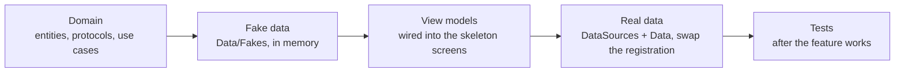
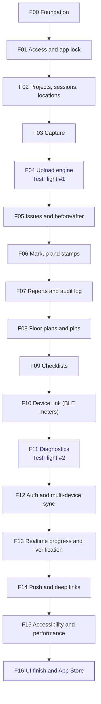

# Roadmap

<dl><dd>

- Work is guided **by feature**: one feature is finished end to end before the next starts.
- Specs: [docs/feature-docs](docs/feature-docs/); step-by-step guides: [docs/feature-guide](docs/feature-guide/), one per feature.

</dd></dl>

## Contents

<dl><dd>

1. [How work is split](#how-work-is-split)
2. [Summary](#summary)
3. [F00 — Foundation](#f00--foundation--26h)
4. [F01 — Access and app lock](#f01--access-and-app-lock--15h)
5. [F02 — Projects, sessions, locations](#f02--projects-sessions-locations--31h)
6. [F03 — Capture](#f03--capture--20h)
7. [F04 — Upload engine · TestFlight #1](#f04--upload-engine--testflight-1--89h)
8. [F05 — Issues and before/after](#f05--issues-and-beforeafter--21h)
9. [F06 — Markup and stamps](#f06--markup-and-stamps--19h)
10. [F07 — Reports and audit log](#f07--reports-and-audit-log--31h)
11. [F08 — Floor plans and pins](#f08--floor-plans-and-pins--16h)
12. [F09 — Checklists](#f09--checklists--10h)
13. [F10 — DeviceLink (BLE meters)](#f10--devicelink-ble-meters--18h)
14. [F11 — Diagnostics · TestFlight #2](#f11--diagnostics--testflight-2--17h)
15. [F12 — Auth and multi-device sync](#f12--auth-and-multi-device-sync--60h)
16. [F13 — Realtime progress and verification](#f13--realtime-progress-and-verification--20h)
17. [F14 — Push and deep links](#f14--push-and-deep-links--11h)
18. [F15 — Accessibility and performance](#f15--accessibility-and-performance--14h)
19. [F16 — UI finish and App Store](#f16--ui-finish-and-app-store--48h)
20. [Rules](#rules)

</dd></dl>

## How work is split

<dl><dd>

- Every feature runs the same steps: Domain → fake data → view models → real data → tests.
- **Fakes live only in the Data layer** (`Packages/DataLayer/Sources/DataLayer/Fakes/`). Domain and Presentation never name a fake;
  `AppDependencies` picks fake or real, and the dev menu seeds / clears the fakes.
- The UI skeleton (~30% of Figma, every screen) is done; a feature's view models replace its `FakeData` use
  in `App/Fakes/FakeData.swift` and delete those types. The other ~70% of the UI is `F16`, last.
- Step format: `FXX.n - [layer] - [est hours] - description`.
- Estimates: dev-hours for one developer new to Swift and SwiftUI, learning included.

</dd></dl>

## Summary

<dl><dd>

| | |
|---|---|
| Total | 17 features, 71 open steps ≈ 458 hours (`F00.0` done, 8h) |
| Releases | TestFlight #1 after `F04`, TestFlight #2 after `F11`, App Store after `F16` |
| UI skeleton | Done 2026-10-08: every screen at ~30% of Figma on `FakeData`, debug dev menu in Settings |
| Goal | App Store release with the full scope; no feature is dropped |

</dd></dl>

## F00 — Foundation · 26h

<dl><dd>

- Demo: builds with zero warnings, CI green, DesignSystem snapshot passes.
- Spec: [00](docs/feature-docs/00-overview.md), [05](docs/feature-docs/05-platform.md)
- Guide: [docs/feature-guide/00-foundation.md](docs/feature-guide/00-foundation.md)

- [x] **F00.0** - [Tooling] - [8h] - Xcode project, XcodeGen, SwiftLint, hot reload, entry point
- [ ] **F00.1** - [Architecture] - [6h] - Layer folders, Factory DI, injected `AppClock`, test libraries
- [ ] **F00.2** - [CI] - [5h] - Fastlane `test` lane and GitHub Actions PR checks
- [ ] **F00.3** - [CI] - [4h] - CI guards: layer rules, zero warnings, no `print(`, secret scan
- [ ] **F00.4** - [Tests] - [3h] - DesignSystem: hex test, `DSGallery`, snapshot test (tokens + components already built)

</dd></dl>

## F01 — Access and app lock · 15h

<dl><dd>

- Demo: Face ID / passcode lock, re-lock after *Lock after*, app switcher overlay.
- Spec: [07.2](docs/feature-docs/04-reporting-security.md#072-app-lock)
- Guide: [docs/feature-guide/01-access.md](docs/feature-guide/01-access.md)

- [ ] **F01.1** - [Domain] - [1h] - `AccessSettings`, `PasscodeCheck`, `AccessRepository`, use cases
- [ ] **F01.2** - [Fake data] - [1h] - `InMemoryAccessRepository`, registrations, dev menu seed / delete
- [ ] **F01.3** - [View models] - [5h] - `RootViewModel`, A1–A3, S4, S5 view models wired into the skeleton
- [ ] **F01.4** - [Real data] - [8h] - Keychain + Face ID repository
- [ ] Tests written and green (after the feature works)

</dd></dl>

## F02 — Projects, sessions, locations · 31h

<dl><dd>

- Demo: project → 80 generated locations → walkthrough, all offline and kept after relaunch.
- Spec: [01](docs/feature-docs/01-field-work.md#01-projects-sessions-locations), [00 §3 Data model](docs/feature-docs/00-overview.md#3-data-model)
- Guide: [docs/feature-guide/02-projects.md](docs/feature-guide/02-projects.md)

- [ ] **F02.1** - [Domain] - [4h] - Entities, protocols, use cases
- [ ] **F02.2** - [Fake data] - [2h] - In-memory repositories
- [ ] **F02.3** - [View models] - [10h] - Wire the Projects screens
- [ ] **F02.4** - [Real data] - [15h] - SwiftData
- [ ] Tests written and green (after the feature works)

</dd></dl>

## F03 — Capture · 20h

<dl><dd>

- Demo: photo captured and hashed in airplane mode, linked to a location, kept after relaunch.
- Spec: [02](docs/feature-docs/01-field-work.md#02-capture-pipeline)
- Guide: [docs/feature-guide/03-capture.md](docs/feature-guide/03-capture.md)

- [ ] **F03.1** - [Domain] - [1h] - Record a capture
- [ ] **F03.2** - [Fake data] - [2h] - Fake capture source
- [ ] **F03.3** - [View models] - [3h] - Wire the camera
- [ ] **F03.4** - [Real data] - [14h] - Camera, disk, SHA-256
- [ ] Tests written and green (after the feature works)

</dd></dl>

## F04 — Upload engine · TestFlight #1 · 89h

<dl><dd>

- Demo: 200 files reach storage and survive app kill and airplane mode; first TestFlight build.
- Spec: [04 Upload engine](docs/feature-docs/02-upload-sync.md#04-upload-engine), [14 Backend](docs/feature-docs/03-backend.md#1-role), [17 CI/CD](docs/feature-docs/05-platform.md#17-cicd-and-testflight)
- Guide: [docs/feature-guide/04-upload.md](docs/feature-guide/04-upload.md)

- [ ] **F04.1** - [Domain + fake] - [3h] - UploadKit API and in-memory store
- [ ] **F04.2** - [View models] - [6h] - Wire the Sync tab
- [ ] **F04.3** - [Backend] - [15h] - Backend endpoints
- [ ] **F04.4** - [Real data] - [55h] - UploadKit
- [ ] **F04.5** - [Release] - [10h] - Signing and TestFlight #1
- [ ] Tests written and green (after the feature works)

</dd></dl>

## F05 — Issues and before/after · 21h

<dl><dd>

- Demo: issue logged from the camera, re-checked next session, closed as a before/after pair.
- Spec: [03](docs/feature-docs/01-field-work.md#03-issues-and-before-after-pairing), [12.3 dictation](docs/feature-docs/01-field-work.md#123-dictation-and-voice-notes)
- Guide: [docs/feature-guide/05-issues.md](docs/feature-guide/05-issues.md)

- [ ] **F05.1** - [Domain] - [2h] - Issue entities and use cases
- [ ] **F05.2** - [Fake data] - [1h] - In-memory issues
- [ ] **F05.3** - [View models] - [7h] - Wire the Issues screens
- [ ] **F05.4** - [Real data] - [11h] - Issue logic and dictation
- [ ] Tests written and green (after the feature works)

</dd></dl>

## F06 — Markup and stamps · 19h

<dl><dd>

- Demo: markup saved as a layer over the original; stamped copy shared with trusted time.
- Spec: [12](docs/feature-docs/01-field-work.md#12-annotation-and-verifiable-stamps)
- Guide: [docs/feature-guide/06-markup.md](docs/feature-guide/06-markup.md)

- [ ] **F06.1** - [Domain] - [1h] - Annotation types
- [ ] **F06.2** - [Fake data] - [1h] - In-memory annotations
- [ ] **F06.3** - [View models] - [4h] - Wire markup and stamp
- [ ] **F06.4** - [Real data] - [13h] - Rendering and trusted time
- [ ] Tests written and green (after the feature works)

</dd></dl>

## F07 — Reports and audit log · 31h

<dl><dd>

- Demo: signed, branded PDF and CSV from a real session, shared in airplane mode; audit chain verifies.
- Spec: [05](docs/feature-docs/04-reporting-security.md#05-pdf-and-spreadsheet-export), [07.3 audit](docs/feature-docs/04-reporting-security.md#073-audit-log)
- Guide: [docs/feature-guide/07-reports.md](docs/feature-guide/07-reports.md)

- [ ] **F07.1** - [Domain] - [1h] - Report types
- [ ] **F07.2** - [Fake data] - [1h] - In-memory reports
- [ ] **F07.3** - [View models] - [4h] - Wire the report flow
- [ ] **F07.4** - [Real data] - [25h] - CSV, PDF, audit chain
- [ ] Tests written and green (after the feature works)

</dd></dl>

## F08 — Floor plans and pins · 16h

<dl><dd>

- Demo: real PDF plan imported, issues pinned, pins survive relaunch.
- Spec: [11](docs/feature-docs/01-field-work.md#11-floor-plans-and-issue-pins)
- Guide: [docs/feature-guide/08-plans.md](docs/feature-guide/08-plans.md)

- [ ] **F08.1** - [Domain] - [1h] - Plan types
- [ ] **F08.2** - [Fake data] - [1h] - In-memory plans
- [ ] **F08.3** - [View models] - [5h] - Wire the Plans screens
- [ ] **F08.4** - [Real data] - [9h] - Import and pins
- [ ] Tests written and green (after the feature works)

</dd></dl>

## F09 — Checklists · 10h

<dl><dd>

- Demo: checklist run in a room; a Fail creates one prefilled issue.
- Spec: [13](docs/feature-docs/01-field-work.md#13-checklist-templates)
- Guide: [docs/feature-guide/09-checklists.md](docs/feature-guide/09-checklists.md)

- [ ] **F09.1** - [Domain] - [1h] - Checklist types
- [ ] **F09.2** - [Fake data] - [1h] - In-memory checklists
- [ ] **F09.3** - [View models] - [4h] - Wire the Checklists screens
- [ ] **F09.4** - [Real data] - [4h] - Templates and results
- [ ] Tests written and green (after the feature works)

</dd></dl>

## F10 — DeviceLink (BLE meters) · 18h

<dl><dd>

- Demo: laser reading from the macOS mock peripheral shows on the camera; capture never waits.
- Spec: [06](docs/feature-docs/01-field-work.md#06-devicelink-ble-measuring-tools)
- Guide: [docs/feature-guide/10-devicelink.md](docs/feature-guide/10-devicelink.md)

- [ ] **F10.1** - [Domain] - [1h] - DeviceLink types
- [ ] **F10.2** - [Fake data] - [1h] - Fake device link
- [ ] **F10.3** - [View models] - [3h] - Wire pairing and overlay
- [ ] **F10.4** - [Real data] - [13h] - BLE and mock peripheral
- [ ] Tests written and green (after the feature works)

</dd></dl>

## F11 — Diagnostics · TestFlight #2 · 17h

<dl><dd>

- Demo: integrity check, storage cleanup, diagnostic bundle, Crashlytics; second TestFlight build.
- Spec: [09](docs/feature-docs/05-platform.md#09-diagnostics-and-observability), [19 Instruments](docs/feature-docs/05-platform.md#19-performance-profiling-with-instruments)
- Guide: [docs/feature-guide/11-diagnostics.md](docs/feature-guide/11-diagnostics.md)

- [ ] **F11.1** - [Domain + fake] - [1h] - Diagnostics snapshot and fake
- [ ] **F11.2** - [View models] - [2h] - Wire diagnostics and cleanup
- [ ] **F11.3** - [Real data] - [8h] - Storage, bundle, Crashlytics
- [ ] **F11.4** - [Release] - [6h] - Instruments pass and TestFlight #2
- [ ] Tests written and green (after the feature works)

</dd></dl>

## F12 — Auth and multi-device sync · 60h

<dl><dd>

- Demo: a second device sees the same data; deletes propagate.
- Spec: [08](docs/feature-docs/02-upload-sync.md#08-auth-and-sync), [14 §7 Sync](docs/feature-docs/03-backend.md#7-sync)
- Guide: [docs/feature-guide/12-auth-sync.md](docs/feature-guide/12-auth-sync.md)

- [ ] **F12.1** - [Domain] - [1h] - Auth and sync protocols
- [ ] **F12.2** - [Fake data] - [1h] - Fake auth and sync
- [ ] **F12.3** - [View models] - [8h] - Wire sign-in, account, sync status
- [ ] **F12.4** - [Backend] - [6h] - Pull and push endpoints
- [ ] **F12.5** - [Real data] - [44h] - Firebase Auth and sync engine
- [ ] Tests written and green (after the feature works)

</dd></dl>

## F13 — Realtime progress and verification · 20h

<dl><dd>

- Demo: the Sync tab shows server-confirmed state as events arrive; mismatches are flagged.
- Spec: [10](docs/feature-docs/02-upload-sync.md#10-realtime-progress-channel), [14 §8–9](docs/feature-docs/03-backend.md#8-integrity)
- Guide: [docs/feature-guide/13-realtime.md](docs/feature-guide/13-realtime.md)

- [ ] **F13.1** - [Fake data] - [1h] - Fake event stream
- [ ] **F13.2** - [View models] - [2h] - Live state on the Sync tab
- [ ] **F13.3** - [Real data] - [17h] - Channel, bridge, verification worker
- [ ] Tests written and green (after the feature works)

</dd></dl>

## F14 — Push and deep links · 11h

<dl><dd>

- Demo: a push opens its target; `sitelog://` links work after cold launch.
- Spec: [18](docs/feature-docs/05-platform.md#18-push-notifications-and-deep-links)
- Guide: [docs/feature-guide/14-push-deeplinks.md](docs/feature-guide/14-push-deeplinks.md)

- [ ] **F14.1** - [Domain] - [1h] - Deep link parser
- [ ] **F14.2** - [View models] - [2h] - Notification permission and settings
- [ ] **F14.3** - [Real data] - [8h] - Push and routing
- [ ] Tests written and green (after the feature works)

</dd></dl>

## F15 — Accessibility and performance · 14h

<dl><dd>

- Demo: VoiceOver walk unlock → projects → capture → report; every Instruments budget met.
- Spec: [19 Instruments](docs/feature-docs/05-platform.md#19-performance-profiling-with-instruments)
- Guide: [docs/feature-guide/15-release-readiness.md](docs/feature-guide/15-release-readiness.md)

- [ ] **F15.1** - [Polish] - [8h] - Accessibility pass
- [ ] **F15.2** - [Release] - [6h] - Budgets and feedback

</dd></dl>

## F16 — UI finish and App Store · 48h

<dl><dd>

- Demo: every screen next to its Figma frame, light and dark; build submitted.
- Spec: [Design plan](docs/design/00-design-plan.md)
- Guide: [docs/feature-guide/16-ui-finish.md](docs/feature-guide/16-ui-finish.md)

- [ ] **F16.1** - [UI] - [6h] - Components to Figma; snapshot references re-recorded
- [ ] **F16.2** - [UI] - [3h] - S1 access screens
- [ ] **F16.3** - [UI] - [6h] - S2–S3 projects, sessions, rooms
- [ ] **F16.4** - [UI] - [6h] - S4–S5 camera, capture review, issues
- [ ] **F16.5** - [UI] - [5h] - S6–S7 markup, stamp, plans
- [ ] **F16.6** - [UI] - [6h] - S8–S9 checklists, reports
- [ ] **F16.7** - [UI] - [5h] - S10–S11 sync, diagnostics, settings
- [ ] **F16.8** - [UI] - [5h] - Dark mode; empty, error, offline states; real imagery
- [ ] **F16.9** - [Release] - [6h] - Accessibility re-check, App Store listing, submission

</dd></dl>

## Rules

<dl><dd>

1. One feature at a time, in the order above; a feature is done when its demo runs on a real device and its tests pass.
2. Each step ends with something runnable, never "half a screen".
3. Fakes only in `Packages/DataLayer/Sources/DataLayer/Fakes/`; switching fake → real changes `AppDependencies` only.
4. Tests come after a feature is done: once it works end to end, write the tests listed in its guide.
   No tests while a step is still being built.
5. Visual work to Figma waits for `F16`; until then a step changes layout only when a view model needs it.
6. A step estimated above 8h is split when you start it.
7. Tick the box in the same commit that finishes the step.

</dd></dl>
