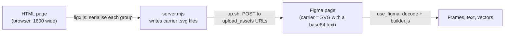

# Figma sync — log and how to resume

<dl><dd>

- Log of moving the HTML design pages ([../html/](../html/)) into Figma as editable layers, and the tools that do it.
- Last run: 2026-11-17. Stopped by the Figma MCP limit (Starter plan, View seat: 20 calls a month). Resume when the limit resets (next monthly cycle) or after an upgrade to a Full seat.

</dd></dl>

## Contents

<dl><dd>

1. [Status](#1-status)
2. [Left to do](#2-left-to-do)
3. [How it works](#3-how-it-works)
4. [Resume](#4-resume)

</dd></dl>

## 1. Status

<dl><dd>

- File 1: [Site Log iOS Design](https://www.figma.com/design/uJZcCP6lzw8QTSkcu8uqvV/Site-Log-iOS-Design) (`uJZcCP6lzw8QTSkcu8uqvV`), plan `team::1667582086334207196` (Starter: 3 pages per file).
- File 2 (pages 04–05): not created yet.

| Page | Figma page id | Built | State |
|---|---|---|---|
| 01 Foundations | `0:1` | 2026-11-17 | Done: header, App icon (`55:4`), Text styles, Colour tokens, Spacing; checked against the HTML |
| 02 iOS | `54:2` | 2026-11-17 | Done: header + 13 groups, 72 screens; checked against the HTML |
| 03 Android | `54:3` | 2026-11-17 | Built: header + 13 groups, 72 screens; not yet checked by screenshot |
| 04 Flows | — | — | Not started (file 2) |
| 05 System design | — | — | Not started (file 2) |

- Removed from the old Page 1 (approved): the old `mockups/index.html` import and a stray text node.
- Each group is one top-level frame named after its heading; each screen is a frame named by its id and title (e.g. `A1 Face ID lock`) with a `phone` frame inside.

</dd></dl>

## 2. Left to do

<dl><dd>

| # | Task | Calls (est.) |
|---|---|---|
| 1 | Pages 02, 03: wrap the app mark on A1, A2, A3, T5 in a rounded clipping frame (iOS radius 16 / 11 / 13 / 14, Android 36 / 24 / 28 / 32) | 2 |
| 2 | Pages 01–03: re-space frames to the new HTML gaps (`base.css`: rows 96, screens 64, boards 64; they were 48 / 40 / 40 at import) | 3 |
| 3 | Page 03: screenshot check against the HTML | 1–2 |
| 4 | Create file 2 (`create_new_file`, exempt from the limit), pages 04 Flows and 05 System design: export, upload, build | 6–8 |
| 5 | Remove the builder carrier `figx-builder` (`54:4` on page 01) when everything is built | 1 |
| 6 | Update the status in [00-design-plan §4](../00-design-plan.md#4-status-2026-11-17) and this log; put the file 2 page links in the README Design sections (iOS §4, Android §6), replacing "Not imported yet" | — |

- About 15 calls in all: fits in one month of the Starter limit if nothing fails. Do the read-only checks last.
- Any later change to the HTML pages makes the Figma copy stale: re-export only the changed groups and replace their frames.

</dd></dl>

## 3. How it works

<dl><dd>



| File | Role |
|---|---|
| [figx.js](figx.js) | In the browser: turns `::before` / `::after` into real spans, inlines ``, serialises each chunk (boxes, fills, borders, radii, shadows, blur, text runs with font and line height, SVG icons) and posts it to the server as a carrier SVG |
| [server.mjs](server.mjs) | Local endpoint on port 8766 that writes each posted carrier to a folder |
| [up.sh](up.sh) | Uploads carriers, in name order, to the upload URLs from `upload_assets`; each becomes a frame named `figx-c-…` on the target page |
| [builder.js](builder.js) | Runs inside Figma: reads the carriers on a page, builds the layers at the HTML positions, deletes the carriers. Stored in the file as the carrier `figx-builder` (`54:4`) so each `use_figma` call stays small |

- Why carriers: the Figma MCP here has no HTML import tool and the plugin sandbox has no `fetch`; uploads are the only way to move large data into the file.
- Fonts in Figma: IBM Plex Sans / Mono (iOS pages), Inter / JetBrains Mono (Android); all available in the file.
- Known limits: SVG `<mask>` / `<clipPath>` are not imported (rounded `<svg>` elements are now wrapped in a clipping frame by `figx.js`); glass blur becomes a Figma background blur.

</dd></dl>

## 4. Resume

<dl><dd>

1. Start the design server and the export server (the `out` folder is git-ignored):

```bash
python3 -m http.server 8765 --directory docs/design
```

```bash
node docs/design/figma-sync/server.mjs "$PWD/docs/design/figma-sync/out"
```

2. In the browser, open the page at 1600 px wide, load `/figma-sync/figx.js`, then export (page 01 first runs `__FIGX.inlineImgs()`):

| Page | Call |
|---|---|
| 04 Flows | `await __FIGX.exportPage('flo', 'header.page-head, #app .flow', '.flow-step, .phone')` — the cards are `transform: scale(0.5)`, and `figx.js` reads font sizes unscaled: first set `FLOW_SCALE` to 1 (or strip the transform) before export, then `rescale(0.5)` the cards in Figma, or teach `figx.js` the scale |
| 05 System design | `await __FIGX.exportPage('sys', 'header.page-head, #app > section.cmp', '')` |

3. `upload_assets` with `count` = number of chunks and the target `currentPageId`, then `OUT=out ./up.sh <page-id> figx-c-<prefix> <uuid…>`.
4. One `use_figma` per page with the wrapper below (`args.max` = chunks to build in that call; 7–8 groups fit).
5. In file 2, upload `builder.js` once as its own carrier first (any name, e.g. `figx-builder`) and use that node id in the wrapper.

<details>
<summary>use_figma wrapper</summary>

```js
const D = (b64) => { const A = 'ABCDEFGHIJKLMNOPQRSTUVWXYZabcdefghijklmnopqrstuvwxyz0123456789+/'; const m = {}; for (let i = 0; i < 64; i++) m[A[i]] = i; const by = []; let buf = 0, bits = 0; for (const ch of b64) { if (ch === '=') break; const v = m[ch]; if (v === undefined) continue; buf = ((buf << 6) | v) & 0xffffff; bits += 6; if (bits >= 8) { bits -= 8; by.push((buf >> bits) & 255); } } let s = '', i = 0; while (i < by.length) { const b = by[i++]; if (b < 128) s += String.fromCharCode(b); else if (b < 224) s += String.fromCharCode(((b & 31) << 6) | (by[i++] & 63)); else if (b < 240) s += String.fromCharCode(((b & 15) << 12) | ((by[i++] & 63) << 6) | (by[i++] & 63)); else { const cp = ((b & 7) << 18) | ((by[i++] & 63) << 12) | ((by[i++] & 63) << 6) | (by[i++] & 63); s += String.fromCodePoint(cp); } } return s; };
const B = await figma.getNodeByIdAsync('54:4'); // builder carrier
const src = D(B.findOne(n => n.type === 'TEXT').characters);
const AF = Object.getPrototypeOf(async function () {}).constructor;
return await new AF('figma', 'D', 'args', src)(figma, D, { page: '<page id>', max: 7, bg: 'E6E7EA' });
```

- To build the carrier for `builder.js`: base64 the file into `<svg xmlns="http://www.w3.org/2000/svg" width="8" height="8"><text x="0" y="6" font-size="6">BASE64</text></svg>`.

</details>

</dd></dl>
