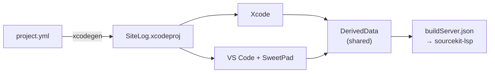

# Xcode + VS Code side by side

Both editors work on the same files and the same `SiteLog.xcodeproj`. Pick per task: VS Code for
editing and search, Xcode for previews, Instruments, signing and anything with a UI editor.

## 1. One-time setup

| Step | Action |
|---|---|
| 1 | Open the repo root in VS Code; accept the recommended extensions ([`.vscode/extensions.json`](../../.vscode/extensions.json)) |
| 2 | Tools: `brew install xcodegen xcode-build-server swiftlint` |
| 3 | Build once (Xcode ⌘B or SweetPad), then Command Palette → **SweetPad: Generate Build Server Config** |
| 4 | Command Palette → **Swift: Restart LSP Server**; completion and jump-to-definition now work |

`buildServer.json` is machine-specific and git-ignored. Regenerate it when the scheme or project
path changes.

## 2. What lives where

| File | Purpose |
|---|---|
| [`.vscode/settings.json`](../../.vscode/settings.json) | swift-format on save (reads `.swift-format`), 100-column ruler, SweetPad scheme, `xcodegen` on file add/remove |
| [`.vscode/launch.json`](../../.vscode/launch.json) | `dev-17-pro-max` (CodeLLDB): F5 opens the Debug Console at once, builds, runs; Restart rebuilds and relaunches; Stop kills the app |
| [`.vscode/sitelog_sim.py`](../../.vscode/sitelog_sim.py) | Inside LLDB: build (warnings, errors and the duration go to the Debug Console), install, launch with `simctl --wait-for-debugger`, attach by the pid simctl prints, stream that app's logs into the Debug Console |
| [`.vscode/tasks.json`](../../.vscode/tasks.json) | `sitelog: build`: manual build with full output (Terminal → Run Task). F5 does not use it; it builds inside the debug session |
| [`.vscode/swift.code-snippets`](../../.vscode/swift.code-snippets) | `view` / `viewvm`, same as the Xcode snippets ([code-snippets.md](code-snippets.md)) |
| `.swiftlint.yml` | Read by the SwiftLint extension and the Xcode build phase alike |

## 3. Daily use in VS Code

| Task | How |
|---|---|
| Simulator | F5 uses the booted **iPhone 17 Pro Max**, else the one on the newest iOS (booted on demand) — `SIMULATOR_NAME` in `sitelog_sim.py`. SweetPad Build & Run uses `sweetpad.build.destination` in `settings.json` (this Mac's UUID) |
| Run with debugger | **F5** (config `dev-17-pro-max`). **Restart** rebuilds and relaunches a fresh app; **⇧F5** kills it |
| Run without debugger | SweetPad sidebar → **Build & Run** |
| App logs | **Debug Console**, opened on F5 — like `flutter run`: `AppLogger` lines (every level, e.g. `I  SiteLog[pid:tid] [app.dd.site.log:Startup] App Launched`) and the app's stdout/stderr (InjectionNext, crash messages). Each Restart streams the new app |
| Hot reload | Save a view (⌘S). F5 starts InjectionNext in the background if it is not running and passes `INJECTION_PROJECT_ROOT` to the app; the Debug Console shows `🔥 Recompiling` → `✅ Hot reload complete` ([hot-reload.md](hot-reload.md)) |
| New file | Create it in the explorer; SweetPad runs `xcodegen` so Xcode sees it |

## 4. Rules for working in both

| Rule | Why |
|---|---|
| Build in one editor at a time | Both write the same DerivedData; parallel builds lock its database |
| Config changes go through `project.yml` | `xcodegen` overwrites anything set in the Xcode UI |
| After `xcodegen` runs, let Xcode reload the project | Xcode asks when `project.pbxproj` changes on disk; choose **Revert** (read from disk) |
| Previews, Instruments, signing: Xcode | VS Code has no equivalent |
| Format on save in Xcode | Hammerspoon hook, see [xcode-format-on-save.md](xcode-format-on-save.md); both use `.swift-format` |

## 5. Troubleshooting

| Symptom | Fix |
|---|---|
| "No such module" / no completion in VS Code | Build once, regenerate the build server config, restart the LSP |
| New file not visible in Xcode | Run `xcodegen generate`, then let Xcode reload |
| No app logs in the Debug Console | The stream starts in `sitelog_launch`; check the Debug Console for `sitelog_launch failed`. Logs come only from `AppLogger` (subsystem `app.dd.site.log`) |
| `Build failed` / `sitelog_launch failed` in the Debug Console | The lines above it say why (compiler error, no simulator with that name, install error). Fix and press F5 or Restart; check `SIMULATOR_NAME` in `sitelog_sim.py` |
| `sitelog_launch failed: install timed out` | An older SiteLog is held stopped by another debugger (a second VS Code or Xcode session). Stop that session, then F5 |
| History: why not SweetPad's attach | Its Restart made CodeLLDB start the binary outside the simulator → `EXC_BREAKPOINT` in `BKSDisplayServicesStart`; guessing the pid by name raced with the relaunch. Launching with `simctl` and attaching by its pid avoids both |
| SweetPad picks the wrong scheme | `.vscode/settings.json` → `sweetpad.build.scheme` |
