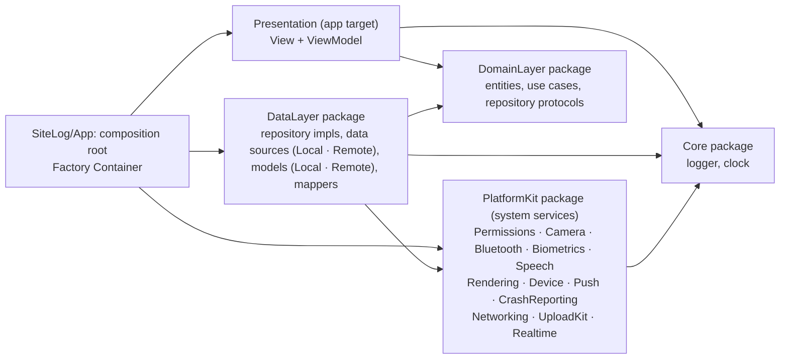

# 00 — Overview

<dl><dd>

- Product, market, data model, architecture, data flows, infrastructure, conventions.
- Feature specs live in five files ([§8](#8-feature-specs)); spec numbers `01`–`19` are stable and
  used by [ROADMAP.md](../../ROADMAP.md), which also owns the build order.
- This is the approved target design, not a claim that every feature or dependency is implemented.
  `project.yml` and source files show the current implementation; feature guides show the build steps.
- **Suggested reading order:** read this overview first, then the feature spec you need, then its
  matching guide in `docs/feature-guide/`. A *specification* describes intended behavior; a *guide*
  walks through implementation steps.

</dd></dl>

## Contents

<dl><dd>

1. [Product](#1-product) — positioning, core rule, stack, non-goals
2. [Market](#2-market)
3. [Data model](#3-data-model)
4. [Architecture](#4-architecture) — layout, layers, MVVM, Factory, startup, errors
5. [Data flows](#5-data-flows)
6. [Infrastructure](#6-infrastructure)
7. [Conventions](#7-conventions)
8. [Feature specs](#8-feature-specs)
9. [Decisions](#9-decisions) — D01–D20, why each library, engine and package split
10. [Beginner glossary](#beginner-glossary) — common SwiftUI and architecture terms

</dd></dl>

## Beginner glossary

<dl><dd>

| Term | Meaning | Short example |
|---|---|---|
| Feature | One user task and the code that supports it | Projects: create and browse projects |
| View | A SwiftUI value that describes what appears on screen | `Text("projects.project_list.projects")` |
| ViewModel | An object that prepares screen state and handles user actions | A project list model loads rows for a screen |
| MVVM | Model–View–ViewModel, a pattern that keeps screen state and actions outside layout code | The View draws project rows; its ViewModel loads them |
| Clean Architecture | A way to keep business rules independent from screens and storage | A use case can work without SwiftUI |
| Swift package | A reusable module with its own source and dependencies | `DesignSystem` is a package the app imports |
| `@State` | SwiftUI storage for a value owned by one View | A selected tab stays in that screen |
| Use case | One named action the app can perform | `CreateProjectUseCase` creates one project |
| Repository | A boundary for reading and writing app data | `ProjectRepository` stores projects |
| Dependency injection (DI) | Supplying an object its collaborators from outside | Pass a use case into a ViewModel's `init` |
| Entity | A business concept that does not depend on storage or UI | `Project` |
| DTO | A data-transfer object used at a system boundary | JSON received from a server |
| Actor | A Swift type that protects mutable state across concurrent tasks | An upload actor serializes upload changes |
| Localization key | A stable identifier whose visible text is translated by the app | `projects.project_list.projects` → “Projects” |

</dd></dl>

## 1. Product

<dl><dd>

| | |
|---|---|
| What | Offline-first iOS app for recording construction site conditions |
| Deliverable | Signed PDF inspection report |
| Users | Site supervisors, subcontractors, apartment handover teams |

```
Create project → start session → walk floors/rooms, capture + log issues
→ reach WiFi, background upload → export signed PDF report
```

### 1.1 Positioning and constraints

<dl><dd>

- Competitors lose evidence three ways: stalled or incomplete uploads, photos vanishing on reload,
  sync failing with no reason.
- SiteLog assumes the network is bad.

| Constraint | Consequence |
|---|---|
| Sites, basements, alleys have weak or no signal | Every write path completes offline |
| 150–250 files and several GB per session | Upload survives suspend, termination, network loss |
| User closes the app and keeps walking | No state lives only in RAM |
| The PDF is the paid deliverable | Never truncate, never silently drop images |

</dd></dl>

### 1.2 Core rule

<dl><dd>

- `Capture` is immutable after creation; only descriptive metadata is editable.
- Each carries a `sha256` computed after the file closes, before the DB write.
- Annotations are a separate vector layer, so markup never invalidates a hash.

</dd></dl>

### 1.3 Stack

<dl><dd>

| Area | Choice |
|---|---|
| UI | SwiftUI, iOS 18.6 deployment target; Swift 6 strict concurrency, `MainActor` default isolation |
| Architecture | Clean Architecture (Presentation · Domain · Data), MVVM; `DomainLayer`, `DataLayer`, `Core`, `DesignSystem` are local Swift packages, Presentation lives in the app target ([D09](#d09--layers-as-local-swift-packages)) |
| Dependency injection | [Factory](https://github.com/hmlongco/Factory) 3.x (`FactoryKit`) ([D01](#d01--factory-for-dependency-injection)) |
| Concurrency | Swift Concurrency — `actor` for upload, `@MainActor` for view models |
| Local store | SwiftData (`#Unique`, `#Index` need iOS 18) |
| Media | AVFoundation (`AVCaptureSession`, `AVAssetWriter`) |
| Plans | PDFKit + `CATiledLayer` |
| Crypto | CryptoKit + iOS Data Protection, keys in Keychain |
| External devices | CoreBluetooth |
| Transport | Hand-written background `URLSession` engine ([D02](#d02--hand-written-upload-engine)) |
| Object storage | Amazon S3, multipart + presigned URLs |
| Realtime | Hand-written `URLSessionWebSocketTask` channel ([D04](#d04--websocket-realtime-channel)) |
| Remote images | [Kingfisher](https://github.com/onevcat/Kingfisher) 8.x ([D05](#d05--kingfisher-for-remote-images)) |
| Auth / crash | Firebase iOS SDK 12.x: Auth, Crashlytics — **no Firestore** ([D07](#d07--firebase-crashlytics)) |
| Tests | Swift Testing, `FactoryTesting`; swift-snapshot-testing optional, last (F18) ([testing](05-platform.md#testing-strategy)) |
| Tooling | XcodeGen, SwiftLint, swift-format, Fastlane, GitHub Actions |
| Dev only | [Inject](https://github.com/krzysztofzablocki/Inject) 1.6.0 + InjectionNext (hot reload, Debug) |
| Backend | Separate repo [site-log-be](https://github.com/DAMHONGDUC/site-log-be): Node 24 + TypeScript + Fastify, PostgreSQL 16 on AWS, raw SQL, hand-written sync ([03 API](03-backend.md), [D03](#d03--node--postgresql-backend-hand-written-sync)) |

- This table records the selected target stack. A dependency is part of the app only after it appears
  in [`project.yml`](../../project.yml).

</dd></dl>

### 1.4 Non-goals

<dl><dd>

| Excluded | Reason |
|---|---|
| Firebase Storage, third-party upload libraries | The transfer engine is the core of the product |
| `UIImagePickerController` / `PhotosPicker` | A hash only means something for a file the app produced |
| Firebase touching file bytes or data | Identity and crash reporting only |
| Burning annotations into original pixels | Destroys the hash |
| RFIs, scheduling, budgets, CAD, real-time multi-user editing, cloud AI defect detection | Different product, or indefensible in a dispute |

</dd></dl>

</dd></dl>

## 2. Market

<dl><dd>

- Research: September 2026.

| App | Position | Taken for SiteLog |
|---|---|---|
| Fieldwire, SnagR, PlanInspect | Drawing-centric punch lists | Pins on floor plans ([11](01-field-work.md#11-floor-plans-and-issue-pins)) |
| SnagPal, IssMan | Photo → annotate → pin → branded PDF | Annotation ([12](01-field-work.md#12-annotation-and-verifiable-stamps)), branded PDF ([05](04-reporting-security.md#05-pdf-and-spreadsheet-export)) |
| CompanyCam | Photo-first, auto-organized | Camera is home |
| Timemark | Tamper-resistant timestamp, per-photo code | Trusted time + verification code |
| GoAudits, SafetyCulture | Template inspections | Checklists ([13](01-field-work.md#13-checklist-templates)) |
| PlanGrid / Autodesk Build | Enterprise | Reviewers cite cost and learning curve — stay single-operator |

| Reported pain | SiteLog's answer |
|---|---|
| "Uploads stall or complete with photos missing" | Per-part state machine, ETag checks, server hash cross-check ([04](02-upload-sync.md#04-upload-engine)) |
| "Photos vanish on reload; comments fail silently" | Local store is truth; nothing deleted until `synced` ([09](05-platform.md#09-diagnostics-and-observability)) |
| "Sync failed with no explanation" | Plain-language reasons + redacted diagnostic bundle ([09](05-platform.md#09-diagnostics-and-observability)) |
| "Slows or crashes with many photos" | Downsampled rendering, streaming hashes ([05](04-reporting-security.md#05-pdf-and-spreadsheet-export)) |

| Edge | Why it matters | Answer |
|---|---|---|
| Verifiable capture | `Date()` is spoofable from Settings, breaking chain of custody | Wall clock + monotonic uptime + server offset, printed `timeConfidence`, server verification code ([12](01-field-work.md#12-annotation-and-verifiable-stamps)) |
| Vietnamese handover | A signed two-party record documents acceptance; the legal effect depends on the local process | Signature page, before/after loop ([03](01-field-work.md#03-issues-and-before-after-pairing)), checklists are load-bearing |

</dd></dl>

## 3. Data model

<dl><dd>

### 3.1 Hierarchy

<dl><dd>

```
Project
 ├ PlanSheet                                → 11
 ├ ChecklistTemplate                        → 13
 └ Session (survey run)
    └ Location (floor / unit / room)
       ├ ChecklistRun → ChecklistResult     → 13
       └ Capture (photo | video | audio)
          ├ Annotation (vector overlay)     → 12
          └ Issue → PlanPin                 → 03, 11
```

- `Location` belongs to `Project`, not `Session`: this makes cross-session before/after pairing possible.

</dd></dl>

### 3.2 Entities

<dl><dd>

| Entity | Fields | Rules |
|---|---|---|
| `Project` | `id`, `name`, `address`, `clientName`, `createdAt` | Cascade-deletes sessions, locations, plans |
| `Session` | `id`, `startedAt`, `endedAt?`, `surveyorName`, `note`, `state` | `draft → active → closed → exported`; `closed` blocks captures, `exported` is read-only |
| `Location` | `id` (stable across renames), `code` (`"A-12.05"`), `kind` (`floor/unit/room`), `parent?`, `sortIndex` | Max depth 3 |
| `Capture` | `id`, `kind`, `fileURL` (**relative**), `sha256`, `byteSize`, `capturedAt`, `trustedTime`, `verificationCode?`, `latitude?`/`longitude?`/`horizontalAccuracy?`, `deviceModel`, `duration?`, `deviceReading?`, `uploadState`, `remoteKey?`, `isExcludedFromReport` | GPS nullable — basements have none |
| `Issue` | `id`, `title`, `detail`, `severity` (`critical/major/minor`), `status` (`open → inProgress → resolved → verified`), `dueDate?`, `location`, `assigneeName?`, `trade?`, `planPin?`, `sourceChecklistResult?`, `captures`, `resolvedByIssue?` | Anchored to `Location`; `severity` drives upload priority |

- **Frozen after creation:** `id`, `fileURL`, `sha256`, `capturedAt`, `trustedTime`, GPS,
  `deviceModel`, `byteSize`, `kind`.
- No API deletes a `Capture` from an exported session; hiding sets `isExcludedFromReport` + audit entry.
- Store relative paths: absolute ones break on reinstall.

</dd></dl>

### 3.3 UploadState

<dl><dd>

- `pending → uploading → synced`; `failed` reachable from `uploading`.
- `failed` is not terminal and never deletes local files.
- Full job state machine: [04](02-upload-sync.md#04-upload-engine).

</dd></dl>

### 3.4 Schema versioning

<dl><dd>

- `VersionedSchema` + `SchemaMigrationPlan` from v1; `#Unique`/`#Index` mirror the Postgres
  uniqueness rules (location code per project, capture `sha256` per project).
- Per change: add `SchemaV{n}`, keep `SchemaV{n-1}`, declare a `MigrationStage`.
- Test migrations against an old-version fixture store, never an empty one.

</dd></dl>

</dd></dl>

## 4. Architecture

<dl><dd>

- The layout and flows below describe the target architecture. Create folders with their first source
  file; do not treat an empty directory in this diagram as an implemented feature.
- Clean Architecture: dependencies point inward to `DomainLayer`.
- Layers are local Swift packages in `Packages/`; the app target holds `App/` and `Presentation/`.
- `SiteLog/App/` is the only place that wires layers together.
- Data sources (SwiftData, Keychain, files, backend calls, Firebase Auth) live in `DataLayer/DataSources/Local/` and `Remote/`: protocol + `Impl` only.
- System services (permissions, camera, Bluetooth, Face ID, speech, rendering, device, push, crash reporting) and the standalone engines on system APIs (HTTP client, `UploadKit`, `Realtime`) live in `PlatformKit`, which knows nothing about Domain.
- Presentation uses MVVM.



### 4.1 Repo layout

<dl><dd>

```
site-log-ios/
├── SiteLog/                          # app target: composition root + Presentation
│   ├── App/                          # composition root: may use everything
│   │   ├── SiteLogApp.swift          # @main
│   │   ├── AppDelegate.swift         # process-level iOS events
│   │   ├── DI/                       # Factory registrations, one file per layer
│   │   ├── Startup/                  # guarded startup steps (Steps/ per step)
│   │   ├── Config/                   # *.xcconfig, entitlements
│   │   ├── Fakes/                    # UI skeleton sample data; shrinks as each feature lands
│   │   └── Resources/                # Assets.xcassets and seeded templates
│   └── Presentation/                 # View + ViewModel
│       ├── Navigation/               # NavigationCoordinator, CoordinatedStack, appDestinations()
│       ├── Root/                     # RootView + RootViewModel: startup → access → main tabs
│       ├── Access/                   # Splash/ SignIn/ FaceIDLock/ PasscodeUnlock/ PrivacyOverlay/
│       ├── MainTab/
│       ├── Resources/Strings/         # Localizable.xcstrings; centralized presentation text keys
│       └── <Feature>/                # <Feature>Route.swift + 2+ screens → one subfolder per screen
├── Packages/                         # local Swift packages; each has Sources/<Name>/ and Tests/<Name>Tests/
│   ├── DomainLayer/                  # Entities/<Feature>/ Repositories/ (all boundary protocols) UseCases/<Feature>/ — Foundation only
│   ├── DataLayer/                    # Repositories/ DataSources/ Models/ Mappers/ — uses DomainLayer + PlatformKit + Core
│   │                                 #   Models/Local/: SwiftData @Model + Schema/ · Models/Remote/: DTOs
│   │                                 #   DataSources/Local/:  Persistence/ (SwiftData) Keychain/ FileStorage/ — protocol + Impl only
│   │                                 #   DataSources/Remote/: <Noun>RemoteDataSource + Impl over PlatformKit engines; Auth/ (Firebase)
│   ├── PlatformKit/               # system services, like an outside library — uses Core only
│   │                                 #   Permissions/ Camera/ Bluetooth/ Biometrics/ Speech/
│   │                                 #   Rendering/ (PDF, CSV, PDF / image tiles, stamps) Device/ Push/ CrashReporting/
│   │                                 #   Networking/ (HTTP client) UploadKit/ Realtime/ (standalone engines)
│   ├── Core/                         # Logger/AppLogger, Clock/AppClock + SystemClock, Crypto/ (PasscodeHasher, FileHasher); no business logic
│   └── DesignSystem/                 # Tokens/ Components/ (UI only)
├── SiteLogTests/                     # app tests: Presentation/ (package tests live in each package)
├── SiteLogUITests/
├── Tools/CI/                         # CI guard scripts
├── Tools/Hammerspoon/                # format-on-save config for Xcode
├── fastlane/  .github/workflows/  Gemfile
├── docs/feature-docs/                # project specs
├── docs/feature-guide/               # step-by-step guides: one folder per sprint (S0–S9), one guide per feature (F00–F18)
├── docs/design/                      # design plan, mockups, app icon
└── project.yml                       # XcodeGen
```

- Add package folders as their first files are implemented. When a `.gitkeep` is needed to retain an
  empty app folder, `project.yml` excludes it from the build.
- Why packages: [D09](#d09--layers-as-local-swift-packages); what goes in data sources vs PlatformKit: [D11](#d11--data-sources-in-datalayer-platformkit-for-system-services).

</dd></dl>

### 4.2 Layers and dependency rules

<dl><dd>

| Layer | Where | May use |
|---|---|---|
| Presentation | `SiteLog/Presentation/` (app target) | `DomainLayer`, `Core`, `DesignSystem`, `FactoryKit` in views only (`Container.shared.<useCase>()` to build a view model); never `DataLayer` or `PlatformKit` |
| Domain | `Packages/DomainLayer` | `Foundation` only |
| Data | `Packages/DataLayer` (`Repositories/`, `DataSources/Local/`, `DataSources/Remote/`, `Models/Local/`, `Models/Remote/`, `Mappers/`) | `DomainLayer`, `PlatformKit`, `Core` |
| PlatformKit | `Packages/PlatformKit` (`Sources/PlatformKit/<Name>/`): system services and standalone engines on system APIs | `Core`, Apple frameworks, SDKs; never `DomainLayer`, `DataLayer` or app code |
| DesignSystem | `Packages/DesignSystem` (Swift package) | SwiftUI + UIKit (`UIColor` provides dynamic light/dark colors); never `DomainLayer` or app code |
| Core | `Packages/Core` (`Logger/`, `Clock/`, `Crypto/`) | `Foundation`, `os`, `CommonCrypto` / `CryptoKit`; used by every layer except `DomainLayer` and `DesignSystem` |
| Composition root | `SiteLog/App/` (`DI/`, `Startup/`, `Config/`, `Fakes/`, `Resources/`) | Everything, plus `FactoryKit` |

| Rule | Enforcement |
|---|---|
| `DomainLayer` imports nothing beyond `Foundation` | CI `check-imports.sh` (a package may still import Apple frameworks) |
| `DomainLayer` never uses `DataLayer`, `PlatformKit` or `Core`; `PlatformKit` uses only `Core`; `Core` uses no other layer | Compiler (package dependencies) |
| Presentation never imports `DataLayer` or `PlatformKit` (the app links them for `App/` only) | CI `check-imports.sh` |
| Presentation never uses SwiftData, `ModelContext` or `URLSession` | CI `check-imports.sh` |
| View models call use cases only — never a repository | Review |
| Domain folders: `Entities/<Feature>/`, `UseCases/<Feature>/`; `Repositories/` flat (repository and other boundary protocols such as `CaptureSource`) | Review |
| Repository protocols in `DomainLayer`, implementations in `DataLayer` | Review |
| DTOs and `@Model` types never cross into `DomainLayer` or Presentation | Compiler (DomainLayer cannot import DataLayer or PlatformKit) + CI `check-imports.sh` (Presentation imports neither) |
| Data sources and PlatformKit return their own records (DTOs) and errors, never entities; repositories map them | Compiler for PlatformKit (cannot import DomainLayer); review for data sources (same module as repositories) |
| Each data source and each PlatformKit folder ships a protocol next to its real type; repositories hold the protocol | Review |
| A data source folder holds only data source protocols and their `Impl`s; helpers go to `Core/`, SwiftData schema to `Models/Local/Schema/` | Review |
| Data sources and PlatformKit take their configuration (base URL, bucket) through `init`; they never read `AppConfig` | Review |
| Data sources never use repositories or each other; a store may implement a PlatformKit protocol (`Local/Persistence/UploadStoreImpl` → `PlatformKit/UploadKit`) | Review |
| PlatformKit holds system services and standalone engines on system APIs; reading or writing app data is a data source | Review |
| PlatformKit is a library ([D16](#d16--platformkit-is-a-library-not-a-ring)): no Domain or Data types, no business rules; it may know the external formats it speaks (backend messages, BLE profiles, PDF layout) | CI `check-imports.sh` (no `DomainLayer` / `DataLayer` import) + review |
| Only `DataLayer` wraps PlatformKit for the app: it holds the PlatformKit protocol, maps its records and errors to entities and Domain errors | Review |
| `UploadKit` and `Realtime` use nothing from the rest of the app, and not each other | Review |
| `DesignSystem` uses nothing from the app | Compiler (separate package, no dependencies) |
| Package types the app uses are `public` (with a `public init`); package code is `nonisolated` by default | Compiler |

</dd></dl>

### 4.3 MVVM, use cases, repositories

<dl><dd>

| Type | Rules |
|---|---|
| `View` | Layout only: no business `if`, no `ModelContext`, no async work; a full screen is named `<Name>Screen` |
| `ViewModel` | `@MainActor @Observable final class`; calls use cases; exposes `Sendable` row structs |
| Row struct | `LocationRow`, `IssueSnapshot`; never an entity or `PersistentModel` |
| Route | `<Feature>Route` enum, `Hashable`, cases carry ids only; `<feature>Destinations()` turns a route into its screen ([D19](#d19--feature-routes-and-a-coordinator-per-stack)) |
| Coordinator | `NavigationCoordinator`, one per `NavigationStack` (`CoordinatedStack`), owns the path; views push routes, never views; sheets and full-screen covers stay local state |
| Use case | One per user action, a `struct` with one `execute`, one file each in `DomainLayer/UseCases/<Feature>/`; depends on repository protocols only |
| Repository | One per aggregate: `ProjectRepository`, `CaptureRepository`, `IssueRepository`, … |

</dd></dl>

### 4.4 Composition root (Factory)

<dl><dd>

- All registrations live in `SiteLog/App/DI/`, one `extension Container` file per layer ([D20](#d20--di-files-split-by-layer)):

| File | Registers |
|---|---|
| `CoreDI.swift` | `Core` helpers: clock, logger |
| `PlatformDI.swift` | PlatformKit services and engines |
| `DataSourcesDI.swift` | Data sources, `ModelContainer` |
| `RepositoriesDI.swift` | Repositories (`<Noun>RepositoryImpl`) |
| `UseCasesDI.swift` | Use cases, one `// MARK: - <Feature>` per feature; `UseCases/DevData/` ones under `#if DEBUG` |

- A file is added with its first registration; each key lives in one file only.
- `DomainLayer`, `DataLayer` and `PlatformKit` never import `FactoryKit` (their packages do not depend on it).

```swift
import DesignSystem
import Inject
import SwiftUI

struct SplashScreen: View {
    @ObserveInjection var inject

    let viewModel: SplashViewModel

    var body: some View {
        Group {
            switch viewModel.state {
            case .running:
                VStack(spacing: DSSpacing.spacing8) {
                    Image(systemName: "hammer")
                        .modifier(DSTextStyle.iconLarge)
                    ProgressView()
                }

            case .failed:
                VStack(spacing: DSSpacing.spacing8) {
                    Text("access.splash.error")
                        .modifier(DSTextStyle.body)
                    Button("access.splash.try_again") {
                        Task {
                            await viewModel.onAppear()
                        }
                    }
                    .modifier(DSTextStyle.headline)
                    .buttonStyle(.borderedProminent)
                }

            case .ready:
                VStack(spacing: DSSpacing.spacing8) {
                    Text("access.splash.ready")
                        .modifier(DSTextStyle.body)
                }
            }
        }
        .task {
            await viewModel.onAppear()
        }
        .enableInjection()
    }
}

#Preview {
    SplashScreen(viewModel: SplashViewModel())
}
```

This is the current splash screen pattern: the View receives its ViewModel through `init`, renders its state, and starts async work with `.task`. Real feature screens receive use cases through their ViewModel initializer; `Container.shared` is resolved at the composition boundary ([D14](#d14--view-models-take-use-cases-through-init)).

| Rule | Detail |
|---|---|
| Scope | PlatformKit services and stateful services `.singleton`; use cases unscoped |
| Resolution | View models take use cases through `init` and never import `FactoryKit`; the view resolves them with `Container.shared` ([D14](#d14--view-models-take-use-cases-through-init)) |
| Previews | The registered repositories; Debug `seed()` gives them sample data |
| Tests | View models: built directly on test doubles, no container; registrations: `@Suite(.container)` from `FactoryTesting` |
| Injected seams | Repositories, `AppClock`, `UploadStore`, `UploadTransport`, `CaptureSessionControlling`, `RandomNumberGenerator` |

</dd></dl>

### 4.5 Startup sequence

<dl><dd>

- Each step guarded and logged separately — never one `try` around init.

| # | Step | On failure |
|---|---|---|
| 1 | Crashlytics | Continue — never blocks launch |
| 2 | Logger | Continue with a no-op logger |
| 3 | Keychain: audit HMAC key, tokens | Block, show recovery screen |
| 4 | `ModelContainer` + migration | Block, offer diagnostic export |
| 5 | Recreate background session, reconcile tasks ↔ store | Continue, mark jobs `pending` |
| 6 | Audit chain verify (async) | Flag in Diagnostics |
| 7 | Sweep orphan files, temp parts, stale derived images | Log only |
| 8 | App lock gate at `RootView` (when Lock app is on) | Face ID → app passcode → forgot-passcode flow |

</dd></dl>

### 4.6 Error handling

<dl><dd>

| Layer | Returns / throws | Catches to |
|---|---|---|
| Data source / PlatformKit | Its own errors (`KeychainError`, `NetworkError`, `CameraError`), typed `throws(…)` | Map Apple errors (`OSStatus`, `URLError`, `DecodingError`) to its own; retry transient ones (timeout) |
| DataLayer (repository impl) | Never throws: `Result<Entity, DomainError>` (`.failure(.storageUnavailable)`) | Every data source / PlatformKit call: map its error to `.failure(DomainError)`; a case that is not a failure (`itemNotFound` on first launch) returns `.success` |
| Domain (use case) | Returns the `Result` as is, or chains it (`flatMap`, `map`) | Nothing to catch; a business rule returns `.failure` |
| ViewModel | — | No catch: `switch` the `Result`, `.failure` → state `.failed(message)` |
| View | — | Never; shows the state |

- Either, as in Flutter: Swift's built-in `Result<Success, Failure>` (`.success` = Right, `.failure` = Left), no library.
  - Protocol: `func loadAccessSetting() async -> Result<AccessSetting, AccessError>`.
  - Domain errors: one `enum <Feature>Error: Error, Sendable` per feature in `DomainLayer/Entities/<Feature>/`.
  - `throws` stops at the repository impl; Domain and Presentation never `try`.
- A result that is a business answer stays an enum, not an error (`PasscodeCheck`).
- Catch only to add something: log, map or retry; a catch that only rethrows is removed.
- Every catch logs `String(reflecting: error)`; each layer logs what it knows: data source / PlatformKit the technical detail (status, URL), the repository the meaning (“Load access settings failed → storageUnavailable”).
- Errors never skip a layer: data source and PlatformKit errors stop at the repository, `Result.failure` at the view model.

</dd></dl>

</dd></dl>

## 5. Data flows

<dl><dd>

### 5.1 Capture → stored evidence

<dl><dd>

| # | Step | Thread | Failure |
|---|---|---|---|
| 1 | Write file to `media/…`, apply `.completeUnlessOpen` | `writerQueue` | Abort, surface error |
| 2 | Stream SHA-256 in 1 MB chunks | `hashQueue` | Abort, delete file |
| 3 | Build `TrustedTimestamp` + GPS | `hashQueue` | Degrade confidence, never abort |
| 4 | Insert `Capture` via `@ModelActor` | background | Retry once, then orphan sweep |
| 5 | Enqueue upload with `priority` | `UploadCoordinator` | Stays `pending` |
| 6 | Thumbnail to UI | `@MainActor` | — |

- **Invariant:** no DB row without a hash; no file without a row for longer than one launch.
- Upload, reconciliation, sync: [02-upload-sync.md](02-upload-sync.md). Report export: [05](04-reporting-security.md#05-pdf-and-spreadsheet-export).

</dd></dl>

### 5.2 Concurrency map

<dl><dd>

| Context | Type | Holds |
|---|---|---|
| UI | `@MainActor` | View models, `mainContext` |
| DB writes | `@ModelActor` | Its own `ModelContext` |
| Upload | `actor UploadCoordinator` | Job table, effects |
| Capture | `sessionQueue`, `videoDataQueue`/`audioDataQueue`, `hashQueue` | `AVCaptureSession`, writer, hashing |
| BLE | `actor DeviceLinkManager` | `CBCentralManager` |
| WebSocket | `actor RealtimeChannel` | Task + ping timer |

- Pass `PersistentIdentifier`, never `PersistentModel`, across actors.
- Never call `startRunning()` on main.
- No `@unchecked Sendable` to silence a warning.

</dd></dl>

</dd></dl>

## 6. Infrastructure

<dl><dd>

### 6.1 Filesystem

<dl><dd>

| Path | Protection | Evidence |
|---|---|---|
| `<AppSupport>/media/<project>/<session>/<capture>.<ext>` | `.completeUnlessOpen` | **Yes** |
| `<AppSupport>/plans/<project>/<sheet>.<ext>` | `.completeUnlessOpen` | Yes |
| `<AppSupport>/derived/<…>-stamped.jpg` | `.completeUnlessOpen` | No — regenerable |
| `<Caches>/plans/<sheet>/tiles/`, `<Caches>/prebuffer/` | default | No |
| `<tmp>/upload-parts/` | `.completeUnlessOpen` | No |
| SwiftData store | `.complete` | Metadata |

- Media is excluded from iCloud backup (`isExcludedFromBackup`). S3 holds the remote media copy; the
  local store remains authoritative for local app state.
- The DB stores relative paths.

</dd></dl>

### 6.2 Configuration

<dl><dd>

| Item | Where | Committed |
|---|---|---|
| `project.yml` | Repository root | Yes; current XcodeGen source of truth |
| `GoogleService-Info.plist`, environment `.xcconfig` files, backend URL and bucket | Planned under `SiteLog/App/Config/` | Keep secrets out of Git; add CI injection when Firebase/backend integration is implemented |
| AWS credentials, bucket names | Backend (site-log-be) configuration | Never in the app; the app only gets presigned URLs ([03-backend.md](03-backend.md)) |

- Current project has one `SiteLog` scheme with Debug and Release configurations. Additional
  environments and schemes are future work; CI status is in [17](05-platform.md#17-cicd-and-testflight).

</dd></dl>

</dd></dl>

## 7. Conventions

<dl><dd>

| Rule | Detail |
|---|---|
| Layers | Dependencies point inward; `DomainLayer` imports no frameworks |
| Dependencies | Only well-known packages SwiftUI developers commonly use: mature, widely adopted, actively maintained, listed on [Swift Package Index](https://swiftpackageindex.com); prefer Apple frameworks; add via `project.yml`; record the choice in [§9 Decisions](#9-decisions) |
| Constants | In dedicated `enum`s; spacing via `DSSpacing`, typography via `DSTextStyle`, and color via `DSColor` in `DesignSystem` |
| User-facing text | Keep translatable UI copy in `SiteLog/Presentation/Resources/Strings/Localizable.xcstrings`; fixed values such as names, dates, IDs, counts, measurements, and file names stay as direct values in Presentation. Never put user-facing literals in Domain or Data |
| Text keys | Use short `snake_case` keys named for the UI role, such as `access.sign_in.title` or `access.sign_in.description`; do not derive keys from the displayed wording. The String Catalog holds the actual translated copy. Keep fixed display values out of the catalog. Do not build sentences by concatenating localized fragments. When a DesignSystem component accepts `String`, pass `String(localized: "feature.screen.description")` so it receives translated text |
| Current catalog status | UI text keys live in `SiteLog/Presentation/Resources/Strings/Localizable.xcstrings`; add each key there with its default-language value before using it |
| Examples | Keep code snippets short, use explicit types, and explain one idea at a time; label pseudocode and target contracts so readers do not mistake them for current, runnable code |
| Logging | Every action logs with data, successes included: `"Upload failed — {captureId, part: 3/12, status: 503}"` |
| Errors | Log `String(reflecting:)`; catch broad; **no `print`**; which layer catches: [§4.6](#46-error-handling) |
| Startup | Each step guarded; crash reporting first |
| SwiftUI body size | Extract subviews when `body` exceeds ~50 lines; see [SwiftUI rules](../swiftui-rules.md) |
| Views | No business logic; view models orchestrate |
| Style | Explicit types, `let` by default |
| Existentials | A protocol used as a type is written `any P` (`any AccessRepository`); `some P` or a generic when one concrete type is fixed at build |
| Formatting | `.swift-format` on save: one line when it fits, otherwise one argument per line and `)` on its own line |

| Kind | Pattern | Example |
|---|---|---|
| Screen (a full-screen view, pushed or presented) | `<Name>Screen` | `CameraScreen`, `ProjectDetailScreen` |
| Other view (container, overlay, component) | `<Name>View` or no suffix | `RootView`, `PrivacyOverlayView`, `BottomDock` |
| ViewModel | `<Name>ViewModel` (screen name without `Screen`) | `CameraViewModel` for `CameraScreen` |
| Route / destinations | `<Feature>Route` / `<feature>Destinations()` in `<Feature>Route.swift` | `ProjectsRoute`, `projectsDestinations()` |
| Use case | `<Verb><Noun>UseCase.swift`, one per file | `CreateProjectUseCase.swift` |
| Repository protocol / impl | `<Noun>Repository` / `<Noun>RepositoryImpl` | `ProjectRepository` / `ProjectRepositoryImpl` |
| SwiftData model | `<Noun>Model` in `Models/Local/` | `ProjectModel` |
| DTO / mapper | `<Noun>DTO` in `Models/Remote/` / `<Noun>Mapper` | `ProjectDTO` / `ProjectMapper` |
| Data source protocol / impl | `<Noun>LocalDataSource` · `<Noun>RemoteDataSource` / same name + `Impl` | `AccessLocalDataSource` / `AccessLocalDataSourceImpl` |
| Other protocol implemented in DataLayer | `<Protocol>Impl` | `CaptureSourceImpl`, `DeviceLinkImpl`, `UploadStoreImpl` |
| PlatformKit engine type | Its own noun | `HTTPClient`, `UploadCoordinator`, `RealtimeChannel` |
| PlatformKit protocol | `<Noun>ing` / `<Noun>Providing` | `PlanRendering` |
| Actor | `<Noun>Coordinator` / `<Noun>Manager` | `UploadCoordinator` |
| Constants | `enum <Area>Constants` | `UploadConstants` |
| Dependency variables and parameters | End with the dependency role: `...UseCase`, `...Repository`, or `...DataSource` | `loadSettingsUseCase`, `accessRepository`, `accessLocalDataSource` |
| Factory registration | lowerCamel noun plus the registered role on `Container` | `projectRepository`, `loadSettingsUseCase` |
| DI file | `<Layer>DI.swift` in `App/DI/`, one per layer | `CoreDI.swift`, `RepositoriesDI.swift`, `UseCasesDI.swift` |
| Test file | `<Type>Tests.swift` | `UploadStateMachineTests.swift` |

**Definition of done (every change)**

- Clean build, zero warnings; scoped tests pass.
- Diff reviewed for literals, hard-coded user strings, unlogged `catch`, cross-boundary imports.
- No secret in the diff or logs.
- Every user-facing string uses a key from the centralized String Catalog; keep dynamic values as arguments, not concatenated text.

**Adding a feature**

- Steps and sprint order: [feature-guide/README.md](../feature-guide/README.md#how-every-feature-runs).

1. Contract: DTOs, sync table columns and endpoint shapes, shared by app and backend.
2. Domain: sync-ready entities (`UUID` id, `updatedAt`, `deletedAt`, `syncState`), repository protocol, use cases.
3. Fake data: the real repository (`<Noun>RepositoryImpl` in `DataLayer/Repositories/`) — rules, mapping, `catch` → `Result`, logs — over data source `Impl`s (`DataSources/Local/`, `Remote/`) that hold in-memory values. Fake data never lives in a repository. Each type is registered once in `App/DI/`; the dev menu resets / seeds through Debug-only `resetAllData()` / `seedSampleData()` on the repository protocol and `UseCases/DevData/` use cases.
4. View models wired into the screens; the feature runs end to end with Continue offline.
5. Local: replace the data source `Impl`s' insides with SwiftData, Keychain, files and PlatformKit; same types, same registrations, repository unchanged.
6. Backend: migration, route, validation, backend tests.
7. Sync: the local data source becomes syncable (or a remote data source switches to `HTTPClient`); signed in, a second device sees the change.
   Test doubles live only in test targets (`SiteLogTests/Doubles/`, `Packages/<Name>/Tests/`).
8. Tests once the feature works end to end; schema change → new `SchemaV{n}` + migration test.

</dd></dl>

## 8. Feature specs

<dl><dd>

| File | Specs |
|---|---|
| [01-field-work.md](01-field-work.md) | 01 Projects, sessions, locations · 02 Capture · 03 Issues and before-after pairing · 06 DeviceLink · 11 Floor plans · 12 Annotation and trusted time · 13 Checklists |
| [02-upload-sync.md](02-upload-sync.md) | 04 Upload engine · 08 Auth and sync · 10 Realtime channel |
| [03-backend.md](03-backend.md) | 14 Backend API (client guide); the server: [site-log-be](https://github.com/DAMHONGDUC/site-log-be) |
| [04-reporting-security.md](04-reporting-security.md) | 05 PDF and spreadsheet export · 07 Security and audit log |
| [05-platform.md](05-platform.md) | 09 Diagnostics · 17 CI/CD and TestFlight · 18 Push and deep links · 19 Instruments |

- Every spec has the same shape: goal and scope, design, rules and risks, done and tests.

</dd></dl>

## 9. Decisions

<dl><dd>

- Choices that are expensive to reverse: context, decision, rejected options, consequences.
- A superseded decision stays, marked `Superseded by DNN`.

| # | Decision | Status |
|---|---|---|
| [D01](#d01--factory-for-dependency-injection) | Factory for dependency injection | Accepted |
| [D02](#d02--hand-written-upload-engine) | Hand-written upload engine on background `URLSession` | Accepted |
| [D03](#d03--node--postgresql-backend-hand-written-sync) | Node + PostgreSQL backend, hand-written sync | Accepted |
| [D04](#d04--websocket-realtime-channel) | WebSocket realtime channel | Accepted |
| [D05](#d05--kingfisher-for-remote-images) | Kingfisher for remote images | Accepted |
| [D06](#d06--test-libraries) | Swift Testing + FactoryTesting; snapshots optional, last | Accepted |
| [D07](#d07--firebase-crashlytics) | Firebase Crashlytics for crash reporting | Accepted |
| [D08](#d08--xcodegen-owns-the-xcode-project) | XcodeGen owns the Xcode project | Accepted |
| [D09](#d09--layers-as-local-swift-packages) | Layers as local Swift packages | Accepted |
| [D10](#d10--infrastructure-as-a-library-package) | Infrastructure as a library package | Superseded by D11 |
| [D11](#d11--data-sources-in-datalayer-platformkit-for-system-services) | Data sources in DataLayer, PlatformKit for system services | Accepted |
| [D12](#d12--mvvm-instead-of-presenters-and-output-ports) | MVVM instead of presenters and output ports | Accepted |
| [D13](#d13--presentation-stays-in-the-app-target) | Presentation stays in the app target | Accepted |
| [D14](#d14--view-models-take-use-cases-through-init) | View models take use cases through `init` | Accepted |
| [D15](#d15--use-cases-return-entities) | Use cases return entities | Accepted |
| [D16](#d16--platformkit-is-a-library-not-a-ring) | PlatformKit is a library, not a ring | Accepted |
| [D17](#d17--rename-infrastructure-and-systemdesign) | Rename `Infrastructure` and `SystemDesign` | Accepted |
| [D18](#d18--dev-menu-data-through-use-cases) | Dev menu data through use cases | Accepted |
| [D19](#d19--feature-routes-and-a-coordinator-per-stack) | Feature routes and a coordinator per stack | Accepted |
| [D20](#d20--di-files-split-by-layer) | DI files split by layer | Accepted |

- D01–D08 accepted 2026-09-30, D09 2026-10-04, D10 2026-10-12, D11–D17 2026-10-13, D18–D20 2026-10-14. New decision: copy a section, keep its four parts, add a row above.

---

### D01 — Factory for dependency injection

<dl><dd>

- **Context:** one place must bind `DataLayer` implementations to `DomainLayer` protocols and let previews
  and tests swap them; a hand-written `make…()` per use case grows with every feature.
- **Decision:** [Factory](https://github.com/hmlongco/Factory) 3.x (`FactoryKit`).
  - All registrations: `extension Container` in `SiteLog/App/DI/`, one file per layer ([D20](#d20--di-files-split-by-layer)).
  - PlatformKit services and stateful services `.singleton`; use cases unscoped.
  - View models resolve **use cases only**: `@ObservationIgnored @Injected(\.useCase)`. *Superseded by [D14](#d14--view-models-take-use-cases-through-init): use cases come in through `init`.*
  - `DomainLayer`, `DataLayer` and `PlatformKit` never import `FactoryKit`.

| Rejected | Why not |
|---|---|
| Hand-written composition root | Boilerplate per use case; overrides hand-built each time |
| swift-dependencies (Point-Free) | Larger ecosystem; idioms fit TCA better than MVVM |
| Swinject | Runtime registration, failures at runtime |
| SwiftUI `Environment` only | Reaches views, not view models or services |

- **Consequences:**
  - A missing registration does not compile.
  - Tests override in one line: `Container.shared.accessRepository.register { StubAccessRepository() }`.
  - Tests: `@Suite(.container)` (`FactoryTesting`), one isolated container per test.
  - Replacing the library touches `App/DI/` plus the `Container.shared` lines in views.

</dd></dl>

### D02 — Hand-written upload engine

<dl><dd>

- Spec: [04](02-upload-sync.md#04-upload-engine)

- **Context:** a session produces 150–250 files and several GB that must reach S3 through network
  loss, suspension, termination, reboot and URL expiry — the product's core claim.
- **Decision:** `UploadKit`, in-house, on a background `URLSessionConfiguration`: own job store
  protocol, state machine, S3 multipart with resume, jittered backoff, relaunch reconciliation.
  Imports nothing from the project.

| Rejected | Why not |
|---|---|
| Alamofire | Foreground sessions; no relaunch or task ↔ job reconciliation |
| Firebase Storage `putFile()` | Cannot reattach after cold launch; no `isDiscretionary` or priority control |
| AWS Amplify / S3 SDK | Heavy; hides the background session lifecycle |

- **Consequences:**
  - Full control of retry, priority, Wi-Fi policy, URL refresh.
  - Largest block of work (F06–F07 `UploadKit` steps) and the most test surface: state machine,
    `MockTransport` scripting 503/403/timeouts, kill-and-relaunch tests.

</dd></dl>

### D03 — Node + PostgreSQL backend, hand-written sync

<dl><dd>

- Specs: [08](02-upload-sync.md#08-auth-and-sync), [14](03-backend.md)

- **Context:** the backend signs S3 URLs, countersigns hashes, owns all metadata, serves delta sync
  to several devices, pushes job state. Firebase already covers identity and crashes.
- **Decision:** Node + TypeScript + Fastify, PostgreSQL 16, raw SQL, in its own repository [site-log-be](https://github.com/DAMHONGDUC/site-log-be) on AWS (EC2 + Docker Compose, RDS, S3; its decisions B01–B08). Sync: cursor-based delta pull,
  batched push, tombstones with a purge window, LWW per field, monotonic session state, offline
  mutation queue in SwiftData.

| Rejected | Why not |
|---|---|
| Firestore | Vendor-tied model and queries; presigning and countersigning still need a server |
| Supabase | Postgres, but row sync and conflict rules would still be ours |
| CloudKit | Apple-only; no server-side evidence verification |

- **Consequences:**
  - Offline persistence, delete propagation, listener fan-out are ours (tombstones, `pg_notify`).
  - ~1800–2500 lines of TypeScript; a two-device convergence test.
  - Hosting, migrations, backups operated by us: [site-log-be · AWS and operations](https://github.com/DAMHONGDUC/site-log-be/blob/main/docs/feature-docs/04-aws-operations.md).

</dd></dl>

### D04 — WebSocket realtime channel

<dl><dd>

- Spec: [10](02-upload-sync.md#10-realtime-progress-channel)

- **Context:** the server learns about assembly, checksum results and hash mismatches before the app,
  especially after a kill mid-upload.
- **Decision:** observation-only channel on `URLSessionWebSocketTask` in `Packages/PlatformKit/Sources/PlatformKit/Realtime`: connect,
  auth with the Firebase ID token, ping, reconnect with backoff, events reconciled into the upload
  store. Never controls `UploadKit`.

| Rejected | Why not |
|---|---|
| Polling | 243 jobs every 10 s drains battery and data on site networks |
| Server-Sent Events | One-way; subscribe and heartbeat need a second path |
| APNs silent push | Not guaranteed, rate-limited |
| Starscream / Socket.IO | `URLSessionWebSocketTask` covers it; no extra dependency |

- **Consequences:**
  - Target check: the app should build and pass its scoped tests with `Realtime` removed. No nightly CI job is configured yet.
  - Backend serves the channel from the same process, fanned out by `pg_notify`.

</dd></dl>

### D05 — Kingfisher for remote images

<dl><dd>

- **Context:** a second device shows photos from S3 via presigned GET; lists show hundreds of
  thumbnails. Caching, downsampling, cancellation, prefetch are commodity problems.
- **Decision:** [Kingfisher](https://github.com/onevcat/Kingfisher) 8.x (`KFImage`) with
  `DownsamplingImageProcessor` to cell size and a bounded disk cache. Local originals always read
  from disk with `CGImageSourceCreateThumbnailAtIndex`, never through Kingfisher.

| Rejected | Why not |
|---|---|
| `AsyncImage` | No disk cache, downsampling or prefetch |
| Nuke | Equally capable; Kingfisher is more widely used |
| Hand-written cache | Commodity, no product value |

- **Consequences:**
  - Cache key drops the presigned query string, or every URL refresh re-downloads.
  - Cache cleared on sign-out and account deletion ([08](02-upload-sync.md#08-auth-and-sync)).

</dd></dl>

### D06 — Test libraries

<dl><dd>

- Strategy: [05 § Testing](05-platform.md#testing-strategy)

- **Context:** domain logic and view models need fast tests on CI without a device; a guard against
  visual regressions on screens is useful but optional, so it waits for the last feature (F18).

| Need | Library |
|---|---|
| Unit tests | Swift Testing (`@Test`, `#expect`) |
| View snapshots (optional, F18) | [swift-snapshot-testing](https://github.com/pointfreeco/swift-snapshot-testing) 1.x |
| DI isolation | `FactoryTesting` — `@Suite(.container)` |
| UI flows | XCUITest, smoke paths only |

| Rejected | Why not |
|---|---|
| XCTest for new unit tests | Swift Testing is Apple's current default; XCTest kept for XCUITest |
| ViewInspector | Tests view internals; breaks on SwiftUI changes |
| Quick/Nimble | Extra DSL on top of Swift Testing |

- **Consequences:** no snapshot library until F18 step 10; if added, references are committed and
  recorded on one pinned simulator model and OS.

</dd></dl>

### D07 — Firebase Crashlytics

<dl><dd>

- Spec: [09](05-platform.md#09-diagnostics-and-observability)

- **Context:** field crashes must be symbolicated, grouped and alerted; Firebase is already in for Auth.
- **Decision:** Crashlytics (firebase-ios-sdk 12.x), initialized first at launch; dSYMs uploaded by the
  Fastlane release lane; non-fatals carry the same structured data as the log line.

| Rejected | Why not |
|---|---|
| Sentry | Second vendor and SDK next to Firebase |
| MetricKit / Organizer only | Delayed, store builds only, no custom keys or non-fatals |

- **Consequences:**
  - No user content or PII in custom keys; IDs only.
  - Startup never blocks on Crashlytics ([§4.5](#45-startup-sequence)).

</dd></dl>

### D08 — XcodeGen owns the Xcode project

<dl><dd>

- How-to: [Dev setup § XcodeGen](05-platform.md#2-xcodegen)

- **Context:** `project.pbxproj` is hard to review and conflicts on merge; packages, settings and
  scheme environment should be readable in a diff.
- **Decision:** `project.yml` is the source of truth; `xcodegen generate` writes `SiteLog.xcodeproj`.
  Code and files are edited in Xcode; packages, links, settings, capabilities, targets and schemes
  change only in `project.yml`.

| Rejected | Why not |
|---|---|
| Hand-maintained `.xcodeproj` | Settings hidden in the pbxproj; merge conflicts |
| Tuist | More than one app target needs; own manifests and CLI lifecycle |

- **Consequences:**
  - A setting changed in Xcode's UI is lost on the next generate.
  - Run `xcodegen generate` after pulling a `project.yml` change.
  - Sources are synced folders (`type: syncedFolder`): adding a file never touches `project.pbxproj`,
    so Xcode no longer reloads the whole project on every new file.

</dd></dl>

### D09 — Layers as local Swift packages

<dl><dd>

- **Context:** Clean Architecture needs layer boundaries. As folders in one target, only a CI script
  could stop a wrong reference; the compiler could not.
- **Decision:** `DomainLayer`, `DataLayer`, `PlatformKit` ([D10](#d10--infrastructure-as-a-library-package)), `Core` and `DesignSystem`
  are local Swift packages in `Packages/`; the app target keeps `App/` (composition root) and `Presentation/`.
  - The package graph is the dependency rule: `DataLayer` → `DomainLayer` + `PlatformKit` + `Core`; `PlatformKit` → `Core`; `DomainLayer` and `Core` depend on nothing.
  - `DataLayer`, not `Data`: a module named `Data` would clash with `Foundation.Data`.
  - Left to `Tools/CI/check-imports.sh`: Domain imports Foundation only; Presentation never imports `DataLayer` or `PlatformKit`.

| Rejected | Why not |
|---|---|
| Layers as folders in one target | The compiler cannot stop a view from using a `Data` type; only a grep script can |
| One package per feature (microfeatures) | About 30 packages; built for many teams |

- **Consequences:**
  - Every type another layer uses is `public`, with a `public init` for structs.
  - Package code is `nonisolated` by default; only the app target defaults to `MainActor`.
  - A package with no tests yet has no test target; `fastlane test` lists only packages with tests.

</dd></dl>

### D10 — Infrastructure as a library package

<dl><dd>

- **Status:** superseded by [D11](#d11--data-sources-in-datalayer-platformkit-for-system-services) on 2026-10-13: data sources moved back to `DataLayer`; the package stays, for system services only.
- **Context:** framework code (SwiftData, files, Keychain, camera, PDF, Bluetooth, HTTP, upload, WebSocket,
  Firebase Auth) sat in `DataLayer/DataSources/`, next to repositories, and could import `DomainLayer`.
  Nothing kept business rules out of it, and repositories and framework code shared one module.
- **Decision:** a separate local package `Packages/Infrastructure`, built like an outside library.
  - Depends on `Core` and frameworks only; never `DomainLayer`, `DataLayer` or app code.
  - Public API is a protocol plus its real type per folder; own records and errors; configuration through `init`.
  - `DataLayer` calls it and maps its records to entities; `SiteLog/App/` sets it up and registers it.
  - Direction stays `DataLayer` → `Infrastructure` (pragmatic), not inverted.

| Rejected | Why not |
|---|---|
| Keep `DataLayer/DataSources/` | Framework code could use Domain types; one module for adapters and drivers |
| Strict inversion (`DataLayer` declares protocols, `Infrastructure` implements them) | Infrastructure would import `DataLayer` and see Domain through it; a protocol per data source doubled |
| One package per Infrastructure folder | About 11 more packages; every new file reloads the Xcode navigator per package |

- **Consequences:**
  - The compiler stops framework code from touching Domain; Domain stays Foundation only.
  - Repositories are testable with a fake of the Infrastructure protocol.
  - One more local package in `project.yml`; adding a file there reloads the Xcode navigator, as in every package.
  - A Domain protocol with a device behind it (`CaptureSource`, `DeviceLink`) gets a Data adapter over the Infrastructure type.

</dd></dl>

### D11 — Data sources in DataLayer, PlatformKit for system services

<dl><dd>

- **Context:** D10 put every framework adapter in `Infrastructure`: storage and network (SwiftData, Keychain,
  files, HTTP, upload, WebSocket, Firebase Auth) next to device services (camera, Bluetooth, Face ID).
  Reading and writing app data belongs with the repositories that own it; `PlatformKit` should only be the
  system the app calls, plus engines built only on system APIs. A data source should stay a thin protocol + `Impl`.
- **Decision:**
  - Data sources: `Packages/DataLayer/Sources/DataLayer/DataSources/`.
    - `Local/`: `Persistence/` (SwiftData), `Keychain/` (Keychain), `FileStorage/` (media files).
    - `Remote/`: `<Noun>RemoteDataSource` + `Impl` over the PlatformKit engines (HTTP, upload, realtime); `Auth/` (Firebase Auth).
    - Each one: a protocol and its real type in the same folder; repositories hold the protocol.
    - A data source folder holds only `<Noun>DataSource` protocols and their `Impl`s; helpers go to `Core/` (hashing), schema to `Models/Local/Schema/`.
    - They return DTOs / records and their own errors, never entities; repositories map.
  - `Packages/PlatformKit`: system services and standalone engines on system APIs; uses `Core` only.
    - `Permissions/`, `Camera/` (AVFoundation), `Bluetooth/` (CoreBluetooth), `Biometrics/` (LocalAuthentication), `Speech/`.
    - `Rendering/` (PDF, CSV, PDF / image tiles, stamped copies), `Device/` (disk, battery, thermal), `Push/` (APNs), `CrashReporting/` (Crashlytics).
    - Standalone engines on system APIs: `Networking/` (`HTTPClient`), `UploadKit/` (background `URLSession`), `Realtime/` (WebSocket).
  - Direction: `DataLayer` → `PlatformKit` → `Core`.

| Rejected | Why not |
|---|---|
| Keep D10 (all framework code in `Infrastructure`) | Data sources sit far from the repositories that own them; storage and device services mixed |
| Data sources as their own package | One more package for code that belongs to Data |
| PlatformKit for everything but SwiftData | No clear line; Keychain and media files are app data too |
| Engines (`HTTPClient`, `UploadKit`, `Realtime`) in `DataSources/Remote/` | A data source folder would hold engines and helpers, not only protocol + `Impl` |

- **Consequences:**
  - Data sources share a module with repositories, so “never return entities” is a review rule, not a compiler rule.
  - Repositories are testable with test doubles of the data source protocols.
  - `UploadKit` and `Realtime` stay standalone inside `PlatformKit/` (review); remote data sources wrap them.
  - A Domain protocol with a device behind it (`CaptureSource`, `DeviceLink`) gets a Data adapter over the PlatformKit type.

</dd></dl>

### D12 — MVVM instead of presenters and output ports

<dl><dd>

- **Context:** Clean Architecture's book flow is Controller → Input Port (Interactor) → Output Port → Presenter → view model struct → View; the interactor never returns, it calls the output port.
- **Decision:** MVVM. A `@MainActor @Observable` view model calls a use case, gets its `Result` back and updates its own state; no input / output port protocols, no presenters.

| Rejected | Why not |
|---|---|
| Input Port + Output Port + Presenter per use case | About 3 more types per use case that only pass data on; SwiftUI already redraws from observable state |

- **Consequences:**
  - The dependency rule still holds: view models depend on Domain use cases; Domain knows nothing about them.
  - Use cases return their result; view models map it to row structs for the view.

</dd></dl>

### D13 — Presentation stays in the app target

<dl><dd>

- **Context:** a `Presentation` package would let the compiler stop views and view models from importing `DataLayer` or `PlatformKit`; today the app target links both for `App/`.
- **Decision:** keep `SiteLog/Presentation/` in the app target; `Tools/CI/check-imports.sh` enforces the boundary (no `DataLayer` / `PlatformKit` import, no SwiftData or `URLSession`).

| Rejected | Why not |
|---|---|
| `Packages/Presentation` | Assets and strings move to `Bundle.module`; `App/Fakes` moves too; Inject hot reload needs re-setup; Xcode reloads the navigator on every new file; every type `App/` uses becomes `public` |

- **Consequences:**
  - The boundary is a CI rule, not a compiler rule; the script runs on every PR and every push to `main`.
  - Revisit when a second target (widget, Mac app) needs the same screens.

</dd></dl>

### D14 — View models take use cases through init

<dl><dd>

- **Context:** D01 had view models look up use cases with `@Injected`, so every view model imported `FactoryKit` and hid its dependencies; tests had to register stubs in a container.
- **Decision:** a view model receives its use cases (and `AppClock`, closures) through `init` and never imports `FactoryKit`. The view creates it in `@State`, resolving the use cases with `Container.shared.<useCase>()`.

| Rejected | Why not |
|---|---|
| Keep `@Injected` in view models (D01) | A framework inside the adapter layer; dependencies invisible in `init`; tests need a container |
| Register every view model in `App/DI/` | One more factory per view model for the same result |
| `App/` builds every screen and passes factories down | No `FactoryKit` in `Presentation` at all, but every screen must receive a factory from its parent |

- **Consequences:**
  - `FactoryKit` in `Presentation` only in views; view models are plain classes.
  - View model tests: `PasscodeUnlockViewModel(checkPasscodeUseCase: CheckPasscodeUseCase(repository: StubAccessRepository(…)), …)`; no `FactoryTesting`.
  - Supersedes the `@Injected` bullet of D01.

</dd></dl>

### D15 — Use cases return entities

<dl><dd>

- **Context:** the book passes only simple request / response structures across the use case boundary, never entities, so outer layers do not depend on entity shape or call entity behaviour.
- **Decision:** use cases take and return Domain entities (`Result<AccessSetting, AccessError>`); no `<Name>Request` / `<Name>Response` types.

| Rejected | Why not |
|---|---|
| Request / response model per use case | 1–2 more structs per use case that mostly copy the entity |
| Response models only for entities with behaviour | Two patterns to remember; revisit if view models start calling entity behaviour |

- **Consequences:**
  - Entities are `struct`s, so a view model only ever holds a copy; Domain state never changes behind a use case.
  - View models still map entities to row structs ([§4.3](#43-mvvm-use-cases-repositories)); views never see an entity.
  - A business rule (for example “Face ID needs the lock on”) lives in the use case, not the view model, even though the view model can build the entity.

</dd></dl>

### D16 — PlatformKit is a library, not a ring

<dl><dd>

- **Context:** the dependency rule says inner rings never depend on outer ones. `DataLayer → PlatformKit` looks like an adapter depending on frameworks and drivers, unless `PlatformKit` is not one of the app's rings.
- **Decision:** `PlatformKit` is treated as an external library, like Foundation or an SDK the team happens to write. The dependency rule covers the app's own layers (Domain, Data, Presentation); using a library from `DataLayer` is allowed.
  - The library stays generic: no Domain or Data types, no business rules, no app names (`Passcode`, `Project`); it offers capabilities (“authenticate with biometrics”, “store a Keychain item”, “send a request”) and may know the external formats it speaks (backend messages, BLE profiles, PDF layout).
  - `DataLayer` is the only app layer that wraps it: repositories and data sources hold its protocols through `init` and map its records and errors before Domain sees anything.

| Rejected | Why not |
|---|---|
| Invert: `PlatformKit` implements protocols declared in `DataLayer` | Every `Impl` moves out of Data (undoes D11); `PlatformKit` would see Domain through `DataLayer` |
| `DataContracts` package between Data and PlatformKit | One more package and every data source split across two places, for a boundary the library already keeps |
| Merge `PlatformKit` into `Core` | `Presentation` imports `Core`, so it would reach camera, network and upload directly; `Core` would link every framework |

- **Consequences:**
  - Changing a library (Firebase → another provider, Crashlytics → another tool) touches `PlatformKit` and its wrapper in `DataLayer`; Domain, use cases and view models stay.
  - If `PlatformKit` starts to hold business rules, it stops being a library: move that code to `DataLayer` or Domain.
  - Revisit with D13 if a second target (widget, watchOS) needs `DataLayer` without the heavy frameworks.

</dd></dl>

### D17 — Rename Infrastructure and SystemDesign

<dl><dd>

- **Context:** “Infrastructure” is also the name of Clean Architecture's outer ring, which made the library read as an app layer (see D16). `SystemDesign` reads as “system design” rather than a design system.
- **Decision:**
  - `Packages/Infrastructure` → `Packages/PlatformKit`: wraps Apple platform services; the `Kit` suffix marks a library, as in `UIKit` or `MapKit`.
  - `Packages/SystemDesign` → `Packages/DesignSystem`; every token and component prefix `SD` → `DS` (`DSColor`, `DSSpacing`, `DSListRow`…).

| Rejected | Why not |
|---|---|
| `SystemKit` | Close to Apple's `System` package |
| `DeviceKit` | Clashes with a well-known open-source library; misses `HTTPClient` and `UploadKit` |
| `Drivers`, `Adapters` | Clean Architecture ring names: the same confusion as before |

- **Consequences:**
  - D10 keeps the old name as history; every other rule, guide and line of code uses `PlatformKit` and `DesignSystem`.
  - New components start with `DS`.

</dd></dl>

### D18 — Dev menu data through use cases

<dl><dd>

- **Context:** the dev menu needs to wipe and seed every feature’s data; only the repositories hold it.
- **Decision:** each repository protocol gets Debug-only `resetAllData()` / `seedSampleData()`; `UseCases/DevData/` holds `ResetAll<Feature>DataUseCase` / `Seed<Feature>DataUseCase`; `DevMenuViewModel` takes them through `init` like any screen.

| Rejected | Why not |
|---|---|
| A separate `DevDataResettable` protocol, cast from the registered repository | A cast at runtime and a second path the rest of the app does not use |
| Dev data as its own repository over the concrete repositories | Needs the concrete types registered again or a cast |

- **Consequences:**
  - Every implementation, test doubles included, writes the two methods under `#if DEBUG`.
  - Release builds contain none of it: protocol methods, use cases, registrations and the dev menu are all `#if DEBUG`.

</dd></dl>

### D19 — Feature routes and a coordinator per stack

<dl><dd>

- **Context:** screens pushed their next screen with `NavigationLink { View() }`, so every view built other features’ views and nothing could navigate from outside (deep links, push notifications).
- **Decision:** typed, value-based navigation.
  - Each feature owns `<Feature>Route` (`Hashable` enum, ids only) and `<feature>Destinations()` (route → screen) in `Presentation/<Feature>/<Feature>Route.swift`.
  - One `NavigationCoordinator` (`@Observable`, owns `NavigationPath`) per `NavigationStack`; `CoordinatedStack` creates it, registers `appDestinations()` and puts it in the environment.
  - Views call `coordinator.push(ProjectsRoute.detail(projectID:))`; sheets and full-screen covers stay local `@State`.

| Rejected | Why not |
|---|---|
| A coordinator per feature | One tab’s stack mixes features (Room → Checklist, Survey → Plan); a per-feature path cannot hold them |
| Keep `NavigationLink { View() }` | Views build other features’ views; no single place for deep links |

- **Consequences:**
  - Deep links (F16) map a URL to a tab and a route, then push on that tab’s coordinator.
  - A sheet that opens a full screen dismisses itself, then pushes on the tab’s coordinator.
  - With view models, routes keep ids; the destination builds the view model from `Container.shared` (D14).

</dd></dl>

### D20 — DI files split by layer

<dl><dd>

- **Context:** every registration sat in one `AppDependencies.swift`; at ~15 features (100+ factories) one file becomes hard to read and a merge hotspot.
- **Decision:** `SiteLog/App/DI/` holds one `extension Container` file per layer: `CoreDI`, `PlatformDI`, `DataSourcesDI`, `RepositoriesDI`, `UseCasesDI`.
  - Each file imports only the layer it registers.
  - A shared repository or data source needs no owner: it sits with its layer.
  - When `UseCasesDI.swift` grows past ~300 lines, it becomes `DI/UseCases/<Feature>UseCasesDI.swift`.

| Rejected | Why not |
|---|---|
| One file per feature in `App/DI/` | Shared repositories and data sources need an owner feature |
| `<Feature>DI.swift` next to `<Feature>Route.swift` | Presentation may not import `DataLayer`; registrations would split between two places |
| Each package registers itself | `DomainLayer` and `PlatformKit` cannot import `FactoryKit`; needs interface modules |

- **Consequences:**
  - Adding a feature edits `RepositoriesDI` and `UseCasesDI` (its DevData use cases under `#if DEBUG`).
  - Only `App/DI/` imports `DataLayer` and `PlatformKit` for registration.

</dd></dl>

</dd></dl>
