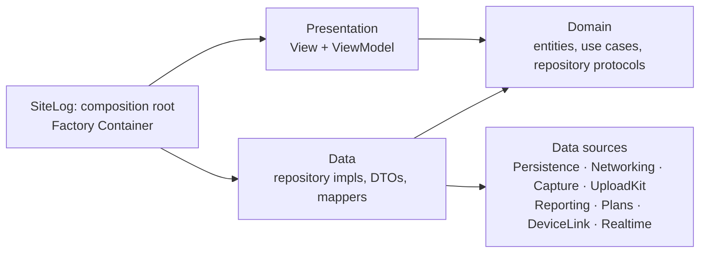

# 00 — Overview

<dl><dd>

- Product, market, data model, architecture, data flows, infrastructure, conventions.
- Feature specs live in five files ([§8](#8-feature-specs)); spec numbers `01`–`19` are stable and
  used by [ROADMAP.md](../../ROADMAP.md), which also owns the build order.

</dd></dl>

## Contents

<dl><dd>

1. [Product](#1-product) — positioning, core rule, stack, non-goals
2. [Market](#2-market)
3. [Data model](#3-data-model)
4. [Architecture](#4-architecture) — layout, layers, MVVM, Factory, startup
5. [Data flows](#5-data-flows)
6. [Infrastructure](#6-infrastructure)
7. [Conventions](#7-conventions)
8. [Feature specs](#8-feature-specs)
9. [Decisions](#9-decisions) — D01–D08, why each library or hand-written engine

</dd></dl>

## 1. Product

<dl><dd>

| | |
|---|---|
| What | Offline-first iOS app for recording construction site conditions |
| Deliverable | Signed PDF inspection report |
| Users | Site supervisors, subcontractors, apartment handover teams |

```
Create project → start session → walk floors/rooms, capture + log issues
→ reach WiFi, background upload → export signed PDF report
```

### 1.1 Positioning and constraints

<dl><dd>

- Competitors lose evidence three ways: stalled or incomplete uploads, photos vanishing on reload,
  sync failing with no reason.
- SiteLog assumes the network is bad.

| Constraint | Consequence |
|---|---|
| Sites, basements, alleys have weak or no signal | Every write path completes offline |
| 150–250 files and several GB per session | Upload survives suspend, termination, network loss |
| User closes the app and keeps walking | No state lives only in RAM |
| The PDF is the paid deliverable | Never truncate, never silently drop images |

</dd></dl>

### 1.2 Core rule

<dl><dd>

- `Capture` is immutable after creation; only descriptive metadata is editable.
- Each carries a `sha256` computed after the file closes, before the DB write.
- Annotations are a separate vector layer, so markup never invalidates a hash.

</dd></dl>

### 1.3 Stack

<dl><dd>

| Area | Choice |
|---|---|
| UI | SwiftUI, iOS 18.6 deployment target; Swift 6 strict concurrency, `MainActor` default isolation |
| Architecture | Clean Architecture (Presentation · Domain · Data), MVVM, one app target with a folder per layer, `DesignSystem` package ([D09](#d09--layers-as-folders-in-one-app-target)) |
| Dependency injection | [Factory](https://github.com/hmlongco/Factory) 3.x (`FactoryKit`) ([D01](#d01--factory-for-dependency-injection)) |
| Concurrency | Swift Concurrency — `actor` for upload, `@MainActor` for view models |
| Local store | SwiftData (`#Unique`, `#Index` need iOS 18) |
| Media | AVFoundation (`AVCaptureSession`, `AVAssetWriter`) |
| Plans | PDFKit + `CATiledLayer` |
| Crypto | CryptoKit + iOS Data Protection, keys in Keychain |
| External devices | CoreBluetooth |
| Transport | Hand-written background `URLSession` engine ([D02](#d02--hand-written-upload-engine)) |
| Object storage | Cloudflare R2, S3 multipart + presigned URLs |
| Realtime | Hand-written `URLSessionWebSocketTask` channel ([D04](#d04--websocket-realtime-channel)) |
| Remote images | [Kingfisher](https://github.com/onevcat/Kingfisher) 8.x ([D05](#d05--kingfisher-for-remote-images)) |
| Auth / crash | Firebase iOS SDK 12.x: Auth, Crashlytics — **no Firestore** ([D07](#d07--firebase-crashlytics)) |
| Tests | Swift Testing, swift-snapshot-testing, `FactoryTesting` ([testing](05-platform.md#testing-strategy)) |
| Tooling | XcodeGen, SwiftLint, swift-format, Fastlane, GitHub Actions |
| Dev only | [Inject](https://github.com/krzysztofzablocki/Inject) 1.6.0 + InjectionNext (hot reload, Debug) |
| Backend | Node 22 + TypeScript + Fastify, PostgreSQL 16, raw SQL, hand-written sync ([03](03-backend.md), [D03](#d03--node--postgresql-backend-hand-written-sync)) |

</dd></dl>

### 1.4 Non-goals

<dl><dd>

| Excluded | Reason |
|---|---|
| Firebase Storage, third-party upload libraries | The transfer engine is the core of the product |
| `UIImagePickerController` / `PhotosPicker` | A hash only means something for a file the app produced |
| Firebase touching file bytes or data | Identity and crash reporting only |
| Burning annotations into original pixels | Destroys the hash |
| RFIs, scheduling, budgets, CAD, real-time multi-user editing, cloud AI defect detection | Different product, or indefensible in a dispute |

</dd></dl>

</dd></dl>

## 2. Market

<dl><dd>

- Research: September 2026.

| App | Position | Taken for SiteLog |
|---|---|---|
| Fieldwire, SnagR, PlanInspect | Drawing-centric punch lists | Pins on floor plans ([11](01-field-work.md#11-floor-plans-and-issue-pins)) |
| SnagPal, IssMan | Photo → annotate → pin → branded PDF | Annotation ([12](01-field-work.md#12-annotation-and-verifiable-stamps)), branded PDF ([05](04-reporting-security.md#05-pdf-and-spreadsheet-export)) |
| CompanyCam | Photo-first, auto-organized | Camera is home |
| Timemark | Tamper-resistant timestamp, per-photo code | Trusted time + verification code |
| GoAudits, SafetyCulture | Template inspections | Checklists ([13](01-field-work.md#13-checklist-templates)) |
| PlanGrid / Autodesk Build | Enterprise | Reviewers cite cost and learning curve — stay single-operator |

| Reported pain | SiteLog's answer |
|---|---|
| "Uploads stall or complete with photos missing" | Per-part state machine, ETag checks, server hash cross-check ([04](02-upload-sync.md#04-upload-engine)) |
| "Photos vanish on reload; comments fail silently" | Local store is truth; nothing deleted until `synced` ([09](05-platform.md#09-diagnostics-and-observability)) |
| "Sync failed with no explanation" | Plain-language reasons + redacted diagnostic bundle ([09](05-platform.md#09-diagnostics-and-observability)) |
| "Slows or crashes with many photos" | Downsampled rendering, streaming hashes ([05](04-reporting-security.md#05-pdf-and-spreadsheet-export)) |

| Edge | Why it matters | Answer |
|---|---|---|
| Verifiable capture | `Date()` is spoofable from Settings, breaking chain of custody | Wall clock + monotonic uptime + server offset, printed `timeConfidence`, server verification code ([12](01-field-work.md#12-annotation-and-verifiable-stamps)) |
| Vietnamese handover | Signed two-party record has legal standing; buyers sign only after every defect is re-inspected; room-by-room | Signature page, before/after loop ([03](01-field-work.md#03-issues-and-before-after-pairing)), checklists are load-bearing |

</dd></dl>

## 3. Data model

<dl><dd>

### 3.1 Hierarchy

<dl><dd>

```
Project
 ├ PlanSheet                                → 11
 ├ ChecklistTemplate                        → 13
 └ Session (survey run)
    └ Location (floor / unit / room)
       ├ ChecklistRun → ChecklistResult     → 13
       └ Capture (photo | video | audio)
          ├ Annotation (vector overlay)     → 12
          └ Issue → PlanPin                 → 03, 11
```

- `Location` belongs to `Project`, not `Session`: this makes cross-session before/after pairing possible.

</dd></dl>

### 3.2 Entities

<dl><dd>

| Entity | Fields | Rules |
|---|---|---|
| `Project` | `id`, `name`, `address`, `clientName`, `createdAt` | Cascade-deletes sessions, locations, plans |
| `Session` | `id`, `startedAt`, `endedAt?`, `surveyorName`, `note`, `state` | `draft → active → closed → exported`; `closed` blocks captures, `exported` is read-only |
| `Location` | `id` (stable across renames), `code` (`"A-12.05"`), `kind` (`floor/unit/room`), `parent?`, `sortIndex` | Max depth 3 |
| `Capture` | `id`, `kind`, `fileURL` (**relative**), `sha256`, `byteSize`, `capturedAt`, `trustedTime`, `verificationCode?`, `latitude?`/`longitude?`/`horizontalAccuracy?`, `deviceModel`, `duration?`, `deviceReading?`, `uploadState`, `remoteKey?`, `isExcludedFromReport` | GPS nullable — basements have none |
| `Issue` | `id`, `title`, `detail`, `severity` (`critical/major/minor`), `status` (`open → inProgress → resolved → verified`), `dueDate?`, `location`, `assigneeName?`, `trade?`, `planPin?`, `sourceChecklistResult?`, `captures`, `resolvedByIssue?` | Anchored to `Location`; `severity` drives upload priority |

- **Frozen after creation:** `id`, `fileURL`, `sha256`, `capturedAt`, `trustedTime`, GPS,
  `deviceModel`, `byteSize`, `kind`.
- No API deletes a `Capture` from an exported session; hiding sets `isExcludedFromReport` + audit entry.
- Store relative paths: absolute ones break on reinstall.

</dd></dl>

### 3.3 UploadState

<dl><dd>

- `pending → uploading → synced`; `failed` reachable from `uploading`.
- `failed` is not terminal and never deletes local files.
- Full job state machine: [04](02-upload-sync.md#04-upload-engine).

</dd></dl>

### 3.4 Schema versioning

<dl><dd>

- `VersionedSchema` + `SchemaMigrationPlan` from v1; `#Unique`/`#Index` mirror the Postgres
  uniqueness rules (location code per project, capture `sha256` per project).
- Per change: add `SchemaV{n}`, keep `SchemaV{n-1}`, declare a `MigrationStage`.
- Test migrations against an old-version fixture store, never an empty one.

</dd></dl>

</dd></dl>

## 4. Architecture

<dl><dd>

- Clean Architecture: dependencies point inward to `Domain`.
- One app target; each layer is a folder in `SiteLog/`.
- `SiteLog/App/` is the only place that wires layers together.
- Presentation uses MVVM.



### 4.1 Repo layout

<dl><dd>

```
site-log-ios/
├── SiteLog/                          # one app target; each layer is a folder
│   ├── App/                          # composition root: may use everything
│   │   ├── SiteLogApp.swift          # @main
│   │   ├── AppDelegate.swift         # process-level iOS events
│   │   ├── AppDependencies.swift     # Factory registrations
│   │   └── Startup/                  # guarded startup steps (Steps/ per step)
│   ├── Presentation/                 # View + ViewModel
│   │   ├── Root/                     # RootView + RootViewModel: startup → access → main tabs
│   │   ├── Access/                   # Startup/ SignIn/ FaceIDLock/ PasscodeUnlock/ PrivacyOverlay/
│   │   ├── MainTab/
│   │   └── <Feature>/                # 2+ screens → one subfolder per screen
│   ├── Domain/                       # Entities/ UseCases/ Repositories/
│   ├── Data/                         # Repositories/ DTOs/ Mappers/
│   ├── DataSources/                  # Persistence/ (SwiftData) Networking/ (backend HTTP client)
│   │                                 # Capture/ UploadKit/ Reporting/ Plans/ DeviceLink/ Realtime/
│   └── Core/                         # app-wide support, no business logic
│       ├── Config/                   # *.xcconfig, entitlements
│       ├── Fakes/                    # UI skeleton sample data; shrinks as each feature lands
│       ├── Helper/                   # Logger/AppLogger, Clock/AppClock + SystemClock; use nothing else from the app
│       └── Resources/                # Assets.xcassets, localization, seeded templates
├── Packages/DesignSystem/            # Swift package: Tokens/ Components/ (UI only)
├── SiteLogTests/                     # mirrors SiteLog/: Core/ Domain/ Data/ DataSources/ Presentation/ Snapshots/
├── SiteLogUITests/
├── Tools/CI/                         # CI guard scripts
├── Tools/Hammerspoon/                # format-on-save config for Xcode
├── Tools/MockPeripheral/             # macOS BLE simulator
├── Backend/                          # Node + Postgres → 03-backend.md
├── fastlane/  .github/workflows/  Gemfile
├── docs/feature-docs/                # project specs
├── docs/feature-guide/               # step-by-step guide per feature (F00–F16)
├── docs/design/                      # design plan, mockups, app icon
└── project.yml                       # XcodeGen
```

- The folder skeleton exists from the start; empty folders hold a `.gitkeep` (excluded from the build in `project.yml`).
- Why folders, not packages: [D09](#d09--layers-as-folders-in-one-app-target).

</dd></dl>

### 4.2 Layers and dependency rules

<dl><dd>

| Layer | Folder | May use |
|---|---|---|
| Presentation | `SiteLog/Presentation/` | `Domain`, `DesignSystem`, `FactoryKit` (`@Injected` only) |
| Domain | `SiteLog/Domain/` | `Foundation` only |
| Data | `SiteLog/Data/` | `Domain` and data sources |
| Data sources | `SiteLog/DataSources/<Name>/` | Frameworks; `Domain` for shared value types; never `Data` or each other |
| DesignSystem | `Packages/DesignSystem` (Swift package) | SwiftUI only; never `Domain` or app code |
| Core | `SiteLog/Core/` (`Helper/Logger`, `Helper/Clock`, `Config`, `Resources`) | `Foundation`, `os` (`Fakes/` also `DesignSystem` until it is gone); used by every layer except `Domain` |
| Composition root | `SiteLog/App/` (`AppDependencies.swift`, `Startup/`) | Everything, plus `FactoryKit` |

| Rule | Enforcement |
|---|---|
| `Domain` imports nothing beyond `Foundation` | CI `check-imports.sh` |
| Presentation and `Domain` never use a type declared in `Data/` or `DataSources/` | CI `check-imports.sh` |
| `Domain` never uses a type declared in `Core/` | CI `check-imports.sh` |
| Presentation never uses SwiftData, `ModelContext` or `URLSession` | CI `check-imports.sh` |
| View models call use cases only — never a repository | Review |
| Repository protocols in `Domain`, implementations in `Data` | Review |
| DTOs and `@Model` types never cross into `Domain` or Presentation | CI `check-imports.sh` + review |
| `UploadKit` and `Realtime` use nothing from the rest of the app, and not each other | Review |
| `DesignSystem` uses nothing from the app | Compiler (separate package, no dependencies) |
| Types in `Domain/`, `Data/`, `DataSources/` are `nonisolated` (the target defaults to `MainActor`) | Compiler + review |

</dd></dl>

### 4.3 MVVM, use cases, repositories

<dl><dd>

| Type | Rules |
|---|---|
| `View` | Layout only: no business `if`, no `ModelContext`, no async work |
| `ViewModel` | `@MainActor @Observable final class`; calls use cases; exposes `Sendable` row structs |
| Row struct | `LocationRow`, `IssueSnapshot`; never an entity or `PersistentModel` |
| Use case | One per user action, a `struct` with one `execute`; depends on repository protocols only |
| Repository | One per aggregate: `ProjectRepository`, `CaptureRepository`, `IssueRepository`, … |

</dd></dl>

### 4.4 Composition root (Factory)

<dl><dd>

- All registrations live in `SiteLog/App/AppDependencies.swift`.
- `Domain` and `Data` never import `FactoryKit`.

```swift
extension Container {
    var projectRepository: Factory<any ProjectRepository> {
        self { SwiftDataProjectRepository(container: self.modelContainer()) }.singleton
    }
    var createProject: Factory<CreateProjectUseCase> {
        self { CreateProjectUseCase(repository: self.projectRepository(), clock: self.clock()) }
    }
}

@MainActor @Observable
final class ProjectListViewModel {
    @ObservationIgnored @Injected(\.createProject) private var createProject
}
```

| Rule | Detail |
|---|---|
| Scope | Data sources and stateful services `.singleton`; use cases unscoped |
| Resolution | View models `@Injected` use cases only |
| Previews | `Container.shared.projectRepository { InMemoryProjectRepository() }` |
| Tests | `@Suite(.container)` from `FactoryTesting` |
| Injected seams | Repositories, `AppClock`, `UploadStore`, `UploadTransport`, `CaptureSessionControlling`, `RandomNumberGenerator` |

</dd></dl>

### 4.5 Startup sequence

<dl><dd>

- Each step guarded and logged separately — never one `try` around init.

| # | Step | On failure |
|---|---|---|
| 1 | Crashlytics | Continue — never blocks launch |
| 2 | Logger | Continue with a no-op logger |
| 3 | Keychain: audit HMAC key, tokens | Block, show recovery screen |
| 4 | `ModelContainer` + migration | Block, offer diagnostic export |
| 5 | Recreate background session, reconcile tasks ↔ store | Continue, mark jobs `pending` |
| 6 | Audit chain verify (async) | Flag in Diagnostics |
| 7 | Sweep orphan files, temp parts, stale derived images | Log only |
| 8 | App lock gate at `RootView` (when Lock app is on) | Face ID → app passcode → forgot-passcode flow |

</dd></dl>

</dd></dl>

## 5. Data flows

<dl><dd>

### 5.1 Capture → stored evidence

<dl><dd>

| # | Step | Thread | Failure |
|---|---|---|---|
| 1 | Write file to `media/…`, apply `.completeUnlessOpen` | `writerQueue` | Abort, surface error |
| 2 | Stream SHA-256 in 1 MB chunks | `hashQueue` | Abort, delete file |
| 3 | Build `TrustedTimestamp` + GPS | `hashQueue` | Degrade confidence, never abort |
| 4 | Insert `Capture` via `@ModelActor` | background | Retry once, then orphan sweep |
| 5 | Enqueue upload with `priority` | `UploadCoordinator` | Stays `pending` |
| 6 | Thumbnail to UI | `@MainActor` | — |

- **Invariant:** no DB row without a hash; no file without a row for longer than one launch.
- Upload, reconciliation, sync: [02-upload-sync.md](02-upload-sync.md). Report export: [05](04-reporting-security.md#05-pdf-and-spreadsheet-export).

</dd></dl>

### 5.2 Concurrency map

<dl><dd>

| Context | Type | Holds |
|---|---|---|
| UI | `@MainActor` | View models, `mainContext` |
| DB writes | `@ModelActor` | Its own `ModelContext` |
| Upload | `actor UploadCoordinator` | Job table, effects |
| Capture | `sessionQueue`, `videoDataQueue`/`audioDataQueue`, `hashQueue` | `AVCaptureSession`, writer, hashing |
| BLE | `actor DeviceLinkManager` | `CBCentralManager` |
| WebSocket | `actor RealtimeChannel` | Task + ping timer |

- Pass `PersistentIdentifier`, never `PersistentModel`, across actors.
- Never call `startRunning()` on main.
- No `@unchecked Sendable` to silence a warning.

</dd></dl>

</dd></dl>

## 6. Infrastructure

<dl><dd>

### 6.1 Filesystem

<dl><dd>

| Path | Protection | Evidence |
|---|---|---|
| `<AppSupport>/media/<project>/<session>/<capture>.<ext>` | `.completeUnlessOpen` | **Yes** |
| `<AppSupport>/plans/<project>/<sheet>.<ext>` | `.completeUnlessOpen` | Yes |
| `<AppSupport>/derived/<…>-stamped.jpg` | `.completeUnlessOpen` | No — regenerable |
| `<Caches>/plans/<sheet>/tiles/`, `<Caches>/prebuffer/` | default | No |
| `<tmp>/upload-parts/` | `.completeUnlessOpen` | No |
| SwiftData store | `.complete` | Metadata |

- Nothing backed up to iCloud (`isExcludedFromBackup`); R2 is the source of truth.
- The DB stores relative paths.

</dd></dl>

### 6.2 Configuration

<dl><dd>

| Item | Where | Committed |
|---|---|---|
| `GoogleService-Info.plist` | `SiteLog/Core/Config/` | No — CI writes it from a secret |
| Backend URL, bucket, feature flags | `*.xcconfig` per environment → `AppConfig` | `.example` only |
| R2 access keys | Backend only | Never in the app |

- Schemes: `SiteLog-Debug`, `SiteLog-Staging`, `SiteLog-Release`. CI: [17](05-platform.md#17-cicd-and-testflight).

</dd></dl>

</dd></dl>

## 7. Conventions

<dl><dd>

| Rule | Detail |
|---|---|
| Layers | Dependencies point inward; `Domain` imports no frameworks |
| Dependencies | Only well-known packages SwiftUI developers commonly use: mature, widely adopted, actively maintained, listed on [Swift Package Index](https://swiftpackageindex.com); prefer Apple frameworks; add via `project.yml`; record the choice in [§9 Decisions](#9-decisions) |
| Constants | In dedicated `enum`s; spacing/color/type via `DesignSystem` |
| Logging | Every action logs with data, successes included: `"Upload failed — {captureId, part: 3/12, status: 503}"` |
| Errors | Log `String(reflecting:)`; catch broad; **no `print`** |
| Startup | Each step guarded; crash reporting first |
| Size | Extract at ~80 lines; variants are parameters |
| Views | No business logic; view models orchestrate |
| Style | Explicit types, `let` by default |

| Kind | Pattern | Example |
|---|---|---|
| ViewModel | `<Screen>ViewModel` | `SurveySessionViewModel` |
| Use case | `<Verb><Noun>UseCase` | `CreateProjectUseCase` |
| Repository protocol / impl | `<Noun>Repository` / `<Source><Noun>Repository` | `SwiftDataProjectRepository` |
| DTO / mapper | `<Noun>DTO` / `<Noun>Mapper` | `ProjectDTO` |
| Data source protocol | `<Noun>ing` / `<Noun>Providing` | `PlanRendering` |
| Actor | `<Noun>Coordinator` / `<Noun>Manager` | `UploadCoordinator` |
| Constants | `enum <Area>Constants` | `UploadConstants` |
| Factory registration | lowerCamel noun on `Container` | `projectRepository` |
| Test file | `<Type>Tests.swift` | `UploadStateMachineTests.swift` |

**Definition of done (every change)**

- Clean build, zero warnings; scoped tests pass.
- Diff reviewed for literals, hard-coded user strings, unlogged `catch`, cross-boundary imports.
- No secret in the diff or logs.

**Adding a feature**

1. Domain: entity, repository protocol, use cases.
2. Fake data: in-memory repository in `Data/Fakes/` (the only place fakes live), registered in `AppDependencies`.
3. View models wired into the screens, running on the fake.
4. Real data (Data impl, DTO, mapper; framework code in a data source); the Factory registration swaps the fake for it.
5. Tests once the feature works end to end; schema change → new `SchemaV{n}` + migration test.

</dd></dl>

## 8. Feature specs

<dl><dd>

| File | Specs |
|---|---|
| [01-field-work.md](01-field-work.md) | 01 Projects, sessions, locations · 02 Capture · 03 Issues and before-after pairing · 06 DeviceLink · 11 Floor plans · 12 Annotation and trusted time · 13 Checklists |
| [02-upload-sync.md](02-upload-sync.md) | 04 Upload engine · 08 Auth and sync · 10 Realtime channel |
| [03-backend.md](03-backend.md) | 14 Backend |
| [04-reporting-security.md](04-reporting-security.md) | 05 PDF and spreadsheet export · 07 Security and audit log |
| [05-platform.md](05-platform.md) | 09 Diagnostics · 17 CI/CD and TestFlight · 18 Push and deep links · 19 Instruments |

- Every spec has the same shape: goal and scope, design, rules and risks, done and tests.

</dd></dl>

## 9. Decisions

<dl><dd>

- Choices that are expensive to reverse: context, decision, rejected options, consequences.
- A superseded decision stays, marked `Superseded by DNN`.

| # | Decision | Status |
|---|---|---|
| [D01](#d01--factory-for-dependency-injection) | Factory for dependency injection | Accepted |
| [D02](#d02--hand-written-upload-engine) | Hand-written upload engine on background `URLSession` | Accepted |
| [D03](#d03--node--postgresql-backend-hand-written-sync) | Node + PostgreSQL backend, hand-written sync | Accepted |
| [D04](#d04--websocket-realtime-channel) | WebSocket realtime channel | Accepted |
| [D05](#d05--kingfisher-for-remote-images) | Kingfisher for remote images | Accepted |
| [D06](#d06--test-libraries) | Swift Testing + swift-snapshot-testing + FactoryTesting | Accepted |
| [D07](#d07--firebase-crashlytics) | Firebase Crashlytics for crash reporting | Accepted |
| [D08](#d08--xcodegen-owns-the-xcode-project) | XcodeGen owns the Xcode project | Accepted |
| [D09](#d09--layers-as-folders-in-one-app-target) | Layers as folders in one app target | Accepted |

- D01–D08 accepted 2026-09-30, D09 2026-10-04. New decision: copy a section, keep its four parts, add a row above.

---

### D01 — Factory for dependency injection

<dl><dd>

- **Context:** one place must bind `Data` implementations to `Domain` protocols and let previews
  and tests swap them; a hand-written `make…()` per use case grows with every feature.
- **Decision:** [Factory](https://github.com/hmlongco/Factory) 3.x (`FactoryKit`).
  - All registrations: `extension Container` in `SiteLog/App/AppDependencies.swift`.
  - Data sources and stateful services `.singleton`; use cases unscoped.
  - View models resolve **use cases only**: `@ObservationIgnored @Injected(\.useCase)`.
  - `Domain` and `Data` never import `FactoryKit`.

| Rejected | Why not |
|---|---|
| Hand-written composition root | Boilerplate per use case; overrides hand-built each time |
| swift-dependencies (Point-Free) | Larger ecosystem; idioms fit TCA better than MVVM |
| Swinject | Runtime registration, failures at runtime |
| SwiftUI `Environment` only | Reaches views, not view models or services |

- **Consequences:**
  - A missing registration does not compile.
  - Previews override in one line: `Container.shared.projectRepository { InMemoryProjectRepository() }`.
  - Tests: `@Suite(.container)` (`FactoryTesting`), one isolated container per test.
  - Replacing the library touches one file plus the `@Injected` lines.

</dd></dl>

### D02 — Hand-written upload engine

<dl><dd>

- Spec: [04](02-upload-sync.md#04-upload-engine)

- **Context:** a session produces 150–250 files and several GB that must reach R2 through network
  loss, suspension, termination, reboot and URL expiry — the product's core claim.
- **Decision:** `UploadKit`, in-house, on a background `URLSessionConfiguration`: own job store
  protocol, state machine, S3 multipart with resume, jittered backoff, relaunch reconciliation.
  Imports nothing from the project.

| Rejected | Why not |
|---|---|
| Alamofire | Foreground sessions; no relaunch or task ↔ job reconciliation |
| Firebase Storage `putFile()` | Cannot reattach after cold launch; no `isDiscretionary` or priority control |
| AWS Amplify / S3 SDK | Heavy; hides the background session lifecycle |

- **Consequences:**
  - Full control of retry, priority, Wi-Fi policy, URL refresh.
  - Largest block of work (F04 `UploadKit` steps) and the most test surface: state machine,
    `MockTransport` scripting 503/403/timeouts, kill-and-relaunch tests.

</dd></dl>

### D03 — Node + PostgreSQL backend, hand-written sync

<dl><dd>

- Specs: [08](02-upload-sync.md#08-auth-and-sync), [14](03-backend.md)

- **Context:** the backend signs R2 URLs, countersigns hashes, owns all metadata, serves delta sync
  to several devices, pushes job state. Firebase already covers identity and crashes.
- **Decision:** Node 22 + TypeScript + Fastify, PostgreSQL 16, raw SQL. Sync: cursor-based delta pull,
  batched push, tombstones with a purge window, LWW per field, monotonic session state, offline
  mutation queue in SwiftData.

| Rejected | Why not |
|---|---|
| Firestore | Vendor-tied model and queries; presigning and countersigning still need a server |
| Supabase | Postgres, but row sync and conflict rules would still be ours |
| CloudKit | Apple-only; no server-side evidence verification |

- **Consequences:**
  - Offline persistence, delete propagation, listener fan-out are ours (tombstones, `pg_notify`).
  - ~1800–2500 lines of TypeScript; a two-device convergence test.
  - Hosting, migrations, backups operated by us.

</dd></dl>

### D04 — WebSocket realtime channel

<dl><dd>

- Spec: [10](02-upload-sync.md#10-realtime-progress-channel)

- **Context:** the server learns about assembly, checksum results and hash mismatches before the app,
  especially after a kill mid-upload.
- **Decision:** observation-only channel on `URLSessionWebSocketTask` in `SiteLog/DataSources/Realtime`: connect,
  auth with the Firebase ID token, ping, reconnect with backoff, events reconciled into the upload
  store. Never controls `UploadKit`.

| Rejected | Why not |
|---|---|
| Polling | 243 jobs every 10 s drains battery and data on site networks |
| Server-Sent Events | One-way; subscribe and heartbeat need a second path |
| APNs silent push | Not guaranteed, rate-limited |
| Starscream / Socket.IO | `URLSessionWebSocketTask` covers it; no extra dependency |

- **Consequences:**
  - App must build and pass tests with `Realtime` removed (nightly CI).
  - Backend serves the channel from the same process, fanned out by `pg_notify`.

</dd></dl>

### D05 — Kingfisher for remote images

<dl><dd>

- **Context:** a second device shows photos from R2 via presigned GET; lists show hundreds of
  thumbnails. Caching, downsampling, cancellation, prefetch are commodity problems.
- **Decision:** [Kingfisher](https://github.com/onevcat/Kingfisher) 8.x (`KFImage`) with
  `DownsamplingImageProcessor` to cell size and a bounded disk cache. Local originals always read
  from disk with `CGImageSourceCreateThumbnailAtIndex`, never through Kingfisher.

| Rejected | Why not |
|---|---|
| `AsyncImage` | No disk cache, downsampling or prefetch |
| Nuke | Equally capable; Kingfisher is more widely used |
| Hand-written cache | Commodity, no product value |

- **Consequences:**
  - Cache key drops the presigned query string, or every URL refresh re-downloads.
  - Cache cleared on sign-out and account deletion ([08](02-upload-sync.md#08-auth-and-sync)).

</dd></dl>

### D06 — Test libraries

<dl><dd>

- Strategy: [05 § Testing](05-platform.md#testing-strategy)

- **Context:** domain logic, view models and screens need fast tests on CI without a device; screens
  need a guard against visual regressions in light, dark and large Dynamic Type.

| Need | Library |
|---|---|
| Unit tests | Swift Testing (`@Test`, `#expect`) |
| View snapshots | [swift-snapshot-testing](https://github.com/pointfreeco/swift-snapshot-testing) 1.x |
| DI isolation | `FactoryTesting` — `@Suite(.container)` |
| UI flows | XCUITest, smoke paths only |

| Rejected | Why not |
|---|---|
| XCTest for new unit tests | Swift Testing is Apple's current default; XCTest kept for XCUITest |
| ViewInspector | Tests view internals; breaks on SwiftUI changes |
| Quick/Nimble | Extra DSL on top of Swift Testing |

- **Consequences:** snapshot references committed; recorded on one pinned simulator model and OS.

</dd></dl>

### D07 — Firebase Crashlytics

<dl><dd>

- Spec: [09](05-platform.md#09-diagnostics-and-observability)

- **Context:** field crashes must be symbolicated, grouped and alerted; Firebase is already in for Auth.
- **Decision:** Crashlytics (firebase-ios-sdk 12.x), initialized first at launch; dSYMs uploaded by the
  Fastlane release lane; non-fatals carry the same structured data as the log line.

| Rejected | Why not |
|---|---|
| Sentry | Second vendor and SDK next to Firebase |
| MetricKit / Organizer only | Delayed, store builds only, no custom keys or non-fatals |

- **Consequences:**
  - No user content or PII in custom keys; IDs only.
  - Startup never blocks on Crashlytics ([§4.5](#45-startup-sequence)).

</dd></dl>

### D08 — XcodeGen owns the Xcode project

<dl><dd>

- How-to: [Dev setup § XcodeGen](05-platform.md#2-xcodegen)

- **Context:** `project.pbxproj` is hard to review and conflicts on merge; packages, settings and
  scheme environment should be readable in a diff.
- **Decision:** `project.yml` is the source of truth; `xcodegen generate` writes `SiteLog.xcodeproj`.
  Code and files are edited in Xcode; packages, links, settings, capabilities, targets and schemes
  change only in `project.yml`.

| Rejected | Why not |
|---|---|
| Hand-maintained `.xcodeproj` | Settings hidden in the pbxproj; merge conflicts |
| Tuist | More than one app target needs; own manifests and CLI lifecycle |

- **Consequences:**
  - A setting changed in Xcode's UI is lost on the next generate.
  - Run `xcodegen generate` after pulling a `project.yml` change.

</dd></dl>

### D09 — Layers as folders in one app target

<dl><dd>

- **Context:** Clean Architecture needs layer boundaries. One SPM package per layer lets the compiler
  enforce them, but adds a manifest per layer, `public` on every cross-layer type and a build per package.
- **Decision:** one app target; `Domain/`, `Data/`, `DataSources/`, `Presentation/` are folders in `SiteLog/`.
  - Exception: `DesignSystem` is a Swift package — pure UI with no app dependencies, so the compiler
    keeps it reusable and its previews build alone.
  - Layer rules: `Tools/CI/check-imports.sh` + review ([§4.2](#42-layers-and-dependency-rules)).
  - Types in `Domain/`, `Data/`, `DataSources/` are `nonisolated`: the target defaults to `MainActor`.

| Rejected | Why not |
|---|---|
| One SPM package per layer | Manifests, `public` everywhere, more setup than one developer needs |
| One package per feature (microfeatures) | About 30 packages; built for many teams |

- **Consequences:**
  - The compiler no longer stops a view from using a `Data/` type; the CI script does.
  - Moving a folder to a package later means adding a manifest and `public`.

</dd></dl>

</dd></dl>
