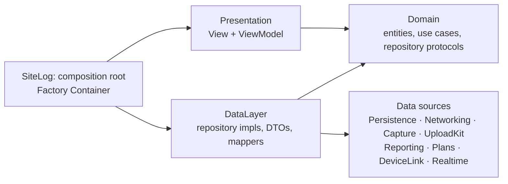

# 00 — Overview

Product, market, data model, architecture, data flows, infrastructure, conventions. Feature specs
live in five files, grouped by area ([§9](#9-feature-specs)); spec numbers (`01`–`19`) are stable
and used by [ROADMAP.md](../../ROADMAP.md).

**Contents** — 1. [Product](#1-product) · 2. [Market](#2-market) · 3. [Data model](#3-data-model) · 4. [Architecture](#4-architecture) · 5. [Data flows](#5-data-flows) · 6. [Infrastructure](#6-infrastructure) · 7. [Build order](#7-build-order) · 8. [Conventions](#8-conventions) · 9. [Feature specs](#9-feature-specs)

## 1. Product

Offline-first iOS app for recording construction site conditions; the deliverable is a signed PDF
inspection report. Users: site supervisors, subcontractors, apartment handover teams.

```
Create project → start session → walk floors/rooms, capture + log issues
→ reach WiFi, background upload → export signed PDF report
```

### 1.1 Positioning and constraints

Competitors lose evidence three ways: uploads stall or complete with photos missing, photos vanish on
reload, and sync fails with no actionable reason. SiteLog assumes the network is bad.

| Constraint | Consequence |
|---|---|
| Sites, basements, alleys have weak or no signal | Every write path completes offline |
| 150–250 files and several GB per session | Upload survives suspend, termination, network loss |
| User closes the app and keeps walking | No state lives only in RAM |
| The PDF is the paid deliverable | Never truncate, never silently drop images |

### 1.2 Core rule

- `Capture` is immutable after creation; only descriptive metadata is editable.
- Each carries a `sha256` computed after the file closes, before the DB write.
- Annotations are a separate vector layer, so markup never invalidates a hash.

### 1.3 Stack

| Area | Choice |
|---|---|
| UI | SwiftUI, iOS 18+ |
| Architecture | Clean Architecture (Presentation · Domain · Data), MVVM, SPM packages per layer |
| Dependency injection | [Factory](https://github.com/hmlongco/Factory) 3.x (`FactoryKit`) ([ADR 0001](../adr/0001-factory-di.md)) |
| Concurrency | Swift Concurrency — `actor` for upload, `@MainActor` for view models |
| Local store | SwiftData (`#Unique`, `#Index` need iOS 18) |
| Media | AVFoundation (`AVCaptureSession`, `AVAssetWriter`) |
| Plans | PDFKit + `CATiledLayer` |
| Crypto | CryptoKit + iOS Data Protection, keys in Keychain |
| External devices | CoreBluetooth |
| Transport | Hand-written background `URLSession` engine ([ADR 0002](../adr/0002-handwritten-upload-engine.md)) |
| Object storage | Cloudflare R2, S3 multipart + presigned URLs |
| Realtime | Hand-written `URLSessionWebSocketTask` channel ([ADR 0004](../adr/0004-websocket-realtime.md)) |
| Remote images | [Kingfisher](https://github.com/onevcat/Kingfisher) 8.x ([ADR 0005](../adr/0005-kingfisher-images.md)) |
| Auth / crash | Firebase iOS SDK 12.x: Auth, Crashlytics — **no Firestore** ([ADR 0007](../adr/0007-firebase-crashlytics.md)) |
| Tests | Swift Testing, swift-snapshot-testing, `FactoryTesting` ([testing.md](../testing.md)) |
| Tooling | XcodeGen, SwiftLint, swift-format, Fastlane, GitHub Actions |
| Backend | Node 22 + TypeScript + Fastify, PostgreSQL 16, raw SQL, hand-written sync ([03](03-backend.md), [ADR 0003](../adr/0003-node-postgres-sync.md)) |

### 1.4 Non-goals

| Excluded | Reason |
|---|---|
| Firebase Storage, third-party upload libraries | The transfer engine is the core of the product |
| `UIImagePickerController` / `PhotosPicker` | A hash only means something for a file the app produced |
| Firebase touching file bytes or data | Identity and crash reporting only |
| Burning annotations into original pixels | Destroys the hash |
| RFIs, scheduling, budgets, CAD, real-time multi-user editing, cloud AI defect detection | Different product, or indefensible in a dispute |

## 2. Market

Research: September 2026.

| App | Position | Taken for SiteLog |
|---|---|---|
| Fieldwire, SnagR, PlanInspect | Drawing-centric punch lists | Pins on floor plans ([11](01-field-work.md#11-floor-plans-and-issue-pins)) |
| SnagPal, IssMan | Photo → annotate → pin → branded PDF | Annotation ([12](01-field-work.md#12-annotation-and-verifiable-stamps)), branded PDF ([05](04-reporting-security.md#05-pdf-and-spreadsheet-export)) |
| CompanyCam | Photo-first, auto-organized | Camera is home |
| Timemark | Tamper-resistant timestamp, per-photo code | Trusted time + verification code |
| GoAudits, SafetyCulture | Template inspections | Checklists ([13](01-field-work.md#13-checklist-templates)) |
| PlanGrid / Autodesk Build | Enterprise | Reviewers cite cost and learning curve — stay single-operator |

| Reported pain | SiteLog's answer |
|---|---|
| "Uploads stall or complete with photos missing" | Per-part state machine, ETag checks, server hash cross-check ([04](02-upload-sync.md#04-upload-engine)) |
| "Photos vanish on reload; comments fail silently" | Local store is truth; nothing deleted until `synced` ([09](05-platform.md#09-diagnostics-and-observability)) |
| "Sync failed with no explanation" | Plain-language reasons + redacted diagnostic bundle ([09](05-platform.md#09-diagnostics-and-observability)) |
| "Slows or crashes with many photos" | Downsampled rendering, streaming hashes ([05](04-reporting-security.md#05-pdf-and-spreadsheet-export)) |

**Differentiator — verifiable capture.** `Date()` is spoofable from Settings, which undermines chain
of custody. Each capture records wall clock, monotonic uptime and a server offset, prints its
`timeConfidence`, and gets a server-side verification code
([12](01-field-work.md#12-annotation-and-verifiable-stamps)).

**Vietnamese handover market.** A signed record between both parties has legal standing, buyers are
told not to sign until every defect is re-inspected, and inspections run room by room. So the
signature page, the before/after loop ([03](01-field-work.md#03-issues-and-before-after-pairing)) and
checklists are load-bearing.

## 3. Data model

### 3.1 Hierarchy

```
Project
 ├ PlanSheet                                → 11
 ├ ChecklistTemplate                        → 13
 └ Session (survey run)
    └ Location (floor / unit / room)
       ├ ChecklistRun → ChecklistResult     → 13
       └ Capture (photo | video | audio)
          ├ Annotation (vector overlay)     → 12
          └ Issue → PlanPin                 → 03, 11
```

`Location` belongs to `Project`, not `Session`, which makes cross-session before/after pairing
possible.

### 3.2 Entities

| Entity | Fields | Rules |
|---|---|---|
| `Project` | `id`, `name`, `address`, `clientName`, `createdAt` | Cascade-deletes sessions, locations, plans |
| `Session` | `id`, `startedAt`, `endedAt?`, `surveyorName`, `note`, `state` | `draft → active → closed → exported`; `closed` blocks captures, `exported` is read-only |
| `Location` | `id` (stable across renames), `code` (`"A-12.05"`), `kind` (`floor/unit/room`), `parent?`, `sortIndex` | Max depth 3 |
| `Capture` | `id`, `kind`, `fileURL` (**relative**), `sha256`, `byteSize`, `capturedAt`, `trustedTime`, `verificationCode?`, `latitude?`/`longitude?`/`horizontalAccuracy?`, `deviceModel`, `duration?`, `deviceReading?`, `uploadState`, `remoteKey?`, `isExcludedFromReport` | GPS nullable — basements have none |
| `Issue` | `id`, `title`, `detail`, `severity` (`critical/major/minor`), `status` (`open → inProgress → resolved → verified`), `dueDate?`, `location`, `assigneeName?`, `trade?`, `planPin?`, `sourceChecklistResult?`, `captures`, `resolvedByIssue?` | Anchored to `Location`; `severity` drives upload priority |

**Frozen after creation:** `id`, `fileURL`, `sha256`, `capturedAt`, `trustedTime`, GPS,
`deviceModel`, `byteSize`, `kind`. No API deletes a `Capture` from an exported session; hiding sets
`isExcludedFromReport` and writes an audit entry. Absolute paths break on reinstall — store relative.

### 3.3 UploadState

`pending → uploading → synced`, with `failed` reachable from `uploading`. `failed` is not terminal
and never deletes local files. Full job state machine: [04](02-upload-sync.md#04-upload-engine).

### 3.4 Schema versioning

- `VersionedSchema` + `SchemaMigrationPlan` from v1; `#Unique`/`#Index` mirror the Postgres
  uniqueness rules (location code per project, capture `sha256` per project).
- Per change: add `SchemaV{n}`, keep `SchemaV{n-1}`, declare a `MigrationStage`.
- Test migrations against an old-version fixture store, never an empty one.

## 4. Architecture

Clean Architecture: dependencies point inward to `Domain`; the app target is the only place that
wires layers together. Presentation uses MVVM.



### 4.1 Repo layout

```
site-log-ios/
├── SiteLog/                          # app target
│   ├── App/                          # composition root: may import everything
│   │   ├── SiteLogApp.swift          # @main
│   │   ├── AppDelegate.swift         # process-level iOS events
│   │   ├── AppDependencies.swift     # Factory registrations
│   │   └── Startup/                  # guarded startup steps (Steps/ per step)
│   ├── Presentation/                 # Domain + DesignSystem only
│   │   ├── Root/RootView.swift       # startup → app lock gate → main tabs
│   │   ├── Access/Startup/           # StartupView + StartupViewModel
│   │   ├── MainTab/
│   │   └── <Feature>/                # 2+ screens → one subfolder per screen
│   ├── Helper/Logger/AppLogger.swift # shared helpers; import nothing from the project
│   ├── Resources/                    # Assets.xcassets, localization, seeded templates
│   └── Config/                       # *.xcconfig, entitlements
├── Packages/
│   ├── Domain/                       # Entities/ UseCases/ Repositories/
│   ├── DataLayer/                    # Repositories/ DTOs/ Mappers/
│   ├── Persistence/ Networking/      # data sources: SwiftData, backend HTTP client
│   ├── Capture/ UploadKit/ Reporting/ Plans/ DeviceLink/ Realtime/
│   └── DesignSystem/                 # Tokens/ Components/ Resources/
├── SiteLogTests/ SiteLogUITests/
├── Tools/MockPeripheral/             # macOS BLE simulator
├── Backend/                          # Node + Postgres → 03-backend.md
├── fastlane/  .github/workflows/
├── docs/
└── project.yml                       # XcodeGen
```

Packages are created when their milestone starts. `DataLayer` is not named `Data` because a module
called `Data` shadows `Foundation.Data`.

### 4.2 Layers and dependency rules

| Layer | Lives in | May import |
|---|---|---|
| Presentation | `SiteLog/Presentation/` | `Domain`, `DesignSystem` |
| Domain | `Packages/Domain` | `Foundation` only |
| Data | `Packages/DataLayer` | `Domain` and data sources |
| Data sources | `Packages/<Name>` | Frameworks; `Domain` for shared value types; never `DataLayer` or each other |
| Composition root | `SiteLog/App/` (`AppDependencies.swift`, `Startup/`) | Everything, plus `FactoryKit` |

| Rule | Enforcement |
|---|---|
| `Domain` imports nothing beyond `Foundation` | CI grep |
| Presentation never imports `DataLayer` or a data source | CI dependency-graph check |
| View models call use cases only — never a repository, `ModelContext` or `URLSession` | Review |
| Repository protocols in `Domain`, implementations in `DataLayer` | CI grep |
| DTOs and `@Model` types never cross into `Domain` or Presentation | Review |
| `UploadKit` and `Realtime` import nothing from the project, and not each other | CI builds each standalone |
| Cross-module access via `public` only | `internal` by default |

### 4.3 MVVM, use cases, repositories

| Type | Rules |
|---|---|
| `View` | Layout only: no business `if`, no `ModelContext`, no async work |
| `ViewModel` | `@MainActor @Observable final class`; calls use cases; exposes `Sendable` row structs |
| Row struct | `LocationRow`, `IssueSnapshot`; never an entity or `PersistentModel` |
| Use case | One per user action, a `struct` with one `execute`; depends on repository protocols only |
| Repository | One per aggregate: `ProjectRepository`, `CaptureRepository`, `IssueRepository`, … |

### 4.4 Composition root (Factory)

All registrations live in `SiteLog/App/AppDependencies.swift`. `Domain` and `DataLayer` never import
`FactoryKit`.

```swift
extension Container {
    var projectRepository: Factory<any ProjectRepository> {
        self { SwiftDataProjectRepository(container: self.modelContainer()) }.singleton
    }
    var createProject: Factory<CreateProjectUseCase> {
        self { CreateProjectUseCase(repository: self.projectRepository(), clock: self.clock()) }
    }
}

@MainActor @Observable
final class ProjectListViewModel {
    @ObservationIgnored @Injected(\.createProject) private var createProject
}
```

| Rule | Detail |
|---|---|
| Scope | Data sources and stateful services `.singleton`; use cases unscoped |
| Resolution | View models `@Injected` use cases only |
| Previews | `Container.shared.projectRepository { InMemoryProjectRepository() }` |
| Tests | `@Suite(.container)` from `FactoryTesting` |
| Injected seams | Repositories, `Clock`, `UploadStore`, `UploadTransport`, `CaptureSessionControlling`, `RandomNumberGenerator` |

### 4.5 Startup sequence

Each step guarded and logged separately — never one `try` around init.

| # | Step | On failure |
|---|---|---|
| 1 | Crashlytics | Continue — never blocks launch |
| 2 | Logger | Continue with a no-op logger |
| 3 | Keychain: audit HMAC key, tokens | Block, show recovery screen |
| 4 | `ModelContainer` + migration | Block, offer diagnostic export |
| 5 | Recreate background session, reconcile tasks ↔ store | Continue, mark jobs `pending` |
| 6 | Audit chain verify (async) | Flag in Diagnostics |
| 7 | Sweep orphan files, temp parts, stale derived images | Log only |
| 8 | App lock gate at `RootView` (when Lock app is on) | Face ID → app passcode → forgot-passcode flow |

## 5. Data flows

### 5.1 Capture → stored evidence

| # | Step | Thread | Failure |
|---|---|---|---|
| 1 | Write file to `media/…`, apply `.completeUnlessOpen` | `writerQueue` | Abort, surface error |
| 2 | Stream SHA-256 in 1 MB chunks | `hashQueue` | Abort, delete file |
| 3 | Build `TrustedTimestamp` + GPS | `hashQueue` | Degrade confidence, never abort |
| 4 | Insert `Capture` via `@ModelActor` | background | Retry once, then orphan sweep |
| 5 | Enqueue upload with `priority` | `UploadCoordinator` | Stays `pending` |
| 6 | Thumbnail to UI | `@MainActor` | — |

**Invariant:** no DB row without a hash; no file without a row for longer than one launch.

Upload, reconciliation and sync flows: [02-upload-sync.md](02-upload-sync.md). Report export:
[05](04-reporting-security.md#05-pdf-and-spreadsheet-export).

### 5.2 Concurrency map

| Context | Type | Holds |
|---|---|---|
| UI | `@MainActor` | View models, `mainContext` |
| DB writes | `@ModelActor` | Its own `ModelContext` |
| Upload | `actor UploadCoordinator` | Job table, effects |
| Capture | `sessionQueue`, `videoDataQueue`/`audioDataQueue`, `hashQueue` | `AVCaptureSession`, writer, hashing |
| BLE | `actor DeviceLinkManager` | `CBCentralManager` |
| WebSocket | `actor RealtimeChannel` | Task + ping timer |

Pass `PersistentIdentifier`, never `PersistentModel`, across actors. Never call `startRunning()` on
main. No `@unchecked Sendable` to silence a warning.

## 6. Infrastructure

### 6.1 Filesystem

| Path | Protection | Evidence |
|---|---|---|
| `<AppSupport>/media/<project>/<session>/<capture>.<ext>` | `.completeUnlessOpen` | **Yes** |
| `<AppSupport>/plans/<project>/<sheet>.<ext>` | `.completeUnlessOpen` | Yes |
| `<AppSupport>/derived/<…>-stamped.jpg` | `.completeUnlessOpen` | No — regenerable |
| `<Caches>/plans/<sheet>/tiles/`, `<Caches>/prebuffer/` | default | No |
| `<tmp>/upload-parts/` | `.completeUnlessOpen` | No |
| SwiftData store | `.complete` | Metadata |

Nothing is backed up to iCloud (`isExcludedFromBackup`); R2 is the source of truth. The DB stores
relative paths.

### 6.2 Configuration

| Item | Where | Committed |
|---|---|---|
| `GoogleService-Info.plist` | `SiteLog/Config/` | No — CI writes it from a secret |
| Backend URL, bucket, feature flags | `*.xcconfig` per environment → `AppConfig` | `.example` only |
| R2 access keys | Backend only | Never in the app |

Schemes: `SiteLog-Debug`, `SiteLog-Staging`, `SiteLog-Release`. CI: [17](05-platform.md#17-cicd-and-testflight).

## 7. Build order

[ROADMAP.md](../../ROADMAP.md) is the source of truth. The full scope ships; this orders the work.

| Order | Items |
|---|---|
| First | Upload engine, hash + trusted time, PDF export, backend upload endpoints |
| Next | Annotation, branding, assignee, CSV |
| Then | Floor plan pins, checklist templates |
| Last | Pre-record buffer, audio, BLE (mock, then hardware), WebSocket realtime |

## 8. Conventions

| Rule | Detail |
|---|---|
| Layers | Dependencies point inward; `Domain` imports no frameworks |
| Constants | In dedicated `enum`s; spacing/color/type via `DesignSystem` |
| Logging | Every action logs with data, successes included: `"Upload failed — {captureId, part: 3/12, status: 503}"` |
| Errors | Log `String(reflecting:)`; catch broad; **no `print`** |
| Startup | Each step guarded; crash reporting first |
| Size | Extract at ~80 lines; variants are parameters |
| Views | No business logic; view models orchestrate |
| Style | Explicit types, `let` by default |

| Kind | Pattern | Example |
|---|---|---|
| ViewModel | `<Screen>ViewModel` | `SurveySessionViewModel` |
| Use case | `<Verb><Noun>UseCase` | `CreateProjectUseCase` |
| Repository protocol / impl | `<Noun>Repository` / `<Source><Noun>Repository` | `SwiftDataProjectRepository` |
| DTO / mapper | `<Noun>DTO` / `<Noun>Mapper` | `ProjectDTO` |
| Data source protocol | `<Noun>ing` / `<Noun>Providing` | `PlanRendering` |
| Actor | `<Noun>Coordinator` / `<Noun>Manager` | `UploadCoordinator` |
| Constants | `enum <Area>Constants` | `UploadConstants` |
| Factory registration | lowerCamel noun on `Container` | `projectRepository` |
| Test file | `<Type>Tests.swift` | `UploadStateMachineTests.swift` |

**Definition of done (every change):** clean build with zero warnings per package; scoped tests;
diff reviewed for literals, hard-coded user strings, unlogged `catch`, cross-boundary imports; no
secret in the diff or logs.

**Adding a feature:** Domain first (entity, use case, repository protocol) → DataLayer (impl, DTO,
mapper; framework code in a data source) → Presentation (view model calls the use case) → Factory
registration. Schema change → new `SchemaV{n}` + migration test.

## 9. Feature specs

| File | Specs |
|---|---|
| [01-field-work.md](01-field-work.md) | 01 Projects, sessions, locations · 02 Capture · 03 Issues and before-after pairing · 06 DeviceLink · 11 Floor plans · 12 Annotation and trusted time · 13 Checklists |
| [02-upload-sync.md](02-upload-sync.md) | 04 Upload engine · 08 Auth and sync · 10 Realtime channel |
| [03-backend.md](03-backend.md) | 14 Backend |
| [04-reporting-security.md](04-reporting-security.md) | 05 PDF and spreadsheet export · 07 Security and audit log |
| [05-platform.md](05-platform.md) | 09 Diagnostics · 17 CI/CD and TestFlight · 18 Push and deep links · 19 Instruments |

Every spec follows the same shape: goal and scope, design, rules and risks, done and tests.
