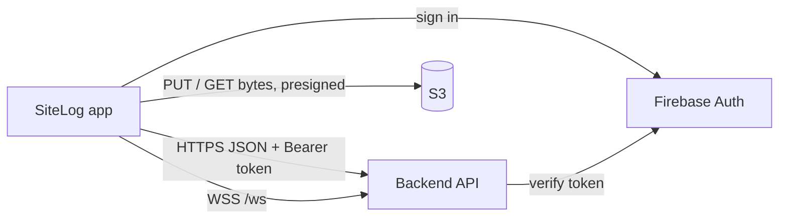

# Backend API (client guide)

<dl><dd>

- What the app calls on the backend, what it sends and gets back, how each call works on the server, and what the app must do with the answer.
- The backend lives in its own repository: [site-log-be](https://github.com/DAMHONGDUC/site-log-be). Full contract with every field and example: [site-log-be · 01-api](https://github.com/DAMHONGDUC/site-log-be/blob/main/docs/feature-docs/01-api.md). Server internals, AWS and the backend guides: [site-log-be docs](https://github.com/DAMHONGDUC/site-log-be/blob/main/README.md#docs).
- Client side of uploads, sync and realtime: [02-upload-sync.md](02-upload-sync.md).

</dd></dl>

## Contents

<dl><dd>

1. [Where it lives](#1-where-it-lives)
2. [Calling the API](#2-calling-the-api)
3. [Errors and retries](#3-errors-and-retries)
4. [Endpoints by feature](#4-endpoints-by-feature)
5. [Auth and account](#5-auth-and-account)
6. [Sync](#6-sync)
7. [Uploads](#7-uploads)
8. [Verify](#8-verify)
9. [Realtime channel](#9-realtime-channel)
10. [Push registration](#10-push-registration)
11. [Shared constants](#11-shared-constants)
12. [Testing against a local backend](#12-testing-against-a-local-backend)

</dd></dl>

## 1. Where it lives

<dl><dd>

| Env | Base URL | Used by | Firebase project |
|---|---|---|---|
| Local | `http://localhost:3000` (simulator), `http://<mac>.local:3000` (iPhone) | Debug, while building a feature | `sitelog-dev` |
| Staging | `https://api-staging.<domain>` | Debug and TestFlight | `sitelog-dev` |
| Production | `https://api.<domain>` | App Store | `sitelog-prod` |

- Stack (for reading logs and errors): Node + Fastify + PostgreSQL on AWS (EC2, RDS, S3), Firebase only checks identity ([site-log-be · 00-overview](https://github.com/DAMHONGDUC/site-log-be/blob/main/docs/feature-docs/00-overview.md)).
- Files live in Amazon S3. The app uploads and downloads them **directly** with presigned URLs; the API never carries bytes.



</dd></dl>

## 2. Calling the API

<dl><dd>

| Rule | Detail |
|---|---|
| Auth header | `Authorization: Bearer <Firebase ID token>`; get it with `getIDToken(forcingRefresh: false)` on every request, never cache it yourself |
| Body | JSON, `Content-Type: application/json`, ≤ 1 MiB |
| Names | `camelCase` fields |
| Ids | App-made UUIDs; the server returns them **lowercase** — compare with `UUID(uuidString:)`, not as strings |
| Timestamps | ISO 8601 UTC with milliseconds `2026-11-05T09:00:00.000Z`: `ISO8601DateFormatter` with `[.withInternetDateTime, .withFractionalSeconds]` |
| Dates | `YYYY-MM-DD` |
| Hashes | SHA-256, 64 lowercase hex |
| Clock | The `Date` header of any response (e.g. `/health`) is the trusted time for the clock offset |

- Where it is built: `PlatformKit/Networking` (`HTTPClient`, base URL and token provider through `init`); each feature's remote data source in `DataLayer/DataSources/Remote/` maps DTOs.

</dd></dl>

## 3. Errors and retries

<dl><dd>

- Every error body is `{ "error": { "code": "<snake_case>", "message": "…" } }`. Log `code`, never show `message` raw to users.

| Status | Means | The app |
|---|---|---|
| `200` | Done (also a repeated `complete` or `DELETE`) | Continue |
| `400` | Permanent: the request can never succeed | Stop; an upload job → `.permanent`, abort |
| `401` | Token missing, expired or revoked (never `403`) | One shared refresh (`forcingRefresh: true`), retry once; no retry budget used |
| `404` | Unknown or aborted upload, nothing uploaded, unknown code | Permanent |
| `409` | On `complete`: another upload of the same key won — the body carries `remoteKey` and `verificationCode` | Treat as success |
| `413` | Body or file too large | Permanent |
| `429` | Rate limit | Wait, retry (`.serverTransient`) |
| `5xx` | Server fault, `503 auth_unavailable` | Retry with backoff (`.serverTransient`) |
| S3 `403` on a presigned URL | URL expired | `.urlExpired`: refresh URLs, no budget used |

</dd></dl>

## 4. Endpoints by feature

<dl><dd>

| Feature | Call | Section |
|---|---|---|
| F00 | `GET /health` | [§1](#1-where-it-lives) (clock, reachability) |
| F02 Auth | `DELETE /account` | [§5](#5-auth-and-account) |
| F04 Sync | `POST /sync/pull`, `POST /sync/push` | [§6](#6-sync) |
| F06 Upload | `POST /uploads`, `POST /uploads/:id/complete`, `DELETE /uploads/:id`, `POST /media/urls` | [§7](#7-uploads) |
| F07 Resumable upload | Multipart answer of `POST /uploads`, `POST /uploads/:id/parts/refresh` | [§7](#7-uploads) |
| F10 Reports | `GET /verify/:code` | [§8](#8-verify) |
| F15 Realtime | `WS /ws` | [§9](#9-realtime-channel) |
| F16 Push | `POST /devices`, `DELETE /devices/:token` | [§10](#10-push-registration) |
| F03, F05, F08–F12 | Their tables ride on `/sync` | [§6.3](#63-synced-tables) |

</dd></dl>

## 5. Auth and account

<dl><dd>

- Every route except `/health` and `/verify` runs `requireUser` on the server: `verifyIdToken(token, checkRevoked: true)` → the caller's `uid`, or `401`.
- Every file key and row is scoped to that `uid`; the app never sends a uid in a body.

```text
DELETE /account
→ 200 { "deletedObjects": 214, "abortedUploads": 1, "deletedRows": 932 }
```

| Server does, in order | Client rule |
|---|---|
| Aborts unfinished multipart uploads, deletes every object under `{uid}/`, deletes every row in one transaction, deletes the Firebase user | Reauthenticate first; show the numbers; then wipe local store, Keychain and media |
| Safe to repeat; a repeat returns zeros | After success the token is revoked: any further call is `401` — sign out locally |

</dd></dl>

## 6. Sync

<dl><dd>

### 6.1 Pull

<dl><dd>

```text
POST /sync/pull { "since": <nextRev of last pull, 0 at first>, "limit": 500 }
→ { "changes": { "<table>": [rows] }, "nextRev": 41, "hasMore": false }
→ { "resyncRequired": true }
```

| Server mechanism | Client rule |
|---|---|
| Every row has a per-user `rev`, gap-free and commit-ordered | Store `nextRev` only after the page is applied |
| Returns rows with `rev > since`, tombstones included (`deletedAt` set) | Delete tombstoned rows locally |
| `hasMore: true` when capped | Pull again at once |
| `resyncRequired` when `since` is older than the 90-day tombstone purge | Wipe synced data, pull from `0` |

</dd></dl>

### 6.2 Push

<dl><dd>

```text
POST /sync/push { "mutations": [ { "table", "id", "op": "upsert" or "delete", "clientUpdatedAt", "fields": { full row } } ] }
→ { "results": [ { "id", "status": "applied" | "superseded" | "rejected", "serverRow"?, "reason"? } ], "serverRev": 44 }
```

| Server mechanism | Client rule |
|---|---|
| One transaction per batch (≤ 200), parents may come after children inside it | Queue in dependency order: projects → locations → plan_sheets → sessions → captures → issues → issue_captures → annotations → checklist_* |
| Last write wins on `clientUpdatedAt`, decided in SQL | Send the time of the edit, not of the push |
| `upsert` needs the **full row** (every field, `null` where empty) | Never send partial `fields` |
| A deleted row never comes back; `sessions.state` only moves forward; frozen columns keep their first value | `superseded` is not an error: adopt `serverRow` (its `id` may differ for natural-key tables) |
| `rejected` + `reason` (`invalid_row:<code>`, `missing_parent`, `forbidden`, `unknown_field:<name>`) | Drop that mutation, log the reason, keep the rest |

</dd></dl>

### 6.3 Synced tables

<dl><dd>

| Table | Since | Notes for the DTO |
|---|---|---|
| `projects`, `locations`, `sessions` | F03 | `kind` ∈ floor · unit · room; `state` ∈ draft · active · closed · exported |
| `captures` | F05 | Evidence fields frozen after the first push; `latitude`/`longitude` both or neither |
| `issues`, `issue_captures`, `phrases` | F08 | Pin = `planSheetId` + `pinX` + `pinY` (0…1) or all `null`; a phrase with the same text merges |
| `annotations` | F09 | `id` = the capture id; `shapes` is a JSON array |
| `report_branding` | F10 | One per user; `accentHex` = `#RRGGBB` |
| `plan_sheets` | F11 | |
| `checklist_templates`, `checklist_template_items`, `checklist_runs`, `checklist_results` | F12 | One live result per `(runId, templateItemId)` |

- Exact field lists: [site-log-be · 01-api §6.3](https://github.com/DAMHONGDUC/site-log-be/blob/main/docs/feature-docs/01-api.md#63-synced-tables). DTOs in `DataLayer/Models/Remote/` mirror them one to one.

</dd></dl>

</dd></dl>

## 7. Uploads

<dl><dd>

### 7.1 Keys

<dl><dd>

| File | Key |
|---|---|
| Capture | `{uid}/{projectId}/{sessionId}/{captureId}.{jpg·heic·png·mov·mp4·m4a}` |
| Plan sheet | `{uid}/{projectId}/plans/{sheetId}.{pdf·jpg·png·heic}` |
| Branding logo | `{uid}/branding/{logoId}.{png·jpg}` |

- Any other shape or another uid → `400 invalid_key`.

</dd></dl>

### 7.2 Begin and PUT

<dl><dd>

```text
POST /uploads { "key", "byteSize", "contentType", "sha256" }
→ { "mode": "single", "uploadId", "url", "expiresAt" }
→ { "mode": "multipart", "uploadId", "partSizeBytes": 8388608, "parts": [ { "number", "url" } ], "expiresAt" }   (F07)
```

| Server mechanism | Client rule |
|---|---|
| Picks the mode from `byteSize` (< 5 MiB single) | Never choose the mode yourself; plan parts from `partSizeBytes` |
| URLs are signed for 1 hour and include `Content-Type` | PUT with header `Content-Type` = the `contentType` sent; keep each part's `ETag` |
| Rate limit 600 begins / minute / user | `429` → back off |

</dd></dl>

### 7.3 Complete

<dl><dd>

```text
POST /uploads/:id/complete {}                                   (single)
POST /uploads/:id/complete { "parts": [ { "number", "etag" } ] } (multipart: every part, once)
→ { "uploadId", "remoteKey", "sha256", "verificationCode", "verified": false, "receivedAt" }
```

| Server mechanism | Client rule |
|---|---|
| Locks the upload row, checks the object in S3 (`HeadObject`, size = `byteSize`), issues a code | Retry freely: the answer is the same every time (**idempotent**) |
| `404 object_not_found` (nothing uploaded), `400 size_mismatch` | Permanent: restart the job from the file |
| The hash is `registered` now; a worker re-reads the file later and marks it `verified` (F15) | Print "registered {code}" until the channel or a pull says verified |

</dd></dl>

### 7.4 Refresh, abort, media

<dl><dd>

| Call | Server | Client |
|---|---|---|
| `POST /uploads/:id/parts/refresh { "numbers": [13, 14] }` | New URLs for exactly those parts; `404` once completed or aborted | Mandatory after a long kill or any S3 `403` |
| `DELETE /uploads/:id` | Aborts in S3, frees parts; repeatable | User cancel, account switch |
| `POST /media/urls { "keys": [...] }` (≤ 200) | GET URLs for the caller's own keys, 1 hour | Kingfisher cache key = the object key, not the URL |

</dd></dl>

</dd></dl>

## 8. Verify

<dl><dd>

```text
GET /verify/K7M2QX9HTP      (no token)
→ { "code", "sha256", "byteSize", "receivedAt", "verifyState": "registered" | "verified" | "mismatch", "verified", "verifiedAt", "projectRef" }
```

- Server: public, rate limited per IP, constant delay, never returns the file, a URL, the uid or coordinates.
- App: print `projectRef` (first 8 of the project id, upper case) in the report header and the code under each photo; wording per [01-field-work §12.5](01-field-work.md#125-verification-code).

</dd></dl>

## 9. Realtime channel

<dl><dd>

| App → server | Server → app |
|---|---|
| `{"type":"auth","token":"…"}` first, within 5 s | `{"type":"snapshot","sessionID","completed":[…],"failed":[…]}` — always first after subscribe |
| `{"type":"subscribe","sessionID":"…"}` | `{"type":"jobCompleted","jobID","remoteKey","sha256","verified"}` — after complete, again when verified |
| `{"type":"ping","at":n}` | `{"type":"jobFailed","jobID","reason":"integrity"}` (or `"aborted"`) · `{"type":"pong","at":n}` |

| Server mechanism | Client rule |
|---|---|
| Events fan out through Postgres `pg_notify`; delivery is best effort | The snapshot is the recovery path; never wait for an event |
| `jobID` = the `uploadId` from begin | Match on it; ignore unknown ids |
| Close `4000` no auth · `4001` token · `4003` foreign session · `4008` too many sockets | `4001` → refresh token, reconnect; others → log |

- Trust `jobCompleted` only if its `sha256` equals the local hash. Protocol and client rules: [02-upload-sync §10](02-upload-sync.md#10-realtime-progress-channel).

</dd></dl>

## 10. Push registration

<dl><dd>

```text
POST /devices { "token": "<APNs hex>", "environment": "sandbox" | "production" }   → { "registered": true }
DELETE /devices/:token                                                          → { "removed": true }
```

- Register after sign-in and on every token change; remove on sign-out. Debug = `sandbox`, TestFlight and App Store = `production`.
- The server pushes once when the last upload of a session is verified: `aps.alert`, `deepLink` (`sitelog://session/<id>`), `account` (hash of the uid — ignore if it is not the signed-in user).

</dd></dl>

## 11. Shared constants

<dl><dd>

| Constant | Value | App |
|---|---|---|
| Single-PUT threshold | 5 MiB | `UploadConstants.singlePutThresholdBytes` |
| Part size | 8 MiB | `UploadConstants.partSizeBytes` |
| Presigned URL lifetime | 1 h | proactive refresh before `expiresAt` |
| Pull page | ≤ 500 | `SyncConstants.pullPageSize` |
| Push batch | ≤ 200 | `SyncConstants.pushBatchSize` |
| Tombstone retention | 90 days | `SyncConstants.tombstoneRetentionDays` |
| WS auth timeout · max message | 5 s · 64 KiB | `RealtimeConstants.authTimeout` · `maxMessageBytes` |

- A change to any of these is made in [site-log-be · 01-api §12](https://github.com/DAMHONGDUC/site-log-be/blob/main/docs/feature-docs/01-api.md#12-shared-constants) first, then on both sides.

</dd></dl>

## 12. Testing against a local backend

<dl><dd>

- Run the backend on the Mac and point a Debug build at it: [site-log-be · local testing with iOS](https://github.com/DAMHONGDUC/site-log-be/blob/main/docs/feature-guide/local-testing-with-ios.md).
- Debug builds need `NSAllowsLocalNetworking = YES` (and `NSLocalNetworkUsageDescription` for an iPhone) to reach `http://localhost:3000` or `http://<mac>.local:3000`; Release builds never have them.

</dd></dl>
