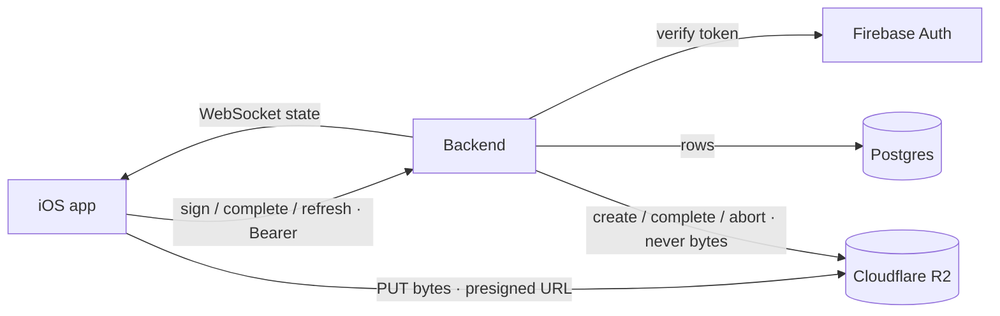

# Backend (spec 14)

<dl><dd>

- Directory: `Backend/` · Node.js + TypeScript ([D03](00-overview.md#d03--node--postgresql-backend-hand-written-sync)).
- Signs URLs, owns **all** application data, pushes state. Firebase: identity and crash reporting only.
- Client side: [02-upload-sync.md](02-upload-sync.md).

</dd></dl>

## Contents

<dl><dd>

1. [Role](#1-role)
2. [Stack](#2-stack)
3. [Endpoints](#3-endpoints)
4. [Auth](#4-auth)
5. [Database](#5-database) — `uploads`, `sync_state`, metadata tables
6. [Flows](#6-flows)
7. [Sync](#7-sync) — pull, push, idempotent complete
8. [Integrity](#8-integrity)
9. [WebSocket](#9-websocket)
10. [Error contract](#10-error-contract)
11. [Operations](#11-operations)
12. [Done and tests](#12-done-and-tests)

</dd></dl>

## 1. Role

<dl><dd>

| Does | Does not |
|---|---|
| Verify Firebase ID tokens | Proxy or buffer file bytes |
| Create, sign, refresh, abort R2 uploads | Render reports |
| Store every metadata row, serve delta sync | Own business rules — the app decides, the server records |
| Record job state, countersign capture hashes | Authenticate users itself |
| Serve the WebSocket channel, resolve verification codes, delete accounts | |

- Expect ~1800–2500 lines of TypeScript.

</dd></dl>

## 2. Stack

<dl><dd>

| Concern | Choice |
|---|---|
| Runtime / HTTP | Node 22 LTS, TypeScript, ESM, Fastify (`@fastify/websocket`) |
| Validation | TypeBox or Zod — every body validated before touching R2 |
| R2 | `@aws-sdk/client-s3` + `s3-request-presigner` (presigning is local crypto) |
| Tokens | `firebase-admin` |
| Database | PostgreSQL 16, `pg` with **raw parameterized SQL**, no ORM |
| Migrations | Numbered `.sql` files + `node-pg-migrate`, forward-only in production |
| Tests | `vitest`, `aws-sdk-client-mock`, throwaway Postgres |
| Deploy | Fly.io or Railway — a long-lived process is needed for WebSocket |

- Not Cloudflare Workers: `firebase-admin` needs Node APIs; WebSocket would need Durable Objects.

</dd></dl>

## 3. Endpoints

<dl><dd>

| # | Method | Path | Auth | Purpose |
|---|---|---|---|---|
| 1 | `POST` | `/uploads` | Bearer | Begin: returns single-PUT or multipart plan (backend picks by `byteSize`) |
| 2 | `POST` | `/uploads/:id/parts/refresh` | Bearer | Re-sign expired part URLs — mandatory |
| 3 | `POST` | `/uploads/:id/complete` | Bearer | Confirm object (`CompleteMultipartUpload` / `HeadObject`), record job, return `remoteKey` + code — **idempotent** |
| 4 | `DELETE` | `/uploads/:id` | Bearer | Abort, clean orphaned parts |
| 5 | `POST` | `/sync/pull` | Bearer | Delta pull since a `rev` cursor |
| 6 | `POST` | `/sync/push` | Bearer | Apply a batch of client mutations |
| 7 | `GET` | `/verify/:code` | **none** | Resolve a code printed in a report |
| 8 | `DELETE` | `/account` | Bearer | Delete every R2 object and row for the caller |
| 9 | `GET` | `/health` | none | Liveness |
| — | `WS` | `/ws` | first message | Progress channel |

- Single-PUT threshold 5 MB and part size 8 MB **must match the client** (config on both sides).
- Presign TTL 1 h; longer TTLs are not a fix — refresh is.
- `HeadObject` on `complete` stops a client registering a code for an object it never uploaded.
- `/verify` returns `{sha256, byteSize, receivedAt, verified, verifiedAt, projectRef}` — never media,
  URL, uid or coordinates. Codes are 10+ random characters from an unambiguous alphabet; rate limited
  per IP; unknown codes answer `404` after the same delay as a hit.
- `/account` pages `ListObjectsV2` + `DeleteObjects` under `{uid}/` in 1000s, aborts in-flight
  multipart uploads, **then** deletes rows in one transaction (rows first would lose the list of what
  to delete), returns counts, is idempotent.

</dd></dl>

## 4. Auth

<dl><dd>

```ts
async function requireUser(req: FastifyRequest): Promise<{ uid: string }> {
  const header = req.headers.authorization
  if (!header?.startsWith('Bearer ')) throw unauthorized()
  const decoded = await getAuth().verifyIdToken(header.slice(7), true) // checkRevoked
  return { uid: decoded.uid }
}
```

- Verify on **every** request, with `checkRevoked`.
- Keys: `{uid}/{projectID}/{sessionID}/{captureID}.{ext}` and `{uid}/{projectID}/plans/{sheetID}.{ext}`,
  validated by a strict full-shape regex; reject `..` and absolute paths. Without this the signer is
  an open relay into the bucket.
- Auth failures return `401`, never `403` (the client reads `403` as an expired presigned URL).

</dd></dl>

## 5. Database

<dl><dd>

- Migrations: `0001_uploads.sql`, `0002_sync_core.sql`, `0003_metadata.sql` — 16 tables + `pgmigrations`.

### 5.1 `uploads`

<dl><dd>

```sql
create type upload_mode  as enum ('single', 'multipart');
create type upload_state as enum ('created', 'completed', 'aborted');
create type verify_state as enum ('registered', 'verified', 'mismatch');

create table uploads (
    id uuid primary key default gen_random_uuid(),
    uid text not null, session_id uuid not null, capture_id uuid,
    object_key text not null, sha256 char(64) not null,
    byte_size bigint not null check (byte_size > 0), content_type text not null,
    mode upload_mode not null, s3_upload_id text,
    state upload_state not null default 'created',
    verification_code text unique, verify_state verify_state, verified_at timestamptz,
    created_at timestamptz not null default now(), completed_at timestamptz,
    constraint multipart_needs_s3_id check (mode <> 'multipart' or s3_upload_id is not null),
    constraint completed_needs_code check (state <> 'completed' or verification_code is not null)
);
create unique index uploads_completed_key on uploads (uid, object_key) where state = 'completed';
create index uploads_snapshot  on uploads (uid, session_id, state);
create index uploads_abandoned on uploads (created_at) where state = 'created';
```

| Choice | Why |
|---|---|
| `timestamptz` everywhere | The client derives its clock offset from this service |
| `bigint` sizes | Video passes 2 GB |
| Enums, partial indexes | No free-text states; small hot indexes |
| No `parts` table | Refresh needs only `s3_upload_id`; `complete` carries the ETags |

</dd></dl>

### 5.2 `sync_state`

<dl><dd>

```sql
create table sync_state (uid text primary key, last_rev bigint not null default 0,
                         created_at timestamptz not null default now());
-- first statement of every mutating transaction:
update sync_state set last_rev = last_rev + 1 where uid = $1 returning last_rev;
```

**The load-bearing detail of sync**

- A `nextval()` sequence can commit revs 7 and 8 in reverse order → a client polling `rev > 7` never sees 7.
- The row lock serializes one user's writes → revs are gap-free and commit-ordered.
- One person writes at human speed, so the lock costs nothing.

</dd></dl>

### 5.3 Metadata tables

<dl><dd>

- Every synced table: `id uuid` (client-generated), `uid`, `rev`, `client_updated_at`, `deleted_at`,
  index on `(uid, rev)`.
- Every FK is `deferrable initially deferred`: a push batch may insert a child before its parent.

| Table | Business columns | Constraints |
|---|---|---|
| `projects` | `name`, `address`, `client_name`, `created_at` | |
| `locations` | `project_id`, `parent_id`, `code`, `kind`, `sort_index` | unique `(project_id, code)` where live |
| `plan_sheets` | `project_id`, `location_id`, `name`, `page_index`, `pixel_width/height`, `sha256`, `remote_key` | |
| `sessions` | `project_id`, `started_at`, `ended_at`, `surveyor_name`, `note`, `state` | state enum, monotonic in push |
| `captures` | `project_id`, `session_id`, `location_id`, `kind`, `sha256`, `byte_size`, `captured_at`, `time_confidence`, lat/long/accuracy, `device_model`, `duration_seconds`, `remote_key`, `excluded_from_report` | coords paired; unique `(project_id, sha256)` where live |
| `annotations` | `capture_id` (PK, 1:1), `shapes jsonb` | |
| `issues` | `project_id`, `location_id`, `title`, `detail`, `severity`, `status`, `due_date`, `assignee_name`, `trade`, `plan_sheet_id`, `pin_x/pin_y`, `resolved_by_issue_id`, `source_checklist_result_id` | pin all-or-none, pin in 0…1 |
| `issue_captures` | `(issue_id, capture_id)` PK | |
| `checklist_templates` / `_template_items` | name, `applies_to`, `is_built_in`, `usage_count` / `ordinal`, `text`, `default_severity`, `requires_photo_on_fail` | |
| `checklist_runs` / `_results` | template, session, location, times / `run_id`, `template_item_id`, `outcome`, `note`, `issue_id`, `answered_at` | template FKs `on delete restrict`; unique `(run_id, template_item_id)` |
| `phrases` | `text`, `usage_count` | unique `(uid, text)` where live |
| `report_branding` | `uid` PK, company, logo key, accent, client block, footer | |

- Uniques use `where deleted_at is null` so tombstones do not block reuse.
- No `plan_pins` table: one pin per issue fits in three columns.

</dd></dl>

</dd></dl>

## 6. Flows

<dl><dd>



- Control, bytes and state are separate paths; a slow backend never stalls an upload.

```mermaid
sequenceDiagram
    autonumber
    participant App as iOS
    participant BE as Backend
    participant R2 as R2
    App->>BE: POST /uploads {byteSize 240 MB}
    BE->>R2: CreateMultipartUpload
    BE-->>App: multipart, 30 × 8 MB parts
    loop parts 1..12
        App->>R2: PUT part → 200 + ETag
    end
    Note over App: killed; relaunch hours later, reconcile
    App->>R2: PUT part 13 → 403 (.urlExpired, no budget spent)
    App->>BE: POST /parts/refresh {13..30}
    loop parts 13..30
        App->>R2: PUT part → 200 + ETag
    end
    App->>BE: POST /complete {30 ETags}
    BE->>R2: CompleteMultipartUpload
    BE-->>App: {remoteKey, verificationCode}
```

- Small files: one `POST /uploads`, one PUT, one `complete` with `HeadObject`.
- A lost `complete` response is retried and must return the byte-identical body ([§7.3](#73-idempotent-complete)).

</dd></dl>

## 7. Sync

<dl><dd>

### 7.1 Pull

<dl><dd>

- Per table: `select … where uid = $1 and rev > $2 order by rev limit $3`; merged, capped at `pullPageSize`.
- Includes tombstones; `nextRev` = highest rev returned; `hasMore` when capped.
- `since` older than the 90-day purge window → `{ resyncRequired: true }`.

</dd></dl>

### 7.2 Push

<dl><dd>

```sql
begin;
set constraints all deferred;
update sync_state set last_rev = last_rev + 1 where uid = $1 returning last_rev;  -- one rev per batch
insert into issues (id, uid, rev, client_updated_at, …) values (…)
on conflict (id) do update set …, rev = excluded.rev, client_updated_at = excluded.client_updated_at
 where issues.client_updated_at < excluded.client_updated_at;                    -- LWW in SQL
commit;
```

- A losing row returns `superseded` with the stored row.
- `captures`: `on conflict do nothing`.
- `sessions.state` advances by enum ordinal, never backwards.
- Every statement filters `uid = $1`.
- Nightly job purges tombstones older than 90 days.

</dd></dl>

### 7.3 Idempotent complete

<dl><dd>

```sql
update uploads
   set state = 'completed',
       completed_at      = coalesce(completed_at, now()),
       verification_code = coalesce(verification_code, $2),
       verify_state      = coalesce(verify_state, 'registered')
 where id = $1 and uid = $3 and state in ('created', 'completed')   -- 'aborted' never resurrects
returning object_key, verification_code, verify_state;
```

- A repeat returns the original code and time; zero rows → `404`, never `400` (the client aborts on `400`).
- S3 `CompleteMultipartUpload` runs first in the same transaction and is itself idempotent.

**Access rules**

- Parameterized queries only; `and uid = $n` on every user query.
- `pg.Pool` sized under the platform cap; one transaction per request, released in `finally`.

</dd></dl>

</dd></dl>

## 8. Integrity

<dl><dd>

- Recording a client-supplied hash does **not** verify it.
- R2 checksum-on-write for presigned multipart is unreliable.

| Phase | Mechanism | Claim |
|---|---|---|
| `registered` | `complete` records the client hash, issues a code, `verified: false` | "This hash was registered by this account at this time" |
| `verified` | Worker streams the object back from R2, recomputes SHA-256 | "The stored bytes hash to this value" |
| `mismatch` | Worker hash differs | `jobFailed(integrity)` pushed to the app |

- Affordable: R2 charges no egress.
- Abandoned `created` uploads are aborted after 7 days.
- The report prints exactly the state reached ([12.5](01-field-work.md#125-verification-code)).

</dd></dl>

## 9. WebSocket

<dl><dd>

- Protocol: [10](02-upload-sync.md#10-realtime-progress-channel).

**Server obligations**

- Require `auth` within 5 s; never from the query string.
- Answer `subscribe` with a `snapshot` from `uploads_snapshot`.
- Scope every message to the socket's uid; another uid's session closes the socket.
- Close `4001` on token expiry; answer `ping`; send `sha256` with `jobCompleted`; cap sockets per uid.
- Advisory channel: no backend logic may assume a socket is attached.

**Fan-out across instances**

- After `complete`, same transaction: `pg_notify('upload_events', {uid, sessionId, uploadId, type})`,
  ids only (8000-byte cap).
- Each instance: one dedicated `LISTEN` connection outside the pool → re-read the row → route to local sockets.
- At-most-once delivery; the client's `snapshot` on reconnect is the recovery path.
- Works unchanged with one instance.

</dd></dl>

## 10. Error contract

<dl><dd>

| Status | Client reads it as | Use for |
|---|---|---|
| `200` | Success | Including a repeated `complete` |
| `400` | `.permanent` — **aborts the job** | Malformed body only |
| `401` | Refresh token, retry | Missing, expired, revoked token |
| `404` | `.permanent` | Unknown or aborted `uploadId` |
| `409` | Success on `complete` | Concurrent completion |
| `413` | `.permanent` | Body over `MAX_REQUEST_BYTES` |
| `429` / `5xx` | `.serverTransient` | Rate limit (`Retry-After`) / genuine faults |

- Returning `400` for a transient condition destroys an upload — the highest-risk backend mistake.
- Error body: `{ "error": { "code": "invalid_key", "message": "…" } }`, never a stack trace.

</dd></dl>

## 11. Operations

<dl><dd>

| Area | Rule |
|---|---|
| Time | Hosts NTP-synced; no caching CDN in front of the API (a cached `Date` poisons client offsets) |
| R2 | Abort incomplete multipart after 7 days; public access off; one bucket per env (`sitelog-dev/-staging/-prod`); token scoped to one bucket |
| Config | `R2_*`, `FIREBASE_SERVICE_ACCOUNT`, `DATABASE_URL` (`sslmode=require`), `PG_POOL_MAX`, `PRESIGN_TTL_SECONDS`, `SINGLE_PUT_THRESHOLD_BYTES`, `PART_SIZE_BYTES`, `MAX_REQUEST_BYTES`; `.env` gitignored, `.env.example` committed |
| Logs | Structured JSON `{uid, uploadId, key, byteSize, partCount, durationMs, status}`; never URLs, tokens or service-account JSON |
| Abuse | Rate limit per uid on `/uploads`, per IP on `/verify` |

</dd></dl>

## 12. Done and tests

<dl><dd>

**Done**

- A key outside the caller's prefix is rejected (with a test)
- `complete` twice returns `200` with identical bodies
- A revoked token stops on the next request
- `/verify` leaks no uid, URL or coordinates
- Account deletion leaves nothing under `{uid}/`
- A 60 s TTL still finishes a 200-file session via refresh
- No secret in any log

**Tests**

- Key prefix (`other-uid/`, `../`, absolute)
- Migrations on empty and seeded DBs
- Table constraints reject bad rows
- Concurrent duplicate `complete`
- Aborted job cannot complete
- Mode selection at 4.9/5/5.1 MB
- Expired/revoked token → `401`
- Refresh returns exactly the requested parts
- Abort with mocked S3
- `/verify` redaction and rate limit
- Account deletion past 1000 objects
- WS auth timeout and cross-uid subscribe close the socket
- `pg_notify` reaches a second instance
- Worker flips `verified` or raises `integrity`

</dd></dl>
