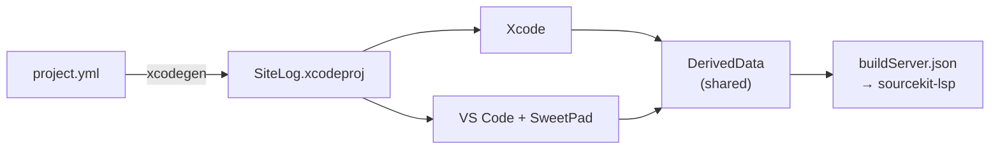

# Platform

- Everything around the features: dev tooling, diagnostics, testing, release pipeline,
  notifications and deep links, profiling.

## Contents

| Section | Topic |
|---|---|
| [Dev setup](#dev-setup) | Xcode + VS Code tooling: XcodeGen, SwiftLint, format on save, hot reload, snippets |
| [09](#09-diagnostics-and-observability) | Diagnostics — upload status, integrity and cleanup, bundle, logging |
| [Testing](#testing-strategy) | Test layers, rules, coverage |
| [17](#17-cicd-and-testflight) | CI/CD and TestFlight |
| [18](#18-push-notifications-and-deep-links) | Push notifications and deep links |
| [19](#19-performance-profiling-with-instruments) | Performance profiling with Instruments |

---

## Dev setup

- Tooling for working on SiteLog in Xcode and VS Code side by side.


1. [First-time setup](#1-first-time-setup)
2. [XcodeGen](#2-xcodegen)
3. [SwiftLint and swift-format](#3-swiftlint-and-swift-format)
4. [Format on save in Xcode](#4-format-on-save-in-xcode)
5. [Hot reload](#5-hot-reload)
6. [Code snippets](#6-code-snippets)
7. [VS Code](#7-vs-code)
8. [Rules for working in both editors](#8-rules-for-working-in-both-editors)
9. [Troubleshooting](#9-troubleshooting)



### 1. First-time setup

| Step | Action |
|---|---|
| 1 | Xcode with an iPhone simulator; `brew install xcodegen xcode-build-server swiftlint xcbeautify` |
| 2 | Optional, hot reload: [InjectionNext](https://github.com/johnno1962/InjectionNext/releases) in `/Applications` ([§5](#5-hot-reload)) |
| 3 | `xcodegen generate` |
| 4 | Open the repo root in VS Code; install the recommended extensions ([`.vscode/extensions.json`](../../.vscode/extensions.json)) |
| 5 | Build once (Xcode ⌘B or F5) → Command Palette → **SweetPad: Generate Build Server Config** → **Swift: Restart LSP Server** |
| 6 | Run and Debug → **Run SiteLog (simulator)** → F5 |

- Nothing in the committed `.vscode/` is tied to one Mac.
- `buildServer.json` and `.vscode/sitelog.local.json` are per machine and git-ignored.

### 2. XcodeGen

- Why: [D08](00-overview.md#d08--xcodegen-owns-the-xcode-project).
- `SiteLog.xcodeproj` is generated from [`project.yml`](../../project.yml); never edit the `.pbxproj` by hand.

| When | Action |
|---|---|
| After changing `project.yml` | `xcodegen` |
| After pulling a `project.yml` change | `xcodegen` |
| Adding files in Xcode | Nothing: `SiteLog/` is a synced folder |
| Adding or removing files in VS Code | Automatic: `sweetpad.xcodegen.autogenerate` is on |

- Close the project in Xcode before regenerating, or Xcode keeps the old one in memory.
- The generated `.xcodeproj` stays committed, so the repo opens without running XcodeGen first.

| `project.yml` owns | Key |
|---|---|
| Team, versions, Swift 6 concurrency flags | `settings.base` |
| Local `DesignSystem` package and remote ones (`Factory`, `Inject`, `swift-snapshot-testing`, later `Kingfisher`, `Firebase`) | `packages` |
| Which products each target links | `targets.<name>.dependencies` |
| App target, bundle id, iOS 18.6 | `targets.SiteLog` |
| SwiftLint build phase | `targets.SiteLog.postBuildScripts` |
| Hot reload flags, Debug only | `targets.SiteLog.settings.configs.Debug` |
| Shared `SiteLog` scheme, `INJECTION_PROJECT_ROOT` | `schemes.SiteLog` |

### 3. SwiftLint and swift-format

| Tool | Owns | Config |
|---|---|---|
| `swift-format` | Formatting: layout, line length, import order | [`.swift-format`](../../.swift-format) |
| SwiftLint | Correctness and style rules that don't fight the formatter | [`.swiftlint.yml`](../../.swiftlint.yml) |

**SwiftLint build phase** (`SiteLog` → Build Phases → **Run SwiftLint**, after Resources):

| Condition | Behavior |
|---|---|
| Apple Silicon | Prepends `/opt/homebrew/bin` to `PATH` |
| `swiftlint` found | Runs from the repo root; issues show as Xcode warnings |
| `swiftlint` missing | Build warning `brew install swiftlint`; build continues |
| `ENABLE_USER_SCRIPT_SANDBOXING = NO` (target only) | Lets SwiftLint read the repo; with sandboxing on: `Sandbox: swiftlint deny file-read-data` |

| `.swiftlint.yml` | Values |
|---|---|
| `excluded` | `.build`, `DerivedData`, `build` |
| `disabled_rules` | `trailing_whitespace`, `line_length`, `trailing_comma` (owned by `swift-format`) |
| `opt_in_rules` | `empty_count`, `explicit_init`, `redundant_type_annotation`, `unneeded_parentheses_in_closure_argument` |

| `.swift-format` key | Value | Why |
|---|---|---|
| `lineLength` | `100` | Shared limit; SwiftLint's `line_length` is off |
| `indentation.spaces` | `4` | Xcode default |
| `respectsExistingLineBreaks` | `true` | SwiftUI modifier chains stay multi-line |
| `lineBreakBeforeEachArgument` | `false` | Arguments stay on one line when they fit |
| `multiElementCollectionTrailingCommas` | `true` | Cleaner diffs |
| `OrderedImports` | on | Imports sorted |

- Run manually: `swiftlint`.
- Regenerate format defaults: `swift format dump-configuration > .swift-format`.

### 4. Format on save in Xcode

- A Hammerspoon ⌘S hotkey, active only while Xcode is frontmost: **Editor → Structure → Format File
  with ‘swift-format’**, then **File → Save** 0.25 s later.

| Step | Action |
|---|---|
| 1 | `brew install --cask hammerspoon`; grant Accessibility on first launch |
| 2 | `cp Tools/Hammerspoon/init.lua ~/.hammerspoon/init.lua` |
| 3 | Hammerspoon menu-bar icon → **Reload Config**; enable **Launch at Login** |
| 4 | Menu item name check: focus a `.swift` file, press **⌘⌥D**, open Hammerspoon **Console**, copy the `Format File with ‘swift-format’` string; if it differs from [`Tools/Hammerspoon/init.lua`](../../Tools/Hammerspoon/init.lua), paste it into `selectMenuItem` |

| Global in `init.lua` | Role |
|---|---|
| `xcodeSave` | ⌘S: format, then save |
| `xcodeDebug` | ⌘⌥D: prints every **Editor → Structure** item to the Console |
| `xcodeWatcher` | Enables `xcodeSave` only while Xcode is active |

| Symptom | Fix |
|---|---|
| ⌘S does nothing after reloading config | Xcode was already frontmost; switch away and back |
| `selectMenuItem` fails in the Console | Console is frontmost, not Xcode; test via the hotkey |
| Format item not found after an Xcode update | ⌘⌥D again; update the string (curly quotes U+2018/U+2019) |

### 5. Hot reload

- Save a `.swift` file → InjectionNext recompiles it → the running simulator app redraws, no rebuild.

| Step | Action |
|---|---|
| 1 | Download [InjectionNext](https://github.com/johnno1962/InjectionNext/releases) → `/Applications` → open (menu bar) |
| 2 | Menu bar icon → **...or Watch Project** → repo root. Quit InjectionIII if it runs |
| 3 | ⌘R once; then edit and save — the icon flashes on each injection |

| Project setting (done) | Value |
|---|---|
| `OTHER_LDFLAGS` (Debug) | `-Xlinker -interposable` |
| `EMIT_FRONTEND_COMMAND_LINES` (Debug) | `YES` |
| Scheme env `INJECTION_PROJECT_ROOT` | `$(SRCROOT)` |
| `Inject` package | 1.6.0 |

- Every view: `@ObserveInjection var inject` + `.enableInjection()` on the body.

| Symptom | Fix |
|---|---|
| `Could not connect … running standalone` | Open `InjectionNext.app`, ⌘R again |
| No hot reload from VS Code (F5) | Debug Console should show `🔥 Platform connected`; else see `.vscode/sitelog_sim.py` (`ensure_injection_next`) |
| Nothing changes on save | App built before InjectionNext watched; rebuild once |
| Change applies, view does not redraw | Missing `@ObserveInjection` or `.enableInjection()` |
| Stored property or new type changed | Not injectable; rebuild |

### 6. Code snippets

| Shortcut | Inserts | File |
|---|---|---|
| `view` | SwiftUI view with Inject hot reload | `<Screen>View.swift` |
| `viewvm` | `@Observable` view model (`State` enum, `onAppear()`) | `<Screen>ViewModel.swift` |

- VS Code: [`.vscode/swift.code-snippets`](../../.vscode/swift.code-snippets), in the repo.
- Xcode: user snippets live in `~/Library/Developer/Xcode/UserData/CodeSnippets/`, per machine.
  New machine: Library (⇧⌘L) → `{}` → select the code → right-click → **Create Code Snippet**,
  completion `view` / `viewvm`, availability Top Level.
- Use: new empty file → type the shortcut → Return → Tab between placeholders; ⌃⌘E renames all uses.

### 7. VS Code

| File | Purpose |
|---|---|
| [`.vscode/settings.json`](../../.vscode/settings.json) | swift-format on save, 100-column ruler, SweetPad scheme, `xcodegen` on file add/remove, Debug Console in expression mode |
| [`.vscode/launch.json`](../../.vscode/launch.json) | **Run SiteLog (simulator)** (CodeLLDB): build, run, Restart rebuilds, Stop kills the app |
| [`.vscode/sitelog_sim.py`](../../.vscode/sitelog_sim.py) | In LLDB: build, install, `simctl launch --wait-for-debugger`, attach by pid, stream app logs |
| [`.vscode/tasks.json`](../../.vscode/tasks.json) | `sitelog: build`: manual build with full output (F5 does not use it) |
| [`.vscode/swift.code-snippets`](../../.vscode/swift.code-snippets) | `view` / `viewvm` |

| Task | How |
|---|---|
| Run with debugger | **F5**; **Restart** = fresh build and launch; **⇧F5** kills the app |
| Run without debugger | SweetPad sidebar → **Build & Run** |
| App logs | **Debug Console**: every `AppLogger` line plus stdout/stderr |
| Debug Console input | Swift expression directly (`self.title`); LLDB commands with `/cmd ` (`/cmd bt`) |
| Hot reload | Save; F5 starts InjectionNext if needed; Console shows `🔥 Recompiling` → `✅ Hot reload complete` |
| New file | Create in the explorer; SweetPad runs `xcodegen` |

**Simulator choice (F5), in order:**

1. `SITELOG_SIMULATOR` env var, or `.vscode/sitelog.local.json`: `{ "simulator": "iPhone 17 Pro Max" }`.
2. A booted iPhone simulator, else the iPhone on the newest iOS (booted on demand).

**F5 opens the Debug Console at once** (optional, user keybindings — VS Code has no per-workspace
keybindings): Command Palette → **Preferences: Open Keyboard Shortcuts (JSON)**:

```jsonc
{
  "key": "f5",
  "command": "runCommands",
  "args": { "commands": ["workbench.debug.action.focusRepl", "workbench.action.debug.start"] },
  "when": "!inDebugMode"
}
```

### 8. Rules for working in both editors

| Rule | Why |
|---|---|
| Build in one editor at a time | Both write the same DerivedData; parallel builds lock its database |
| Config changes go through `project.yml` | `xcodegen` overwrites the Xcode UI |
| After `xcodegen`, let Xcode reload (**Revert**) | Reads the new `project.pbxproj` from disk |
| Previews, Instruments, signing: Xcode | No VS Code equivalent |
| Both editors format with `.swift-format` | Xcode via Hammerspoon ([§4](#4-format-on-save-in-xcode)) |

### 9. Troubleshooting

| Symptom | Fix |
|---|---|
| "No such module" / no completion in VS Code | Build once, regenerate build server config, restart LSP |
| New file not visible in Xcode | `xcodegen generate`, let Xcode reload |
| No app logs in the Debug Console | Check for `sitelog_launch failed`; logs come only from `AppLogger` (subsystem `app.dd.site.log`) |
| `Build failed` / `sitelog_launch failed` | Lines above say why (compiler error, unknown simulator name, install error) |
| `install timed out` | An older SiteLog is held by another debugger session; stop it, F5 |
| SweetPad picks the wrong scheme | `.vscode/settings.json` → `sweetpad.build.scheme` |
| Why not SweetPad's attach | Its Restart started the binary outside the simulator (`EXC_BREAKPOINT` in `BKSDisplayServicesStart`); pid-by-name raced the relaunch. `simctl` launch + attach by pid avoids both |

---

## 09. Diagnostics and observability

- Module: `SiteLog/Presentation/Diagnostics`

**Goal:** users answer "where are my photos?" themselves; one exported file is enough for a developer
to diagnose; cleanup can never delete anything not yet uploaded.

### 09.1 Upload status screen

```
Session 05 Sep — Ánh Dương Tower
████████████░░░░  187/243 files · 1.8 GB / 2.4 GB · ~6 min remaining
⚠ 4 waiting: Waiting for WiFi (3) · Waiting for a new upload link (1)
✕ 2 failed — [Retry]
```

- **Waiting is never red** — `waitingForNetwork` and `waitingForURL` are normal.
- Plain-language reasons, never enum names; "Will upload when the device is idle" when the OS holds
  tasks; estimates from the trailing `throughputWindow`.
- A closed realtime channel is not an error, only slower.

### 09.2 Integrity checks and cleanup

| Check | Detects |
|---|---|
| Record with no file / file with no record | Lost media / orphan from a crash |
| Recomputed hash ≠ `sha256` (originals only) | Corruption or substitution |
| Audit chain HMAC | Tampered log |
| Temp part with no job; `uploading` with no task | Garbage; stuck job → reset to `pending` |
| Derived image with no source | Stale stamped copy |

- Default: random sample of `integritySampleSize`; background "verify everything" on demand.

**Cleanup**

- **Only `synced` files are eligible**, even with a full disk.
- Numbers first: "Delete 156 uploaded files, freeing 1.4 GB. 12 not yet uploaded will be kept."
- Temp parts, prebuffer, tiles, derived images: a separate "reclaimable" line.
- Every cleanup writes an audit entry.

### 09.3 Diagnostic bundle and status flags

- `diagnostic-<date>.zip`: `device.json`, `permissions.json`, `upload-state.json` (no URLs),
  `integrity.json`, `logs.ndjson` (24 h).
- **Redact on write:** strip URLs, tokens, emails, user text, GPS; keep ids, enums, counters, status codes.

| Red flag | Condition |
|---|---|
| Permission | Camera, mic, location or Bluetooth denied |
| Disk | Free space below `minFreeDiskBytes` |
| Thermal | `.serious` or worse |
| Battery | Below `lowBatteryThreshold` with pending uploads |
| Network | Offline with pending jobs |
| Audit | Chain verification failed |
| Sync | Metadata sync older than `staleSyncThreshold` |

### 09.4 App-wide logging

- `os.Logger`, subsystem `app.dd.site.log`, category per module (`capture`, `upload`, `report`,
  `plans`, `devicelink`, `sync`, `security`).
- Every action logs with data, successes included; every `catch` logs `String(reflecting:)`; no
  `print` (CI greps for it).
- Firebase Crashlytics initializes first; non-fatals via `Crashlytics.crashlytics().record(error:)`
  with the same structured data ([D07](00-overview.md#d07--firebase-crashlytics)).

```swift
enum DiagnosticsConstants {
    static let throughputWindow: TimeInterval = 60
    static let integritySampleSize: Int = 50
    static let logRetentionHours: Int = 24
    static let staleSyncThreshold: TimeInterval = 86_400
    static let lowBatteryThreshold: Float = 0.20
}
```

**Done**

- All seven integrity conditions detected
- The bundle has no URL, token, email, text or coordinate
- Cleanup with 12 `pending` files deletes none of them

**Tests**

- Detectors on a fake filesystem
- Cleanup never touches `pending`/`failed`
- Redaction snapshot
- Estimates never `NaN` or negative
- Flags at 7 boundaries
- `uploading` without task resets

---

## Testing strategy

- Libraries and why: [D06](00-overview.md#d06--test-libraries).
- Per-feature test lists live in each spec's **Tests** block; this section sets the rules.

| Layer | Target | Tool | What |
|---|---|---|---|
| Domain | `SiteLogTests/Domain` | Swift Testing | Every use case and pure domain service; no device, no frameworks |
| Data | `SiteLogTests/Data` | Swift Testing | Mappers (DTO ↔ entity), repository impls over in-memory SwiftData |
| Data sources | `SiteLogTests/DataSources/<Name>` | Swift Testing | `UploadKit` state machine with `MockTransport`, `Realtime` decoding, `Reporting` layout |
| DesignSystem | `Packages/DesignSystem/Tests` | Swift Testing | Tokens (hex decoding); components via snapshots |
| Presentation | `SiteLogTests/Presentation` | Swift Testing + `FactoryTesting` | View models against fakes |
| Screens | `SiteLogTests/Snapshots` | swift-snapshot-testing | Each screen: light, dark, `accessibility3` Dynamic Type |
| Flows | `SiteLogUITests` | XCUITest | Smoke paths only: unlock → projects → capture → report |
| Backend | `Backend/test` | vitest | See [03-backend §12](03-backend.md#12-done-and-tests) |

**Rules**

1. Scoped: a change runs the tests of the folder it touched plus `Domain` (`-only-testing:`), not the full suite.
2. No real network, clock, camera or Bluetooth in unit tests; inject `AppClock`, `UploadTransport`,
   `CaptureSessionControlling`, `RandomNumberGenerator`.
3. Every Factory override happens inside `@Suite(.container)`, so tests never leak registrations.
4. A bug fix lands with the test that would have caught it.
5. Snapshot references are recorded on one pinned simulator (iPhone 17 Pro, iOS 26.4); re-record only
   in a commit that says why. First run records and fails; the second run passes.

| Coverage scope | Line coverage |
|---|---|
| `Domain` | ≥ 90% |
| `UploadKit`, sync engine | ≥ 85% |
| `Data` | ≥ 70% |
| View models | ≥ 70% |
| Views | Snapshot per screen, no line target |

- CI reports coverage per folder; a PR that lowers a target fails.
- Examples: `SiteLogTests/Access/PasscodeUnlockViewModelTests.swift` (view model + `FactoryTesting`),
  `SiteLogTests/Snapshots/DesignSystemSnapshotTests.swift` (snapshots) — full code in [F00 guide](../feature-guide/00-foundation.md).

---

## 17. CI/CD and TestFlight

- Modules: `fastlane/`, `.github/workflows/`

**Goal**

- Every PR proves lint, builds, unit and snapshot tests, coverage ([Testing](#testing-strategy)).
- A tag becomes a TestFlight build with no manual Xcode step.
- No certificates or keys stored in CI; App Store review submission stays manual.

| Lane | Does |
|---|---|
| `test` | `xcodegen`, `DesignSystem` package tests, app unit + snapshot tests on the simulator, coverage per folder |
| `beta` | Release archive, upload dSYMs to Crashlytics, upload to TestFlight without waiting |
| `release` | Same, waits for processing |

| Workflow | Trigger | Runs |
|---|---|---|
| PR checks | PR, push to `main` | `swiftlint --strict`, lane `test` |
| TestFlight | tag `v*`, manual | lane `beta`, in the protected `testflight` environment |

**Runners** — private repo, so hosted macOS minutes bill at 10× (≈200 per month).

| Runner | When | Jobs |
|---|---|---|
| Ubuntu (hosted) | Every push | `Domain` purity, Presentation imports, `UploadKit`/`Realtime` boundary, `print(` grep, `gitleaks`, SwiftLint; backend `vitest` + `tsc` + ESLint + migrations on a throwaway Postgres |
| Self-hosted dev Mac | Every PR | App build, zero warnings (`build-strict.sh`); lane `test` |
| Self-hosted dev Mac | Nightly | App without `Realtime`; full suite |
| Hosted macOS | Disabled | Fallback only |

- Self-hosting is safe only because the repo is private.

**Signing and versions**

- Xcode-managed signing: `-allowProvisioningUpdates` + App Store Connect API key (`ASC_KEY_ID`,
  `ASC_ISSUER_ID`, `ASC_KEY_CONTENT`, App Manager role), written to a temp file, deleted after the build.
- Build number = latest TestFlight + 1; `MARKETING_VERSION` in `project.yml`, bumped by hand.
- Release: `git tag v1.0.0 && git push origin v1.0.0`.

**Risks**

- Fork PRs never see secrets (environment-scoped)
- Tags serialize build numbers
- Pin the runner's Xcode on the first mismatch

**Done**

- A SwiftLint warning, a compiler warning or a failing test fails the PR
- Pushing `v0.0.1` produces a TestFlight build with no local step
- The repo holds no `.p8`, certificate or profile

---

## 18. Push notifications and deep links

- Modules: `SiteLog/Presentation/Notifications`, `SiteLog/Presentation/DeepLinks`

**Goal:** a notification tap or a `sitelog://` URL opens the exact session or issue through one
shared `DeepLink` type; a link during cold launch is not lost.

- Out: rich notifications, universal links, silent push as an upload trigger.

- Format `sitelog://<route>/<id>` (`session/42`, `issue/7`); wrong scheme, unknown route or missing
  id is ignored and logged. The parser is pure; ids are opaque data.
- Payload `{ "aps": { "alert": {…} }, "deepLink": "sitelog://issue/42" }` carries a destination only;
  state comes from the local store.
- Authorization is requested at a moment that makes sense, not blindly at first launch; the token is
  logged truncated, replaceable, and re-sent when it changes.
- Routing: `URL / push → parser → router (pending) → view consumes and navigates`. The router
  **holds** the destination until a view consumes it (cold launch), consuming clears it, and a deleted
  target lands on a safe screen.
- Setup: Push capability, `aps-environment`, `sitelog` URL scheme and `remote-notification`
  background mode in `project.yml`. Simulator: `xcrun simctl push booted app.dd.site.log
  payload.json`, `xcrun simctl openurl booted sitelog://session/42`.

**Risks**

- Crafted ids from other apps are data, re-checked at the destination
- Pushes for another account are ignored
- The app works fully with push denied

**Done**

- Links open from Safari and `simctl`
- A tap opens the target when killed, backgrounded or foregrounded
- Garbage is ignored without a crash

**Tests**

- Parser routes and rejections
- Payload with/without `deepLink`
- Router holds until consumed
- Cold-launch link survives (UI test)

---

## 19. Performance profiling with Instruments

- Tooling only; signposts live next to the code they measure.

**Goal:** know the real cost of the upload queue, the socket and capture before testers do; every
performance claim has a measurement behind it. Always a real device, Release build.

| Question | Template |
|---|---|
| Slow or janky | Time Profiler |
| Memory growth, retain cycles | Allocations, Leaks |
| A SwiftUI view re-renders too often | SwiftUI |
| Slow or duplicated requests | Network |
| Battery cost of socket / upload | Energy Log |
| Time inside our own code | os_signpost / Points of Interest |

- Signposts: subsystem `app.dd.site.log`; intervals `Connection`/`Message` (Realtime),
  `UploadPart`/`Reconcile` (Upload), `Capture`/`HashFile`/`Thumbnail` (Capture).
- Signpost metadata: sizes and counts only; they stay in Release.

| # | Scenario | Budget |
|---|---|---|
| 1 | Queue 243 files | Flat memory, no growth linear in file count |
| 2 | 30-minute upload | No "High" energy impact in the foreground |
| 3 | Socket open 10 minutes | `Message` in microseconds; no wake-ups beyond ping |
| 4 | Burst of 20 photos | No dropped frames |
| 5 | Session with 243 rows | No re-renders on unrelated updates |

- Profile before optimizing; justify a change with a before/after trace.
- Save traces for failed budgets; record device and OS with every result.
- Scenarios run on device before each TestFlight build.
