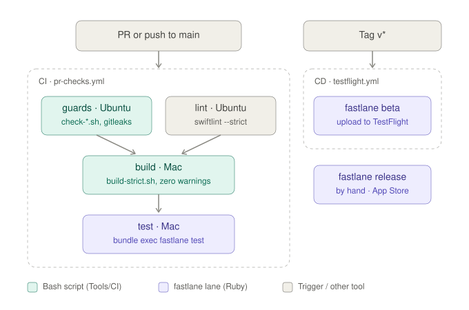

# F00 — Foundation

<dl><dd>

- F00 · 26h (8h done) · step-by-step guide with full, tested code.

</dd></dl>

## Contents

<dl><dd>

1. [Overview](#overview)
2. [Target structure](#target-structure)
3. [0. Entry point (done)](#0-entry-point-done)
4. [1. Layer packages, Factory DI, AppClock](#1-layer-packages-factory-di-appclock)
5. [2. Fastlane test lane, PR checks](#2-fastlane-test-lane-pr-checks)
6. [3. CI guards](#3-ci-guards)
7. [4. DesignSystem tests](#4-designsystem-tests)
8. [Feature done](#feature-done)

</dd></dl>

## Overview

<dl><dd>

- **Goal:** what every feature builds on — layer packages, DI, CI, DesignSystem.
- **Demo:** the app builds with zero warnings, CI is green, the DesignSystem gallery snapshot passes.
- **Specs:** [00-overview](../feature-docs/00-overview.md) (architecture, DI), [05-platform](../feature-docs/05-platform.md) (testing, CI).
- **Already done:** entry point and tooling; DesignSystem tokens and components (built with the UI skeleton, 2026-10-08).
- **Verified:** all code below builds with zero warnings and passes its tests on iPhone 17 Pro (iOS 26.4); `fastlane test` passes.
- **How to use:** per file, answer **Think** first, write the file, open **Hint 1 → 3** one at a time only when stuck, check against **Code**, then do **Try**.
- **File tags:** <b class="tag-new">New</b> create the file · <b class="tag-edit">Edit</b> change only the part shown · <b class="tag-replace">Replace</b> overwrite the whole file · <b class="tag-check">Check</b> already in the repo, compare only.

| Step | Layer | Hours | Status | What |
|---|---|---|---|---|
| 0 | Tooling | 8h | done | Xcode project, XcodeGen, SwiftLint, hot reload, entry point |
| [1](#1-layer-packages-factory-di-appclock) | Architecture | 6h | not start | Layer packages, Factory DI, `AppClock`, test libraries |
| [2](#2-fastlane-test-lane-pr-checks) | CI | 5h | not start | Fastlane `test` lane, GitHub Actions PR checks |
| [3](#3-ci-guards) | CI | 4h | not start | CI guards: no `print(`, layer rules, secret scan, strict build |
| [4](#4-designsystem-tests) | Tests | 3h | not start | Hex test, `DSGallery`, snapshot test |

- Order: step 1 first (every feature needs DI). F01 can start right after step 1; steps 2–4 any time.

</dd></dl>

## Target structure

<dl><dd>

```text
site-log-ios/
├── Gemfile                                   # 2
├── fastlane/Appfile, Fastfile                # 2
├── .github/workflows/pr-checks.yml           # 2 + 3
├── Tools/CI/                                 # 3: check-no-print, check-imports, build-strict
├── project.yml                               # 1: local packages, Factory, SnapshotTesting
├── Packages/
│   ├── Core/                                 # 1: Clock/ (AppClock, SystemClock), Logger/; Tests/CoreTests
│   ├── DomainLayer/                          # 1: empty layer folders, filled from F01
│   ├── DataLayer/                            # 1: empty layer folders + DataSources/Local, Remote
│   └── DesignSystem/                         # done: Tokens/, Components/; 4: DSGallery + tests
├── SiteLog/App/AppDependencies.swift         # 1 (clock) → F01 (access)
└── SiteLogTests/
    ├── SiteLogTests.swift                    # 1: FixedClock + Factory test
    └── Snapshots/DesignSystemSnapshotTests.swift  # 4
```

<details open>
<summary><strong>Adding files</strong></summary>
<dl><dd>

| Editor | New Swift file |
|---|---|
| Xcode | Right-click the folder → **New Empty File**; nothing else (`SiteLog/` is a synced folder) |
| VS Code | Explorer → right-click → **New File…**; nothing else (synced folder) |
| Packages | Files under `Packages/<Name>/Sources/<Name>/` are picked up by SwiftPM in both editors |

</dd></dl>
</details>

</dd></dl>

## 0. Entry point (done)

<dl><dd>

| # | Runs | File |
|---|---|---|
| 1 | iOS creates `SiteLogApp`; `@UIApplicationDelegateAdaptor` creates `AppDelegate` | `App/SiteLogApp.swift` |
| 2 | `didFinishLaunching` logs “App Launched” (Firebase goes first here in F12) | `App/AppDelegate.swift` |
| 3 | `RootView` shows `StartupView` while state is `.running` | `Presentation/Root/RootView.swift` |
| 4 | `StartupViewModel.onAppear()` runs `StartupSequence`, each step guarded and logged | `App/Startup/` |
| 5 | `.ready` → access flow (F01) → `MainTabView`; `.failed` → error + Try again | `Presentation/Access/Startup/` |

- Try the failure screen: pass `TestFailStartupStep()` in `RootView`’s `StartupSequence(steps:)`, run, then remove it.

</dd></dl>

## 1. Layer packages, Factory DI, AppClock

<dl><dd>

- **Goal:** `DomainLayer`, `DataLayer` and `Core` as local packages, one composition root (Factory), an injectable clock, test libraries ready.
- **Why packages:** [D09](../feature-docs/00-overview.md#d09--layers-as-local-swift-packages).
- **Why:** [D01](../feature-docs/00-overview.md#d01--factory-for-dependency-injection), [D06](../feature-docs/00-overview.md#d06--test-libraries).

<details open>
<summary><strong>1.1 project.yml — add libraries</strong></summary>
<dl><dd>

<b>File</b> · <b class="tag-edit">Edit</b> · `project.yml` → `packages:` *(add under `Inject`)*

<b>Explain</b> · Adds the four local packages (DesignSystem, Core, DomainLayer, DataLayer) and two libraries: Factory (DI) and swift-snapshot-testing.

<b>Think</b>

- Why list packages in `project.yml` instead of adding them with Xcode’s **Add Package** button?
- `from: 3.4.1` lets SPM pick which versions? Why not pin one exact version?

<details open>
<summary><b>Hint 1 · Idea</b></summary>

- Each package is a named entry: a local one points at a folder, a remote one at a git URL plus a version rule.

</details>

<details open>
<summary><b>Hint 2 · APIs</b></summary>

- Local: `path:`. Remote: `url:` + `from:`.
- The entry name (`Factory`) is what targets refer to later in `dependencies`.

</details>

<details open>
<summary><b>Hint 3 · Skeleton</b></summary>

```yaml
  DesignSystem:
    path: # folder of the local package
  Core:
    path:
  DomainLayer:
    path:
  DataLayer:
    path:
  Factory:
    url: # git URL
    from: # lowest version you accept
  SnapshotTesting:
    url:
    from:
```

</details>

<details>
<summary><b>Code</b></summary>

```yaml
  DesignSystem:
    path: Packages/DesignSystem
  Core:
    path: Packages/Core
  DomainLayer:
    path: Packages/DomainLayer
  DataLayer:
    path: Packages/DataLayer
  Factory:
    url: https://github.com/hmlongco/Factory
    from: 3.4.1
  SnapshotTesting:
    url: https://github.com/pointfreeco/swift-snapshot-testing
    from: 1.19.6
```

</details>

<b>Try</b>

- Misspell `Factory` as `Factroy` here only, run `xcodegen generate`, read the error: which part of `project.yml` does it point to? Fix it after.

---

<b>File</b> · <b class="tag-edit">Edit</b> · `project.yml` → `targets.SiteLog.dependencies` *(add at the end)*

<b>Explain</b> · Lets the app target use the four local packages and FactoryKit.

<b>Think</b>

- Factory ships two products, `FactoryKit` and `FactoryTesting`. Which one belongs in the app, which in the tests, and why?

<details open>
<summary><b>Hint 1 · Idea</b></summary>

- Link only what the app uses; test-only libraries never ship inside the app.

</details>

<details open>
<summary><b>Hint 2 · APIs</b></summary>

- `- package: <name>`; add `product:` when the product name differs from the package name.

</details>

<details>
<summary><b>Code</b></summary>

```yaml
      - package: DesignSystem
      - package: Core
      - package: DomainLayer
      - package: DataLayer
      - package: Factory
        product: FactoryKit
```

</details>

<b>Try</b>

- Remove the two `Factory` lines, `xcodegen generate`, build: which file fails first, with what message? Put them back.

---

<b>File</b> · <b class="tag-edit">Edit</b> · `project.yml` → `targets.SiteLogTests` *(replace its `dependencies` and `settings`)*

<b>Explain</b> · Lets the tests use the app, Core (for `AppClock`), FactoryTesting and SnapshotTesting.

<b>Think</b>

- `@testable import SiteLog` needs what from the test target?
- Why should tests use the same Swift version as the app?

<details open>
<summary><b>Hint 1 · Idea</b></summary>

- Tests link the app plus the test-only libraries, with the same Swift 6 rules as the app.

</details>

<details open>
<summary><b>Hint 2 · APIs</b></summary>

- `- target: SiteLog`, `- package: Core`, `- package: Factory` + `product: FactoryTesting`, `- package: SnapshotTesting`.
- `settings.base.SWIFT_VERSION`.

</details>

<details>
<summary><b>Code</b></summary>

```yaml
    dependencies:
      - target: SiteLog
      - package: Core
      - package: Factory
        product: FactoryTesting
      - package: SnapshotTesting
    settings:
      base:
        PRODUCT_BUNDLE_IDENTIFIER: app.dd.SiteLogTests
        SWIFT_VERSION: "6.0"          # was 5.0
```

</details>

<b>Try</b>

- Delete `- target: SiteLog`, regenerate, run ⌘U: read what the test target can no longer see. Put it back.

| Editor | Then |
|---|---|
| Xcode | Close the project → `xcodegen generate` in Terminal → reopen |
| VS Code | Save `project.yml`; run `xcodegen generate` in the terminal |

</dd></dl>
</details>

<details open>
<summary><strong>1.2 Layer packages</strong></summary>
<dl><dd>

- Each layer is a local Swift package in `Packages/` ([00-overview §4](../feature-docs/00-overview.md#4-architecture)); the app target keeps only `App/` and `Presentation/`.
- The package graph is the dependency rule: `DataLayer` → `DomainLayer` + `Core`; `DomainLayer` and `Core` depend on nothing.
- `Packages/DesignSystem/Sources/DesignSystem/DesignSystem.swift` (Xcode template): replace its content with `public enum DesignSystem {}` so the package still builds without `print`; delete it once the tokens exist (already done).

| Rule | Why |
|---|---|
| Types the app uses are `public`; structs also get a `public init` | Other modules see only `public`; a struct's memberwise init is never public |
| `import DomainLayer`, `import Core`, … where needed | Each package is its own module |
| No `nonisolated` in packages | Package code is nonisolated by default; only the app target defaults to `MainActor` |
| A package needs one `.swift` file to build | Until the first real type lands, a `Placeholder.swift` keeps it compiling |
| `.gitkeep` in package folders is fine | SwiftPM ignores hidden files |
| `Tools/CI/check-imports.sh` (step 3) still checks two rules | Domain imports Foundation only; Presentation never imports `DataLayer` |

<b>File</b> · <b class="tag-check">Check</b> · `Packages/DesignSystem/Package.swift`

<b>Explain</b> · Manifest of the DesignSystem package: one library and its test target.

<b>Think</b>

- In a package, what is the difference between a *target* and a *product*?
- Why can `DesignSystem` never import anything from the app?

<details open>
<summary><b>Hint 1 · Idea</b></summary>

- A target is code that compiles into a module; a product is what other code may import; a test target holds that module’s tests.

</details>

<details open>
<summary><b>Hint 2 · APIs</b></summary>

- `Package(name:platforms:products:targets:)`, `.library(name:targets:)`, `.target(name:swiftSettings:)`, `.testTarget(name:dependencies:)`.
- `.enableUpcomingFeature("ApproachableConcurrency")`.

</details>

<details open>
<summary><b>Hint 3 · Skeleton</b></summary>

```swift
// swift-tools-version: 6.4

import PackageDescription

let package = Package(
    name: "DesignSystem",
    platforms: [ /* iOS 18 */ ],
    products: [ /* one library */ ],
    targets: [
        // .target: the code
        // .testTarget: its tests
    ]
)
```

</details>

<details>
<summary><b>Code</b></summary>

```swift
// swift-tools-version: 6.4

import PackageDescription

let package = Package(
    name: "DesignSystem",
    platforms: [
        .iOS(.v18),
    ],
    products: [
        .library(
            name: "DesignSystem",
            targets: ["DesignSystem"]
        ),
    ],
    targets: [
        // Tokens and components only; knows nothing about Domain or features
        .target(
            name: "DesignSystem",
            swiftSettings: [
                .enableUpcomingFeature("ApproachableConcurrency"),
            ],
        ),
        .testTarget(
            name: "DesignSystemTests",
            dependencies: ["DesignSystem"],
            swiftSettings: [
                .enableUpcomingFeature("ApproachableConcurrency"),
            ],
        ),
    ]
)
```

</details>

<b>Try</b>

- Add `import FactoryKit` to any DesignSystem file and build. The app has Factory, so why does the package fail? Remove it after.

---

<b>File</b> · <b class="tag-new">New</b> · `Packages/Core/Package.swift`

<b>Explain</b> · Core package: app-wide helpers (clock, logger), with a test target. Depends on nothing.

<b>Think</b>

- Why may every layer except Domain use Core, while Core may use no layer?

<details open>
<summary><b>Hint 1 · Idea</b></summary>

- Same shape as DesignSystem: one library, one target, one test target.

</details>

<details>
<summary><b>Code</b></summary>

```swift
// swift-tools-version: 6.4

import PackageDescription

let package = Package(
    name: "Core",
    platforms: [
        .iOS(.v18)
    ],
    products: [
        .library(
            name: "Core",
            targets: ["Core"]
        )
    ],
    targets: [
        // App-wide helpers: logger, clock. Knows nothing about features
        .target(
            name: "Core",
            swiftSettings: [
                .enableUpcomingFeature("ApproachableConcurrency")
            ],
        ),
        .testTarget(
            name: "CoreTests",
            dependencies: ["Core"],
            swiftSettings: [
                .enableUpcomingFeature("ApproachableConcurrency")
            ],
        ),
    ]
)
```

</details>

<b>Try</b>

- In Xcode, pick the scheme **Core** and build it alone. Why is that faster than building the app?

---

<b>File</b> · <b class="tag-new">New</b> · `Packages/DomainLayer/Package.swift` + `Sources/DomainLayer/Placeholder.swift`

<b>Explain</b> · Domain package: entities, repository protocols, use cases. No dependencies; no test target until the first Domain test.

<b>Think</b>

- DomainLayer lists no dependencies. What does that stop the compiler from allowing?

<details open>
<summary><b>Hint 1 · Idea</b></summary>

- Like Core, minus the test target; folders `Entities/`, `UseCases/`, `Repositories/` with a `.gitkeep` each.

</details>

<details>
<summary><b>Code</b></summary>

```swift
// swift-tools-version: 6.4

import PackageDescription

let package = Package(
    name: "DomainLayer",
    platforms: [
        .iOS(.v18)
    ],
    products: [
        .library(
            name: "DomainLayer",
            targets: ["DomainLayer"]
        )
    ],
    targets: [
        // Entities, repository protocols, use cases. Foundation only
        .target(
            name: "DomainLayer",
            swiftSettings: [
                .enableUpcomingFeature("ApproachableConcurrency")
            ],
        ),
    ]
)
```

```swift
// Placeholder.swift
// A package needs one source file to build; delete this when the first DomainLayer type lands.
enum DomainLayerPlaceholder {}
```

</details>

<b>Try</b>

- Add `import Core` to `Placeholder.swift` and build the **DomainLayer** scheme: read the error. Remove it.

---

<b>File</b> · <b class="tag-new">New</b> · `Packages/DataLayer/Package.swift` + `Sources/DataLayer/Placeholder.swift`

<b>Explain</b> · DataLayer package: repositories, DTOs, mappers, fakes and `DataSources/Local`, `DataSources/Remote`. Uses Domain and Core.

<b>Think</b>

- Why `DataLayer` and not `Data`? (Hint: what does `Data` already mean in Foundation?)

<details open>
<summary><b>Hint 1 · Idea</b></summary>

- A local package can depend on other local packages by path.

</details>

<details open>
<summary><b>Hint 2 · APIs</b></summary>

- `dependencies: [.package(path: "../DomainLayer"), …]` at the package level; `dependencies: ["DomainLayer", "Core"]` on the target.

</details>

<details>
<summary><b>Code</b></summary>

```swift
// swift-tools-version: 6.4

import PackageDescription

let package = Package(
    name: "DataLayer",
    platforms: [
        .iOS(.v18)
    ],
    products: [
        .library(
            name: "DataLayer",
            targets: ["DataLayer"]
        )
    ],
    dependencies: [
        .package(path: "../DomainLayer"),
        .package(path: "../Core"),
    ],
    targets: [
        // Repositories, DTOs, mappers, fakes and data sources (Local, Remote)
        .target(
            name: "DataLayer",
            dependencies: ["DomainLayer", "Core"],
            swiftSettings: [
                .enableUpcomingFeature("ApproachableConcurrency")
            ],
        ),
    ]
)
```

```swift
// Placeholder.swift
// A package needs one source file to build; delete this when the first DataLayer type lands.
enum DataLayerPlaceholder {}
```

</details>

<b>Try</b>

- Add `.package(path: "../DataLayer")` to DomainLayer’s manifest and `"DataLayer"` to its target. Build: what does SwiftPM say about the cycle? Undo it.

</dd></dl>
</details>

<details open>
<summary><strong>1.3 AppClock</strong></summary>
<dl><dd>

<b>File</b> · <b class="tag-new">New</b> · `Packages/Core/Sources/Core/Clock/AppClock.swift`

<b>Explain</b> · The app’s clock as a protocol: `now` for timestamps, `uptime` for durations; tests swap in a fixed clock. In Core, not Domain: only Data, DataSources and Presentation need time.

<b>Think</b>

- If code calls `Date.now` directly, how would you write a test for “a log created at 8:00”?
- To measure “how long was the app away”, would `Date` work if the user changes the phone’s time?

<details open>
<summary><b>Hint 1 · Idea</b></summary>

- A protocol with two read-only properties: wall-clock time to save, monotonic time to measure. Callers depend on the protocol, never on a concrete clock.

</details>

<details open>
<summary><b>Hint 2 · APIs</b></summary>

- `public protocol`, `{ get }`, `Sendable`.
- `Date` for `now`, `ContinuousClock.Instant` for `uptime`.

</details>

<details open>
<summary><b>Hint 3 · Skeleton</b></summary>

```swift
import Foundation

public protocol AppClock: Sendable {
    var now: /* type */ { get }
    var uptime: /* type */ { get }
}
```

</details>

<details>
<summary><b>Code</b></summary>

```swift
import Foundation

// The app's clock, injected everywhere time matters, so tests can control time.
// Named AppClock so it does not clash with Swift's built-in `Clock` protocol.
public protocol AppClock: Sendable {
    // Wall-clock time: timestamps saved with records (createdAt, capturedAt)
    var now: Date { get }
    // Monotonic time: measuring durations; never jumps when the user changes the time
    var uptime: ContinuousClock.Instant { get }
}
```

</details>

<b>Try</b>

- Remove `Sendable`, build app and tests: does anything complain yet? Where would a non-`Sendable` clock become a problem? (Hint: the actor in F01.) Put it back.
- Swift already has a `Clock` protocol. Look it up in the docs: what would naming ours `Clock` hide?
- Remove `public` and build the app: read what `AppDependencies.swift` can no longer see. Put it back.

---

<b>File</b> · <b class="tag-new">New</b> · `Packages/Core/Sources/Core/Clock/SystemClock.swift`

<b>Explain</b> · The real `AppClock` used by the running app.

<b>Think</b>

- Why computed properties here, not stored `let`s?

<details open>
<summary><b>Hint 1 · Idea</b></summary>

- Every read asks the system for the current time.

</details>

<details open>
<summary><b>Hint 2 · APIs</b></summary>

- `public struct`, `public init() {}`, `public var`.
- `Date()`, `ContinuousClock.now`.

</details>

<details open>
<summary><b>Hint 3 · Skeleton</b></summary>

```swift
import Foundation

public struct SystemClock: AppClock {
    public init() {}

    public var now: Date { /* current wall-clock time */ }
    public var uptime: ContinuousClock.Instant { /* current monotonic time */ }
}
```

</details>

<details>
<summary><b>Code</b></summary>

```swift
import Foundation

// The real clock used by the running app.
public struct SystemClock: AppClock {
    // A struct's memberwise init is internal; other modules need this one
    public init() {}

    public var now: Date {
        return Date()
    }

    public var uptime: ContinuousClock.Instant {
        return ContinuousClock.now
    }
}
```

</details>

<b>Try</b>

- Change `now` to a stored `let now = Date()`. Read it twice, one second apart: what do you get, and which F01 feature would that break? Undo it.

---

<b>File</b> · <b class="tag-new">New</b> · `Packages/Core/Tests/CoreTests/SystemClockTests.swift`

<b>Explain</b> · Checks that `SystemClock.uptime` moves forward.

<b>Think</b>

- What one property of `uptime` is worth testing? Why not test `now == Date()`?

<details open>
<summary><b>Hint 1 · Idea</b></summary>

- Read, wait a little, read again, compare.

</details>

<details open>
<summary><b>Hint 2 · APIs</b></summary>

- `@Test func … async throws`, `try await Task.sleep(for: .milliseconds(10))`, `#expect`, `@testable import Core`.

</details>

<details open>
<summary><b>Hint 3 · Skeleton</b></summary>

```swift
import Foundation
import Testing
@testable import Core

struct SystemClockTests {
    @Test func uptimeMovesForward() async throws {
        // 1. read uptime
        // 2. sleep ~10 ms
        // 3. read again, #expect it grew
    }
}
```

</details>

<details>
<summary><b>Code</b></summary>

```swift
import Foundation
import Testing
@testable import Core

struct SystemClockTests {
    @Test func uptimeMovesForward() async throws {
        let clock = SystemClock()
        let first = clock.uptime

        try await Task.sleep(for: .milliseconds(10))

        let second = clock.uptime
        #expect(second > first)
    }
}
```

</details>

<b>Try</b>

- Flip `>` to `<`, run ⌘U, read how Swift Testing prints both values. Flip it back.

</dd></dl>
</details>

<details open>
<summary><strong>1.4 Composition root</strong></summary>
<dl><dd>

<b>File</b> · <b class="tag-replace">Replace</b> · `SiteLog/App/AppDependencies.swift` *(F00 version; F01 adds Access)*

<b>Explain</b> · Composition root: the one place that registers which implementation backs each protocol (Factory).

<b>Think</b>

- If every view model wrote `SystemClock()` itself, what would a test have to do to change the time?
- Why should a clock be `.singleton` but a use case not?

<details open>
<summary><b>Hint 1 · Idea</b></summary>

- One `Container` extension lists every dependency; each is a `Factory` that knows how to build the real thing.

</details>

<details open>
<summary><b>Hint 2 · APIs</b></summary>

- `import Core` and `import FactoryKit`, `extension Container`, `Factory<any AppClock>`, `self { … }`, `.singleton`.

</details>

<details open>
<summary><b>Hint 3 · Skeleton</b></summary>

```swift
import Core
import FactoryKit

extension Container {
    var clock: Factory</* protocol type */> {
        self { /* the real clock */ }./* scope */
    }
}
```

</details>

<details>
<summary><b>Code</b></summary>

```swift
import Core
import FactoryKit

// Composition root: the only place that knows which implementation backs each protocol.
// Data sources and stateful services are .singleton; use cases are created fresh (unscoped).
extension Container {
    // MARK: - Shared services

    var clock: Factory<any AppClock> {
        self { SystemClock() }.singleton
    }
}
```

</details>

<b>Try</b>

- Delete `.singleton`: does anything change for a `struct` clock? When would it matter? (Think of a class that holds state, like F01’s fake repository.)

</dd></dl>
</details>

<details open>
<summary><strong>1.5 First Factory test</strong></summary>
<dl><dd>

<b>File</b> · <b class="tag-replace">Replace</b> · `SiteLogTests/SiteLogTests.swift`

<b>Explain</b> · First Factory test: swaps the real clock for a fixed one.

<b>Think</b>

- Tests run in parallel. If two tests register different clocks on the same shared container, what goes wrong?

<details open>
<summary><b>Hint 1 · Idea</b></summary>

- A fake clock with fixed values; register it, resolve through the container like the app does, check you got the fake.

</details>

<details open>
<summary><b>Hint 2 · APIs</b></summary>

- `@Suite(.container)` from FactoryTesting.
- `Container.shared.clock.register { … }`, `Container.shared.clock()`, `Date(timeIntervalSince1970:)`.

</details>

<details open>
<summary><b>Hint 3 · Skeleton</b></summary>

```swift
import Core
import FactoryKit
import FactoryTesting
import Foundation
import Testing
@testable import SiteLog

struct FixedClock: AppClock {
    // two stored properties
}

@Suite(.container)
struct AppDependenciesTests {
    @Test func clockCanBeReplacedInTests() {
        // 1. pick a fixed date
        // 2. register a FixedClock on Container.shared.clock
        // 3. resolve the clock, #expect its now
    }
}
```

</details>

<details>
<summary><b>Code</b></summary>

```swift
import Core
import FactoryKit
import FactoryTesting
import Foundation
import Testing
@testable import SiteLog

// A clock that always returns the same time, so tests are repeatable
struct FixedClock: AppClock {
    let now: Date
    let uptime: ContinuousClock.Instant
}

// .container gives each test its own fresh Factory container
@Suite(.container)
struct AppDependenciesTests {
    @Test func clockCanBeReplacedInTests() {
        let fixedDate = Date(timeIntervalSince1970: 0)
        Container.shared.clock.register {
            FixedClock(now: fixedDate, uptime: ContinuousClock.now)
        }

        let clock = Container.shared.clock()

        #expect(clock.now == fixedDate)
    }
}
```

</details>

<b>Try</b>

- Remove `.container`, add a second test that registers a different date, run ⌘U several times: does it ever fail? Put `.container` back.

</dd></dl>
</details>

<details open>
<summary><strong>1.6 Check</strong></summary>
<dl><dd>

| Step | Expect |
|---|---|
| ⌘B (Xcode) or SweetPad Build | Zero warnings |
| ⌘U (scheme SiteLog) | `clockCanBeReplacedInTests` passes |
| ⌘U (scheme Core) | `uptimeMovesForward` passes |

</dd></dl>
</details>

</dd></dl>

## 2. Fastlane test lane, PR checks

<dl><dd>

- **Goal:** one command (`bundle exec fastlane test`) runs the `DesignSystem` package tests and the app tests; GitHub runs it on every PR.
- **Spec:** [05 §17](../feature-docs/05-platform.md#17-cicd-and-testflight).



<details open>
<summary><strong>2.1 Files</strong></summary>
<dl><dd>

<b>File</b> · <b class="tag-new">New</b> · `Gemfile`

<b>Explain</b> · Pins the fastlane version so `bundle exec fastlane` runs the same everywhere.

<b>Think</b>

- Your Mac has fastlane 2.238 and the CI Mac 2.230. A lane passes locally and fails on CI. How do you stop that?

<details open>
<summary><b>Hint 1 · Idea</b></summary>

- Say where gems come from and the one gem you need, with a version rule.

</details>

<details open>
<summary><b>Hint 2 · APIs</b></summary>

- `source "https://rubygems.org"`, `gem "fastlane", "~> 2.228"`.
- `~> 2.228` means ≥ 2.228 and < 3.0.

</details>

<details>
<summary><b>Code</b></summary>

```ruby
source "https://rubygems.org"

# Pinned so every Mac and the CI runner run the same Fastlane
gem "fastlane", "~> 2.228"
```

</details>

<b>Try</b>

- Run `bundle exec fastlane --version` and `fastlane --version`. Same version? Why can they differ?

---

<b>File</b> · <b class="tag-new">New</b> · `fastlane/Appfile`

<b>Explain</b> · App bundle id for fastlane.

<b>Think</b>

- Which fastlane actions need the app’s bundle id? (Look ahead: TestFlight upload in F04.)

<details open>
<summary><b>Hint 1 · Idea</b></summary>

- One line of config shared by every lane.

</details>

<details open>
<summary><b>Hint 2 · APIs</b></summary>

- `app_identifier("…")`.
- The bundle id is in `project.yml` → `PRODUCT_BUNDLE_IDENTIFIER`.

</details>

<details>
<summary><b>Code</b></summary>

```ruby
# Bundle id of the app; signing comes from the App Store Connect API key (F04)
app_identifier("app.dd.site.log")
```

</details>

<b>Try</b>

- Find the bundle id in `project.yml` yourself instead of copying it from **Code**.

---

<b>File</b> · <b class="tag-new">New</b> · `fastlane/Fastfile`

<b>Explain</b> · fastlane lanes; `test` runs the unit and snapshot tests exactly like CI.

<b>Think</b>

- Why test the `DesignSystem` package on its own instead of only through the app?
- Snapshot tests compare pixels. Why pin one simulator name and OS?

<details open>
<summary><b>Hint 1 · Idea</b></summary>

- Constants for the simulator, the packages and the paths; one lane `test` in three steps: generate the project → test each package → test the app.

</details>

<details open>
<summary><b>Hint 2 · APIs</b></summary>

- `default_platform(:ios)`, `platform :ios do … end`, `lane :test do … end`, `sh("…")`.
- `run_tests(project:, scheme:, device:, only_testing:, derived_data_path:, code_coverage:, output_directory:)`.
- `File.expand_path("..", __dir__)`, `File.join`.

</details>

<details open>
<summary><b>Hint 3 · Skeleton</b></summary>

```ruby
default_platform(:ios)

SIMULATOR_NAME = "..."
SIMULATOR_OS = "..."
DESTINATION = "platform=iOS Simulator,name=#{SIMULATOR_NAME},OS=#{SIMULATOR_OS}"
PACKAGES = [...]
ROOT = File.expand_path("..", __dir__)
DERIVED_DATA = File.join(ROOT, "build", "DerivedData")

platform :ios do
  lane :test do
    # 1. xcodegen generate (sh)
    # 2. each package: xcodebuild test (sh)
    # 3. run_tests for SiteLogTests
  end
end
```

</details>

<details>
<summary><b>Code</b></summary>

```ruby
# Lanes for SiteLog. Run from the repo root: bundle exec fastlane <lane>
# Spec: docs/feature-docs/05-platform.md, section 17.

default_platform(:ios)

# One pinned simulator, so snapshot tests compare the same pixels everywhere
SIMULATOR_NAME = "iPhone 17 Pro"
SIMULATOR_OS = "26.4"
DESTINATION = "platform=iOS Simulator,name=#{SIMULATOR_NAME},OS=#{SIMULATOR_OS}"

# Local packages with a test target, tested one by one so a package never leans on the app
PACKAGES = ["DesignSystem", "Core"]

# Fastlane runs inside fastlane/, so the repo root is one level up
ROOT = File.expand_path("..", __dir__)

# Build output stays in build/ (git-ignored and excluded from SwiftLint)
DERIVED_DATA = File.join(ROOT, "build", "DerivedData")

platform :ios do
  desc "Generate the project, test every package, then test the app"
  lane :test do
    # 1. The .xcodeproj must match project.yml
    sh("cd '#{ROOT}' && xcodegen generate")

    # 2. Each package on its own, with code coverage
    PACKAGES.each do |package|
      package_dir = File.join(ROOT, "Packages", package)
      sh(
        "cd '#{package_dir}' && " \
        "xcodebuild test -scheme #{package} -destination '#{DESTINATION}' " \
        "-derivedDataPath '#{DERIVED_DATA}' -enableCodeCoverage YES -quiet"
      )
    end

    # 3. App unit + snapshot tests (UI tests run nightly, not per PR)
    run_tests(
      project: File.join(ROOT, "SiteLog.xcodeproj"),
      scheme: "SiteLog",
      device: "#{SIMULATOR_NAME} (#{SIMULATOR_OS})",
      only_testing: ["SiteLogTests"],
      derived_data_path: DERIVED_DATA,
      code_coverage: true,
      output_directory: File.join(ROOT, "build", "test-output")
    )
  end
end
```

</details>

<b>Try</b>

- Set `SIMULATOR_OS` to a version you do not have, run the lane, read where it fails. Undo it.
- Why `ROOT` and not the current folder? Run the lane from the repo root and from inside `fastlane/`.

---

<b>File</b> · <b class="tag-edit">Edit</b> · `.swiftlint.yml` → `excluded:` *(add one line)*

<b>Explain</b> · Keeps SwiftLint out of Fastlane’s build output.

<b>Think</b>

- SwiftLint checks every `.swift` file under the repo. Which `.swift` files end up inside `build/` after a fastlane run?

<details open>
<summary><b>Hint 1 · Idea</b></summary>

- Tell SwiftLint to skip the build output folder.

</details>

<details open>
<summary><b>Hint 2 · APIs</b></summary>

- One more item under `excluded:`.

</details>

<details>
<summary><b>Code</b></summary>

```yaml
  - build      # Fastlane writes DerivedData here
```

</details>

<b>Try</b>

- Open `build/DerivedData/SourcePackages/checkouts/`: whose code is there, and why would linting it fail the build?

</dd></dl>
</details>

<details open>
<summary><strong>2.2 Workflow (lint + test)</strong></summary>
<dl><dd>

<b>File</b> · <b class="tag-new">New</b> · `.github/workflows/pr-checks.yml` *(step 2 version)*

<b>Explain</b> · GitHub Actions workflow run on every pull request: lint and tests.

<b>Think</b>

- Why run lint on Ubuntu but the tests on your Mac?
- Five pushes arrive in one minute. Without `concurrency`, what happens to your Mac?

<details open>
<summary><b>Hint 1 · Idea</b></summary>

- Triggers (`on`), one concurrency group per branch, two jobs: `lint`, then `test`.

</details>

<details open>
<summary><b>Hint 2 · APIs</b></summary>

- `on: pull_request` / `push: branches:`, `concurrency: group: / cancel-in-progress:`.
- `jobs.<id>.runs-on`, `container:`, `needs:`, `steps:` with `uses:` / `run:`, `actions/checkout@v4`.

</details>

<details open>
<summary><b>Hint 3 · Skeleton</b></summary>

```yaml
name: PR checks

on:
  # PRs, and pushes to main

concurrency:
  # one group per branch, cancel older runs

jobs:
  lint:
    runs-on: # Ubuntu
    container: # SwiftLint image
    steps:
      # checkout, swiftlint --strict
  test:
    runs-on: # your Mac
    needs: # lint
    steps:
      # checkout, bundle install, bundle exec fastlane test
```

</details>

<details>
<summary><b>Code</b></summary>

```yaml
# Runs on every PR and every push to main. Spec: docs/feature-docs/05-platform.md §17.
name: PR checks

on:
  pull_request:
  push:
    branches: [main]

# A newer push to the same branch cancels the older run
concurrency:
  group: pr-checks-${{ github.ref }}
  cancel-in-progress: true

jobs:
  lint:
    runs-on: ubuntu-latest
    container: ghcr.io/realm/swiftlint:0.65.1
    steps:
      - uses: actions/checkout@v4
      - name: SwiftLint (warnings fail)
        run: swiftlint --strict

  # Builds and tests on the self-hosted development Mac
  test:
    runs-on: [self-hosted, macOS]
    needs: [lint]
    steps:
      - uses: actions/checkout@v4
      - name: Install gems
        run: bundle install
      - name: Fastlane test
        run: bundle exec fastlane test
```

</details>

<b>Try</b>

- Push a branch with one SwiftLint warning: which job fails, and does `test` run at all?

</dd></dl>
</details>

<details open>
<summary><strong>2.3 Self-hosted runner (your Mac, once)</strong></summary>
<dl><dd>

| Step | Action |
|---|---|
| 1 | GitHub repo → **Settings → Actions → Runners → New self-hosted runner** → macOS, ARM64 |
| 2 | Run the shown `config.sh` command in a folder outside the repo; keep the default labels (`self-hosted`, `macOS`) |
| 3 | Start it: `./run.sh` (or `./svc.sh install && ./svc.sh start` to run at login) |
| 4 | Private repo only: a public repo would run strangers’ PR code on your Mac |

</dd></dl>
</details>

<details open>
<summary><strong>2.4 Check</strong></summary>
<dl><dd>

| Step | Expect |
|---|---|
| `bundle install` then `bundle exec fastlane test` | “Test Succeeded”, “fastlane.tools finished successfully” |
| Open a PR | **lint** and **test** jobs green |

</dd></dl>
</details>

</dd></dl>

## 3. CI guards

<dl><dd>

- **Goal:** rules that reviews forget are checked by machine: no `print(`, layer rules, secrets, the app builds with warnings as errors.
- Make each script executable once: `chmod +x Tools/CI/*.sh`.

<b>File</b> · <b class="tag-new">New</b> · `Tools/CI/check-no-print.sh`

<b>Explain</b> · Fails CI when app code uses `print(`; logging goes through `AppLogger`.

<b>Think</b>

- Why is `print(` banned but `AppLogger` allowed? Where does each one end up on a user’s phone?
- The pattern skips `.print(` and `myprint(`. Why?

<details open>
<summary><b>Hint 1 · Idea</b></summary>

- Search, list the matches, fail if there are any.

</details>

<details open>
<summary><b>Hint 2 · APIs</b></summary>

- `set -euo pipefail`, `grep -rnE '…' --include='*.swift' --exclude-dir='.build'`, `|| true`, `[ -n "$matches" ]`, `exit 1`.

</details>

<details open>
<summary><b>Hint 3 · Skeleton</b></summary>

```bash
#!/usr/bin/env bash
set -euo pipefail

matches=$(grep ... || true)   # why || true?

if [ -n "$matches" ]; then
  # explain, list, fail
fi

echo "OK: no print( calls"
```

</details>

<details>
<summary><b>Code</b></summary>

```bash
#!/usr/bin/env bash
# Fails when any Swift file in the app or packages calls print(.
# Rule: log with AppLogger (os.Logger), never print.
set -euo pipefail

# grep exits 1 when nothing matches, which is the good case here
matches=$(grep -rnE '(^|[^A-Za-z_.])print\(' SiteLog SiteLogTests Packages --include='*.swift' --exclude-dir='.build' || true)

if [ -n "$matches" ]; then
  echo "print( is not allowed, use AppLogger instead:"
  echo "$matches"
  exit 1
fi

echo "OK: no print( calls"
```

</details>

<b>Try</b>

- Delete `|| true` and run it on a clean repo: why does it now fail with no output? Put it back.

---

<b>File</b> · <b class="tag-new">New</b> · `Tools/CI/check-imports.sh`

<b>Explain</b> · Fails CI on the two layer rules the package graph cannot enforce: Domain imports Foundation only; Presentation never imports `DataLayer`.

<b>Think</b>

- DomainLayer has no package dependencies, so it cannot `import Core`. Why can it still `import UIKit`?
- The app links `DataLayer` so `App/AppDependencies.swift` can register it. What stops a view in the same target from importing it too?

<details open>
<summary><b>Hint 1 · Idea</b></summary>

- Three rules, each one search → report; a `failed` flag so every rule runs before the script exits.

</details>

<details open>
<summary><b>Hint 2 · APIs</b></summary>

- `grep -rhE '^[[:space:]]*import '`, `sed -E 's/^[[:space:]]*//'`, `sort -u`, `grep -vE '^import Foundation$'`.
- `grep -rnE '^[[:space:]]*(@testable[[:space:]]+)?import DataLayer$'`.

</details>

<details open>
<summary><b>Hint 3 · Skeleton</b></summary>

```bash
#!/usr/bin/env bash
set -euo pipefail
failed=0

# Rule 1: every import in Packages/DomainLayer/Sources is "import Foundation"
# Rule 2: nothing in SiteLog/Presentation imports DataLayer
# Rule 3: Presentation never imports SwiftData/CoreData, never uses ModelContext/URLSession

if [ "$failed" -ne 0 ]; then
  exit 1
fi
echo "OK: layer rules"
```

</details>

<details>
<summary><b>Code</b></summary>

```bash
#!/usr/bin/env bash
# Enforces the layer rules in docs/feature-docs/00-overview.md §4.2.
# Package dependencies already stop Domain and Core from using other layers; these rules cover the rest.
set -euo pipefail

failed=0

# Rule 1: Domain imports Foundation only (a package may still import any Apple framework)
domain_imports=$(grep -rhE '^[[:space:]]*import ' Packages/DomainLayer/Sources --include='*.swift' | sed -E 's/^[[:space:]]*//' | sort -u | grep -vE '^import Foundation$' || true)
if [ -n "$domain_imports" ]; then
  echo "Domain may import Foundation only. Found:"
  echo "$domain_imports"
  failed=1
fi

# Rule 2: Presentation never imports DataLayer (the app links it only for App/AppDependencies.swift)
data_imports=$(grep -rnE '^[[:space:]]*(@testable[[:space:]]+)?import DataLayer$' SiteLog/Presentation --include='*.swift' || true)
if [ -n "$data_imports" ]; then
  echo "Presentation may not import DataLayer; use Domain use cases. Found:"
  echo "$data_imports"
  failed=1
fi

# Rule 3: Presentation never touches storage or the network directly
direct_access=$(grep -rnE '^[[:space:]]*import (SwiftData|CoreData)$|ModelContext|URLSession' SiteLog/Presentation --include='*.swift' || true)
if [ -n "$direct_access" ]; then
  echo "Presentation may not use SwiftData, ModelContext or URLSession. Found:"
  echo "$direct_access"
  failed=1
fi

if [ "$failed" -ne 0 ]; then
  exit 1
fi

echo "OK: layer rules"
```

</details>

<b>Try</b>

- Add `import DataLayer` to any view, run the script, read the output. Remove it.

---

<b>File</b> · <b class="tag-new">New</b> · `Tools/CI/build-strict.sh`

<b>Explain</b> · Builds the app with warnings treated as errors.

<b>Think</b>

- Why not just turn on `SWIFT_TREAT_WARNINGS_AS_ERRORS`? (The first comment in **Code** answers it.)
- Why `clean build` and not `build`?

<details open>
<summary><b>Hint 1 · Idea</b></summary>

- Generate → clean build into a log → grep warnings from our own files → fail if any.

</details>

<details open>
<summary><b>Hint 2 · APIs</b></summary>

- `xcodebuild clean build -project … -scheme … -destination … -derivedDataPath … -quiet > "$log" 2>&1`.
- `grep -E '/(SiteLog|Packages)/[^:]+:[0-9]+:[0-9]+: warning: '`, `sort -u`.

</details>

<details open>
<summary><b>Hint 3 · Skeleton</b></summary>

```bash
#!/usr/bin/env bash
set -euo pipefail

destination="..."
derived_data="$(pwd)/build/DerivedData-strict"
log="$(pwd)/build/strict-build.log"
mkdir -p build

# 1. xcodegen generate
# 2. xcodebuild clean build ... > "$log" 2>&1
# 3. warnings=$(grep ... "$log" | sort -u || true)
# 4. not empty → list them, exit 1
```

</details>

<details>
<summary><b>Code</b></summary>

```bash
#!/usr/bin/env bash
# Builds the app from clean and fails on any warning in our own code.
# Not SWIFT_TREAT_WARNINGS_AS_ERRORS: it clashes with the settings of remote packages.
set -euo pipefail

destination="platform=iOS Simulator,name=iPhone 17 Pro,OS=26.4"
derived_data="$(pwd)/build/DerivedData-strict"
log="$(pwd)/build/strict-build.log"
mkdir -p build

# The .xcodeproj must match project.yml
xcodegen generate

# clean: an incremental build would not repeat warnings from unchanged files
xcodebuild clean build -project SiteLog.xcodeproj -scheme SiteLog -destination "$destination" \
  -derivedDataPath "$derived_data" -quiet > "$log" 2>&1

# Warnings (compiler + SwiftLint) in our files only (SiteLog/, Packages/), each listed once
warnings=$(grep -E '/(SiteLog|Packages)/[^:]+:[0-9]+:[0-9]+: warning: ' "$log" | sort -u || true)
if [ -n "$warnings" ]; then
  echo "Warnings are not allowed:"
  echo "$warnings"
  exit 1
fi

echo "OK: the app builds with zero warnings"
```

</details>

<b>Try</b>

- Add `let unused = 1` inside any function, run the script, read the output. Remove it.

---

<b>File</b> · <b class="tag-replace">Replace</b> · `.github/workflows/pr-checks.yml` *(final: adds guards + build jobs)*

<b>Explain</b> · Final workflow: adds the guards job and the strict build before the tests.

<b>Think</b>

- Which jobs are cheap and which are slow? In what order do they fail fastest?
- Why does gitleaks need `fetch-depth: 0`?

<details open>
<summary><b>Hint 1 · Idea</b></summary>

- Two cheap Ubuntu jobs in parallel → strict build on the Mac → tests on the Mac.

</details>

<details open>
<summary><b>Hint 2 · APIs</b></summary>

- `needs: [guards, lint]`, `with: fetch-depth: 0`, `uses: gitleaks/gitleaks-action@v2` with `GITHUB_TOKEN`.

</details>

<details open>
<summary><b>Hint 3 · Skeleton</b></summary>

```yaml
jobs:
  guards:   # Ubuntu: checkout (full history), 2 scripts, gitleaks
  lint:     # Ubuntu: swiftlint --strict
  build:    # Mac, needs guards + lint: build-strict.sh
  test:     # Mac, needs build: bundle install, fastlane test
```

</details>

<details>
<summary><b>Code</b></summary>

```yaml
# Runs on every PR and every push to main. Spec: docs/feature-docs/05-platform.md §17.
name: PR checks

on:
  pull_request:
  push:
    branches: [main]

# A newer push to the same branch cancels the older run
concurrency:
  group: pr-checks-${{ github.ref }}
  cancel-in-progress: true

jobs:
  # Cheap checks on a hosted Linux runner
  guards:
    runs-on: ubuntu-latest
    steps:
      - uses: actions/checkout@v4
        with:
          fetch-depth: 0   # gitleaks scans the whole history
      - name: No print(
        run: Tools/CI/check-no-print.sh
      - name: Layer imports
        run: Tools/CI/check-imports.sh
      - name: Secret scan
        uses: gitleaks/gitleaks-action@v2
        env:
          GITHUB_TOKEN: ${{ secrets.GITHUB_TOKEN }}

  lint:
    runs-on: ubuntu-latest
    container: ghcr.io/realm/swiftlint:0.65.1
    steps:
      - uses: actions/checkout@v4
      - name: SwiftLint (warnings fail)
        run: swiftlint --strict

  # Builds and tests on the self-hosted development Mac
  build:
    runs-on: [self-hosted, macOS]
    needs: [guards, lint]
    steps:
      - uses: actions/checkout@v4
      - name: App builds, warnings as errors
        run: Tools/CI/build-strict.sh

  test:
    runs-on: [self-hosted, macOS]
    needs: [build]
    steps:
      - uses: actions/checkout@v4
      - name: Install gems
        run: bundle install
      - name: Fastlane test
        run: bundle exec fastlane test
```

</details>

<b>Try</b>

- Draw the job graph from the `needs:` lines yourself, then compare it with the diagram at the top of step 2.

<details open>
<summary><strong>3.1 Check</strong></summary>
<dl><dd>

| Step | Expect |
|---|---|
| Run each script from the repo root | `OK: …` |
| Add `print("x")` to any Swift file, run `check-no-print.sh` | Exit 1 with the file and line; then remove it |
| Add `import UIKit` to `Packages/DomainLayer/Sources/DomainLayer/Placeholder.swift`, run `check-imports.sh` | Exit 1; then remove it |
| Add `import DataLayer` to any view, run `check-imports.sh` | Exit 1; then remove it |
| Add `import Core` to DomainLayer’s `Placeholder.swift`, build | Compiler error: DomainLayer does not depend on Core; then remove it |

</dd></dl>
</details>

</dd></dl>

## 4. DesignSystem tests

<dl><dd>

- Tokens and components are already in `Packages/DesignSystem` (built with the UI skeleton).
- The feature is done, so its tests come now.

<b>File</b> · <b class="tag-replace">Replace</b> · `Packages/DesignSystem/Tests/DesignSystemTests/DesignSystemTests.swift`

<b>Explain</b> · Unit test for the hex colour helper behind `DSColor`.

<b>Think</b>

- `UIColor(hex:)` is `internal`. How can a test in another module call it?
- Why compare with `CGFloat(0xD4) / 255` instead of `0.83`?

<details open>
<summary><b>Hint 1 · Idea</b></summary>

- Build a colour from hex, read its RGB back, compare each part.

</details>

<details open>
<summary><b>Hint 2 · APIs</b></summary>

- `@testable import DesignSystem`, `getRed(_:green:blue:alpha:)` with `&` (inout), `#expect`.

</details>

<details open>
<summary><b>Hint 3 · Skeleton</b></summary>

```swift
import Testing
import UIKit
@testable import DesignSystem

struct DesignSystemTests {
    @Test func hexColourIsDecoded() {
        // 1. UIColor(hex: 0xFFD400)
        // 2. four CGFloat vars, getRed(&...)
        // 3. #expect red, green, blue
    }
}
```

</details>

<details>
<summary><b>Code</b></summary>

```swift
import Testing
import UIKit
@testable import DesignSystem

struct DesignSystemTests {
    @Test func hexColourIsDecoded() {
        let color = UIColor(hex: 0xFFD400)

        var red: CGFloat = 0
        var green: CGFloat = 0
        var blue: CGFloat = 0
        var alpha: CGFloat = 0
        color.getRed(&red, green: &green, blue: &blue, alpha: &alpha)

        #expect(red == 1)
        #expect(green == CGFloat(0xD4) / 255)
        #expect(blue == 0)
    }
}
```

</details>

<b>Try</b>

- Replace `CGFloat(0xD4) / 255` with `0.83`: does it pass? What does that say about comparing decimals?

---

<b>File</b> · <b class="tag-new">New</b> · `Packages/DesignSystem/Sources/DesignSystem/Components/DSGallery.swift`

<b>Explain</b> · Every DesignSystem component on one screen, for previews and the snapshot test.

<b>Think</b>

- Why one screen with every component instead of one snapshot per component?
- Why must it be `public`, with a `public init`?

<details open>
<summary><b>Hint 1 · Idea</b></summary>

- A vertical stack with one example of each component group, on the canvas colour, plus Light and Dark previews.

</details>

<details open>
<summary><b>Hint 2 · APIs</b></summary>

- `public struct … : View`, `public init() {}`, `DSSpacing`, `DSColor.canvas.ignoresSafeArea()`.
- `.buttonStyle(.ds(.primary))`, `#Preview("Dark") { … .preferredColorScheme(.dark) }`.

</details>

<details open>
<summary><b>Hint 3 · Skeleton</b></summary>

```swift
import SwiftUI

public struct DSGallery: View {
    public init() {}

    public var body: some View {
        VStack(alignment: .leading, spacing: DSSpacing.regular) {
            // section header
            // two list rows
            // chips + count badge
            // one status marker per kind
            // the five button styles
            // empty state
        }
        // fill the screen with DSColor.canvas
    }
}

// #Preview Light and Dark
```

</details>

<details>
<summary><b>Code</b></summary>

```swift
import SwiftUI

// Every component on one screen: used by previews and by the snapshot test.
public struct DSGallery: View {
    public init() {}

    public var body: some View {
        VStack(alignment: .leading, spacing: DSSpacing.regular) {
            DSSectionHeader(title: "Level 7", trailing: "3 open")

            VStack(spacing: 0) {
                DSListRow(title: "Riverside Tower B", subtitle: "District 7 · 14 open issues", showsChevron: true)
                DSListRow(title: "Lock after", value: "5 minutes", showsChevron: true)
            }

            HStack(spacing: DSSpacing.small) {
                DSChip(title: "All", isSelected: true, action: {})
                DSChip(title: "Has issues", isSelected: false, action: {})
                DSCountBadge(count: 2)
            }
            .padding(.horizontal, DSSpacing.regular)

            HStack(spacing: DSSpacing.regular) {
                ForEach(DSStatusMarker.Kind.allCases, id: \.self) { kind in
                    DSStatusMarker(kind: kind, text: String(describing: kind).capitalized)
                }
            }
            .padding(.horizontal, DSSpacing.regular)

            VStack(spacing: DSSpacing.small) {
                Button("Primary") {}
                    .buttonStyle(.ds(.primary))
                Button("Capture") {}
                    .buttonStyle(.ds(.hiVis))
                Button("Secondary") {}
                    .buttonStyle(.ds(.secondary))
                Button("Ghost") {}
                    .buttonStyle(.ds(.ghost))
                Button("Danger") {}
                    .buttonStyle(.ds(.danger))
            }
            .padding(.horizontal, DSSpacing.regular)

            DSEmptyState(systemImage: "folder", title: "No projects yet", message: "Create a project to start.")
                .frame(maxWidth: .infinity)
        }
        .padding(.vertical, DSSpacing.regular)
        // Fill the whole screen, including behind the status bar
        .frame(maxWidth: .infinity, maxHeight: .infinity, alignment: .top)
        .background(DSColor.canvas.ignoresSafeArea())
    }
}

#Preview("Light") {
    DSGallery()
}

#Preview("Dark") {
    DSGallery()
        .preferredColorScheme(.dark)
}
```

</details>

<b>Try</b>

- Delete `public init() {}` and use `DSGallery()` from the app target: read the error, then put it back.

---

<b>File</b> · <b class="tag-new">New</b> · `SiteLogTests/Snapshots/DesignSystemSnapshotTests.swift`

<b>Explain</b> · Snapshots `DSGallery` in light and dark; fails when a component’s look changes.

<b>Think</b>

- A snapshot test has no `#expect` that you write. What does it compare against, and where does that come from the first time?

<details open>
<summary><b>Hint 1 · Idea</b></summary>

- One test run twice (light, dark): host the SwiftUI view in UIKit and compare it as an image on a fixed device.

</details>

<details open>
<summary><b>Hint 2 · APIs</b></summary>

- `@MainActor`, `@Test(arguments:)`, `.environment(\.colorScheme, scheme)`.
- `UIHostingController(rootView:)`, `assertSnapshot(of:as:named:)`, `.image(on: .iPhone13Pro)`.

</details>

<details open>
<summary><b>Hint 3 · Skeleton</b></summary>

```swift
import DesignSystem
import SnapshotTesting
import SwiftUI
import Testing

@MainActor
struct DesignSystemSnapshotTests {
    @Test(arguments: [/* light, dark */])
    func gallery(scheme: ColorScheme) {
        // 1. DSGallery with that colour scheme
        // 2. wrap it in a UIHostingController
        // 3. assertSnapshot(..., named: "\(scheme)")
    }
}
```

</details>

<details>
<summary><b>Code</b></summary>

```swift
import DesignSystem
import SnapshotTesting
import SwiftUI
import Testing

// First run records the reference images and fails; run again and it passes.
// References live next to this file in __Snapshots__/ and are committed.
@MainActor
struct DesignSystemSnapshotTests {
    @Test(arguments: [ColorScheme.light, ColorScheme.dark])
    func gallery(scheme: ColorScheme) {
        let view = DSGallery()
            .environment(\.colorScheme, scheme)
        let controller = UIHostingController(rootView: view)

        assertSnapshot(of: controller, as: .image(on: .iPhone13Pro), named: "\(scheme)")
    }
}
```

</details>

<b>Try</b>

- After the references exist, change one `DSSpacing` value and run ⌘U: open the failure diff image. Undo the change.

<details open>
<summary><strong>4.1 Check</strong></summary>
<dl><dd>

| Step | Expect |
|---|---|
| Scheme `DesignSystem` → ⌘U | `hexColourIsDecoded` passes |
| ⌘U the first time | Snapshot test fails and records `__Snapshots__/…light.png`, `…dark.png` |
| ⌘U again | Passes; commit the two PNGs |

</dd></dl>
</details>

</dd></dl>

## Feature done

<dl><dd>

| Check | How |
|---|---|
| Zero warnings | ⌘B in Xcode; `Tools/CI/build-strict.sh` |
| All tests green | `bundle exec fastlane test` |
| CI green | PR shows guards, lint, build, test passing |
| Roadmap | F00 steps ticked |

</dd></dl>
