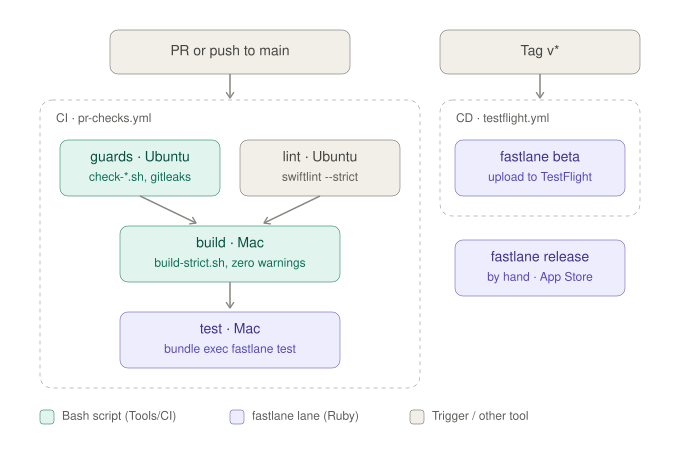

# F04 — Upload engine · TestFlight #1

<dl><dd>

- F04 · 89h · skeleton guide — full code is added when this feature starts.

</dd></dl>

## Contents

<dl><dd>

1. [Overview](#overview)
2. [Target structure](#target-structure)
3. [1. Domain + fake data — UploadKit API and store in memory](#1-domain--fake-data--uploadkit-api-and-store-in-memory)
4. [2. View models — Wire the Sync tab](#2-view-models--wire-the-sync-tab)
5. [3. Backend — Backend endpoints](#3-backend--backend-endpoints)
6. [4. Real data — UploadKit](#4-real-data--uploadkit)
7. [5. Release — Signing and TestFlight #1](#5-release--signing-and-testflight-1)
8. [Tests (after the feature works)](#tests-after-the-feature-works)
9. [Feature done](#feature-done)

</dd></dl>

## Overview

<dl><dd>

- **Goal:** Upload engine end to end: Domain → fake data → view models → real data → tests.
- **Demo:** 200 files reach storage and survive app kill and airplane mode; first TestFlight build.
- **Spec:** [04 Upload engine](../feature-docs/02-upload-sync.md#04-upload-engine), [14 Backend](../feature-docs/03-backend.md#1-role), [17 CI/CD](../feature-docs/05-platform.md#17-cicd-and-testflight)
- **Starts from:** the skeleton screens (~30% of Figma) that read `App/Fakes/FakeData.swift`.
- **No fake repository:** the fake-data step writes the real implementation on in-memory values, registered once in `App/DI/RepositoriesDI.swift`; the real-data step swaps its insides, never the type. The dev menu seeds / clears it through Debug-only `UseCases/DevData/` use cases; test doubles live only in test targets.
- **File tags:** <b class="tag-new">New</b> create the file · <b class="tag-edit">Edit</b> change only the part shown.

| Step | Layer | Hours | Status | What |
|---|---|---|---|---|
| [1](#1-domain--fake-data--uploadkit-api-and-store-in-memory) | Domain + fake data | 3h | not start | UploadKit API, `UploadStoreImpl` in memory |
| [2](#2-view-models--wire-the-sync-tab) | View models | 6h | not start | Wire the Sync tab |
| [3](#3-backend--backend-endpoints) | Backend | 15h | not start | Backend endpoints |
| [4](#4-real-data--uploadkit) | Real data | 55h | not start | UploadKit |
| [5](#5-release--signing-and-testflight-1) | Release | 10h | not start | Signing and TestFlight #1 |

<details open>
<summary><strong>Order</strong></summary>
<dl><dd>

- Steps run top to bottom; the app runs after every step.
- Real data changes only registrations in `App/DI/`, never views or view models.
- Tests come last, once the feature works end to end.

</dd></dl>
</details>

</dd></dl>

## Target structure

<dl><dd>

```text
Backend/                          # 4: Node 22 + TypeScript + Fastify, Postgres, migrations/
Packages/PlatformKit/Sources/PlatformKit/
├── UploadKit/                    # 1–4: uses nothing from the rest of the app
│   ├── UploadStore.swift
│   ├── UploadStateMachine.swift, ChunkPlanner.swift
│   ├── UploadCoordinator.swift (actor), BackgroundSessionDelegate.swift
│   └── PresignedURLProvider.swift
└── Networking/                   # 4: backend HTTP client
Packages/DataLayer/Sources/DataLayer/DataSources/
└── Local/Persistence/UploadStoreImpl.swift  # 1: in memory · 4: SwiftData
SiteLog/
├── App/AppDelegate.swift         # 4: handleEventsForBackgroundURLSession
└── Presentation/Uploads/         # 3: UploadStatus (Sync tab), UploadFiles
```

</dd></dl>

## 1. Domain + fake data — UploadKit API and store in memory

<dl><dd>

- **Goal:** job record, states and the `UploadStore` protocol, plus `UploadStoreImpl` on in-memory values.
- **Spec:** [04.1](../feature-docs/02-upload-sync.md#041-boundary)

| Action | File | Holds |
|---|---|---|
| <b class="tag-new">New</b> | `UploadKit/UploadStore.swift` | Protocol from spec 04.1 |
| <b class="tag-new">New</b> | `UploadKit/UploadJobRecord.swift` | Job, part, state enums |
| <b class="tag-new">New</b> | `Persistence/UploadStoreImpl.swift` | The real store, values in memory until step 4 |
| <b class="tag-new">New</b> | `Packages/PlatformKit/Tests/PlatformKitTests/Doubles/InMemoryUploadStore.swift` | Test double for the state machine tests; test target only |

#### Steps

<dl><dd>

1. New folder `Packages/PlatformKit/Sources/PlatformKit/UploadKit/`; mark what the app uses `public`.
2. Check nothing in `UploadKit/` uses a type from another folder (review).

</dd></dl>

</dd></dl>

## 2. View models — Wire the Sync tab

<dl><dd>

| Action | Skeleton folder | View model work |
|---|---|---|
| <b class="tag-new">New</b> view model · <b class="tag-edit">Edit</b> view | `Presentation/Uploads/UploadStatus/` | U1: big figure, waiting reasons, failed + Retry, Wi-Fi only |
| <b class="tag-new">New</b> view model · <b class="tag-edit">Edit</b> view | `Presentation/Uploads/UploadFiles/` | U2: today's files with state |

#### Steps

<dl><dd>

1. Add `<Screen>ViewModel.swift` next to the view: `@MainActor @Observable`, use cases through `init`; the view builds it with `Container.shared.<useCase>()`.
   Pushes go through `coordinator.push(<Feature>Route…)`; add the case and its screen in `<Feature>Route.swift` ([D19](../feature-docs/00-overview.md#d19--feature-routes-and-a-coordinator-per-stack)).
2. In the view, replace `FakeData…` with view-model state; keep the layout (visual finish is F16).
3. Loading, empty (`DSEmptyState`) and error states; previews for each.
4. Delete this feature's `Fake*` types from `App/Fakes/FakeData.swift` once nothing uses them.
5. “Waiting” uses `DSStatusMarker(.waiting)` — never red; reasons in plain language.

</dd></dl>

</dd></dl>

## 3. Backend — Backend endpoints

<dl><dd>

<details open>
<summary><strong>3.1 Backend skeleton and first migrations</strong></summary>
<dl><dd>

- **Goal:** Fastify app, Postgres, `0001_uploads.sql`, Firebase token check.
- **Spec:** [14 §2–5](../feature-docs/03-backend.md#2-stack)

| Action | File | Holds |
|---|---|---|
| <b class="tag-new">New</b> | `Backend/src/server.ts` | Fastify, `/health`, `requireUser` |
| <b class="tag-new">New</b> | `Backend/migrations/0001_uploads.sql` | Table from 14 §5.1 |
| <b class="tag-new">New</b> | `Backend/.env.example` | Every config key; `.env` gitignored |

#### Steps

<dl><dd>

1. Throwaway Postgres for tests (Docker).
2. `vitest` + `tsc` + ESLint in CI (Ubuntu job).

</dd></dl>
</details>

<details open>
<summary><strong>3.2 Presigned upload endpoint</strong></summary>
<dl><dd>

- **Goal:** `POST /uploads` returns a single-PUT or multipart plan; keys checked against the caller’s uid.
- **Spec:** [14 §3–4](../feature-docs/03-backend.md#3-endpoints)

| Action | File | Holds |
|---|---|---|
| <b class="tag-new">New</b> | `Backend/src/routes/uploads.ts` | Begin, mode by `byteSize` (5 MB threshold, 8 MB parts) |
| <b class="tag-new">New</b> | `Backend/src/keys.ts` | Strict key regex, no `..` |

</dd></dl>

#### Steps

<dl><dd>

1. Presign locally with `s3-request-presigner`; TTL 1 h.
2. One R2 bucket per environment.

</dd></dl>
</details>

<details open>
<summary><strong>3.3 Refresh, complete, abort</strong></summary>
<dl><dd>

- **Goal:** idempotent `complete`, part URL refresh, abort.
- **Spec:** [14 §7.3](../feature-docs/03-backend.md#73-idempotent-complete)

| Action | File | Holds |
|---|---|---|
| <b class="tag-edit">Edit</b> | `Backend/src/routes/uploads.ts` | `/parts/refresh`, `/complete`, `DELETE` |

</dd></dl>

#### Steps

<dl><dd>

1. `complete` twice → identical 200 body.
2. Never 400 for transient conditions (§10).

</dd></dl>
</details>

</dd></dl>

</dd></dl>

## 4. Real data — UploadKit

<dl><dd>

<details open>
<summary><strong>4.1 Job model and local store</strong></summary>
<dl><dd>

- **Goal:** SwiftData-backed `UploadStore` in `Persistence`.
- **Spec:** [04.1](../feature-docs/02-upload-sync.md#041-boundary)

| Action | File | Holds |
|---|---|---|
| <b class="tag-replace">Replace</b> | `Persistence/UploadStoreImpl.swift` | Same type, now on SwiftData |

#### Steps

<dl><dd>

1. Lookup by `taskDescription = "jobID#part"`.

</dd></dl>
</details>

<details open>
<summary><strong>4.2 Single PUT via background URLSession</strong></summary>
<dl><dd>

- **Goal:** files under 5 MB upload through a background session and survive suspension.
- **Spec:** [04.3](../feature-docs/02-upload-sync.md#043-ios-background-constraints)

| Action | File | Holds |
|---|---|---|
| <b class="tag-new">New</b> | `UploadKit/BackgroundSessionDelegate.swift` | Session delegate |
| <b class="tag-new">New</b> | `UploadKit/UploadCoordinator.swift` | Actor, the only executor of effects |

</dd></dl>

#### Steps

<dl><dd>

1. `isDiscretionary = false`, `sessionSendsLaunchEvents = true`.
2. Wire `handleEventsForBackgroundURLSession` in AppDelegate.
3. Enqueue the first batch in the foreground.

</dd></dl>
</details>

<details open>
<summary><strong>4.3 State machine, retry, backoff</strong></summary>
<dl><dd>

- **Goal:** pure `UploadStateMachine.reduce` and jittered backoff.
- **Spec:** [04.4](../feature-docs/02-upload-sync.md#044-state-machine)

| Action | File | Holds |
|---|---|---|
| <b class="tag-new">New</b> | `UploadKit/UploadStateMachine.swift` | Events → (state, effects); no I/O |

</dd></dl>

#### Steps

<dl><dd>

1. 401/403 and offline consume no retry budget.
2. Delay `min(2s × 2^n, 300s) × jitter`, max 5 attempts; inject the RNG.

</dd></dl>
</details>

<details open>
<summary><strong>4.4 Multipart and resume</strong></summary>
<dl><dd>

- **Goal:** files over 5 MB in uniform 8 MB parts, resumable part by part.
- **Spec:** [04.2](../feature-docs/02-upload-sync.md#042-protocol)

| Action | File | Holds |
|---|---|---|
| <b class="tag-new">New</b> | `UploadKit/ChunkPlanner.swift` | Fixed-size parts |
| <b class="tag-new">New</b> | `UploadKit/PartFileWriter.swift` | At most 2 temp part files per job |

</dd></dl>

#### Steps

<dl><dd>

1. Split this part when you start (planner · upload · complete).
2. Final part failure never calls `complete`.

</dd></dl>
</details>

<details open>
<summary><strong>4.5 Kill and relaunch reconciliation</strong></summary>
<dl><dd>

- **Goal:** cold launch reattaches, cancels or resets jobs so nothing sticks at 60%.
- **Spec:** [04.3](../feature-docs/02-upload-sync.md#043-ios-background-constraints)

| Action | File | Holds |
|---|---|---|
| <b class="tag-new">New</b> | `UploadKit/Reconciler.swift` | Three cases: reattach · cancel + log · reset to pending |
| <b class="tag-new">New</b> | `SiteLog/App/Startup/Steps/ReconcileUploadsStep.swift` | Non-blocking startup step |

</dd></dl>

#### Steps

<dl><dd>

1. Recreate the session with the same identifier at launch.

</dd></dl>
</details>

<details open>
<summary><strong>4.6 Wi-Fi only and URL refresh</strong></summary>
<dl><dd>

- **Goal:** Wi-Fi-only policy (default on), dedupe by hash, proactive URL refresh.
- **Spec:** [04.5](../feature-docs/02-upload-sync.md#045-policy)

</dd></dl>

#### Steps

<dl><dd>

1. `allowsCellularAccess = false` when Wi-Fi only.
2. Same `sha256` in a project → reuse `remoteKey`.

</dd></dl>
</details>

<details open>
<summary><strong>4.7 UploadKit behind the screens</strong></summary>
<dl><dd>

- **Goal:** real `UploadCoordinator` + SwiftData store behind the Sync tab; 200-file demo.

| Action | File | Holds |
|---|---|---|
| <b class="tag-edit">Edit</b> | `SiteLog/App/DI/DataSourcesDI.swift`, `PlatformDI.swift`, `RepositoriesDI.swift` | Register the data sources and PlatformKit services, pass them to the repositories; the registered types stay |

</dd></dl>

#### Steps

<dl><dd>

1. Register the real store and coordinator.
2. Run the 200-file demo with a kill in the middle.

</dd></dl>

#### Done when

<dl><dd>

- 200 files / 2 GB complete with matching server hashes
- Airplane mode → waiting, budget intact

</dd></dl>
</details>

</dd></dl>

</dd></dl>

## 5. Release — Signing and TestFlight #1

<dl><dd>

- **Goal:** a `v*` tag becomes a TestFlight build with no local step.
- **Spec:** [17](../feature-docs/05-platform.md#17-cicd-and-testflight)



| Action | File | Holds |
|---|---|---|
| <b class="tag-edit">Edit</b> | `fastlane/Fastfile` | Lanes `beta`, `release` |
| <b class="tag-new">New</b> | `.github/workflows/testflight.yml` | Tag `v*`, protected `testflight` environment |

#### Steps

<dl><dd>

1. App Store Connect API key in GitHub secrets (`ASC_KEY_ID`, `ASC_ISSUER_ID`, `ASC_KEY_CONTENT`).
2. Build number = latest TestFlight + 1.
3. Push `v0.0.1`.

</dd></dl>

#### Done when

<dl><dd>

- TestFlight build appears; repo holds no `.p8`, certificate or profile

</dd></dl>

</dd></dl>

## Tests (after the feature works)

<dl><dd>

**1. Domain + fake data — UploadKit API and store in memory**

- Store round-trip on the test double

**2. View models — Wire the Sync tab**

- Estimates never NaN or negative

**3. Backend — Backend endpoints**

- Migrations on empty and seeded DBs
- Expired / revoked token → 401
- Key prefix (`other-uid/`, `../`, absolute)
- Mode at 4.9 / 5 / 5.1 MB
- Concurrent duplicate complete
- Aborted job cannot complete
- Refresh returns exactly the requested parts

**4. Real data — UploadKit**

- Same contract tests as the test double
- `MockTransport` flow
- Real device: lock the phone mid-upload
- Full (state × event) matrix
- Budget rules
- Backoff with a stubbed RNG
- Planner sizes
- 503 at part 3 retries only part 3
- All three reconciliation cases
- Real kill on device resumes without re-uploading parts
- 60 s URL TTL refreshes automatically
- Wi-Fi only on cellular sends zero bytes

</dd></dl>

## Feature done

<dl><dd>

| Check | How |
|---|---|
| Demo | 200 files survive kill + airplane mode |
| TestFlight #1 | Installed from TestFlight on a real device |
| Tests | `bundle exec fastlane test` green |
| Roadmap | F04 steps ticked |

</dd></dl>
