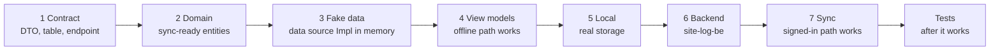

# Feature guides

<dl><dd>

- Step-by-step guides, grouped by sprint: one folder per sprint, one guide per feature.
- 1 developer · 2-week sprints (~60h) · 10 sprints · ~520h. Progress is ticked in [ROADMAP.md](../../ROADMAP.md).
- Specs live in [feature-docs/](../feature-docs/); a guide links the spec section it builds.

</dd></dl>

## Contents

<dl><dd>

1. [Sprint board](#sprint-board)
2. [How every feature runs](#how-every-feature-runs)
3. [Overview first](#overview-first)
4. [Rules](#rules)
5. [Feature numbers](#feature-numbers)

</dd></dl>

## Sprint board

```mermaid
flowchart LR
    S0["S0<br/>Foundation, access"] --> S1["S1<br/>Auth, projects"]
    S1 --> S2["S2<br/>Sync engine"]
    S2 --> S3["S3<br/>Capture, upload"]
    S3 --> S4["S4<br/>Resumable upload<br/>TestFlight #1"]
    S4 --> S5["S5<br/>Issues, markup"]
    S5 --> S6["S6<br/>Reports, plans"]
    S6 --> S7["S7<br/>Checklists, DeviceLink,<br/>diagnostics · TestFlight #2"]
    S7 --> S8["S8<br/>Realtime, push,<br/>accessibility"]
    S8 --> S9["S9<br/>UI finish<br/>App Store"]

    classDef ship fill:#EEEDFE,stroke:#534AB7,color:#3C3489
    class S4,S7,S9 ship
```

<dl><dd>

| Sprint | Features | Hours | Ships |
|---|---|---|---|
| [S0](S0-foundation-access/README.md) | F00 Foundation · F01 Access and app lock | 54 | |
| [S1](S1-auth-projects/README.md) | F02 Auth · F03 Projects, sessions, locations | 56 | |
| [S2](S2-sync-engine/README.md) | F04 Sync engine | 45 | |
| [S3](S3-capture-upload/README.md) | F05 Capture · F06 Upload | 60 | |
| [S4](S4-resumable-upload/README.md) | F07 Resumable upload | 47 | TestFlight #1 |
| [S5](S5-issues-markup/README.md) | F08 Issues and before/after · F09 Markup and stamps | 48 | |
| [S6](S6-reports-plans/README.md) | F10 Reports and audit log · F11 Floor plans and pins | 58 | |
| [S7](S7-checklists-devices-diagnostics/README.md) | F12 Checklists · F13 DeviceLink · F14 Diagnostics | 49 | TestFlight #2 |
| [S8](S8-realtime-push-quality/README.md) | F15 Realtime · F16 Push and deep links · F17 Accessibility and performance | 49 | |
| [S9](S9-release/README.md) | F18 UI finish and App Store | 54 | App Store |

- Every sprint ends with a build that runs **offline** (Continue offline) and **signed in** (from S1 on).
- Hours are dev-hours for one developer new to Swift, learning included; backend hours are estimates.
- The backend has its own repository and guides, same sprints and feature numbers: [site-log-be guides](https://github.com/DAMHONGDUC/site-log-be/blob/main/docs/feature-guide/README.md). What the app calls: [03-backend](../feature-docs/03-backend.md).

</dd></dl>

## How every feature runs

<dl><dd>

| Step | Builds | Done when |
|---|---|---|
| 1 Contract | DTOs, sync table columns, endpoint shapes — written once, used by app and backend | App and backend compile against the same shapes |
| 2 Domain | Entities (`UUID` id, `updatedAt`, `deletedAt`, `syncState`), repository protocol, use cases | Builds; nothing uses them yet |
| 3 Fake data | Real `<Feature>RepositoryImpl` over data source `Impl`s that hold in-memory values | Repository maps, catches, logs; dev menu seeds and resets |
| 4 View models | One view model per screen, wired into the skeleton | The feature runs end to end with **Continue offline** |
| 5 Local | Data source `Impl` insides → SwiftData, Keychain, files, PlatformKit | Relaunch keeps everything; nothing above the data source changed |
| 6 Backend | Built in [site-log-be](https://github.com/DAMHONGDUC/site-log-be/blob/main/docs/feature-guide/README.md) the same sprint: migration, route, tests | Its guide is done; the app reaches it locally or on staging |
| 7 Sync | The local data source adopts `SyncableLocalDataSource` and writes outbox rows; the table joins `/sync/pull` and `/sync/push` | Signed in: a second device sees the change |
| Tests | Tests listed in the guide | `bundle exec fastlane test` green (site-log-be runs its own) |

- A step that does not apply is marked `—` in the guide's step table (for example: app lock has no backend).
- From S2 on, a feature's sync step only makes its table syncable and registers it in `App/DI/SyncTablesDI.swift`; the engine is F04.
- Features that talk to their own endpoints (upload, verify, push) swap a remote data source's insides to `HTTPClient` in this step instead.

</dd></dl>

## Overview first

<dl><dd>

- Every sprint and every step opens with an **overview**: a table, bullets and a Mermaid diagram.
- The overview alone is enough to build the step: goal, files and layers, data flow, how to check it.
- Read the overview, try to build from it, then open the File / Explain / Hint / Code blocks only when stuck.
- No code in an overview.

| Overview of | Holds |
|---|---|
| Sprint (`S<n>/README.md`) | Goal · demo offline and signed in · features and hours · diagram · tasks · done · self-check |
| Step (`#### Overview` in a guide) | Goal · files table · diagram · check |

</dd></dl>

## Rules

<dl><dd>

1. **Offline first, inside every feature:** the offline path works before the backend and sync steps start.
2. **No fake repositories:** fake data lives only in data source `Impl`s. The repository is real from step 3; step 5 and step 7 replace only the data source insides, never its type or DI registration.
3. **Continue offline is a product mode:** test it in every sprint, next to the signed-in path.
4. **Task size 2–6h:** a step above 6h is split into tasks when you start it; ~12–20 tasks per sprint.
5. **Tests after the feature works** end to end, never while a step is half built.
6. **Visual finish waits for F18:** until then a step changes layout only when a view model needs it.
7. **Tick the box** in [ROADMAP.md](../../ROADMAP.md) and the guide's status in the commit that finishes the step.

</dd></dl>

## Feature numbers

<dl><dd>

- Features are numbered in sprint order. Old numbers, for older commits and notes:

| New | Feature | Old |
|---|---|---|
| F00 | Foundation (backend skeleton now in site-log-be S0) | F00 |
| F01 | Access and app lock | F01 |
| F02 | Auth (sign-in part of old F12) | F12 |
| F03 | Projects, sessions, locations | F02 |
| F04 | Sync engine (sync part of old F12) | F12 |
| F05 | Capture | F03 |
| F06 | Upload (single PUT) | F04 |
| F07 | Resumable upload · TestFlight #1 | F04 |
| F08 | Issues and before/after | F05 |
| F09 | Markup and stamps | F06 |
| F10 | Reports and audit log | F07 |
| F11 | Floor plans and pins | F08 |
| F12 | Checklists | F09 |
| F13 | DeviceLink (BLE meters) | F10 |
| F14 | Diagnostics · TestFlight #2 | F11 |
| F15 | Realtime progress and verification | F13 |
| F16 | Push and deep links | F14 |
| F17 | Accessibility and performance | F15 |
| F18 | UI finish and App Store | F16 |

</dd></dl>
