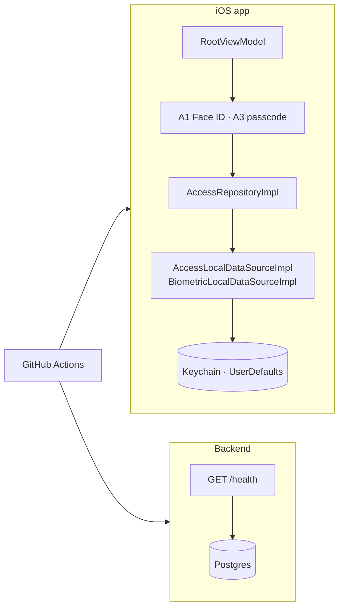

# S0 — Foundation and access

<dl><dd>

- Sprint 0 · 2 weeks · 54h · [all sprints](../README.md)

</dd></dl>

## Contents

<dl><dd>

1. [Overview](#overview)
2. [Tasks](#tasks)
3. [Done](#done)
4. [Self-check](#self-check)

</dd></dl>

## Overview

<dl><dd>

- **Goal:** the app and the backend both build, test and run in CI; the app opens behind Face ID or a passcode.
- **Demo — offline:** first launch → A2 → Continue offline → tabs; lock on → Face ID or passcode; back after *Lock after* → locked again.
- **Demo — signed in:** not yet (auth is S1); `GET /health` answers on the deployed backend.

| F | Feature | Guide | Hours |
|---|---|---|---|
| F00 | Foundation: layer packages, DI, CI, backend skeleton | [F00-foundation.md](F00-foundation.md) | 38 |
| F01 | Access and app lock | [F01-access.md](F01-access.md) | 16 |

</dd></dl>

## Tasks

<dl><dd>

| Task | Step | Layer | Hours | Status |
|---|---|---|---|---|
| F00.0 | Entry point, XcodeGen, SwiftLint | Tooling | 8 | done |
| F00.1 | Layer packages, Factory DI, `AppClock` | Architecture | 6 | not start |
| F00.2 | Fastlane `test` lane, PR checks | CI | 5 | not start |
| F00.3 | CI guards | CI | 4 | not start |
| F00.4 | DesignSystem tests | Tests | 3 | not start |
| F00.5 | [site-log-be S0](https://github.com/DAMHONGDUC/site-log-be/blob/main/docs/feature-guide/S0-foundation/README.md): setup, API skeleton, AWS staging | Backend | 11 | not start |
| F00.6 | Backend base URL per build configuration, local-network ATS | Config | 1 | not start |
| F01.1 | Access types and use cases | Domain | 1 | not start |
| F01.2 | Repository + data sources in memory | Fake data | 2 | not start |
| F01.3 | Access view models (split: root · A1–A3 · S4–S5) | View models | 5 | not start |
| F01.4 | Keychain, `UserDefaults`, Face ID inside the data sources (split: storage · biometrics) | Local | 8 | not start |

</dd></dl>

## Done

<dl><dd>

- [ ] App: zero warnings, `bundle exec fastlane test` green, CI green on a PR
- [ ] Backend ([site-log-be S0](https://github.com/DAMHONGDUC/site-log-be/blob/main/docs/feature-guide/S0-foundation/README.md)): CI green; staging answers `GET /health` from the iPhone
- [ ] Offline demo runs on a real device; relaunch keeps the passcode, settings and lockout
- [ ] F00 and F01 tests written and green

</dd></dl>

## Self-check

<dl><dd>

- Before reading the guides: draw the layers (Presentation → Domain → Data → PlatformKit) and where `AccessRepositoryImpl` sits.
- Which file is the only one allowed to know `AccessLocalDataSourceImpl` exists?
- What changes between F01.2 and F01.4, and what must stay exactly the same?

</dd></dl>
