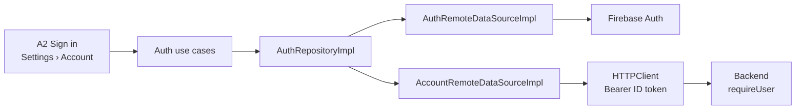
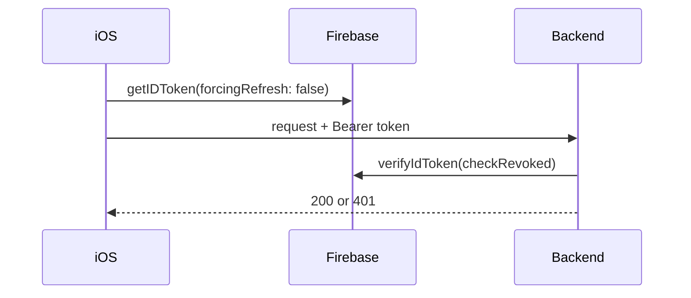
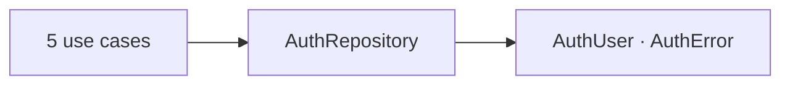
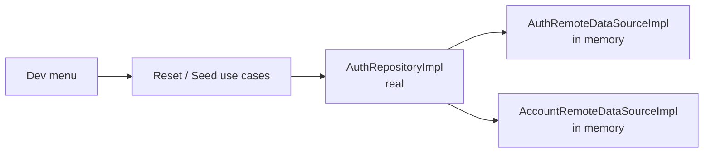
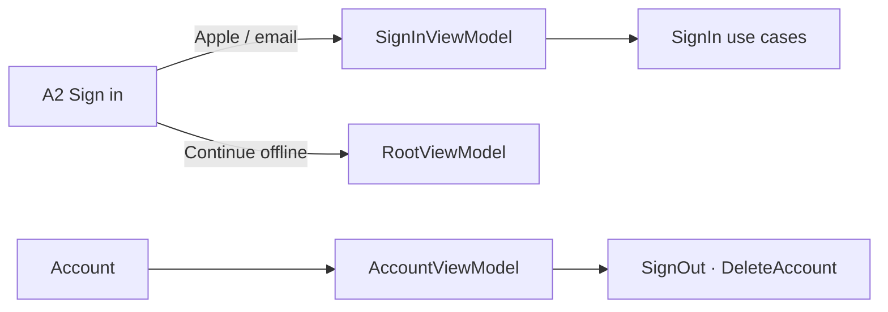
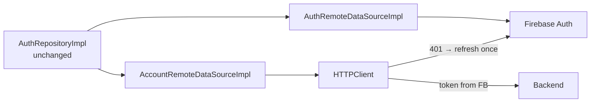
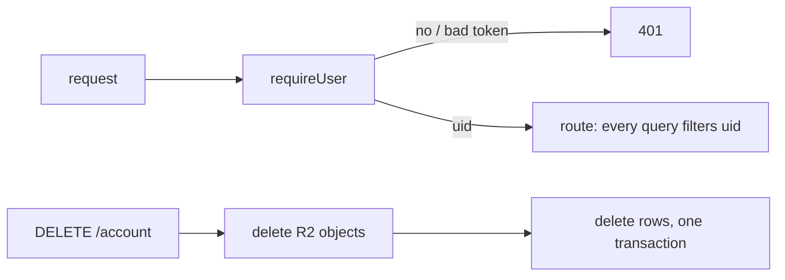

# F02 — Auth

<dl><dd>

- Sprint [S1](README.md) · 21h · skeleton guide — full code is added when this feature starts.
- Code in this guide is a teaching example. Check current source and follow [F00 localization rules](../S0-foundation-access/F00-foundation.md#user-facing-text-and-localization) before applying it.

</dd></dl>

## Contents

<dl><dd>

1. [Overview](#overview)
2. [Target structure](#target-structure)
3. [1. Contract — token and account](#1-contract--token-and-account)
4. [2. Domain — auth types and use cases](#2-domain--auth-types-and-use-cases)
5. [3. Fake data — auth data sources in memory](#3-fake-data--auth-data-sources-in-memory)
6. [4. View models — sign in, account, sign out](#4-view-models--sign-in-account-sign-out)
7. [5. Local — Firebase Auth inside the data source](#5-local--firebase-auth-inside-the-data-source)
8. [6. Backend — requireUser and account deletion](#6-backend--requireuser-and-account-deletion)
9. [Tests (after the feature works)](#tests-after-the-feature-works)
10. [Feature done](#feature-done)

</dd></dl>

## Overview

<dl><dd>

- **Goal:** Sign in with Apple or email next to Continue offline; every backend call carries a fresh ID token; the account can be deleted.
- **Demo — offline:** Continue offline still works; Settings › Account offers sign-in.
- **Demo — signed in:** A2 → Sign in with Apple → tabs; relaunch in airplane mode goes straight in; a call without a token gets `401`.
- **Spec:** [08.1 Offline-first and auth](../../feature-docs/02-upload-sync.md#081-offline-first-and-auth), [03-backend §4 Auth](../../feature-docs/03-backend.md#4-auth)
- **Starts from:** F01 (`SignInViewModel` with logging stubs) and the skeleton `Settings/Account/`.
- **Steps:** [How every feature runs](../README.md#how-every-feature-runs). Sync is `—`: auth has no synced table.
- **File tags:** <b class="tag-new">New</b> create the file · <b class="tag-edit">Edit</b> change only the part shown · <b class="tag-replace">Replace</b> overwrite the whole file.

| Step | Layer | Hours | Status | What |
|---|---|---|---|---|
| [1](#1-contract--token-and-account) | Contract | 1h | not start | Bearer token, `DELETE /account` response |
| [2](#2-domain--auth-types-and-use-cases) | Domain | 1h | not start | `AuthUser`, `AuthError`, `AuthRepository`, use cases |
| [3](#3-fake-data--auth-data-sources-in-memory) | Fake data | 1h | not start | Real `AuthRepositoryImpl` over in-memory data sources |
| [4](#4-view-models--sign-in-account-sign-out) | View models | 4h | not start | A2 sign-in, Account, sign out, delete account |
| [5](#5-local--firebase-auth-inside-the-data-source) | Local | 10h | not start | Firebase Auth, `HTTPClient` with token and 401 refresh |
| [6](#6-backend--requireuser-and-account-deletion) | Backend | 4h | not start | `requireUser`, `DELETE /account` |
| — | Sync | — | — | No synced table |



</dd></dl>

## Target structure

<dl><dd>

```text
Backend/src/auth.ts                                                  # 6: requireUser (firebase-admin, checkRevoked)
Backend/src/routes/account.ts                                        # 6: DELETE /account
Packages/
├── DomainLayer/Sources/DomainLayer/
│   ├── Entities/Auth/                                               # 2: AuthUser, AuthError
│   ├── Repositories/AuthRepository.swift                            # 2
│   └── UseCases/Auth/                                               # 2: one file per use case
├── DataLayer/Sources/DataLayer/
│   ├── Models/Remote/AuthUserDTO.swift, AccountDeletionDTO.swift    # 1
│   ├── Mappers/AuthUserMapper.swift                                 # 3
│   ├── Repositories/AuthRepositoryImpl.swift                        # 3: real from the start
│   └── DataSources/Remote/Auth/, Account/                           # 3: in memory · 5: Firebase, HTTPClient
└── PlatformKit/Sources/PlatformKit/Networking/HTTPClient.swift      # 5: token provider, one 401 refresh
SiteLog/
├── App/AppDelegate.swift                                            # 5: FirebaseApp.configure() first
└── Presentation/Access/SignIn/, Settings/Account/                   # 4
```

</dd></dl>

## 1. Contract — token and account

<dl><dd>

#### Overview

<dl><dd>

- **Goal:** app and backend agree on how a request proves who the user is, and what account deletion returns.

| Shape | Where | Holds |
|---|---|---|
| `Authorization: Bearer <ID token>` | Every request | Firebase ID token, never cached by hand |
| `AuthUserDTO` | `Models/Remote/` | `uid`, `email`, `displayName` |
| `AccountDeletionDTO` | `Models/Remote/` | Deleted object and row counts |
| `401` | Backend | Missing, expired or revoked token — never `403` |



- **Check:** both shapes are written down before step 3; the error body matches the [error contract](../../feature-docs/03-backend.md#10-error-contract).

</dd></dl>

</dd></dl>

## 2. Domain — auth types and use cases

<dl><dd>

#### Overview

<dl><dd>

- **Goal:** the sign-in vocabulary in Domain; nothing knows Firebase exists.

| Action | File | Holds |
|---|---|---|
| <b class="tag-new">New</b> | `Entities/Auth/AuthUser.swift` | `uid`, `email`, `displayName` |
| <b class="tag-new">New</b> | `Entities/Auth/AuthError.swift` | `.cancelled`, `.network`, `.invalidCredentials`, `.unavailable` |
| <b class="tag-new">New</b> | `Repositories/AuthRepository.swift` | Apple, email, current user, sign out, delete account |
| <b class="tag-new">New</b> | `UseCases/Auth/` | `SignInWithAppleUseCase`, `SignInWithEmailUseCase`, `LoadCurrentUserUseCase`, `SignOutUseCase`, `DeleteAccountUseCase` |



- **Check:** ⌘B; DomainLayer imports nothing.

</dd></dl>

</dd></dl>

## 3. Fake data — auth data sources in memory

<dl><dd>

#### Overview

<dl><dd>

- **Goal:** the real `AuthRepositoryImpl` over two data sources that answer from memory.

| Action | File | Holds |
|---|---|---|
| <b class="tag-new">New</b> | `DataSources/Remote/Auth/AuthRemoteDataSource.swift` + `Impl` | Signs in “Hanh Nguyen” instantly; returns `AuthUserDTO` |
| <b class="tag-new">New</b> | `DataSources/Remote/Account/AccountRemoteDataSource.swift` + `Impl` | `deleteAccount()` answers zero counts |
| <b class="tag-new">New</b> | `Mappers/AuthUserMapper.swift` | DTO ↔ entity |
| <b class="tag-new">New</b> | `Repositories/AuthRepositoryImpl.swift` | Real: calls the data sources, maps, `catch` → `.failure(AuthError)`, logs |
| <b class="tag-edit">Edit</b> | `App/DI/DataSourcesDI.swift`, `RepositoriesDI.swift`, `UseCasesDI.swift` | Register once; later steps keep these registrations |



- **Check:** dev menu → Seed data signs in “Hanh Nguyen”; Delete all data signs out.

</dd></dl>

#### Steps

<dl><dd>

1. Data sources `throw`; only the repository returns `Result`.
2. Debug only: `resetAllData()` / `seedSampleData()` on `AuthRepository`, `ResetAllAuthDataUseCase` / `SeedAuthDataUseCase` in `UseCases/DevData/`, called from `DevMenuViewModel`.

</dd></dl>

</dd></dl>

## 4. View models — sign in, account, sign out

<dl><dd>

#### Overview

<dl><dd>

- **Goal:** A2's sign-in buttons work; Settings › Account shows who is signed in and can sign out or delete the account.

| Action | Skeleton folder | View model work |
|---|---|---|
| <b class="tag-edit">Edit</b> view model | `Presentation/Access/SignIn/` | Replace the F01 logging stubs; Continue offline stays |
| <b class="tag-new">New</b> view model · <b class="tag-edit">Edit</b> view | `Presentation/Settings/Account/` | Profile, sign in (when offline-only), sign out, delete account alert |



- **Check:** both paths reach the tabs; sign out returns to A2; the account screen never blocks Continue offline users.

</dd></dl>

#### Steps

<dl><dd>

1. Errors show as plain sentences from `AuthError`; cancel shows nothing.
2. Delete account uses the full-form alert from [F00](../S0-foundation-access/F00-foundation.md#full-form-alert).

</dd></dl>

</dd></dl>

## 5. Local — Firebase Auth inside the data source

<dl><dd>

#### Overview

<dl><dd>

- **Goal:** `AuthRemoteDataSourceImpl` keeps its type and methods; inside it calls Firebase. `AccountRemoteDataSourceImpl` calls the backend through `HTTPClient`.

| Action | File | Holds |
|---|---|---|
| <b class="tag-edit">Edit</b> | `project.yml` | `firebase-ios-sdk` (FirebaseAuth), Sign in with Apple capability; run `xcodegen` |
| <b class="tag-edit">Edit</b> | `App/AppDelegate.swift` | `FirebaseApp.configure()` first |
| <b class="tag-new">New</b> | `PlatformKit/Networking/HTTPClient.swift` | Base URL, token provider, one 401 interceptor that refreshes once |
| <b class="tag-replace">Replace</b> | `DataSources/Remote/Auth/AuthRemoteDataSourceImpl.swift` | Firebase Apple and email sign-in, current user, sign out, ID token |
| <b class="tag-replace">Replace</b> | `DataSources/Remote/Account/AccountRemoteDataSourceImpl.swift` | `DELETE /account` through `HTTPClient` |
| <b class="tag-edit">Edit</b> | `App/DI/PlatformDI.swift`, `DataSourcesDI.swift` | Register `HTTPClient`, pass it in; registered types stay |



- **Check:** real Apple and email sign-in on device; airplane-mode relaunch after sign-in goes straight in; repository and view models unchanged.

</dd></dl>

#### Steps

<dl><dd>

1. `getIDToken(forcingRefresh: false)` per request; never store the token yourself.
2. Ten requests that all get `401` cause one refresh, not ten.
3. Sign out clears nothing local: offline data stays on the device.

</dd></dl>

</dd></dl>

## 6. Backend — requireUser and account deletion

<dl><dd>

#### Overview

<dl><dd>

- **Goal:** every user route knows the caller's `uid`; the account can be wiped.
- **Spec:** [03-backend §3–4](../../feature-docs/03-backend.md#4-auth)

| Action | File | Holds |
|---|---|---|
| <b class="tag-new">New</b> | `Backend/src/auth.ts` | `requireUser`: `verifyIdToken(token, true)`; failures → `401` |
| <b class="tag-new">New</b> | `Backend/src/routes/account.ts` | `DELETE /account`: storage objects first, then rows in one transaction; idempotent |
| <b class="tag-edit">Edit</b> | `Backend/.env.example` | Firebase service-account keys (secret store only) |



- **Check:** `vitest`: no token → `401`, revoked token → `401`, second delete → same counts.

</dd></dl>

#### Steps

<dl><dd>

1. Each later feature that adds a table adds it to the account deletion in its backend step.

</dd></dl>

</dd></dl>

## Tests (after the feature works)

<dl><dd>

**3. Fake data**

- `AuthRepositoryImpl` over test-double data sources: a throwing data source → the right `AuthError`

**5. Local**

- 10 concurrent 401s → one refresh
- Relaunch offline after sign-in → signed in

**6. Backend**

- Expired / revoked token → 401
- `DELETE /account` twice → same body

</dd></dl>

## Feature done

<dl><dd>

| Check | How |
|---|---|
| Demo | Apple and email sign-in on device; Continue offline still works; airplane relaunch goes straight in |
| Tests | `bundle exec fastlane test` and `npm test` green |
| Roadmap | F02 steps ticked |

</dd></dl>
