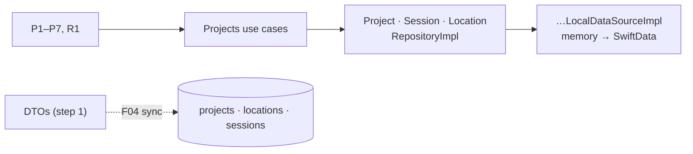
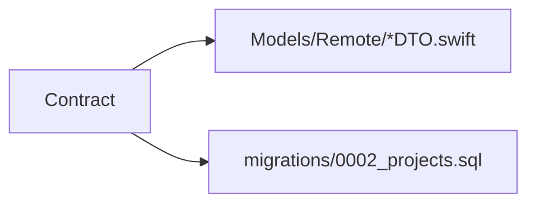
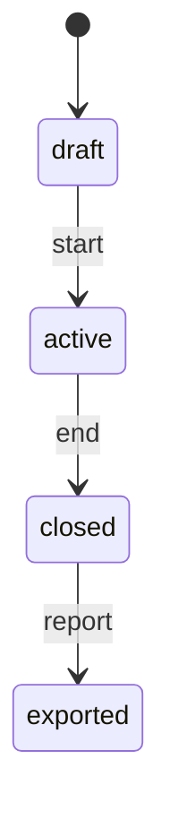
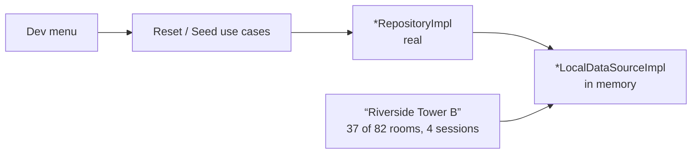
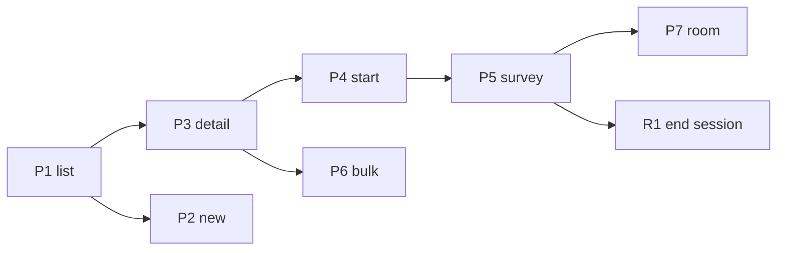
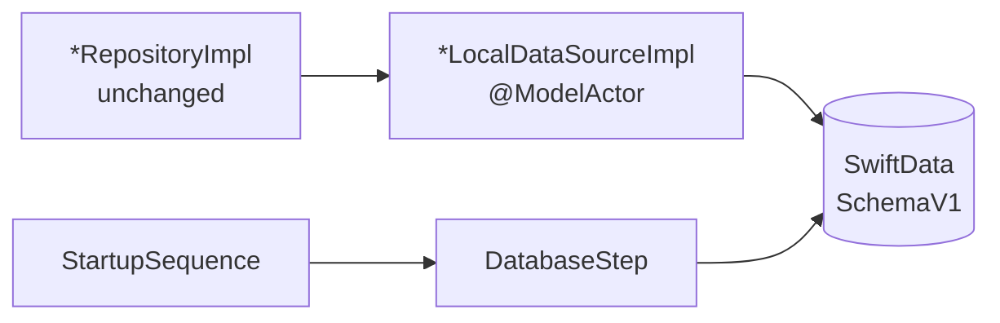
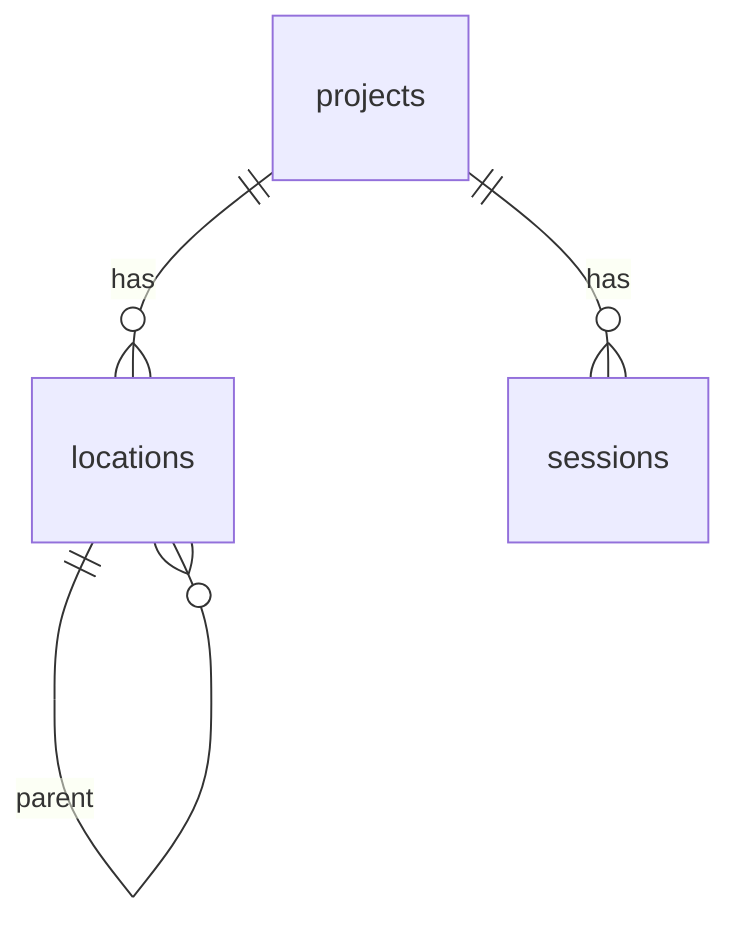

# F03 — Projects, sessions, locations

<dl><dd>

- Sprint [S1](README.md) · 35h · skeleton guide — full code is added when this feature starts.
- Code in this guide is a teaching example. Check current source and follow [F00 localization rules](../S0-foundation-access/F00-foundation.md#user-facing-text-and-localization) before applying it.

</dd></dl>

## Contents

<dl><dd>

1. [Overview](#overview)
2. [Target structure](#target-structure)
3. [1. Contract — project, session, location shapes](#1-contract--project-session-location-shapes)
4. [2. Domain — sync-ready entities, protocols, use cases](#2-domain--sync-ready-entities-protocols-use-cases)
5. [3. Fake data — data sources in memory](#3-fake-data--data-sources-in-memory)
6. [4. View models — wire the Projects screens](#4-view-models--wire-the-projects-screens)
7. [5. Local — SwiftData](#5-local--swiftdata)
8. [6. Backend — in site-log-be](#6-backend--in-site-log-be)
9. [Tests (after the feature works)](#tests-after-the-feature-works)
10. [Feature done](#feature-done)

</dd></dl>

## Overview

<dl><dd>

- **Goal:** projects, sessions and locations end to end on the device, with every field the sync engine (F04) needs.
- **Demo — offline:** project → 80 generated locations → walkthrough, all in airplane mode and kept after relaunch.
- **Demo — signed in:** the same flow; the backend has the tables. Data starts moving between devices in F04.
- **Spec:** [01](../../feature-docs/01-field-work.md#01-projects-sessions-locations), [00 §3 Data model](../../feature-docs/00-overview.md#3-data-model), [03-backend §6.3](../../feature-docs/03-backend.md#63-synced-tables)
- **Starts from:** the skeleton screens (~30% of Figma) that read `App/Fakes/FakeData.swift`.
- **Steps:** [How every feature runs](../README.md#how-every-feature-runs). Sync is done in F04: these are its first tables.
- **File tags:** <b class="tag-new">New</b> create the file · <b class="tag-edit">Edit</b> change only the part shown · <b class="tag-replace">Replace</b> overwrite the whole file.

| Step | Layer | Hours | Status | What |
|---|---|---|---|---|
| [1](#1-contract--project-session-location-shapes) | Contract | 1h | not start | DTOs and table columns |
| [2](#2-domain--sync-ready-entities-protocols-use-cases) | Domain | 4h | not start | Sync-ready entities, protocols, use cases |
| [3](#3-fake-data--data-sources-in-memory) | Fake data | 2h | not start | Real repositories over in-memory data sources |
| [4](#4-view-models--wire-the-projects-screens) | View models | 10h | not start | Wire the Projects screens |
| [5](#5-local--swiftdata) | Local | 15h | not start | SwiftData models, data sources, schema versioning |
| [6](#6-backend--in-site-log-be) | Backend | 3h | not start | site-log-be F03: `0001_projects.sql` |
| — | Sync | — | — | Done in F04 |



</dd></dl>

## Target structure

<dl><dd>

```text
Packages/
├── DomainLayer/Sources/DomainLayer/                                  # 2: Entities/Projects/, Repositories/, UseCases/Projects/
├── DataLayer/Sources/DataLayer/
│   ├── Models/Remote/ProjectDTO.swift, LocationDTO.swift, SessionDTO.swift   # 1
│   ├── Repositories/*RepositoryImpl.swift                            # 3: real from the start
│   ├── Mappers/                                                      # 3: model ↔ entity · 1: DTO ↔ entity
│   ├── DataSources/Local/Persistence/                                # 3: in memory · 5: SwiftData
│   └── Models/Local/                                                 # 5: <Noun>Model (@Model), Schema/
SiteLog/
└── Presentation/Projects/                                            # 4: ProjectList, NewProject, ProjectDetail, StartSession,
                                                                      #    Survey, Room, BulkLocations, CloneTree, EndSession
```

</dd></dl>

## 1. Contract — project, session, location shapes

<dl><dd>

#### Overview

<dl><dd>

- **Goal:** one shape per synced row, written once, used by the app's DTOs and the backend's tables.

| Row | Business fields | Sync fields (every row) |
|---|---|---|
| Project | `name`, `address`, `clientName`, `createdAt` | `id` (client `UUID`), `rev`, `clientUpdatedAt`, `deletedAt` |
| Location | `projectId`, `parentId`, `code`, `kind`, `sortIndex` | same |
| Session | `projectId`, `startedAt`, `endedAt`, `surveyorName`, `note`, `state` | same |



- **Check:** DTO field names match the SQL columns (camelCase ↔ snake_case) one for one.

</dd></dl>

</dd></dl>

## 2. Domain — sync-ready entities, protocols, use cases

<dl><dd>

#### Overview

<dl><dd>

- **Goal:** plain `Sendable` entities and the rules (session states, location depth, bulk generation) with the sync fields already in place.

| Action | File | Holds |
|---|---|---|
| <b class="tag-new">New</b> | `Entities/Projects/` | One file each: `Project`, `Session` (state machine), `Location` (depth ≤ 3), `Capture` (frozen fields); each has `id: UUID`, `updatedAt`, `deletedAt`, `syncState` |
| <b class="tag-new">New</b> | `Repositories/*Repository.swift` | One protocol per aggregate: project, session, location, capture |
| <b class="tag-new">New</b> | `UseCases/Projects/` | `CreateProjectUseCase`, `StartSessionUseCase`, `GenerateLocationsUseCase`, `CloneLocationTreeUseCase`, … |



- **Check:** ⌘B; a session never moves back a state.

</dd></dl>

#### Steps

<dl><dd>

1. No SwiftData in Domain.
2. `GenerateLocationsUseCase` is pure: template `"{floor}-{unit:02}"` → preview (first 5, last 3, total); cap `maxGeneratedPerBatch` 2000, `maxDepth` 3; duplicates rejected.
3. List rows (`LocationRow`) get their counts from one batched call.

</dd></dl>

</dd></dl>

## 3. Fake data — data sources in memory

<dl><dd>

#### Overview

<dl><dd>

- **Goal:** real repositories (rules, mapping, `catch` → `Result`, logs) over data sources that hold the sample data in memory.

| Action | File | Holds |
|---|---|---|
| <b class="tag-new">New</b> | `DataSources/Local/Persistence/<Noun>LocalDataSource.swift` + `Impl` | One per aggregate; values in memory until step 5 |
| <b class="tag-new">New</b> | `Repositories/*RepositoryImpl.swift` | Real: calls its data source, maps, catches, logs |
| <b class="tag-edit">Edit</b> | `App/DI/DataSourcesDI.swift`, `RepositoriesDI.swift`, `UseCasesDI.swift` | Register once; step 5 keeps them |



- **Check:** dev menu seeds and deletes; the repositories already hold every rule.

</dd></dl>

#### Steps

<dl><dd>

1. Data source `Impl`s are actors; they store the models step 5 will persist.
2. Move the sample values out of `App/Fakes/FakeData.swift` into the seed.
3. Debug only: `resetAllData()` / `seedSampleData()` on each repository protocol, `UseCases/DevData/` use cases, called from `DevMenuViewModel`.

</dd></dl>

</dd></dl>

## 4. View models — wire the Projects screens

<dl><dd>

#### Overview

<dl><dd>

- **Goal:** every Projects screen reads real use cases; the whole walkthrough runs with Continue offline.

| Action | Skeleton folder | View model work |
|---|---|---|
| <b class="tag-new">New</b> view model · <b class="tag-edit">Edit</b> view | `Presentation/Projects/ProjectList/` | P1: projects + walkthrough in progress |
| <b class="tag-new">New</b> view model · <b class="tag-edit">Edit</b> view | `Presentation/Projects/NewProject/` | P2: create through `CreateProjectUseCase` |
| <b class="tag-new">New</b> view model · <b class="tag-edit">Edit</b> view | `Presentation/Projects/ProjectDetail/` | P3: Sessions · Locations tabs, sentence summary |
| <b class="tag-new">New</b> view model · <b class="tag-edit">Edit</b> view | `Presentation/Projects/StartSession/` | P4: start through `StartSessionUseCase` |
| <b class="tag-new">New</b> view model · <b class="tag-edit">Edit</b> view | `Presentation/Projects/Survey/` | P5: rooms per unit, filter chips, badge counts |
| <b class="tag-new">New</b> view model · <b class="tag-edit">Edit</b> view | `Presentation/Projects/Room/` | P7: room detail, photos, checklist row |
| <b class="tag-new">New</b> view model · <b class="tag-edit">Edit</b> view | `Presentation/Projects/BulkLocations/` | P6: template form + preview from the use case |
| <b class="tag-new">New</b> view model · <b class="tag-edit">Edit</b> view | `Presentation/Projects/CloneTree/` | Copy a location tree |
| <b class="tag-new">New</b> view model · <b class="tag-edit">Edit</b> view | `Presentation/Projects/EndSession/` | R1: session summary |



- **Check:** airplane mode: project → 80 locations → walkthrough → end session.

</dd></dl>

#### Steps

<dl><dd>

1. `<Screen>ViewModel.swift` next to the view: `@MainActor @Observable`, use cases through `init`; the view builds it with `Container.shared.<useCase>()`.
2. Pushes go through `coordinator.push(ProjectsRoute…)` ([D19](../../feature-docs/00-overview.md#d19--feature-routes-and-a-coordinator-per-stack)).
3. Replace `FakeData…` with view-model state; keep the layout (visual finish is F18).
4. Loading, empty (`DSEmptyState`) and error states; previews for each.
5. Delete this feature's `Fake*` types from `App/Fakes/FakeData.swift` once nothing uses them.
6. Summaries are sentences (“14 open issues, 2 of them overdue”); a 500-row survey list stays at 60 fps.

</dd></dl>

</dd></dl>

## 5. Local — SwiftData

<dl><dd>

#### Overview

<dl><dd>

- **Goal:** the data source `Impl`s keep their types and methods; inside they read and write SwiftData. Repositories and screens do not change.
- **Spec:** [00 §3.4](../../feature-docs/00-overview.md#34-schema-versioning)

| Action | File | Holds |
|---|---|---|
| <b class="tag-new">New</b> | `Models/Local/<Noun>Model.swift` | `@Model`, `#Unique` / `#Index` (location code per project, sha256 per project) |
| <b class="tag-new">New</b> | `Models/Local/Schema/SchemaV1.swift`, `MigrationPlan.swift` | First versioned schema; stages empty until V2 |
| <b class="tag-replace">Replace</b> | `DataSources/Local/Persistence/*LocalDataSourceImpl.swift` | Same types, now `@ModelActor` over SwiftData |
| <b class="tag-new">New</b> | `App/Startup/Steps/DatabaseStep.swift` | Opens the store; blocks launch |
| <b class="tag-new">New</b> | `Packages/DataLayer/Tests/DataLayerTests/Fixtures/` | A 100-location `SchemaV1` store |



- **Check:** relaunch keeps everything; `git diff` shows no change under `Repositories/` or `Presentation/`.

</dd></dl>

#### Steps

<dl><dd>

1. Models mirror the entities, sync fields included; store relative file paths.
2. Cascade delete project → sessions, locations, plans.
3. Commit the fixture store for migration tests.

</dd></dl>

</dd></dl>

## 6. Backend — in site-log-be

<dl><dd>

#### Overview

<dl><dd>

- **Goal:** the server tables for projects, locations and sessions exist before F04 syncs them.
- **Built in:** [F03 Projects](https://github.com/DAMHONGDUC/site-log-be/blob/main/docs/feature-guide/S1-auth-projects/F03-projects.md) — same sprint, separate repository; nothing to write in this repo.
- **API this feature uses:** [§6.3 Synced tables](../../feature-docs/03-backend.md#63-synced-tables).
- **Run it locally:** [local testing with iOS](https://github.com/DAMHONGDUC/site-log-be/blob/main/docs/feature-guide/local-testing-with-ios.md).

| Backend piece | The app | Check from the app |
|---|---|---|
| Tables `projects`, `locations`, `sessions` | DTOs in `DataLayer/Models/Remote/` with the same fields | Field names match [site-log-be 01-api §6.3](https://github.com/DAMHONGDUC/site-log-be/blob/main/docs/feature-docs/01-api.md#63-synced-tables) |
| Foreign keys include `uid`; codes unique per project while live | Ids made by the app (`UUID`) | Nothing to call yet: sync is F04 |



- **Check:** the DTOs compile against the documented fields; staging ran `0001_projects.sql`.

</dd></dl>

</dd></dl>

## Tests (after the feature works)

<dl><dd>

**2. Domain**

- Session state: `closed` rejects `addCapture`; `exported` read-only
- Location depth 4 rejected
- Generate: 1 floor, 1 unit, collisions, batch cap

**4. View models**

- View models against test doubles in `SiteLogTests/Doubles/` (`@Suite(.container)`)
- Bulk preview shows first 5 / last 3 / total

**5. Local**

- Data sources over an in-memory `ModelContainer`
- Cascade delete leaves no orphans; uniques reject duplicates
- Open the fixture store with the current plan
- Store file has `.complete` protection

**6. Backend**

- In site-log-be: `test/projects.test.ts` ([its tests](https://github.com/DAMHONGDUC/site-log-be/blob/main/docs/feature-guide/S1-auth-projects/F03-projects.md#tests))

</dd></dl>

## Feature done

<dl><dd>

| Check | How |
|---|---|
| Demo | Airplane mode: project → 80 locations → walkthrough; relaunch keeps everything |
| Tests | `bundle exec fastlane test` and `npm test` green |
| Roadmap | F03 steps ticked |

</dd></dl>
