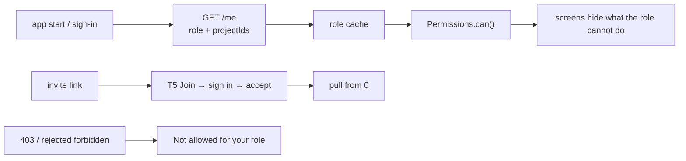

# F19 — Team and roles

<dl><dd>

- Sprint [S10](README.md) · 30h · skeleton guide — parts, files, order, tests. Code is added when the feature starts.
- Rules: [site-log-be · 05-team-and-roles](https://github.com/DAMHONGDUC/site-log-be/blob/main/docs/feature-docs/05-team-and-roles.md) · calls: [site-log-be · 01-api §13](https://github.com/DAMHONGDUC/site-log-be/blob/main/docs/feature-docs/01-api.md#13-team) · client rules: [03-backend §13](../../feature-docs/03-backend.md#13-team-and-roles) · backend: [site-log-be F19](https://github.com/DAMHONGDUC/site-log-be/blob/main/docs/feature-guide/S10-team-roles/F19-team-roles.md) · twin: [Android F19](https://github.com/DAMHONGDUC/site-log-android/blob/main/docs/feature-guide/S10-team-roles/F19-team-roles.md).
- Design: Team and roles screens T1–T8 on page 02 / 03 of the [design pages](https://github.com/DAMHONGDUC/site_log_swift_ui/blob/main/docs/design/00-design-plan.md).

</dd></dl>

## Contents

<dl><dd>

1. [Overview](#overview)
2. [1. Contract](#1-contract)
3. [2. Domain — roles and permissions](#2-domain--roles-and-permissions)
4. [3. Data — team repository](#3-data--team-repository)
5. [4. Gate every screen by role](#4-gate-every-screen-by-role)
6. [5. Team screens](#5-team-screens)
7. [6. Invite link, join, not a member](#6-invite-link-join-not-a-member)
8. [7. Not allowed and access changes](#7-not-allowed-and-access-changes)
9. [Tests](#tests)
10. [Feature done](#feature-done)

</dd></dl>

## Overview

<dl><dd>

- **Goal:** the app knows the member's role and projects, shows only what the role can do, lets Admins run the team and Managers set project members, and joins new members from an invite link.
- **Demo — signed in:** the Admin invites `vu@…` as Inspector on Riverside Tower B; on a second phone the invite link opens SiteLog, Vu signs in and sees only that project; a Viewer opens an issue and gets "View only" with no Re-check button.
- **Demo — offline:** with no signal the cached role still gates every screen; Team screens say they need a connection.

| Step | Layer | Hours | Status | What |
|---|---|---|---|---|
| [1](#1-contract) | Contract | 2h | not start | DTOs for `/me`, members, invitations (preview, resend), member events; `createdBy` |
| [2](#2-domain--roles-and-permissions) | Domain | 4h | not start | `Role`, `Action`, `Permissions.can(role, action, row)` |
| [3](#3-data--team-repository) | Data | 4h | not start | Team repository, role cache, `/me` on start |
| [4](#4-gate-every-screen-by-role) | UI | 6h | not start | Hide or disable actions; Viewer read-only Home and issue (T7, T8) |
| [5](#5-team-screens) | UI | 8h | not start | T1 Team, T2 Invite, T3 Member, T4 Project members |
| [6](#6-invite-link-join-not-a-member) | Platform + UI | 4h | not start | Invite link, T5 Join, T6 Not a member |
| [7](#7-not-allowed-and-access-changes) | Data + UI | 2h | not start | `403 forbidden`, `rejected forbidden:<action>`, resync |

</dd></dl>

## 1. Contract

<dl><dd>

- `DataLayer/Models/Remote/MemberDTO.swift`, `InvitationDTO.swift`, `InvitePreviewDTO.swift`, `MemberEventDTO.swift`, `MeDTO.swift`; `createdBy` on synced DTOs.
- `role` is `admin` · `manager` · `inspector` · `viewer`; `projectIds` is a list or `"all"`.
- **Check:** the DTOs decode the JSON samples of [01-api §13](https://github.com/DAMHONGDUC/site-log-be/blob/main/docs/feature-docs/01-api.md#13-team) byte for byte.

</dd></dl>

## 2. Domain — roles and permissions

<dl><dd>

- `DomainLayer/Entities/Team/` (`Role`, `Member`, `Invitation`, `InvitePreview`, `MemberEvent`, `Action`), `UseCases/Team/` (one per action).
- `Permissions.can(role, action, row)` is the table of [05 §3](https://github.com/DAMHONGDUC/site-log-be/blob/main/docs/feature-docs/05-team-and-roles.md#3-permissions) as data, including "own, same day" (needs `createdBy` and the creation time).
- Use cases: `LoadMe`, `ListMembers`, `InviteMember`, `CancelInvitation`, `ChangeRole`, `RemoveMember`, `SetProjectMembers`, `AcceptInvitation`.
- **Check:** a unit test walks the whole permission table for the four roles.

</dd></dl>

## 3. Data — team repository

<dl><dd>

- `DataLayer/Repositories/TeamRepositoryImpl.swift`, `DataSources/Remote/TeamRemoteDataSource(Impl)`, `DataSources/Local/TeamLocalDataSource(Impl)` (role cache).
- `GET /me` after sign-in, on every start and after every `resyncRequired`; the role and project ids are cached so the gate works offline.
- Members and invitations are read live (no sync); Team screens show "Needs a connection" offline.
- **Check:** kill the network after one start: the role still gates the UI.

</dd></dl>

## 4. Gate every screen by role

<dl><dd>

- `Presentation/*`: each view model reads `Permissions`; `Presentation/Common/ViewOnlyNote`.

| Screen | Viewer | Inspector |
|---|---|---|
| Home | No Resume, no `+`, panel "You can view this project" (T7) | No `+` on Locations and Plans |
| Issues, issue detail | No Re-check, no Mark up, "View only" note (T8) | Full |
| Plans, rooms | Read only | Read only |
| Reports | Open and share PDFs only | Make and sign |
| You | No Team row | No Team row |
| Issue sheet, "Assigned to" | — | Pick a member (sets `assigneeUid`, shows their avatar) or type a name |

- **Check:** sign in as each role on the fake data; nothing the role cannot do is visible.

</dd></dl>

## 5. Team screens

<dl><dd>

- `Presentation/Team/` (`TeamScreen`, `InviteScreen`, `MemberScreen`, `ProjectMembersScreen`, `ActivityScreen`).

| Screen | Who | Does |
|---|---|---|
| T1 Team | Admin | Members with role tags, pending invitations (Resend · Cancel); `+` / Invite; Activity row |
| T2 Invite | Admin | Email, role (four, with descriptions), projects for Inspector and Viewer; Send invite |
| T3 Member | Admin | Change role, project switches (both saved with one `PATCH /members/:uid`), Remove from company (confirm) |
| T4 Project members | Admin, Manager | Home ⋯ → Members: who sees every project, who is on this one; add people |
| T9 Activity | Admin | Team → Activity: who did what to whom, newest first, loads 50 more at the end (`GET /member-events`) |

- **Check:** invite, resend (the old link shows "This invite was replaced"), change role and projects, remove and read it in Activity on staging; the last Admin cannot be demoted (`409 last_admin` shown as a sentence).

</dd></dl>

## 6. Invite link, join, not a member

<dl><dd>

- Associated Domains `applinks:app.<domain>` in `project.yml`; `apple-app-site-association` served by the backend host; `DeepLinkRouter` route `.invite(token)`; `Presentation/Team/Join/`.
- T5 Join: `GET /invitations/:token` before sign-in fills "Name invited you", role and projects; expired or used → a sentence and "Ask for a new invite"; after sign-in `POST /invitations/accept`, then pull from `0`.
- T6 Not a member: `403 not_invited` after sign-in → "Ask an Admin to invite you" and Sign out.
- **Check:** open the link from Mail / Gmail on a phone without the app signed in; it lands on T5.

</dd></dl>

## 7. Not allowed and access changes

<dl><dd>

- `PlatformKit/Networking` maps API `403` (JSON body) to `.forbidden(code)`, distinct from S3 `403`; sync maps `forbidden:<action>`.
- `forbidden` → drop the action, show "Not allowed for your role", log the code; never retry.
- `resyncRequired` after a role or project change → wipe synced data in local store, pull from `0`; lost projects leave the switcher; if the current project is gone, open the first reachable one.

</dd></dl>

## Tests

<dl><dd>

| Test | Proves |
|---|---|
| Permissions | The table, row by row, for four roles |
| Team repository | `/me` cached; members and invitations mapped; errors mapped (`not_invited`, `last_admin`, `forbidden`) |
| View models | Each gated screen hides actions for Viewer and Inspector |
| Deep link | `/invite/<token>` parses; unknown paths are ignored |

</dd></dl>

## Feature done

<dl><dd>

| Check | How |
|---|---|
| Demo | Both demos above on staging, two phones |
| Gate | Every role on every screen, no forbidden action visible |
| Roadmap | F19 steps ticked |

</dd></dl>
