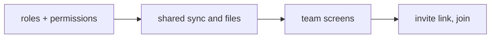

# S10 — Team and roles

<dl><dd>

- Sprint 10 · 2 weeks · 30h app + 16h backend · [all sprints](../README.md) · backend: [S10 backend](https://github.com/DAMHONGDUC/site-log-be/blob/main/docs/feature-guide/S10-team-roles/README.md)

</dd></dl>

## Contents

<dl><dd>

1. [Overview](#overview)
2. [Tasks](#tasks)
3. [Done](#done)
4. [Self-check](#self-check)

</dd></dl>

## Overview

<dl><dd>

- **Goal:** SiteLog becomes a team tool: one company, four roles (Admin, Manager, Inspector, Viewer), projects shared by their members.
- **Demo:** an Admin invites an Inspector by email; the Inspector joins from the link and sees only the projects they were added to; a Viewer reads but cannot change anything.

| F | Feature | Guide | Hours |
|---|---|---|---|
| F19 | Team and roles | [F19-team-roles.md](F19-team-roles.md) | 30 |

</dd></dl>

## Tasks

<dl><dd>

| Task | Step | Layer | Hours | Status |
|---|---|---|---|---|
| F19.1 | Contract: `/me`, members, invitations, `createdBy` | Contract | 2 | not start |
| F19.2 | Domain: roles and permissions | Domain | 4 | not start |
| F19.3 | Data: team repository, role cache | Data | 4 | not start |
| F19.4 | Gate every screen by role (T7, T8) | UI | 6 | not start |
| F19.5 | Team screens T1–T4 | UI | 8 | not start |
| F19.6 | Invite universal link, T5 Join, T6 Not a member | Platform + UI | 4 | not start |
| F19.7 | `403 forbidden`, rejected `forbidden:<action>`, resync | Data + UI | 2 | not start |
| F19.8 | Shared backend: [site-log-be F19](https://github.com/DAMHONGDUC/site-log-be/blob/main/docs/feature-guide/S10-team-roles/F19-team-roles.md) | Backend | 16 | not start |

</dd></dl>

## Done

<dl><dd>

- [ ] Two members on two phones see the same project; a third member on another project sees nothing of it
- [ ] Every role tried on every screen: nothing it may not do is offered, and the server refuses it anyway
- [ ] An invite email signs a new member in and lands on their project

</dd></dl>

## Self-check

<dl><dd>

- Why does the server check every permission again when the app already hides the button?
- What happens to a member's photos and issues when they leave the company, and why?

</dd></dl>
