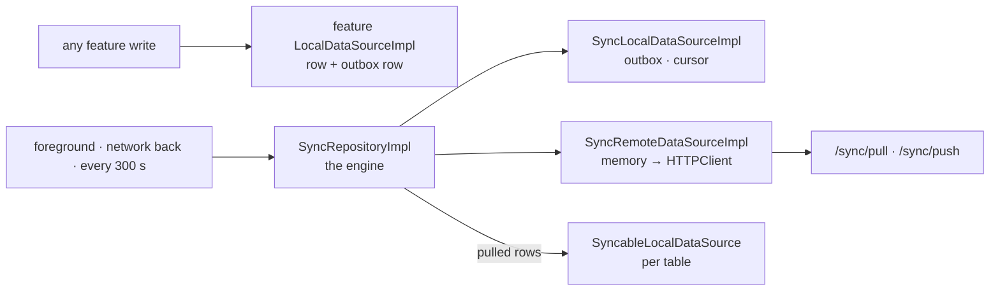
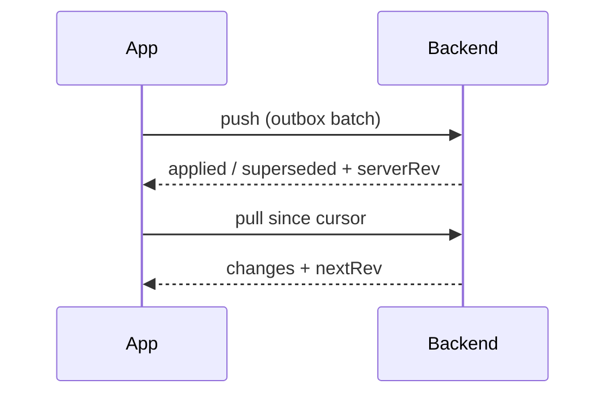
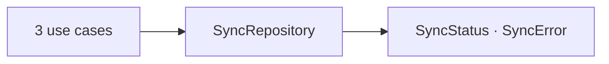
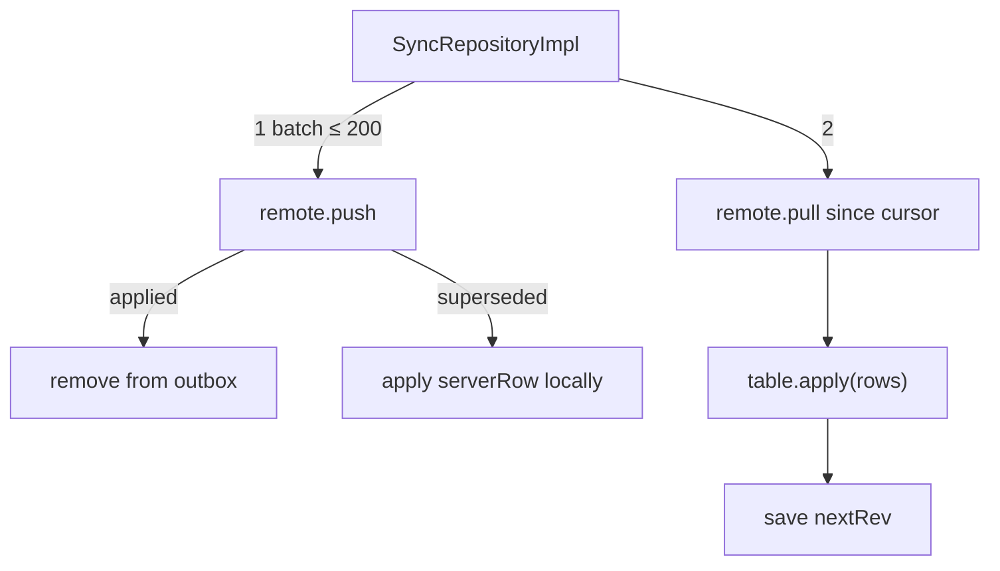
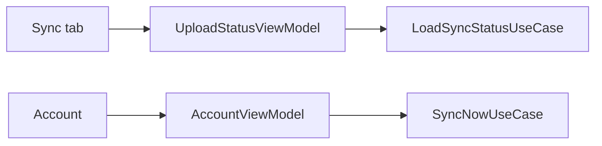
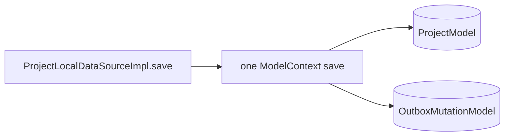
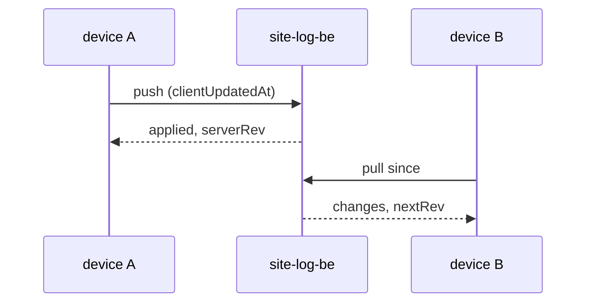
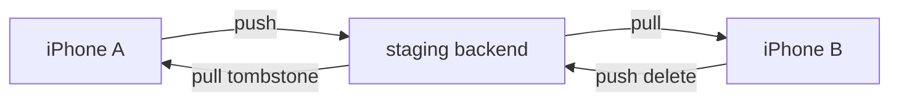

# F04 — Sync engine

<dl><dd>

- Sprint [S2](README.md) · 45h · skeleton guide — full code is added when this feature starts.
- Code in this guide is a teaching example. Check current source and follow [F00 localization rules](../S0-foundation-access/F00-foundation.md#user-facing-text-and-localization) before applying it.

</dd></dl>

## Contents

<dl><dd>

1. [Overview](#overview)
2. [Target structure](#target-structure)
3. [1. Contract — pull and push payloads](#1-contract--pull-and-push-payloads)
4. [2. Domain — sync status and use cases](#2-domain--sync-status-and-use-cases)
5. [3. Fake data — engine over in-memory data sources](#3-fake-data--engine-over-in-memory-data-sources)
6. [4. View models — sync status and account](#4-view-models--sync-status-and-account)
7. [5. Local — outbox and cursor in SwiftData](#5-local--outbox-and-cursor-in-swiftdata)
8. [6. Backend — in site-log-be](#6-backend--in-site-log-be)
9. [7. Sync — real server, two devices](#7-sync--real-server-two-devices)
10. [Tests (after the feature works)](#tests-after-the-feature-works)
11. [Feature done](#feature-done)

</dd></dl>

## Overview

<dl><dd>

- **Goal:** one engine that moves every synced table between devices; projects, sessions and locations (F03) go first.
- **Demo — offline:** edits queue in an outbox; the Sync tab says how many are waiting; relaunch keeps them.
- **Demo — signed in:** two devices on one account converge within one interval; deletes propagate; an exported session never reopens.
- **Spec:** [08.2 Protocol](../../feature-docs/02-upload-sync.md#082-protocol), [08.3 Client engine](../../feature-docs/02-upload-sync.md#083-client-engine), [03-backend §6](../../feature-docs/03-backend.md#6-sync)
- **Starts from:** F02 (ID token, `HTTPClient`) and F03 (first syncable tables).
- **Steps:** [How every feature runs](../README.md#how-every-feature-runs). The engine is built against an in-memory server in step 3, so most of the logic is done before the backend exists.
- **File tags:** <b class="tag-new">New</b> create the file · <b class="tag-edit">Edit</b> change only the part shown · <b class="tag-replace">Replace</b> overwrite the whole file.

| Step | Layer | Hours | Status | What |
|---|---|---|---|---|
| [1](#1-contract--pull-and-push-payloads) | Contract | 2h | not start | `/sync/pull`, `/sync/push` DTOs |
| [2](#2-domain--sync-status-and-use-cases) | Domain | 1h | not start | `SyncStatus`, `SyncRepository`, use cases |
| [3](#3-fake-data--engine-over-in-memory-data-sources) | Fake data | 18h | not start | Real engine over an in-memory outbox and an in-memory server |
| [4](#4-view-models--sync-status-and-account) | View models | 3h | not start | Sync tab status, account |
| [5](#5-local--outbox-and-cursor-in-swiftdata) | Local | 6h | not start | Outbox and cursor in SwiftData; F03 data sources write outbox rows |
| [6](#6-backend--in-site-log-be) | Backend | 8h | not start | site-log-be F04: `/sync/pull`, `/sync/push` |
| [7](#7-sync--real-server-two-devices) | Sync | 7h | not start | Remote data source on `HTTPClient`, two-device convergence |



</dd></dl>

## Target structure

<dl><dd>

```text
Packages/
├── DomainLayer/Sources/DomainLayer/
│   ├── Entities/Sync/SyncStatus.swift, SyncError.swift                  # 2
│   ├── Repositories/SyncRepository.swift                                # 2
│   └── UseCases/Sync/                                                   # 2: SyncNow, LoadSyncStatus, ResyncAll
├── DataLayer/Sources/DataLayer/
│   ├── Models/Remote/SyncPullDTO.swift, SyncPushDTO.swift, SyncRowDTO.swift   # 1
│   ├── Repositories/SyncRepositoryImpl.swift (actor)                    # 3: the engine, real from the start
│   ├── DataSources/Local/Sync/SyncLocalDataSource(+Impl)                # 3: in memory · 5: SwiftData
│   ├── DataSources/Local/Persistence/SyncableLocalDataSource.swift      # 3: what a table gives the engine
│   └── DataSources/Remote/Sync/SyncRemoteDataSource(+Impl)              # 3: in-memory server · 7: HTTPClient
SiteLog/
├── App/DI/SyncTablesDI.swift                                            # 3: the list of synced tables
└── Presentation/Uploads/UploadStatus/, Settings/Account/                # 4
```

</dd></dl>

## 1. Contract — pull and push payloads

<dl><dd>

#### Overview

<dl><dd>

- **Goal:** the two calls every synced table shares.

| Call | Request | Response |
|---|---|---|
| `POST /sync/pull` | `{ since: rev, limit }` | `{ changes: {table: [rows]}, nextRev, hasMore }` or `{ resyncRequired: true }` |
| `POST /sync/push` | `{ mutations: [{ table, id, op, clientUpdatedAt, fields }] }` | `{ results: [{ id, status: applied \| superseded, serverRow? }], serverRev }` |



- **Check:** `SyncRowDTO` carries `id`, `rev`, `clientUpdatedAt`, `deletedAt` and a `fields` dictionary per table.

</dd></dl>

</dd></dl>

## 2. Domain — sync status and use cases

<dl><dd>

#### Overview

<dl><dd>

- **Goal:** what screens may know about sync: status, last synced, waiting count, errors.

| Action | File | Holds |
|---|---|---|
| <b class="tag-new">New</b> | `Entities/Sync/SyncStatus.swift` | `idle`, `syncing`, `waiting(count:)`, `lastSyncedAt`, `failed(SyncError)` |
| <b class="tag-new">New</b> | `Repositories/SyncRepository.swift` | `syncNow()`, `status()`, `resyncAll()` |
| <b class="tag-new">New</b> | `UseCases/Sync/` | `SyncNowUseCase`, `LoadSyncStatusUseCase`, `ResyncAllUseCase` |



- **Check:** ⌘B; no table names in Domain.

</dd></dl>

</dd></dl>

## 3. Fake data — engine over in-memory data sources

<dl><dd>

#### Overview

<dl><dd>

- **Goal:** the real engine — pull, push, conflicts, deletes — written once, against an outbox and a server that live in memory.
- Split into tasks when you start: queue · push · pull · conflicts · deletes.

| Action | File | Holds |
|---|---|---|
| <b class="tag-new">New</b> | `DataSources/Local/Sync/SyncLocalDataSource.swift` + `Impl` | Outbox (mutations in dependency order) and cursor; in memory |
| <b class="tag-new">New</b> | `DataSources/Remote/Sync/SyncRemoteDataSource.swift` + `Impl` | In-memory server: per-user `rev` counter, rows, LWW on `clientUpdatedAt`, tombstones |
| <b class="tag-new">New</b> | `DataSources/Local/Persistence/SyncableLocalDataSource.swift` | Protocol a table's data source adopts: `table`, `apply(rows:)` |
| <b class="tag-new">New</b> | `Repositories/SyncRepositoryImpl.swift` | Actor: push → pull → pull again if `serverRev` moved; adopts `superseded`; logs every cycle |
| <b class="tag-new">New</b> | `App/DI/SyncTablesDI.swift` | Ordered list of syncable data sources: projects → locations → sessions |



- **Check:** a test-only second engine on the same in-memory server sees the first one's project.

</dd></dl>

#### Steps

<dl><dd>

1. Triggers: foreground, network restored, every `syncInterval`, outbox reaching `pushBatchSize` — never per write.
2. `sessions.state` only moves forward; `captures` are insert-only.
3. Every cycle logs `{pulled, pushed, superseded, elapsedMs, cursor}`.

</dd></dl>

</dd></dl>

## 4. View models — sync status and account

<dl><dd>

#### Overview

<dl><dd>

- **Goal:** the user always knows whether their work has left the phone.

| Action | Skeleton folder | View model work |
|---|---|---|
| <b class="tag-edit">Edit</b> view model · <b class="tag-edit">Edit</b> view | `Presentation/Uploads/UploadStatus/` | Last synced, waiting count, errors in plain language |
| <b class="tag-edit">Edit</b> view model | `Presentation/Settings/Account/` | Sync now, last synced |



- **Check:** offline → “3 changes waiting”, never red; signed in → “Synced just now”.

</dd></dl>

</dd></dl>

## 5. Local — outbox and cursor in SwiftData

<dl><dd>

#### Overview

<dl><dd>

- **Goal:** the outbox and cursor survive relaunch; F03's data sources write their outbox row in the same save as the row.

| Action | File | Holds |
|---|---|---|
| <b class="tag-new">New</b> | `Models/Local/OutboxMutationModel.swift`, `SyncCursorModel.swift` | `@Model`; join `SchemaV2` with a migration stage |
| <b class="tag-replace">Replace</b> | `DataSources/Local/Sync/SyncLocalDataSourceImpl.swift` | Same type, now SwiftData |
| <b class="tag-edit">Edit</b> | F03 `*LocalDataSourceImpl.swift` | Adopt `SyncableLocalDataSource`; each write adds an outbox row in the same transaction |



- **Check:** kill the app with 3 changes waiting → relaunch → still 3; repositories unchanged.

</dd></dl>

</dd></dl>

## 6. Backend — in site-log-be

<dl><dd>

#### Overview

<dl><dd>

- **Goal:** delta sync with per-user revisions; the server decides last write wins in SQL.
- **Built in:** [F04 Sync](https://github.com/DAMHONGDUC/site-log-be/blob/main/docs/feature-guide/S2-sync-engine/F04-sync.md) — same sprint, separate repository; nothing to write in this repo.
- **API this feature uses:** [§6 Sync](../../feature-docs/03-backend.md#6-sync).
- **Run it locally:** [local testing with iOS](https://github.com/DAMHONGDUC/site-log-be/blob/main/docs/feature-guide/local-testing-with-ios.md).

| Backend piece | The app | Check from the app |
|---|---|---|
| `POST /sync/pull` | `SyncEngineImpl` pulls from the stored cursor until `hasMore` is false | A project from device A appears on B |
| `POST /sync/push` | Batches of ≤ 200 full rows, parents first; adopts `serverRow` on `superseded` | An older offline edit loses and shows the server's value |
| `resyncRequired` | Full resync from `0` | Cursor older than 90 days (forced in a test) |



- **Check:** the iOS two-device demo passes against a local backend, then staging.

</dd></dl>

</dd></dl>

## 7. Sync — real server, two devices

<dl><dd>

#### Overview

<dl><dd>

- **Goal:** `SyncRemoteDataSourceImpl` keeps its type; inside it calls the backend through `HTTPClient`. The engine does not change.

| Action | File | Holds |
|---|---|---|
| <b class="tag-replace">Replace</b> | `DataSources/Remote/Sync/SyncRemoteDataSourceImpl.swift` | `POST /sync/pull`, `/sync/push` through `HTTPClient` |
| <b class="tag-edit">Edit</b> | `App/DI/DataSourcesDI.swift` | Pass `HTTPClient`; registered type stays |
| <b class="tag-check">Check</b> | site-log-be `test/sync.test.ts` | The server's side of convergence (newer wins, tombstones, monotonic state) is tested there |



- **Check:** two iPhones: create on A appears on B; delete on A stays deleted on B; B cannot un-export A's session.

</dd></dl>

</dd></dl>

## Tests (after the feature works)

<dl><dd>

**3. Fake data**

- LWW tie-break by `id`
- Monotonic session state across all 16 pairs
- 200 mutations = one request
- Tombstones never resurrect
- `superseded` adopts the server row

**5. Local**

- Outbox survives relaunch; row and outbox row are saved together or not at all

**6. Backend**

- In site-log-be: `test/sync.test.ts` ([its tests](https://github.com/DAMHONGDUC/site-log-be/blob/main/docs/feature-guide/S2-sync-engine/F04-sync.md#tests))

**7. Sync**

- Resync from 0 reproduces the store
- Token expiry mid-sync loses nothing
- Convergence test in CI

</dd></dl>

## Feature done

<dl><dd>

| Check | How |
|---|---|
| Demo | Two iPhones converge; deletes propagate; offline edits arrive after reconnect |
| Tests | `bundle exec fastlane test` and `npm test` green |
| Roadmap | F04 steps ticked |

</dd></dl>
