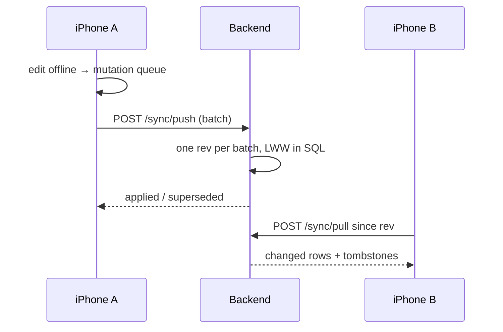

# S2 — Sync engine

<dl><dd>

- Sprint 2 · 2 weeks · 45h · [all sprints](../README.md)

</dd></dl>

## Contents

<dl><dd>

1. [Overview](#overview)
2. [Tasks](#tasks)
3. [Done](#done)
4. [Self-check](#self-check)

</dd></dl>

## Overview

<dl><dd>

- **Goal:** one sync engine that every later feature plugs into; projects, sessions and locations are the first synced tables.
- **Demo — offline:** edits made offline queue up; the Sync tab says how many are waiting.
- **Demo — signed in:** two devices on one account converge; a delete on one stays deleted on the other.
- Lighter sprint on purpose: sync is the riskiest piece of the app.

| F | Feature | Guide | Hours |
|---|---|---|---|
| F04 | Sync engine | [F04-sync-engine.md](F04-sync-engine.md) | 45 |

</dd></dl>

## Tasks

<dl><dd>

| Task | Step | Layer | Hours | Status |
|---|---|---|---|---|
| F04.1 | Pull and push payloads | Contract | 2 | not start |
| F04.2 | Sync status types and use cases | Domain | 1 | not start |
| F04.3 | Engine over an in-memory outbox and server (split: queue · push · pull · conflicts · deletes) | Fake data | 18 | not start |
| F04.4 | Sync tab status, account view models | View models | 3 | not start |
| F04.5 | Outbox and cursor in SwiftData; F03 data sources write outbox rows | Local | 6 | not start |
| F04.6 | [site-log-be F04](https://github.com/DAMHONGDUC/site-log-be/blob/main/docs/feature-guide/S2-sync-engine/F04-sync.md): `sync_state`, `/sync/pull`, `/sync/push` | Backend | 8 | not start |
| F04.7 | Remote data source on `HTTPClient`, two-device convergence | Sync | 7 | not start |

</dd></dl>

## Done

<dl><dd>

- [ ] Offline: edits survive relaunch in the queue
- [ ] Signed in: two devices converge; deletes propagate; a session never moves back a state
- [ ] [site-log-be F04](https://github.com/DAMHONGDUC/site-log-be/blob/main/docs/feature-guide/S2-sync-engine/F04-sync.md) tests green (the server side of convergence)
- [ ] F04 tests written and green

</dd></dl>

## Self-check

<dl><dd>

- Why does the backend use a row lock on `sync_state` instead of a sequence?
- A push batch inserts a location before its project. What makes that legal in Postgres?
- After S2, what is the smallest change a new feature needs to become synced?

</dd></dl>
