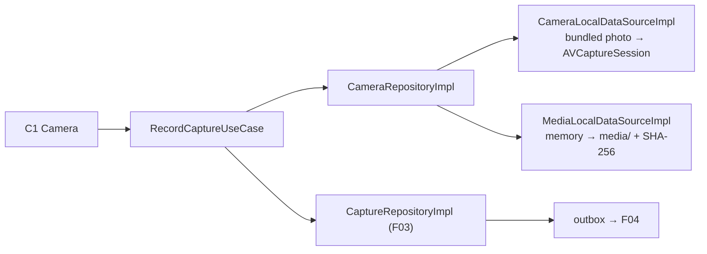
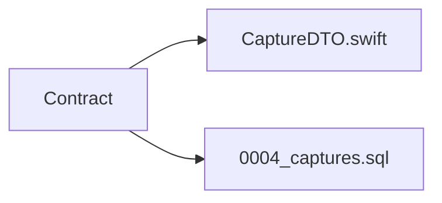
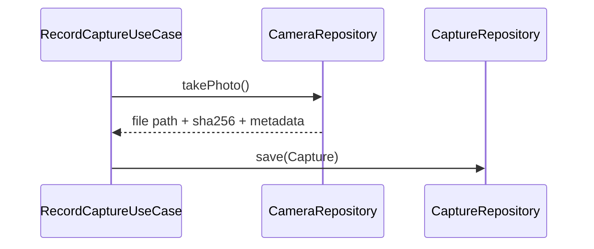
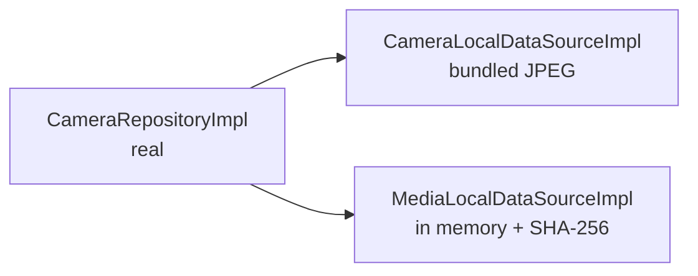
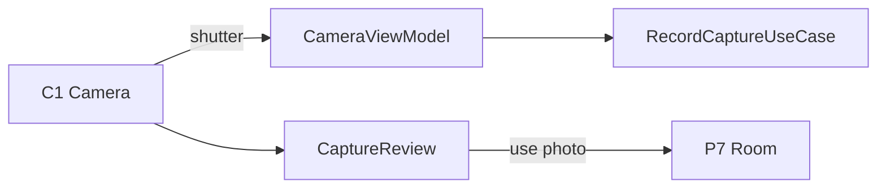
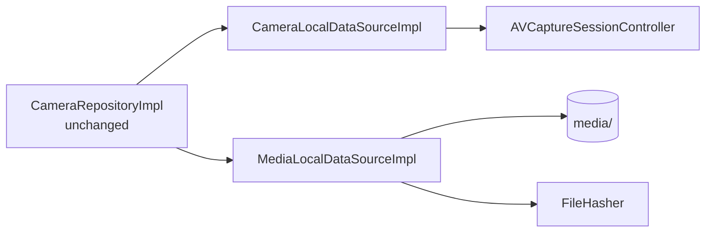
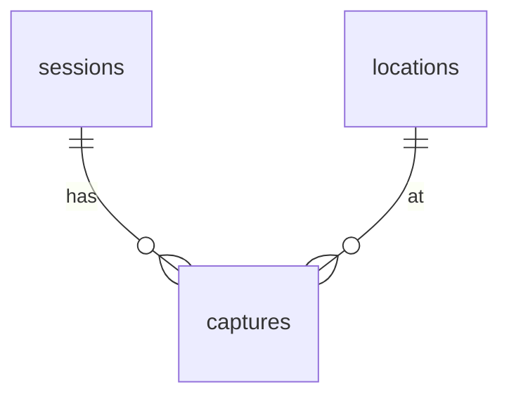
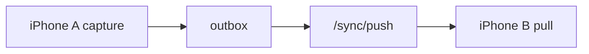

# F05 — Capture

<dl><dd>

- Sprint [S3](README.md) · 24h · skeleton guide — full code is added when this feature starts.
- Code in this guide is a teaching example. Check current source and follow [F00 localization rules](../S0-foundation-access/F00-foundation.md#user-facing-text-and-localization) before applying it.

</dd></dl>

## Contents

<dl><dd>

1. [Overview](#overview)
2. [Target structure](#target-structure)
3. [1. Contract — capture row](#1-contract--capture-row)
4. [2. Domain — record a capture](#2-domain--record-a-capture)
5. [3. Fake data — camera and media in memory](#3-fake-data--camera-and-media-in-memory)
6. [4. View models — wire the camera](#4-view-models--wire-the-camera)
7. [5. Local — camera, disk, SHA-256](#5-local--camera-disk-sha-256)
8. [6. Backend — captures table](#6-backend--captures-table)
9. [7. Sync — captures join the engine](#7-sync--captures-join-the-engine)
10. [Tests (after the feature works)](#tests-after-the-feature-works)
11. [Feature done](#feature-done)

</dd></dl>

## Overview

<dl><dd>

- **Goal:** a photo is captured, written, hashed and linked to a location — offline, before any upload exists.
- **Demo — offline:** airplane mode → project → location → photo with its hash; relaunch shows it.
- **Demo — signed in:** the capture row (not the bytes) appears on the second device; bytes come with F06.
- **Spec:** [02 Capture pipeline](../../feature-docs/01-field-work.md#02-capture-pipeline)
- **Starts from:** F03 (`Capture` entity, `CaptureRepository`) and F04 (sync engine).
- **Steps:** [How every feature runs](../README.md#how-every-feature-runs).
- **File tags:** <b class="tag-new">New</b> create the file · <b class="tag-edit">Edit</b> change only the part shown · <b class="tag-replace">Replace</b> overwrite the whole file.

| Step | Layer | Hours | Status | What |
|---|---|---|---|---|
| [1](#1-contract--capture-row) | Contract | 1h | not start | `CaptureDTO` and table columns |
| [2](#2-domain--record-a-capture) | Domain | 1h | not start | `CameraRepository`, `RecordCaptureUseCase` |
| [3](#3-fake-data--camera-and-media-in-memory) | Fake data | 2h | not start | Real `CameraRepositoryImpl` over a bundled photo and in-memory media |
| [4](#4-view-models--wire-the-camera) | View models | 3h | not start | Camera and review screens |
| [5](#5-local--camera-disk-sha-256) | Local | 14h | not start | `AVCaptureSession`, files on disk, streamed SHA-256 |
| [6](#6-backend--captures-table) | Backend | 2h | not start | `0004_captures.sql` |
| [7](#7-sync--captures-join-the-engine) | Sync | 1h | not start | Captures syncable, insert-only |



</dd></dl>

## Target structure

<dl><dd>

```text
Backend/migrations/0004_captures.sql                                   # 6
Packages/
├── DomainLayer/Sources/DomainLayer/
│   ├── Repositories/CameraRepository.swift                            # 2
│   └── UseCases/Capture/RecordCaptureUseCase.swift                    # 2
├── DataLayer/Sources/DataLayer/
│   ├── Models/Remote/CaptureDTO.swift                                 # 1
│   ├── Repositories/CameraRepositoryImpl.swift                        # 3: real from the start
│   ├── DataSources/Local/Camera/CameraLocalDataSource(+Impl)          # 3: bundled JPEG · 5: PlatformKit camera
│   └── DataSources/Local/FileStorage/MediaLocalDataSource(+Impl)      # 3: in memory · 5: disk
├── Core/Sources/Core/Crypto/FileHasher.swift                          # 5: SHA-256, 1 MB chunks
└── PlatformKit/Sources/PlatformKit/Camera/                            # 5: CaptureSessionControlling, AVCaptureSessionController
SiteLog/
└── Presentation/Capture/Camera/, CaptureReview/                       # 4
```

</dd></dl>

## 1. Contract — capture row

<dl><dd>

#### Overview

<dl><dd>

- **Goal:** the capture metadata row both sides agree on; the bytes travel separately (F06).

| Field group | Fields |
|---|---|
| Links | `projectId`, `sessionId`, `locationId` |
| Evidence | `kind`, `sha256`, `byteSize`, `capturedAt`, `timeConfidence` |
| Place and device | `latitude`, `longitude`, `accuracy` (all or none), `deviceModel`, `durationSeconds` |
| Storage | `remoteKey` (set by F06), `excludedFromReport` |
| Sync | `id`, `rev`, `clientUpdatedAt`, `deletedAt` |



- **Check:** DTO fields match the [captures columns](../../feature-docs/03-backend.md#53-metadata-tables).

</dd></dl>

</dd></dl>

## 2. Domain — record a capture

<dl><dd>

#### Overview

<dl><dd>

- **Goal:** one use case that turns a shutter press into a saved, hashed `Capture`.

| Action | File | Holds |
|---|---|---|
| <b class="tag-new">New</b> | `Repositories/CameraRepository.swift` | Start, stop, take photo → stored file + SHA-256 + metadata |
| <b class="tag-new">New</b> | `UseCases/Capture/RecordCaptureUseCase.swift` | Take photo → save `Capture` through `CaptureRepository` (F03) |



- **Check:** ⌘B; no row can exist without a hash.

</dd></dl>

</dd></dl>

## 3. Fake data — camera and media in memory

<dl><dd>

#### Overview

<dl><dd>

- **Goal:** the real `CameraRepositoryImpl`; its two data sources return a bundled JPEG and keep files in memory, so it runs in the Simulator.

| Action | File | Holds |
|---|---|---|
| <b class="tag-new">New</b> | `DataSources/Local/Camera/CameraLocalDataSource.swift` + `Impl` | Returns a bundled JPEG |
| <b class="tag-new">New</b> | `DataSources/Local/FileStorage/MediaLocalDataSource.swift` + `Impl` | Write, read, delete; in memory; returns the SHA-256 of what it stored |
| <b class="tag-new">New</b> | `Repositories/CameraRepositoryImpl.swift` | Real: calls both, builds metadata, `catch` → `Result`, logs |
| <b class="tag-edit">Edit</b> | `App/DI/DataSourcesDI.swift`, `RepositoriesDI.swift`, `UseCasesDI.swift` | Register once |



- **Check:** the Simulator captures the bundled photo with a real hash.

</dd></dl>

</dd></dl>

## 4. View models — wire the camera

<dl><dd>

#### Overview

<dl><dd>

- **Goal:** shutter, mode and room pill work; review shows hash and time.

| Action | Skeleton folder | View model work |
|---|---|---|
| <b class="tag-new">New</b> view model · <b class="tag-edit">Edit</b> view | `Presentation/Capture/Camera/` | C1: shutter, mode, room pill, thumbnail count |
| <b class="tag-new">New</b> view model · <b class="tag-edit">Edit</b> view | `Presentation/Capture/CaptureReview/` | Hash + time, retake / use photo |



- **Check:** Continue offline → capture → the room shows the photo.

</dd></dl>

#### Steps

<dl><dd>

1. Hi-vis yellow only on the shutter; the camera never waits on upload state.
2. Replace `FakeData…` with view-model state; keep the layout (visual finish is F18).

</dd></dl>

</dd></dl>

## 5. Local — camera, disk, SHA-256

<dl><dd>

#### Overview

<dl><dd>

- **Goal:** the two data source `Impl`s keep their types; inside, the real camera and the real disk. Split into tasks: camera · files and hash · demo.
- **Spec:** [02.1](../../feature-docs/01-field-work.md#021-session-and-state), [02.2](../../feature-docs/01-field-work.md#022-metadata-and-hashing)

| Action | File | Holds |
|---|---|---|
| <b class="tag-new">New</b> | `PlatformKit/Camera/CaptureSessionControlling.swift`, `AVCaptureSessionController.swift`, `CaptureState.swift` | One `AVCaptureSession` on `sessionQueue`; `idle → configuring → ready → capturingPhoto` |
| <b class="tag-new">New</b> | `Core/Crypto/FileHasher.swift` | `public`: streams SHA-256 in 1 MB chunks |
| <b class="tag-replace">Replace</b> | `DataSources/Local/Camera/CameraLocalDataSourceImpl.swift` | Same type, over `CaptureSessionControlling` |
| <b class="tag-replace">Replace</b> | `DataSources/Local/FileStorage/MediaLocalDataSourceImpl.swift` | `media/<project>/<session>/<capture>.<ext>`, `.completeUnlessOpen`, excluded from backup, hashed with `FileHasher` |
| <b class="tag-edit">Edit</b> | `App/DI/PlatformDI.swift`, `DataSourcesDI.swift`; `project.yml` | Register the controller, pass it in; `INFOPLIST_KEY_NSCameraUsageDescription` and friends |



- **Check:** airplane mode on a real device: 50 photos with flat memory; relaunch shows every capture with its hash.

</dd></dl>

#### Steps

<dl><dd>

1. Never `startRunning()` on main; camera, mic and location permissions asked separately.
2. Write → close → hash → insert row.
3. GPS older than `locationStaleAfter` is `nil`.

</dd></dl>

</dd></dl>

## 6. Backend — captures table

<dl><dd>

#### Overview

<dl><dd>

- **Goal:** the server table for capture rows.

| Action | File | Holds |
|---|---|---|
| <b class="tag-new">New</b> | `Backend/migrations/0004_captures.sql` | `captures`; coordinates paired; unique `(project_id, sha256)` where live |
| <b class="tag-edit">Edit</b> | `Backend/src/sync/tables.ts`, `routes/account.ts` | Allow the table in push and pull; join the account deletion |



- **Check:** a second live capture with the same hash in one project is rejected.

</dd></dl>

</dd></dl>

## 7. Sync — captures join the engine

<dl><dd>

#### Overview

<dl><dd>

- **Goal:** capture rows move like every other table; they are insert-only.

| Action | File | Holds |
|---|---|---|
| <b class="tag-edit">Edit</b> | F03 `CaptureLocalDataSourceImpl.swift` | Adopts `SyncableLocalDataSource`; writes its outbox row |
| <b class="tag-edit">Edit</b> | `App/DI/SyncTablesDI.swift` | `captures` after `sessions` |



- **Check:** a capture on A shows on B (without its photo until F06).

</dd></dl>

</dd></dl>

## Tests (after the feature works)

<dl><dd>

**4. View models**

- Camera view model state transitions

**5. Local**

- State machine rejects recording during a photo
- Interruption finalizes once
- Hash against known vectors and `shasum` on 200 MB
- Stale GPS → `nil`

**7. Sync**

- A capture push is `on conflict do nothing`

</dd></dl>

## Feature done

<dl><dd>

| Check | How |
|---|---|
| Demo | Airplane mode on device: project → location → hashed photo, 50 photos with flat memory |
| Tests | `bundle exec fastlane test` and `npm test` green |
| Roadmap | F05 steps ticked |

</dd></dl>
