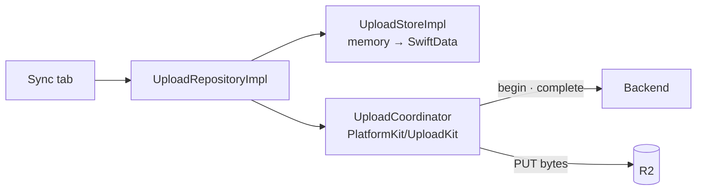
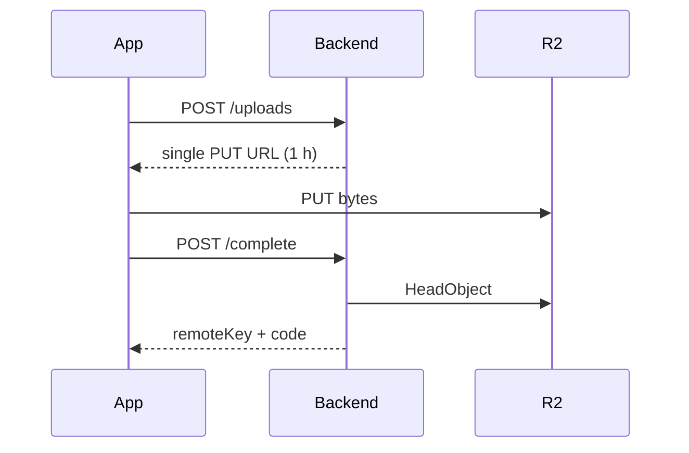
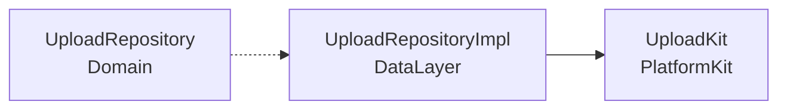
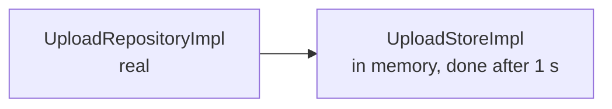
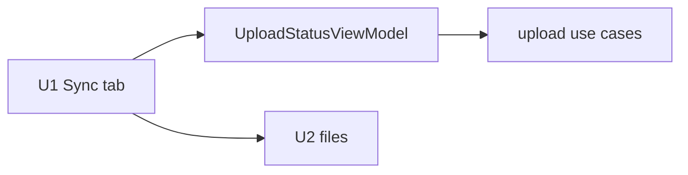
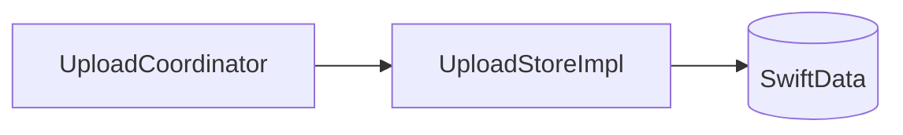
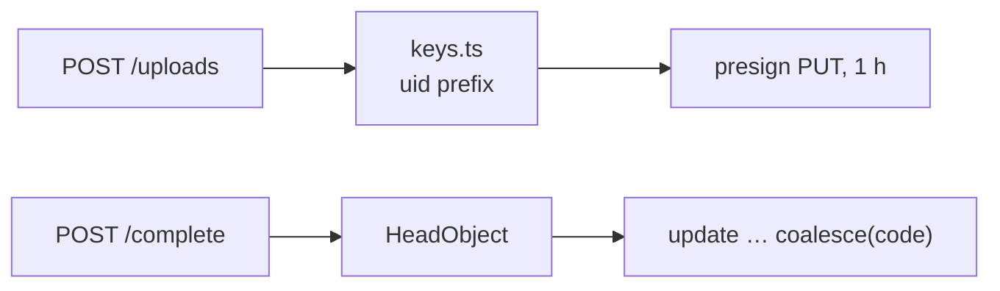
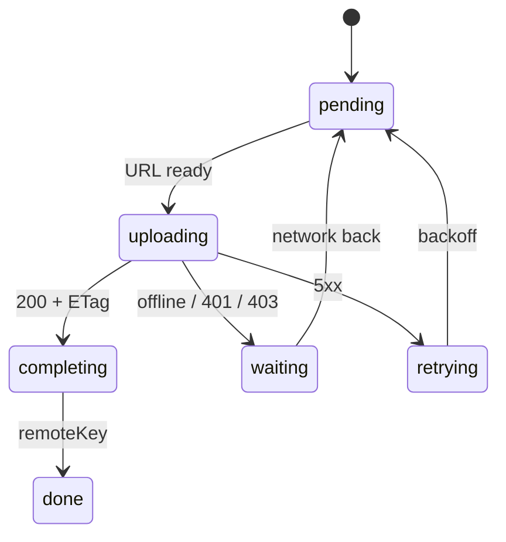

# F06 — Upload (single PUT)

<dl><dd>

- Sprint [S3](README.md) · 36h · skeleton guide — full code is added when this feature starts.
- Code in this guide is a teaching example. Check current source and follow [F00 localization rules](../S0-foundation-access/F00-foundation.md#user-facing-text-and-localization) before applying it.

</dd></dl>

## Contents

<dl><dd>

1. [Overview](#overview)
2. [Target structure](#target-structure)
3. [1. Contract — begin and complete](#1-contract--begin-and-complete)
4. [2. Domain — UploadKit API and job types](#2-domain--uploadkit-api-and-job-types)
5. [3. Fake data — upload store in memory](#3-fake-data--upload-store-in-memory)
6. [4. View models — wire the Sync tab](#4-view-models--wire-the-sync-tab)
7. [5. Local — upload store on SwiftData](#5-local--upload-store-on-swiftdata)
8. [6. Backend — begin and idempotent complete](#6-backend--begin-and-idempotent-complete)
9. [7. Sync — background single PUT](#7-sync--background-single-put)
10. [Tests (after the feature works)](#tests-after-the-feature-works)
11. [Feature done](#feature-done)

</dd></dl>

## Overview

<dl><dd>

- **Goal:** files under 5 MB reach storage through a background `URLSession`, survive suspension, and get a server-confirmed hash. Large files and resume are F07.
- **Demo — offline:** airplane mode → captures wait on the Sync tab with a plain reason; nothing is red.
- **Demo — signed in:** network back → photos upload; kill the app mid-way → they still finish; the server's hash matches.
- **Spec:** [04 Upload engine](../../feature-docs/02-upload-sync.md#04-upload-engine), [03-backend §3, §6, §7.3](../../feature-docs/03-backend.md#3-endpoints)
- **Starts from:** F02 (`HTTPClient`, token) and F05 (hashed media files).
- **Steps:** [How every feature runs](../README.md#how-every-feature-runs). Upload talks to its own endpoints, so step 7 swaps the transport, not a sync table.
- **File tags:** <b class="tag-new">New</b> create the file · <b class="tag-edit">Edit</b> change only the part shown · <b class="tag-replace">Replace</b> overwrite the whole file.

| Step | Layer | Hours | Status | What |
|---|---|---|---|---|
| [1](#1-contract--begin-and-complete) | Contract | 1h | not start | `POST /uploads`, `POST /uploads/:id/complete` DTOs |
| [2](#2-domain--uploadkit-api-and-job-types) | Domain | 1h | not start | UploadKit job, states, `UploadStore` protocol |
| [3](#3-fake-data--upload-store-in-memory) | Fake data | 2h | not start | `UploadStoreImpl` in memory; real `UploadRepositoryImpl` |
| [4](#4-view-models--wire-the-sync-tab) | View models | 6h | not start | Sync tab, today's files |
| [5](#5-local--upload-store-on-swiftdata) | Local | 4h | not start | Upload store on SwiftData |
| [6](#6-backend--begin-and-idempotent-complete) | Backend | 8h | not start | Begin (single mode), idempotent `complete`, key rules |
| [7](#7-sync--background-single-put) | Sync | 14h | not start | Background session, state machine, backoff |



</dd></dl>

## Target structure

<dl><dd>

```text
Backend/src/routes/uploads.ts, src/keys.ts, migrations/0005_uploads.sql   # 6
Packages/PlatformKit/Sources/PlatformKit/UploadKit/                       # uses nothing from the rest of the app
├── UploadStore.swift, UploadJobRecord.swift                              # 2
├── UploadStateMachine.swift                                              # 7
├── UploadCoordinator.swift (actor), BackgroundSessionDelegate.swift      # 7
└── PresignedURLProvider.swift                                            # 7
Packages/DataLayer/Sources/DataLayer/
├── Models/Remote/UploadBeginDTO.swift, UploadCompleteDTO.swift           # 1
├── DataSources/Local/Persistence/UploadStoreImpl.swift                   # 3: in memory · 5: SwiftData
└── Repositories/UploadRepositoryImpl.swift                               # 3: real from the start
SiteLog/
├── App/AppDelegate.swift                                                 # 7: handleEventsForBackgroundURLSession
└── Presentation/Uploads/UploadStatus/, UploadFiles/                      # 4
```

</dd></dl>

## 1. Contract — begin and complete

<dl><dd>

#### Overview

<dl><dd>

- **Goal:** control calls are tiny JSON; bytes never pass through the backend.

| Call | Request | Response |
|---|---|---|
| `POST /uploads` | `sessionId`, `captureId`, `sha256`, `byteSize`, `contentType` | `single` plan: one presigned PUT URL (multipart is F07) |
| `POST /uploads/:id/complete` | ETag | `remoteKey`, `verificationCode` — same body on every repeat |



- **Check:** the single-PUT threshold (5 MiB) is one config value on both sides.

</dd></dl>

</dd></dl>

## 2. Domain — UploadKit API and job types

<dl><dd>

#### Overview

<dl><dd>

- **Goal:** UploadKit's public API — a job record, its states, the store protocol — in PlatformKit, knowing nothing about SiteLog.
- **Spec:** [04.1](../../feature-docs/02-upload-sync.md#041-boundary)

| Action | File | Holds |
|---|---|---|
| <b class="tag-new">New</b> | `UploadKit/UploadStore.swift` | Protocol from spec 04.1 |
| <b class="tag-new">New</b> | `UploadKit/UploadJobRecord.swift` | Job, part, state enums |
| <b class="tag-new">New</b> | `DomainLayer/Repositories/UploadRepository.swift` | Enqueue a capture, status per file, retry |



- **Check:** nothing in `UploadKit/` imports another folder.

</dd></dl>

</dd></dl>

## 3. Fake data — upload store in memory

<dl><dd>

#### Overview

<dl><dd>

- **Goal:** the real `UploadRepositoryImpl`; its store data source keeps jobs in memory and, until step 7, marks each job done after a second.

| Action | File | Holds |
|---|---|---|
| <b class="tag-new">New</b> | `DataSources/Local/Persistence/UploadStoreImpl.swift` | The store, values in memory until step 5 |
| <b class="tag-new">New</b> | `Repositories/UploadRepositoryImpl.swift` | Real: maps jobs to Domain, `catch` → `Result`, logs |
| <b class="tag-new">New</b> | `PlatformKit/Tests/PlatformKitTests/Doubles/InMemoryUploadStore.swift` | Test double for the state machine tests; test target only |
| <b class="tag-edit">Edit</b> | `App/DI/DataSourcesDI.swift`, `RepositoriesDI.swift`, `UseCasesDI.swift` | Register once |



- **Check:** captures appear on the Sync tab and turn “done” one by one.

</dd></dl>

</dd></dl>

## 4. View models — wire the Sync tab

<dl><dd>

#### Overview

<dl><dd>

- **Goal:** one big figure, plain waiting reasons, failed files with Retry.

| Action | Skeleton folder | View model work |
|---|---|---|
| <b class="tag-new">New</b> view model · <b class="tag-edit">Edit</b> view | `Presentation/Uploads/UploadStatus/` | U1: big figure, waiting reasons, failed + Retry, Wi-Fi only |
| <b class="tag-new">New</b> view model · <b class="tag-edit">Edit</b> view | `Presentation/Uploads/UploadFiles/` | U2: today's files with state |



- **Check:** “Waiting” uses `DSStatusMarker(.waiting)` — never red; estimates never NaN or negative.

</dd></dl>

</dd></dl>

## 5. Local — upload store on SwiftData

<dl><dd>

#### Overview

<dl><dd>

- **Goal:** `UploadStoreImpl` keeps its type; jobs survive relaunch.

| Action | File | Holds |
|---|---|---|
| <b class="tag-replace">Replace</b> | `DataSources/Local/Persistence/UploadStoreImpl.swift` | Same type, now SwiftData; lookup by `taskDescription = "jobID#part"` |



- **Check:** kill with 10 files waiting → relaunch → 10 waiting.

</dd></dl>

</dd></dl>

## 6. Backend — begin and idempotent complete

<dl><dd>

#### Overview

<dl><dd>

- **Goal:** sign uploads only for the caller's own keys; `complete` can be called any number of times.
- **Spec:** [03-backend §3–4, §7.3](../../feature-docs/03-backend.md#73-idempotent-complete)

| Action | File | Holds |
|---|---|---|
| <b class="tag-new">New</b> | `Backend/migrations/0005_uploads.sql` | `uploads` from spec §5.1 |
| <b class="tag-new">New</b> | `Backend/src/keys.ts` | Strict key regex `{uid}/{project}/{session}/{capture}.{ext}`; no `..`, no absolute paths |
| <b class="tag-new">New</b> | `Backend/src/routes/uploads.ts` | Begin (single mode), `complete` with `HeadObject`, idempotent |



- **Check:** `complete` twice → identical `200` body; a key under another uid → rejected.

</dd></dl>

#### Steps

<dl><dd>

1. Presign locally with `s3-request-presigner`; one R2 bucket per environment.
2. Never `400` for a transient condition.

</dd></dl>

</dd></dl>

## 7. Sync — background single PUT

<dl><dd>

#### Overview

<dl><dd>

- **Goal:** the coordinator's transport becomes a background `URLSession`; a pure state machine decides every retry. Split into tasks: session · state machine · backoff.
- **Spec:** [04.3](../../feature-docs/02-upload-sync.md#043-ios-background-constraints), [04.4](../../feature-docs/02-upload-sync.md#044-state-machine)

| Action | File | Holds |
|---|---|---|
| <b class="tag-new">New</b> | `UploadKit/BackgroundSessionDelegate.swift` | Session delegate |
| <b class="tag-new">New</b> | `UploadKit/UploadCoordinator.swift` | Actor, the only executor of effects |
| <b class="tag-new">New</b> | `UploadKit/UploadStateMachine.swift` | Events → (state, effects); no I/O |
| <b class="tag-new">New</b> | `UploadKit/PresignedURLProvider.swift` | Begin and complete through `HTTPClient` |
| <b class="tag-edit">Edit</b> | `App/AppDelegate.swift`, `App/DI/PlatformDI.swift` | `handleEventsForBackgroundURLSession`; register the coordinator |



- **Check:** a real device uploads 20 photos with the screen locked; the repository did not change.

</dd></dl>

#### Steps

<dl><dd>

1. `isDiscretionary = false`, `sessionSendsLaunchEvents = true`; enqueue the first batch in the foreground.
2. 401/403 and offline consume no retry budget.
3. Delay `min(2s × 2^n, 300s) × jitter`, max 5 attempts; inject the RNG.

</dd></dl>

</dd></dl>

## Tests (after the feature works)

<dl><dd>

**3. Fake data**

- Store round-trip on the test double

**4. View models**

- Estimates never NaN or negative

**6. Backend**

- Migrations on empty and seeded databases
- Key prefix (`other-uid/`, `../`, absolute)
- Concurrent duplicate `complete`

**7. Sync**

- Full (state × event) matrix
- Budget rules; backoff with a stubbed RNG
- `MockTransport` flow; real device: lock the phone mid-upload

</dd></dl>

## Feature done

<dl><dd>

| Check | How |
|---|---|
| Demo | Small photos upload after a kill; server hashes match; airplane mode waits without red |
| Tests | `bundle exec fastlane test` and `npm test` green |
| Roadmap | F06 steps ticked |

</dd></dl>
