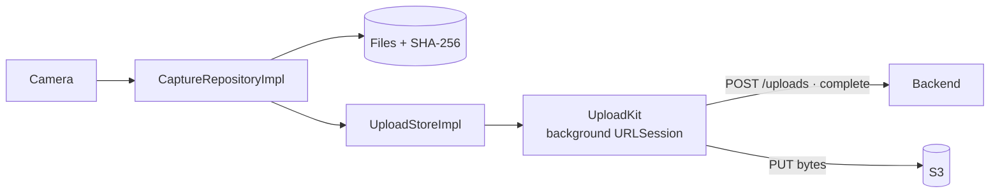

# S3 — Capture and upload

<dl><dd>

- Sprint 3 · 2 weeks · 60h · [all sprints](../README.md)

</dd></dl>

## Contents

<dl><dd>

1. [Overview](#overview)
2. [Tasks](#tasks)
3. [Done](#done)
4. [Self-check](#self-check)

</dd></dl>

## Overview

<dl><dd>

- **Goal:** photos are captured and hashed offline; small files reach storage through a background upload.
- **Demo — offline:** airplane mode → capture → photo linked to a location, kept after relaunch; the Sync tab shows it waiting.
- **Demo — signed in:** network back → the photo uploads, the server confirms its hash, capture metadata syncs to the second device.

| F | Feature | Guide | Hours |
|---|---|---|---|
| F05 | Capture | [F05-capture.md](F05-capture.md) | 24 |
| F06 | Upload (single PUT) | [F06-upload.md](F06-upload.md) | 36 |

</dd></dl>

## Tasks

<dl><dd>

| Task | Step | Layer | Hours | Status |
|---|---|---|---|---|
| F05.1 | Capture contract | Contract | 1 | not start |
| F05.2 | Record a capture | Domain | 1 | not start |
| F05.3 | Repository + capture data source on a bundled photo | Fake data | 2 | not start |
| F05.4 | Camera view models | View models | 3 | not start |
| F05.5 | Camera, disk, SHA-256 (split: camera · files · hash) | Local | 14 | not start |
| F05.6 | [site-log-be F05](https://github.com/DAMHONGDUC/site-log-be/blob/main/docs/feature-guide/S3-capture-upload/F05-captures.md): `0003_captures.sql` | Backend | 2 | not start |
| F05.7 | Captures join sync | Sync | 1 | not start |
| F06.1 | Begin / complete payloads | Contract | 1 | not start |
| F06.2 | UploadKit API and job types | Domain | 1 | not start |
| F06.3 | `UploadStoreImpl` in memory | Fake data | 2 | not start |
| F06.4 | Sync tab view models | View models | 6 | not start |
| F06.5 | Upload store on SwiftData | Local | 4 | not start |
| F06.6 | [site-log-be F06](https://github.com/DAMHONGDUC/site-log-be/blob/main/docs/feature-guide/S3-capture-upload/F06-upload.md): begin, idempotent `complete`, abort, media URLs | Backend | 8 | not start |
| F06.7 | Background single PUT, state machine, backoff (split: 3 tasks) | Sync | 14 | not start |

</dd></dl>

## Done

<dl><dd>

- [ ] Offline: capture in airplane mode, kept after relaunch; "waiting" never shows red
- [ ] Signed in: a small photo uploads after a kill; server hash matches
- [ ] F05 and F06 tests written and green

</dd></dl>

## Self-check

<dl><dd>

- Why is the SHA-256 computed at capture time, not at upload time?
- Which three paths are kept apart: control, bytes, state? Who owns each?
- What should happen when `complete` is called twice?

</dd></dl>
