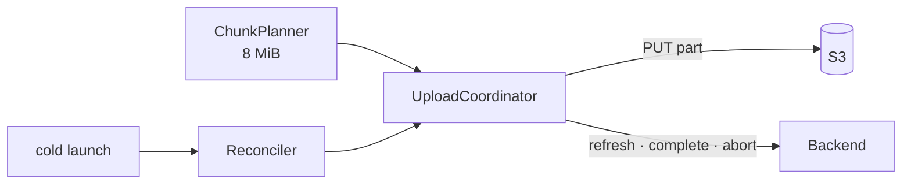
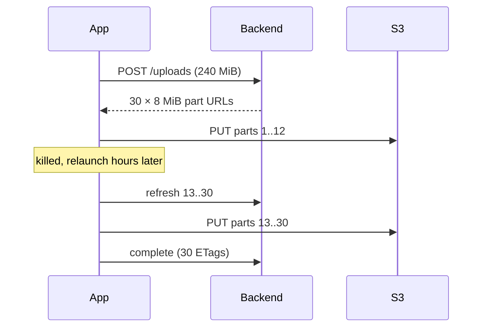
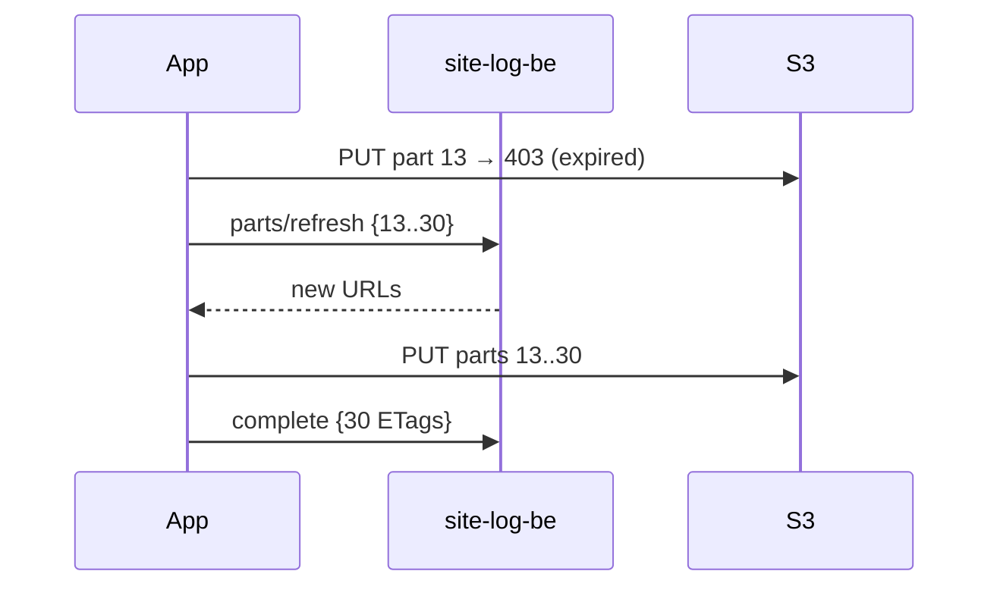
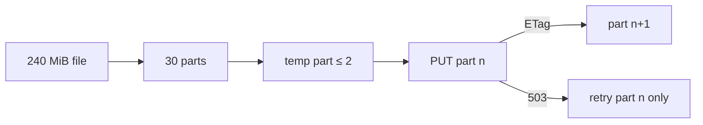
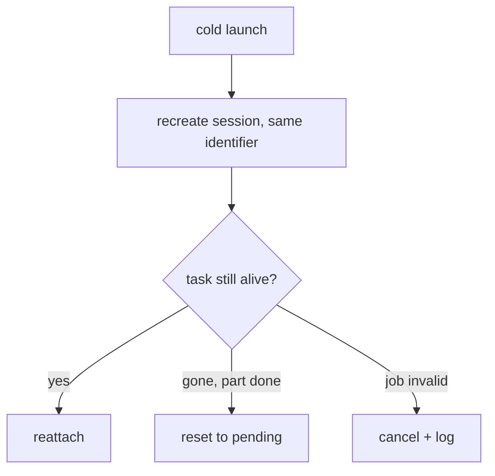
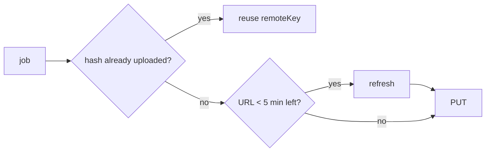
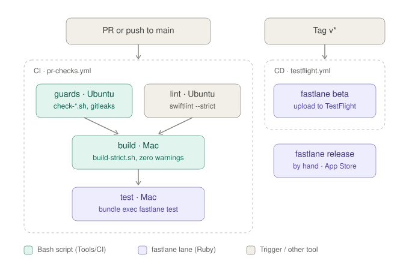

# F07 — Resumable upload · TestFlight #1

<dl><dd>

- Sprint [S4](README.md) · 47h · skeleton guide — full code is added when this feature starts.
- Code in this guide is a teaching example. Check current source and follow [F00 localization rules](../S0-foundation-access/F00-foundation.md#user-facing-text-and-localization) before applying it.

</dd></dl>

## Contents

<dl><dd>

1. [Overview](#overview)
2. [Target structure](#target-structure)
3. [1. Contract — multipart, refresh, abort](#1-contract--multipart-refresh-abort)
4. [2. Backend — in site-log-be](#2-backend--in-site-log-be)
5. [3. Sync — multipart and resume](#3-sync--multipart-and-resume)
6. [4. Sync — kill and relaunch reconciliation](#4-sync--kill-and-relaunch-reconciliation)
7. [5. Sync — Wi-Fi only, dedupe, URL refresh](#5-sync--wi-fi-only-dedupe-url-refresh)
8. [6. Sync — 200-file demo](#6-sync--200-file-demo)
9. [7. Release — signing and TestFlight #1](#7-release--signing-and-testflight-1)
10. [Tests (after the feature works)](#tests-after-the-feature-works)
11. [Feature done](#feature-done)

</dd></dl>

## Overview

<dl><dd>

- **Goal:** files over 5 MB upload in 8 MiB parts and resume part by part after a kill, an expired URL or airplane mode; the first TestFlight build ships.
- **Demo — offline:** 200 files queued in airplane mode, retry budget untouched; Wi-Fi only on cellular sends zero bytes.
- **Demo — signed in:** 200 files / 2 GB finish with a kill in the middle; TestFlight installs on a real device.
- **Spec:** [04.2](../../feature-docs/02-upload-sync.md#042-protocol), [04.5](../../feature-docs/02-upload-sync.md#045-policy), [03-backend §7](../../feature-docs/03-backend.md#7-uploads), [17 CI/CD](../../feature-docs/05-platform.md#17-cicd-and-testflight)
- **Starts from:** F06. Domain, fake data, view models and the store are already built, so this feature starts at the contract and goes straight to the backend and transport.
- **File tags:** <b class="tag-new">New</b> create the file · <b class="tag-edit">Edit</b> change only the part shown.

| Step | Layer | Hours | Status | What |
|---|---|---|---|---|
| [1](#1-contract--multipart-refresh-abort) | Contract | 1h | not start | Multipart plan, refresh, abort DTOs |
| [2](#2-backend--in-site-log-be) | Backend | 6h | not start | site-log-be F07: multipart begin, `/parts/refresh`, abort |
| [3](#3-sync--multipart-and-resume) | Sync | 14h | not start | Chunk planner, part upload, complete |
| [4](#4-sync--kill-and-relaunch-reconciliation) | Sync | 8h | not start | Reattach · cancel · reset at launch |
| [5](#5-sync--wi-fi-only-dedupe-url-refresh) | Sync | 5h | not start | Policy and proactive refresh |
| [6](#6-sync--200-file-demo) | Sync | 3h | not start | Real coordinator behind the screens |
| [7](#7-release--signing-and-testflight-1) | Release | 10h | not start | `v*` tag → TestFlight |



</dd></dl>

## Target structure

<dl><dd>

```text
Packages/PlatformKit/Sources/PlatformKit/UploadKit/
├── ChunkPlanner.swift, PartFileWriter.swift                        # 3
└── Reconciler.swift                                                # 4
Packages/DataLayer/Sources/DataLayer/Models/Remote/UploadPartsDTO.swift   # 1
SiteLog/App/Startup/Steps/ReconcileUploadsStep.swift                # 4
fastlane/Fastfile, .github/workflows/testflight.yml                 # 7
```

</dd></dl>

## 1. Contract — multipart, refresh, abort

<dl><dd>

#### Overview

<dl><dd>

- **Goal:** the extra calls large files need.

| Call | Request | Response |
|---|---|---|
| `POST /uploads` (≥ 5 MiB) | same as F06 | `multipart` plan: part count, part URLs |
| `POST /uploads/:id/parts/refresh` | part numbers | fresh URLs for exactly those parts |
| `POST /uploads/:id/complete` | all ETags | `remoteKey`, `verificationCode` |
| `DELETE /uploads/:id` | — | aborted |



- **Check:** part size 8 MiB is one config value on both sides.

</dd></dl>

</dd></dl>

## 2. Backend — in site-log-be

<dl><dd>

#### Overview

<dl><dd>

- **Goal:** files from 5 MiB upload in 8 MiB parts that survive a kill; expired part URLs are refreshed.
- **Built in:** [F07 Multipart](https://github.com/DAMHONGDUC/site-log-be/blob/main/docs/feature-guide/S4-resumable-upload/F07-multipart.md) — same sprint, separate repository; nothing to write in this repo.
- **API this feature uses:** [§7.2 Begin](../../feature-docs/03-backend.md#72-begin-and-put) · [§7.3 Complete](../../feature-docs/03-backend.md#73-complete) · [§7.4 Refresh, abort](../../feature-docs/03-backend.md#74-refresh-abort-media).
- **Run it locally:** [local testing with iOS](https://github.com/DAMHONGDUC/site-log-be/blob/main/docs/feature-guide/local-testing-with-ios.md).

| Backend piece | The app | Check from the app |
|---|---|---|
| Multipart answer of `POST /uploads` | `ChunkPlanner` follows `partSizeBytes`; one temp file per part | `mode: multipart` for a video |
| `POST /uploads/:id/parts/refresh` | After a long kill or any S3 `403`, no retry budget used | A killed upload finishes hours later |
| `complete` with every part's ETag | Sends all parts once, in any order | Code appears; no part sent twice |



- **Check:** kill the app mid-video, relaunch later: it finishes against staging without re-sending done parts.

</dd></dl>

</dd></dl>

## 3. Sync — multipart and resume

<dl><dd>

#### Overview

<dl><dd>

- **Goal:** uniform parts uploaded one by one; a part failure retries only that part. Split into tasks: planner · upload · complete.

| Action | File | Holds |
|---|---|---|
| <b class="tag-new">New</b> | `UploadKit/ChunkPlanner.swift` | Fixed-size parts |
| <b class="tag-new">New</b> | `UploadKit/PartFileWriter.swift` | At most 2 temp part files per job |
| <b class="tag-edit">Edit</b> | `UploadKit/UploadStateMachine.swift`, `UploadCoordinator.swift` | Part events and effects |



- **Check:** a 503 at part 3 retries only part 3; a final-part failure never calls `complete`.

</dd></dl>

</dd></dl>

## 4. Sync — kill and relaunch reconciliation

<dl><dd>

#### Overview

<dl><dd>

- **Goal:** after a cold launch nothing sticks at 60%.
- **Spec:** [04.3](../../feature-docs/02-upload-sync.md#043-ios-background-constraints)

| Action | File | Holds |
|---|---|---|
| <b class="tag-new">New</b> | `UploadKit/Reconciler.swift` | Three cases: reattach · cancel + log · reset to pending |
| <b class="tag-new">New</b> | `App/Startup/Steps/ReconcileUploadsStep.swift` | Non-blocking startup step |



- **Check:** all three cases on a real device kill.

</dd></dl>

</dd></dl>

## 5. Sync — Wi-Fi only, dedupe, URL refresh

<dl><dd>

#### Overview

<dl><dd>

- **Goal:** respect Wi-Fi only (default on), never upload the same bytes twice, refresh URLs before they expire.
- **Spec:** [04.5](../../feature-docs/02-upload-sync.md#045-policy)

| Rule | Where |
|---|---|
| `allowsCellularAccess = false` when Wi-Fi only | Session configuration |
| Same `sha256` in a project → reuse `remoteKey` | Coordinator, before begin |
| URL near expiry → refresh first | `PresignedURLProvider` |



- **Check:** a 60 s URL TTL refreshes on its own; cellular with Wi-Fi only sends zero bytes.

</dd></dl>

</dd></dl>

## 6. Sync — 200-file demo

<dl><dd>

#### Overview

<dl><dd>

- **Goal:** the real coordinator and SwiftData store behind the Sync tab, proven at scale.

| Action | File | Holds |
|---|---|---|
| <b class="tag-edit">Edit</b> | `App/DI/PlatformDI.swift`, `DataSourcesDI.swift` | Real coordinator and store; registered types stay |


- **Check:** 200 files / 2 GB complete with matching server hashes.

</dd></dl>

</dd></dl>

## 7. Release — signing and TestFlight #1

<dl><dd>

#### Overview

<dl><dd>

- **Goal:** a `v*` tag becomes a TestFlight build with no local step.
- **Spec:** [17](../../feature-docs/05-platform.md#17-cicd-and-testflight)



| Action | File | Holds |
|---|---|---|
| <b class="tag-edit">Edit</b> | `fastlane/Fastfile` | Lanes `beta`, `release` |
| <b class="tag-new">New</b> | `.github/workflows/testflight.yml` | Tag `v*`, protected `testflight` environment |


- **Check:** the build appears in TestFlight; the repo holds no `.p8`, certificate or profile.

</dd></dl>

#### Steps

<dl><dd>

1. App Store Connect API key in GitHub secrets (`ASC_KEY_ID`, `ASC_ISSUER_ID`, `ASC_KEY_CONTENT`).
2. Build number = latest TestFlight + 1.

</dd></dl>

</dd></dl>

## Tests (after the feature works)

<dl><dd>

**2. Backend**

- In site-log-be: `test/multipart.test.ts` ([its tests](https://github.com/DAMHONGDUC/site-log-be/blob/main/docs/feature-guide/S4-resumable-upload/F07-multipart.md#tests))

**3–6. Sync**

- Planner sizes
- 503 at part 3 retries only part 3
- All three reconciliation cases
- Real kill on device resumes without re-uploading parts
- 60 s URL TTL refreshes automatically
- Wi-Fi only on cellular sends zero bytes

</dd></dl>

## Feature done

<dl><dd>

| Check | How |
|---|---|
| Demo | 200 files survive kill + airplane mode |
| TestFlight #1 | Installed from TestFlight on a real device |
| Tests | `bundle exec fastlane test` and `npm test` green |
| Roadmap | F07 steps ticked |

</dd></dl>
