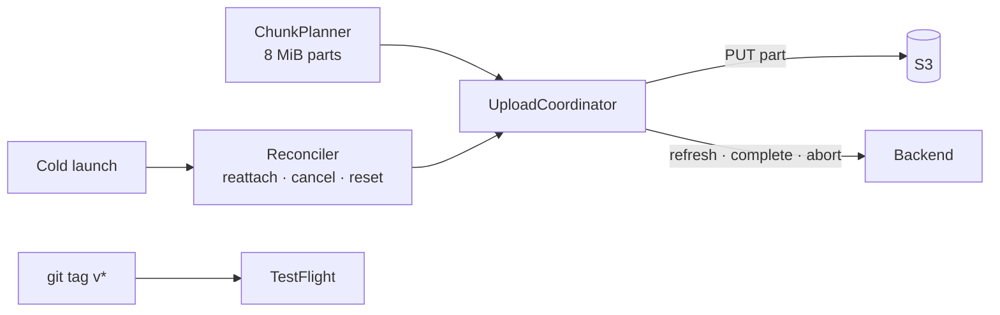

# S4 — Resumable upload · TestFlight #1

<dl><dd>

- Sprint 4 · 2 weeks · 47h · [all sprints](../README.md)

</dd></dl>

## Contents

<dl><dd>

1. [Overview](#overview)
2. [Tasks](#tasks)
3. [Done](#done)
4. [Self-check](#self-check)

</dd></dl>

## Overview

<dl><dd>

- **Goal:** large files upload in parts and survive app kill, expired URLs and airplane mode; first TestFlight build.
- **Demo — offline:** 200 files queued in airplane mode; retry budget untouched.
- **Demo — signed in:** network back → 200 files / 2 GB finish, with a kill in the middle; TestFlight build installs on a real device.

| F | Feature | Guide | Hours |
|---|---|---|---|
| F07 | Resumable upload · TestFlight #1 | [F07-resumable-upload.md](F07-resumable-upload.md) | 47 |

</dd></dl>

## Tasks

<dl><dd>

| Task | Step | Layer | Hours | Status |
|---|---|---|---|---|
| F07.1 | Multipart plan, refresh, abort payloads | Contract | 1 | not start |
| F07.2 | [site-log-be F07](https://github.com/DAMHONGDUC/site-log-be/blob/main/docs/feature-guide/S4-resumable-upload/F07-multipart.md): multipart begin, `/parts/refresh`, abort | Backend | 6 | not start |
| F07.3 | Multipart and resume (split: planner · upload · complete) | Sync | 14 | not start |
| F07.4 | Kill and relaunch reconciliation | Sync | 8 | not start |
| F07.5 | Wi-Fi only, dedupe by hash, URL refresh | Sync | 5 | not start |
| F07.6 | 200-file demo behind the screens | Sync | 3 | not start |
| F07.7 | Signing and TestFlight #1 (split: signing · lane) | Release | 10 | not start |

</dd></dl>

## Done

<dl><dd>

- [ ] 200 files / 2 GB complete with matching server hashes, with a kill in the middle
- [ ] Airplane mode → waiting, budget intact; Wi-Fi only on cellular sends zero bytes
- [ ] TestFlight #1 installed from TestFlight; the repo holds no `.p8`, certificate or profile
- [ ] F07 tests written and green

</dd></dl>

## Self-check

<dl><dd>

- A part URL expires after an hour. Why is refreshing it better than a longer TTL?
- After a kill, which three states can a job be in, and what does each need?
- Why does a final-part failure never call `complete`?

</dd></dl>
