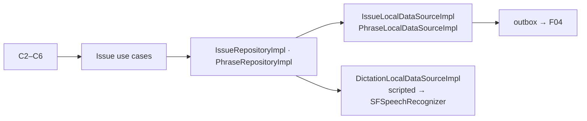
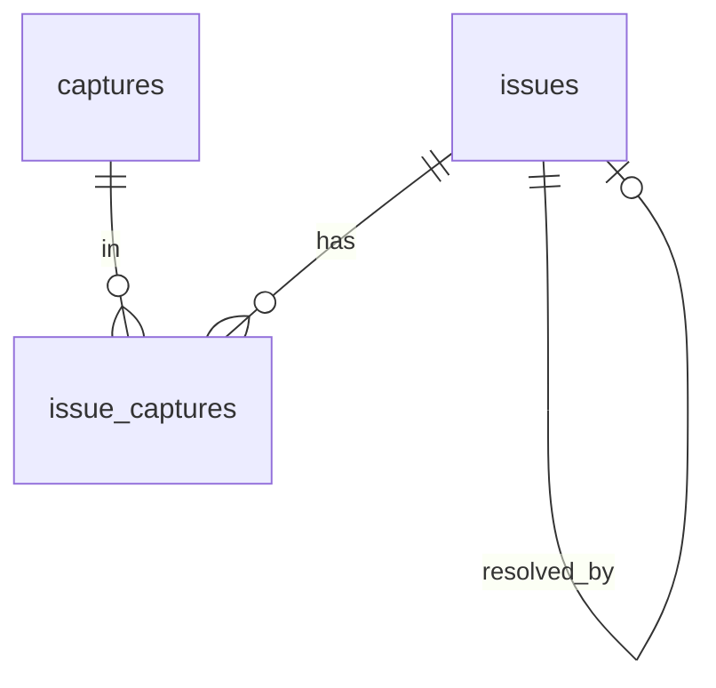
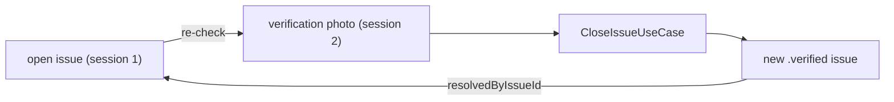
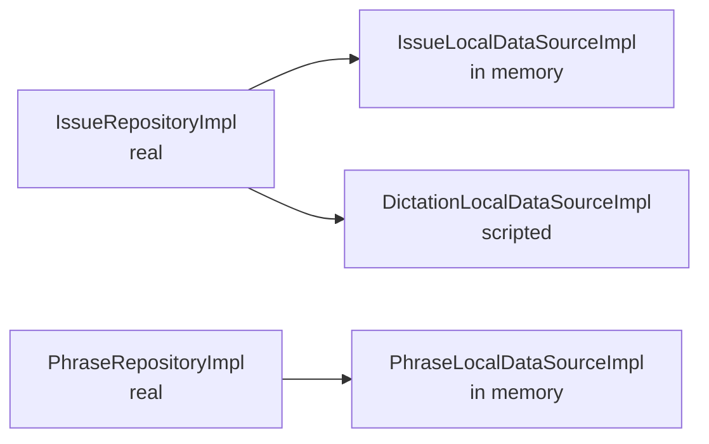
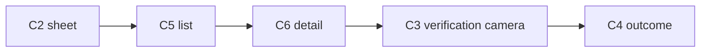
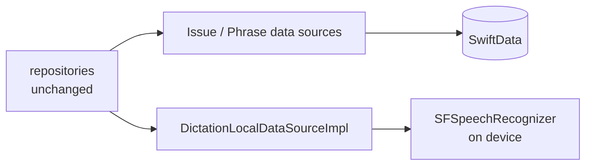
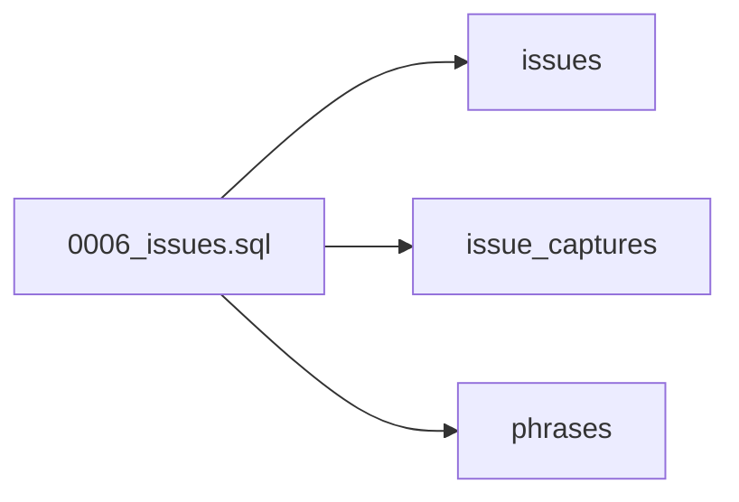
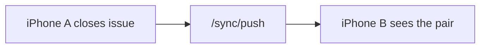

# F08 — Issues and before/after

<dl><dd>

- Sprint [S5](README.md) · 26h · skeleton guide — full code is added when this feature starts.
- Code in this guide is a teaching example. Check current source and follow [F00 localization rules](../S0-foundation-access/F00-foundation.md#user-facing-text-and-localization) before applying it.

</dd></dl>

## Contents

<dl><dd>

1. [Overview](#overview)
2. [Target structure](#target-structure)
3. [1. Contract — issue rows](#1-contract--issue-rows)
4. [2. Domain — issues, pairing, carry-over](#2-domain--issues-pairing-carry-over)
5. [3. Fake data — data sources in memory](#3-fake-data--data-sources-in-memory)
6. [4. View models — wire the Issues screens](#4-view-models--wire-the-issues-screens)
7. [5. Local — SwiftData and dictation](#5-local--swiftdata-and-dictation)
8. [6. Backend — issue tables](#6-backend--issue-tables)
9. [7. Sync — issues join the engine](#7-sync--issues-join-the-engine)
10. [Tests (after the feature works)](#tests-after-the-feature-works)
11. [Feature done](#feature-done)

</dd></dl>

## Overview

<dl><dd>

- **Goal:** log an issue from the camera, surface it next session, close it by a verification photo as a before/after pair.
- **Demo — offline:** issue logged by voice → re-checked next session → closed; the pair shows on the issue.
- **Demo — signed in:** the issue and its pair appear on the second device.
- **Spec:** [03](../../feature-docs/01-field-work.md#03-issues-and-before-after-pairing), [12.3 dictation](../../feature-docs/01-field-work.md#123-dictation-and-voice-notes)
- **Starts from:** F05 (captures) and the skeleton `Presentation/Issues/`.
- **Steps:** [How every feature runs](../README.md#how-every-feature-runs).
- **File tags:** <b class="tag-new">New</b> create the file · <b class="tag-edit">Edit</b> change only the part shown · <b class="tag-replace">Replace</b> overwrite the whole file.

| Step | Layer | Hours | Status | What |
|---|---|---|---|---|
| [1](#1-contract--issue-rows) | Contract | 1h | not start | `IssueDTO`, `IssueCaptureDTO`, `PhraseDTO` |
| [2](#2-domain--issues-pairing-carry-over) | Domain | 3h | not start | Entities, pure pairing, close, carry-over |
| [3](#3-fake-data--data-sources-in-memory) | Fake data | 3h | not start | Real repositories over in-memory data sources |
| [4](#4-view-models--wire-the-issues-screens) | View models | 7h | not start | Sheet, list, detail, verification camera, outcome |
| [5](#5-local--swiftdata-and-dictation) | Local | 8h | not start | SwiftData, on-device speech |
| [6](#6-backend--issue-tables) | Backend | 2h | not start | `0006_issues.sql` |
| [7](#7-sync--issues-join-the-engine) | Sync | 2h | not start | Three tables syncable |



</dd></dl>

## Target structure

<dl><dd>

```text
Backend/migrations/0006_issues.sql                                     # 6
Packages/
├── DomainLayer/Sources/DomainLayer/
│   ├── Entities/Issues/                                               # 2: Issue, IssuePairing, Phrase
│   ├── Repositories/IssueRepository.swift, PhraseRepository.swift     # 2
│   └── UseCases/Issues/                                               # 2: PairIssuesUseCase (pure), log, close, carry-over
├── DataLayer/Sources/DataLayer/
│   ├── Models/Remote/IssueDTO.swift, IssueCaptureDTO.swift, PhraseDTO.swift   # 1
│   ├── Repositories/IssueRepositoryImpl.swift, PhraseRepositoryImpl.swift     # 3: real from the start
│   ├── DataSources/Local/Persistence/Issue…, Phrase…                  # 3: in memory · 5: SwiftData
│   └── DataSources/Local/Speech/DictationLocalDataSource(+Impl)       # 3: scripted · 5: PlatformKit
└── PlatformKit/Sources/PlatformKit/Speech/                            # 5: SFSpeechRecognizer
SiteLog/
└── Presentation/Issues/                                               # 4: IssueSheet, IssueList, IssueDetail, VerificationCamera, OutcomePicker
```

</dd></dl>

## 1. Contract — issue rows

<dl><dd>

#### Overview

<dl><dd>

- **Goal:** the three rows issues need, on both sides.

| Row | Business fields |
|---|---|
| Issue | `projectId`, `locationId`, `title`, `detail`, `severity`, `status`, `dueDate`, `assigneeName`, `trade`, `planSheetId`, `pinX/pinY`, `resolvedByIssueId`, `sourceChecklistResultId` |
| Issue capture | `(issueId, captureId)` — insert-only |
| Phrase | `text`, `usageCount` |



- **Check:** pin is all-or-none and inside 0…1 on both sides.

</dd></dl>

</dd></dl>

## 2. Domain — issues, pairing, carry-over

<dl><dd>

#### Overview

<dl><dd>

- **Goal:** the issue rules live in Domain: pairing is pure; closing creates a new `.verified` issue and links the old one.

| Action | File | Holds |
|---|---|---|
| <b class="tag-new">New</b> | `Entities/Issues/` | `Issue`, `IssuePairing`, `Phrase` — sync fields included |
| <b class="tag-new">New</b> | `Repositories/IssueRepository.swift`, `PhraseRepository.swift` | Protocols |
| <b class="tag-new">New</b> | `UseCases/Issues/` | `PairIssuesUseCase` (pure), `LogIssueUseCase`, `CloseIssueUseCase`, `CarryOverIssuesUseCase` |



- **Check:** ⌘B; closing never mutates a prior capture or issue.

</dd></dl>

#### Steps

<dl><dd>

1. Upload priority: critical 100 · major 50 · minor 10.

</dd></dl>

</dd></dl>

## 3. Fake data — data sources in memory

<dl><dd>

#### Overview

<dl><dd>

- **Goal:** real repositories over data sources seeded with 5 sample issues and a few phrases; dictation returns a scripted sentence.

| Action | File | Holds |
|---|---|---|
| <b class="tag-new">New</b> | `DataSources/Local/Persistence/IssueLocalDataSource.swift`, `PhraseLocalDataSource.swift` + `Impl`s | In memory: 5 issues (critical, major, minor, one closed) |
| <b class="tag-new">New</b> | `DataSources/Local/Speech/DictationLocalDataSource.swift` + `Impl` | Returns “Crack above the door frame” after 1 s |
| <b class="tag-new">New</b> | `Repositories/IssueRepositoryImpl.swift`, `PhraseRepositoryImpl.swift` | Real: map, `catch` → `Result`, log |
| <b class="tag-edit">Edit</b> | `App/DI/…DI.swift`, `UseCases/DevData/` | Register once; reset and seed |



- **Check:** dev menu seeds the 5 issues; the Issues tab badge counts them.

</dd></dl>

#### Steps

<dl><dd>

1. Move the sample values out of `App/Fakes/FakeData.swift`.

</dd></dl>

</dd></dl>

## 4. View models — wire the Issues screens

<dl><dd>

#### Overview

<dl><dd>

- **Goal:** every Issues screen reads real use cases; the full loop runs with Continue offline.

| Action | Skeleton folder | View model work |
|---|---|---|
| <b class="tag-new">New</b> view model · <b class="tag-edit">Edit</b> view | `Presentation/Issues/IssueSheet/` | C2 / K3: severity default Major, assignee, due, phrases |
| <b class="tag-new">New</b> view model · <b class="tag-edit">Edit</b> view | `Presentation/Issues/IssueList/` | C5: Open / Closed / All, grouped by level; tab badge count |
| <b class="tag-new">New</b> view model · <b class="tag-edit">Edit</b> view | `Presentation/Issues/IssueDetail/` | C6: facts, Mark up, Re-check now |
| <b class="tag-new">New</b> view model · <b class="tag-edit">Edit</b> view | `Presentation/Issues/VerificationCamera/` | C3: ghost opacity from `IssueDefaults.overlayOpacity` |
| <b class="tag-new">New</b> view model · <b class="tag-edit">Edit</b> view | `Presentation/Issues/OutcomePicker/` | C4: close / keep open / raise |



- **Check:** Continue offline: log → re-check → close shows the pair on C6.

</dd></dl>

#### Steps

<dl><dd>

1. `<Screen>ViewModel.swift` next to the view; pushes through `coordinator.push(IssuesRoute…)`.
2. Replace `FakeData…`; keep the layout (visual finish is F18).

</dd></dl>

</dd></dl>

## 5. Local — SwiftData and dictation

<dl><dd>

#### Overview

<dl><dd>

- **Goal:** the data source `Impl`s keep their types; inside, SwiftData and on-device speech. Split into tasks: storage · dictation.
- **Spec:** [03.1–03.2](../../feature-docs/01-field-work.md#031-flows), [12.3](../../feature-docs/01-field-work.md#123-dictation-and-voice-notes)

| Action | File | Holds |
|---|---|---|
| <b class="tag-new">New</b> | `Models/Local/IssueModel.swift`, `IssueCaptureModel.swift`, `PhraseModel.swift` | `@Model`; join the next schema version |
| <b class="tag-replace">Replace</b> | `DataSources/Local/Persistence/Issue…Impl.swift`, `Phrase…Impl.swift` | Same types, now `@ModelActor` |
| <b class="tag-new">New</b> | `PlatformKit/Speech/` | `SFSpeechRecognizer` with `requiresOnDeviceRecognition = true`; vi + en |
| <b class="tag-replace">Replace</b> | `DataSources/Local/Speech/DictationLocalDataSourceImpl.swift` | Same type, over PlatformKit Speech |



- **Check:** dictation works in airplane mode; relaunch keeps issues and phrase order.

</dd></dl>

#### Steps

<dl><dd>

1. Voice note = audio `Capture`.
2. Deleting a location with open issues is rejected.

</dd></dl>

</dd></dl>

## 6. Backend — issue tables

<dl><dd>

#### Overview

<dl><dd>

- **Goal:** server tables for the three rows.

| Action | File | Holds |
|---|---|---|
| <b class="tag-new">New</b> | `Backend/migrations/0006_issues.sql` | `issues`, `issue_captures`, `phrases` (unique `(uid, text)` where live) |
| <b class="tag-edit">Edit</b> | `Backend/src/sync/tables.ts`, `routes/account.ts` | Allow in sync; join the account deletion |



- **Check:** a pin outside 0…1 is rejected.

</dd></dl>

</dd></dl>

## 7. Sync — issues join the engine

<dl><dd>

#### Overview

<dl><dd>

- **Goal:** issues, issue captures and phrases move like every other table.

| Action | File | Holds |
|---|---|---|
| <b class="tag-edit">Edit</b> | `Issue…`, `Phrase…LocalDataSourceImpl.swift` | Adopt `SyncableLocalDataSource`; write outbox rows |
| <b class="tag-edit">Edit</b> | `App/DI/SyncTablesDI.swift` | `issues → issue_captures` after `captures`; `phrases` |



- **Check:** a pair closed on A shows on B; `issue_captures` are insert-only.

</dd></dl>

</dd></dl>

## Tests (after the feature works)

<dl><dd>

**2. Domain**

- Pairing with 0 / 1 / n open issues
- Closing never mutates prior captures

**5. Local**

- Delete-with-open-issues rejected
- Phrase ordering tie-break
- Dictation in airplane mode

</dd></dl>

## Feature done

<dl><dd>

| Check | How |
|---|---|
| Demo | Issue → re-check → before/after pair shown on the issue, on both devices |
| Tests | `bundle exec fastlane test` and `npm test` green |
| Roadmap | F08 steps ticked |

</dd></dl>
