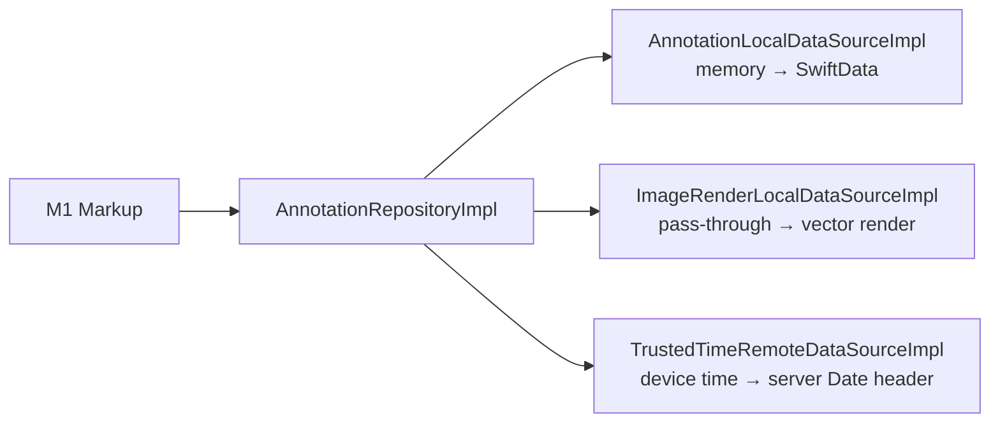
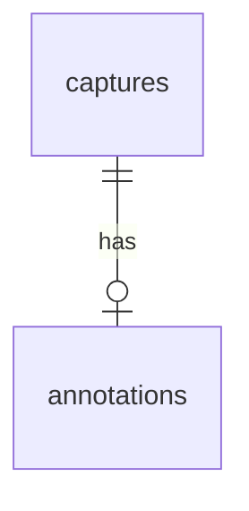
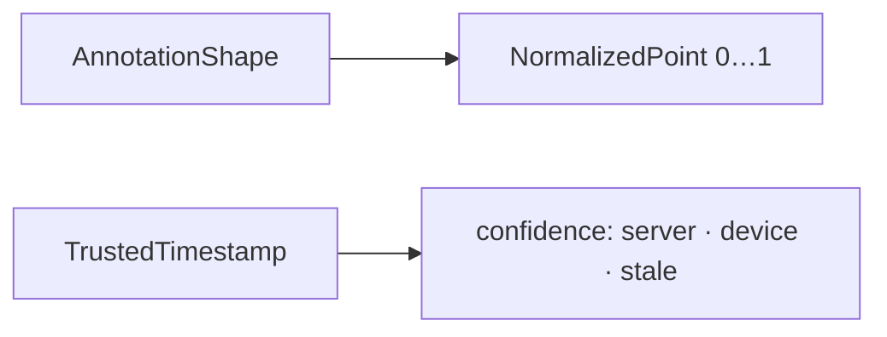
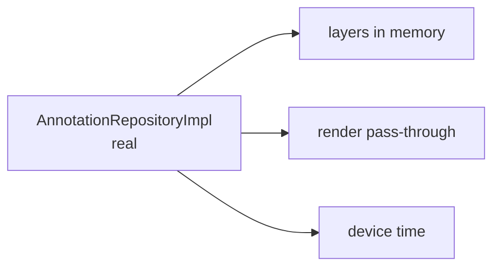
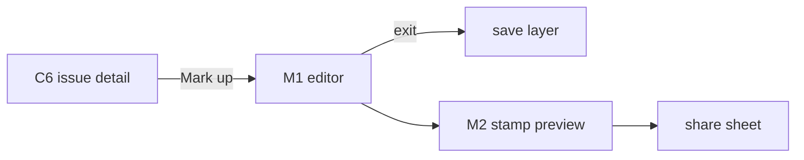
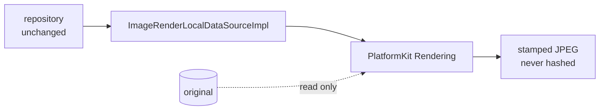
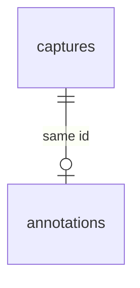
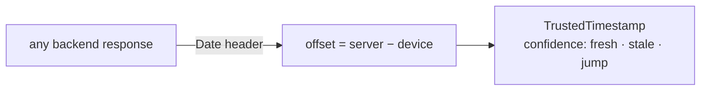

# F09 — Markup and stamps

<dl><dd>

- Sprint [S5](README.md) · 22h · skeleton guide — full code is added when this feature starts.
- Code in this guide is a teaching example. Check current source and follow [F00 localization rules](../S0-foundation-access/F00-foundation.md#user-facing-text-and-localization) before applying it.

</dd></dl>

## Contents

<dl><dd>

1. [Overview](#overview)
2. [Target structure](#target-structure)
3. [1. Contract — annotation row](#1-contract--annotation-row)
4. [2. Domain — annotation types](#2-domain--annotation-types)
5. [3. Fake data — data sources in memory](#3-fake-data--data-sources-in-memory)
6. [4. View models — wire markup and stamp](#4-view-models--wire-markup-and-stamp)
7. [5. Local — vector rendering](#5-local--vector-rendering)
8. [6. Backend — in site-log-be](#6-backend--in-site-log-be)
9. [7. Sync — annotations and trusted time](#7-sync--annotations-and-trusted-time)
10. [Tests (after the feature works)](#tests-after-the-feature-works)
11. [Feature done](#feature-done)

</dd></dl>

## Overview

<dl><dd>

- **Goal:** markup is a vector layer over the original photo; a stamped copy carries trusted time. The original is never touched.
- **Demo — offline:** mark up a photo; the original hash is unchanged; share a stamped copy with “device time” confidence.
- **Demo — signed in:** the markup appears on the second device; the stamp uses the server clock offset.
- **Spec:** [12 Annotation and stamps](../../feature-docs/01-field-work.md#12-annotation-and-verifiable-stamps)
- **Starts from:** F05 (captures) and the skeleton `Presentation/Annotation/`.
- **Steps:** [How every feature runs](../README.md#how-every-feature-runs).
- **File tags:** <b class="tag-new">New</b> create the file · <b class="tag-edit">Edit</b> change only the part shown · <b class="tag-replace">Replace</b> overwrite the whole file.

| Step | Layer | Hours | Status | What |
|---|---|---|---|---|
| [1](#1-contract--annotation-row) | Contract | 1h | not start | `AnnotationDTO` |
| [2](#2-domain--annotation-types) | Domain | 1h | not start | `AnnotationShape`, `NormalizedPoint`, `TrustedTimestamp` |
| [3](#3-fake-data--data-sources-in-memory) | Fake data | 1h | not start | Real `AnnotationRepositoryImpl` over in-memory data sources |
| [4](#4-view-models--wire-markup-and-stamp) | View models | 4h | not start | Markup editor, stamp preview |
| [5](#5-local--vector-rendering) | Local | 7h | not start | Layer rendering, stamped derivative |
| [6](#6-backend--in-site-log-be) | Backend | 1h | not start | site-log-be F09: `0006_annotations.sql` |
| [7](#7-sync--annotations-and-trusted-time) | Sync | 7h | not start | Annotations syncable; clock offset from the server |



</dd></dl>

## Target structure

<dl><dd>

```text
Packages/
├── DomainLayer/Sources/DomainLayer/Entities/Annotation/                 # 2: AnnotationShape, NormalizedPoint, TrustedTimestamp
├── DataLayer/Sources/DataLayer/
│   ├── Models/Remote/AnnotationDTO.swift                                # 1
│   ├── Repositories/AnnotationRepositoryImpl.swift                      # 3: real from the start
│   ├── DataSources/Local/Persistence/AnnotationLocalDataSource(+Impl)   # 3: in memory · 5: SwiftData
│   ├── DataSources/Local/Rendering/ImageRenderLocalDataSource(+Impl)    # 3: pass-through · 5: PlatformKit
│   └── DataSources/Remote/Time/TrustedTimeRemoteDataSource(+Impl)       # 3: device time · 7: HTTPClient
└── PlatformKit/Sources/PlatformKit/Rendering/Annotation/                # 5
SiteLog/
└── Presentation/Annotation/MarkupEditor/, StampPreview/                 # 4
```

</dd></dl>

## 1. Contract — annotation row

<dl><dd>

#### Overview

<dl><dd>

- **Goal:** one annotation row per capture.

| Field | Shape |
|---|---|
| `captureId` | Primary key, 1:1 with the capture |
| `shapes` | JSON array of `AnnotationShape` (points 0…1) |
| Sync | `rev`, `clientUpdatedAt`, `deletedAt` |



- **Check:** `AnnotationShape` encodes to the same JSON the backend stores as `jsonb`.

</dd></dl>

</dd></dl>

## 2. Domain — annotation types

<dl><dd>

#### Overview

<dl><dd>

- **Goal:** the markup vocabulary, size-independent.

| Action | File | Holds |
|---|---|---|
| <b class="tag-new">New</b> | `Entities/Annotation/` | `AnnotationShape`, `NormalizedPoint` (0…1), `TrustedTimestamp` (time + confidence) |
| <b class="tag-new">New</b> | `Repositories/AnnotationRepository.swift`, `UseCases/Annotation/` | Save layer, load layer, make stamped copy |



- **Check:** ⌘B; `AnnotationShape` Codable round-trip.

</dd></dl>

</dd></dl>

## 3. Fake data — data sources in memory

<dl><dd>

#### Overview

<dl><dd>

- **Goal:** the real repository; layers in memory, rendering passes the original through, time is the device clock.

| Action | File | Holds |
|---|---|---|
| <b class="tag-new">New</b> | `DataSources/Local/Persistence/AnnotationLocalDataSource.swift` + `Impl` | Layers per capture; seeded with one markup on the crack photo |
| <b class="tag-new">New</b> | `DataSources/Local/Rendering/ImageRenderLocalDataSource.swift` + `Impl` | Returns the original image unchanged |
| <b class="tag-new">New</b> | `DataSources/Remote/Time/TrustedTimeRemoteDataSource.swift` + `Impl` | Device time, confidence `.device` |
| <b class="tag-new">New</b> | `Repositories/AnnotationRepositoryImpl.swift` | Real: map, `catch` → `Result`, log |



- **Check:** dev menu seeds the crack markup.

</dd></dl>

</dd></dl>

## 4. View models — wire markup and stamp

<dl><dd>

#### Overview

<dl><dd>

- **Goal:** tools, colours, undo, commit on exit; stamp toggles and share.

| Action | Skeleton folder | View model work |
|---|---|---|
| <b class="tag-new">New</b> view model · <b class="tag-edit">Edit</b> view | `Presentation/Annotation/MarkupEditor/` | M1: tools, colours, undo capped at `maxUndoSteps`, commit on exit |
| <b class="tag-new">New</b> view model · <b class="tag-edit">Edit</b> view | `Presentation/Annotation/StampPreview/` | M2: stamp toggles, share |



- **Check:** Continue offline: draw, leave, come back — the layer is there.

</dd></dl>

</dd></dl>

## 5. Local — vector rendering

<dl><dd>

#### Overview

<dl><dd>

- **Goal:** `ImageRenderLocalDataSourceImpl` keeps its type; inside it draws the layer and the stamp. `AnnotationLocalDataSourceImpl` moves to SwiftData. Split into tasks: layer · stamp.
- **Spec:** [12.1](../../feature-docs/01-field-work.md#121-annotation-layer)

| Action | File | Holds |
|---|---|---|
| <b class="tag-new">New</b> | `PlatformKit/Rendering/Annotation/` | Draws shapes at any size; stroke scales with image width |
| <b class="tag-replace">Replace</b> | `DataSources/Local/Rendering/ImageRenderLocalDataSourceImpl.swift` | Over PlatformKit rendering |
| <b class="tag-replace">Replace</b> | `DataSources/Local/Persistence/AnnotationLocalDataSourceImpl.swift` | SwiftData `AnnotationModel` |



- **Check:** same render at two sizes; the original's hash never changes.

</dd></dl>

</dd></dl>

## 6. Backend — in site-log-be

<dl><dd>

#### Overview

<dl><dd>

- **Goal:** the markup layer of a photo syncs as JSON.
- **Built in:** [F09 Annotations](https://github.com/DAMHONGDUC/site-log-be/blob/main/docs/feature-guide/S5-issues-markup/F09-annotations.md) — same sprint, separate repository; nothing to write in this repo.
- **API this feature uses:** [§6.3 Synced tables](../../feature-docs/03-backend.md#63-synced-tables).
- **Run it locally:** [local testing with iOS](https://github.com/DAMHONGDUC/site-log-be/blob/main/docs/feature-guide/local-testing-with-ios.md).

| Backend piece | The app | Check from the app |
|---|---|---|
| Table `annotations`, `id` = capture id | Push after the capture; `shapes` as a JSON array | An arrow drawn on A shows on B |



- **Check:** shapes round-trip unchanged.

</dd></dl>

</dd></dl>

## 7. Sync — annotations and trusted time

<dl><dd>

#### Overview

<dl><dd>

- **Goal:** layers sync; `TrustedTimeRemoteDataSourceImpl` keeps its type and reads the clock offset from the backend's `Date` header.
- **Spec:** [12.2, 12.4](../../feature-docs/01-field-work.md#124-trusted-time)

| Action | File | Holds |
|---|---|---|
| <b class="tag-edit">Edit</b> | `AnnotationLocalDataSourceImpl.swift`, `App/DI/SyncTablesDI.swift` | Syncable; `annotations` after `issue_captures` |
| <b class="tag-replace">Replace</b> | `DataSources/Remote/Time/TrustedTimeRemoteDataSourceImpl.swift` | Offset from `Date` on any `HTTPClient` response; confidence by age |



- **Check:** set the phone clock wrong → the stamp still shows server time with its confidence.

</dd></dl>

</dd></dl>

## Tests (after the feature works)

<dl><dd>

**2. Domain**

- `AnnotationShape` Codable round-trip

**4. View models**

- Undo bounds

**5. Local**

- Same render at two sizes
- Original never mutated
- Stamp position correct in three orientations

**7. Sync**

- Confidence for fresh / stale offset, clock jump, relaunch

</dd></dl>

## Feature done

<dl><dd>

| Check | How |
|---|---|
| Demo | Markup on a photo; original hash unchanged; stamped copy shared; markup on both devices |
| Tests | `bundle exec fastlane test` and `npm test` green |
| Roadmap | F09 steps ticked |

</dd></dl>
