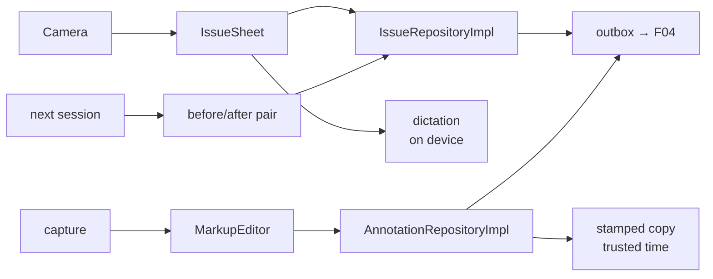

# S5 — Issues and markup

<dl><dd>

- Sprint 5 · 2 weeks · 48h · [all sprints](../README.md)

</dd></dl>

## Contents

<dl><dd>

1. [Overview](#overview)
2. [Tasks](#tasks)
3. [Done](#done)
4. [Self-check](#self-check)

</dd></dl>

## Overview

<dl><dd>

- **Goal:** issues are logged from the camera, carried into the next session and closed as before/after pairs; photos get a markup layer and a stamped copy with trusted time.
- **Demo — offline:** log an issue by voice, re-check it next session, close it with a verification photo; mark it up; share a stamped copy.
- **Demo — signed in:** the issue, its pair and the markup appear on the second device; the stamp's time comes from the server clock.

| F | Feature | Guide | Hours |
|---|---|---|---|
| F08 | Issues and before/after | [F08-issues.md](F08-issues.md) | 26 |
| F09 | Markup and stamps | [F09-markup.md](F09-markup.md) | 22 |

</dd></dl>

## Tasks

<dl><dd>

| Task | Step | Layer | Hours | Status |
|---|---|---|---|---|
| F08.1 | Issue, issue capture, phrase rows | Contract | 1 | not start |
| F08.2 | Issue entities, pairing, close, carry-over use cases | Domain | 3 | not start |
| F08.3 | Repositories + data sources in memory | Fake data | 3 | not start |
| F08.4 | Issues screens (split: sheet · list · detail · verification) | View models | 7 | not start |
| F08.5 | SwiftData, on-device dictation (split: storage · dictation) | Local | 8 | not start |
| F08.6 | [site-log-be F08](https://github.com/DAMHONGDUC/site-log-be/blob/main/docs/feature-guide/S5-issues-markup/F08-issues.md): `0005_issues.sql` | Backend | 2 | not start |
| F08.7 | Issues, issue captures, phrases join sync | Sync | 2 | not start |
| F09.1 | Annotation row | Contract | 1 | not start |
| F09.2 | Annotation types | Domain | 1 | not start |
| F09.3 | Repository + data sources in memory | Fake data | 1 | not start |
| F09.4 | Markup and stamp screens | View models | 4 | not start |
| F09.5 | Vector rendering (split: layer · stamp) | Local | 7 | not start |
| F09.6 | [site-log-be F09](https://github.com/DAMHONGDUC/site-log-be/blob/main/docs/feature-guide/S5-issues-markup/F09-annotations.md): `0006_annotations.sql` | Backend | 1 | not start |
| F09.7 | Annotations sync; trusted time from the server clock | Sync | 7 | not start |

</dd></dl>

## Done

<dl><dd>

- [ ] Offline: issue → re-check → before/after pair; markup saved as a layer; original hash unchanged
- [ ] Signed in: issues and markup converge on two devices; stamp time confidence shown
- [ ] F08 and F09 tests written and green

</dd></dl>

## Self-check

<dl><dd>

- Closing an issue never edits the old one. What gets created instead, and why does a report need that?
- Why are markup points stored 0…1 instead of in pixels?
- Where does “trusted” time come from when the phone's clock is wrong?

</dd></dl>
