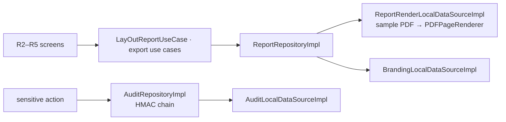
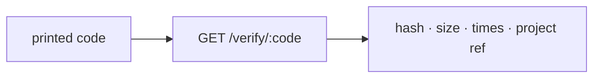
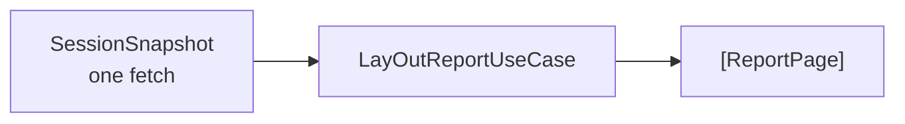
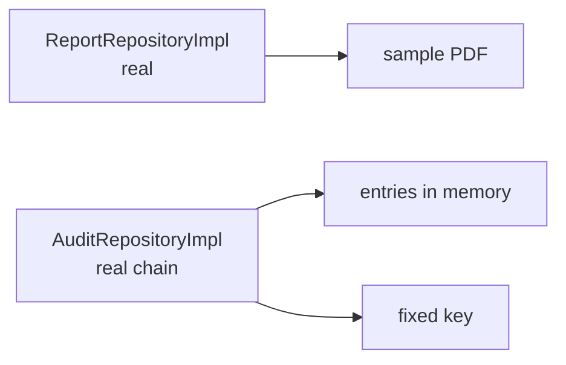
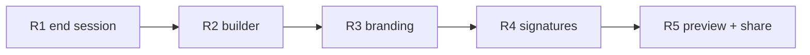
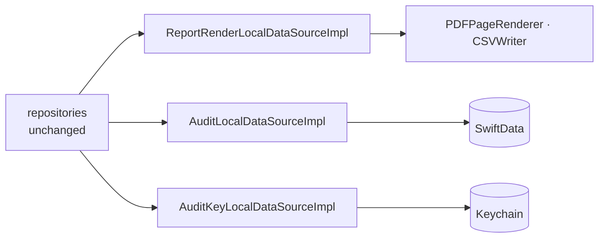
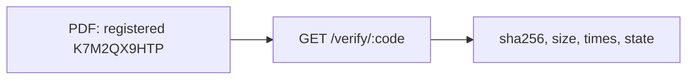
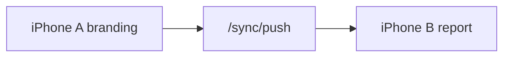

# F10 — Reports and audit log

<dl><dd>

- Sprint [S6](README.md) · 37h · skeleton guide — full code is added when this feature starts.
- Code in this guide is a teaching example. Check current source and follow [F00 localization rules](../S0-foundation-access/F00-foundation.md#user-facing-text-and-localization) before applying it.

</dd></dl>

## Contents

<dl><dd>

1. [Overview](#overview)
2. [Target structure](#target-structure)
3. [1. Contract — verify response and branding](#1-contract--verify-response-and-branding)
4. [2. Domain — report types, audit, pagination](#2-domain--report-types-audit-pagination)
5. [3. Fake data — data sources in memory](#3-fake-data--data-sources-in-memory)
6. [4. View models — wire the report flow](#4-view-models--wire-the-report-flow)
7. [5. Local — CSV, PDF, audit chain](#5-local--csv-pdf-audit-chain)
8. [6. Backend — in site-log-be](#6-backend--in-site-log-be)
9. [7. Sync — branding](#7-sync--branding)
10. [Tests (after the feature works)](#tests-after-the-feature-works)
11. [Feature done](#feature-done)

</dd></dl>

## Overview

<dl><dd>

- **Goal:** a signed, branded PDF and a CSV from one session snapshot; every sensitive action written to an HMAC-chained audit log.
- **Demo — offline:** session → report builder → branding → two signatures → PDF + CSV shared in airplane mode; the audit chain verifies at launch.
- **Demo — signed in:** branding appears on the second device; the code printed in the PDF resolves at `GET /verify/:code`.
- **Spec:** [05 Export](../../feature-docs/04-reporting-security.md#05-pdf-and-spreadsheet-export), [07.3 Audit log](../../feature-docs/04-reporting-security.md#073-audit-log), [03-backend §8](../../feature-docs/03-backend.md#8-verify)
- **Starts from:** F08 and F09 (issues, pairs, markup) and the skeleton `Presentation/Reports/`.
- **Steps:** [How every feature runs](../README.md#how-every-feature-runs).
- **File tags:** <b class="tag-new">New</b> create the file · <b class="tag-edit">Edit</b> change only the part shown · <b class="tag-replace">Replace</b> overwrite the whole file.

| Step | Layer | Hours | Status | What |
|---|---|---|---|---|
| [1](#1-contract--verify-response-and-branding) | Contract | 1h | not start | `VerifyDTO`, `ReportBrandingDTO` |
| [2](#2-domain--report-types-audit-pagination) | Domain | 3h | not start | Report types, `AuditEntry`, `LayOutReportUseCase` |
| [3](#3-fake-data--data-sources-in-memory) | Fake data | 2h | not start | Real repositories; sample PDF, in-memory branding and audit |
| [4](#4-view-models--wire-the-report-flow) | View models | 4h | not start | Builder, branding, signatures, preview |
| [5](#5-local--csv-pdf-audit-chain) | Local | 21h | not start | CSV writer, PDF renderer, audit storage and key |
| [6](#6-backend--in-site-log-be) | Backend | 4h | not start | site-log-be F10: branding table, `GET /verify/:code` |
| [7](#7-sync--branding) | Sync | 2h | not start | Branding syncable |



</dd></dl>

## Target structure

<dl><dd>

```text
Packages/
├── DomainLayer/Sources/DomainLayer/
│   ├── Entities/Reports/                                                  # 2: SessionSnapshot, ReportOptions, ReportBranding, Signature, ReportPage, AuditEntry
│   └── UseCases/Reports/                                                  # 2: LayOutReportUseCase (pure), export, record audit
├── DataLayer/Sources/DataLayer/
│   ├── Models/Remote/VerifyDTO.swift, ReportBrandingDTO.swift             # 1
│   ├── Repositories/ReportRepositoryImpl.swift, AuditRepositoryImpl.swift # 3: real from the start
│   ├── DataSources/Local/Rendering/ReportRenderLocalDataSource(+Impl)     # 3: sample PDF · 5: PlatformKit
│   ├── DataSources/Local/Persistence/Branding…, Audit…                    # 3: in memory · 5: SwiftData
│   └── DataSources/Local/Keychain/AuditKeyLocalDataSource(+Impl)          # 3: fixed key · 5: Keychain
└── PlatformKit/Sources/PlatformKit/Rendering/PDF/                         # 5: PDFPageRenderer, CSVWriter (generic)
SiteLog/
└── Presentation/Reports/                                                  # 4: ReportBuilder, Branding, SignaturePad, PDFPreview
```

</dd></dl>

## 1. Contract — verify response and branding

<dl><dd>

#### Overview

<dl><dd>

- **Goal:** what a third party sees when they check a report, and the branding row.

| Shape | Fields |
|---|---|
| `VerifyDTO` (`GET /verify/:code`) | `sha256`, `byteSize`, `receivedAt`, `verified`, `verifiedAt`, `projectRef` — never media, URL, uid or coordinates |
| `ReportBrandingDTO` | Company, logo key, accent, client block, footer; one row per `uid` |



- **Check:** the verify shape has no field that could identify the user.

</dd></dl>

</dd></dl>

## 2. Domain — report types, audit, pagination

<dl><dd>

#### Overview

<dl><dd>

- **Goal:** what goes on which page is a business rule, so pagination lives in Domain as a pure use case.

| Action | File | Holds |
|---|---|---|
| <b class="tag-new">New</b> | `Entities/Reports/` | `SessionSnapshot`, `ReportOptions`, `ReportBranding`, `Signature`, `ReportPage`, `AuditEntry` |
| <b class="tag-new">New</b> | `UseCases/Reports/LayOutReportUseCase.swift` | Pure: `SessionSnapshot` → `[ReportPage]`; counts images |
| <b class="tag-new">New</b> | `Repositories/ReportRepository.swift`, `AuditRepository.swift` | Protocols |



- **Check:** both groupings give the same total; image count = non-excluded captures.

</dd></dl>

</dd></dl>

## 3. Fake data — data sources in memory

<dl><dd>

#### Overview

<dl><dd>

- **Goal:** the real repositories; rendering returns a bundled sample PDF, branding and audit live in memory, the audit key is fixed.

| Action | File | Holds |
|---|---|---|
| <b class="tag-new">New</b> | `DataSources/Local/Rendering/ReportRenderLocalDataSource.swift` + `Impl` | Returns a bundled sample PDF and CSV |
| <b class="tag-new">New</b> | `DataSources/Local/Persistence/BrandingLocalDataSource.swift`, `AuditLocalDataSource.swift` + `Impl`s | Eastline branding, R-0930-07; audit entries in memory |
| <b class="tag-new">New</b> | `DataSources/Local/Keychain/AuditKeyLocalDataSource.swift` + `Impl` | A fixed demo key |
| <b class="tag-new">New</b> | `Repositories/ReportRepositoryImpl.swift` | Real: maps `ReportPage` → `PDFPageLayout`, calls the render data source, maps errors |
| <b class="tag-new">New</b> | `Repositories/AuditRepositoryImpl.swift` | Real: HMAC chain (each entry hashes the previous), verify from the start |



- **Check:** the preview shows the sample PDF; editing an in-memory entry makes verify fail.

</dd></dl>

</dd></dl>

## 4. View models — wire the report flow

<dl><dd>

#### Overview

<dl><dd>

- **Goal:** grouping, branding, two signatures, preview and share.

| Action | Skeleton folder | View model work |
|---|---|---|
| <b class="tag-new">New</b> view model · <b class="tag-edit">Edit</b> view | `Presentation/Reports/ReportBuilder/` | R2: grouping, sections |
| <b class="tag-new">New</b> view model · <b class="tag-edit">Edit</b> view | `Presentation/Reports/Branding/` | R3: letterhead |
| <b class="tag-new">New</b> view model · <b class="tag-edit">Edit</b> view | `Presentation/Reports/SignaturePad/` | R4: two parties (PencilKit) |
| <b class="tag-new">New</b> view model · <b class="tag-edit">Edit</b> view | `Presentation/Reports/PDFPreview/` | R5: preview, estimated size, share |



- **Check:** Continue offline: a session ends in a shared PDF.

</dd></dl>

</dd></dl>

## 5. Local — CSV, PDF, audit chain

<dl><dd>

#### Overview

<dl><dd>

- **Goal:** the data source `Impl`s keep their types; inside, the real CSV writer, PDF renderer, SwiftData and Keychain. Split into tasks: CSV · layout render · integrity footer · audit chain.
- **Spec:** [05.2](../../feature-docs/04-reporting-security.md#052-rendering), [07.3](../../feature-docs/04-reporting-security.md#073-audit-log)

| Action | File | Holds |
|---|---|---|
| <b class="tag-new">New</b> | `PlatformKit/Rendering/PDF/PDFPageRenderer.swift`, `CSVWriter.swift` | Generic: draws `PDFPageLayout` records with `UIGraphicsPDFRenderer`, one autoreleasepool per page; streams CSV with `FileHandle` |
| <b class="tag-replace">Replace</b> | `ReportRenderLocalDataSourceImpl.swift` | Over the renderer; temp file + atomic move |
| <b class="tag-replace">Replace</b> | `Branding…Impl.swift`, `Audit…Impl.swift` | SwiftData |
| <b class="tag-replace">Replace</b> | `AuditKeyLocalDataSourceImpl.swift` | Key generated once, Keychain only |
| <b class="tag-new">New</b> | `App/Startup/Steps/VerifyAuditStep.swift` | Runs async after `.ready` |



- **Check:** 200 images stay under 200 MB; the PDF never drops an image; repositories unchanged.

</dd></dl>

</dd></dl>

## 6. Backend — in site-log-be

<dl><dd>

#### Overview

<dl><dd>

- **Goal:** branding is shared by the user's devices; codes printed in reports can be checked by anyone.
- **Built in:** [F10 Reports, verify](https://github.com/DAMHONGDUC/site-log-be/blob/main/docs/feature-guide/S6-reports-plans/F10-reports-verify.md) — same sprint, separate repository; nothing to write in this repo.
- **API this feature uses:** [§8 Verify](../../feature-docs/03-backend.md#8-verify) · [§6.3 Synced tables](../../feature-docs/03-backend.md#63-synced-tables).
- **Run it locally:** [local testing with iOS](https://github.com/DAMHONGDUC/site-log-be/blob/main/docs/feature-guide/local-testing-with-ios.md).

| Backend piece | The app | Check from the app |
|---|---|---|
| Table `report_branding` (one per user) | Push full row; adopt the stored one when `superseded` | Branding set on A appears on B |
| `GET /verify/:code` | Print the code under each photo and `projectRef` in the header | Safari opens the code from a real PDF |



- **Check:** a code from an exported PDF resolves on staging.

</dd></dl>

</dd></dl>

## 7. Sync — branding

<dl><dd>

#### Overview

<dl><dd>

- **Goal:** branding set on one device is used on the other.

| Action | File | Holds |
|---|---|---|
| <b class="tag-edit">Edit</b> | `BrandingLocalDataSourceImpl.swift`, `App/DI/SyncTablesDI.swift` | Syncable; `report_branding` |



- **Check:** a report exported on B carries A's letterhead.

</dd></dl>

</dd></dl>

## Tests (after the feature works)

<dl><dd>

**2. Domain**

- Both groupings give the same total
- Image count = non-excluded captures

**5. Local**

- CSV escaping
- 200-image memory under 200 MB
- Hash-of-hashes order-stable
- 100-entry chain verifies
- Edit at 50 / mid-chain delete detected at the right index

**6. Backend**

- In site-log-be: `test/verify.test.ts`, `test/branding.test.ts` ([its tests](https://github.com/DAMHONGDUC/site-log-be/blob/main/docs/feature-guide/S6-reports-plans/F10-reports-verify.md#tests))

</dd></dl>

## Feature done

<dl><dd>

| Check | How |
|---|---|
| Demo | Signed PDF + CSV from a real session, before/after pairs included; printed code verifies |
| Tests | `bundle exec fastlane test` and `npm test` green |
| Roadmap | F10 steps ticked |

</dd></dl>
