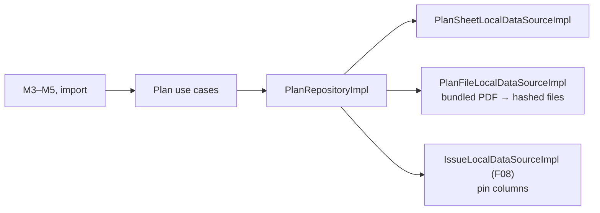
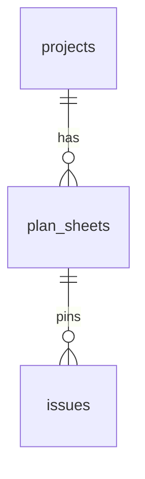
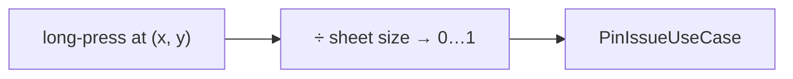
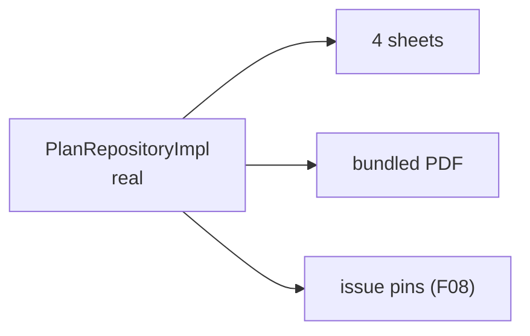
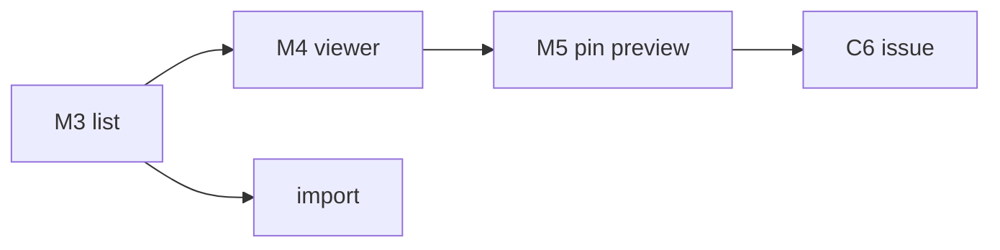
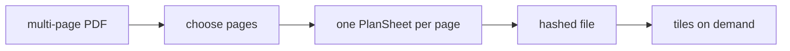
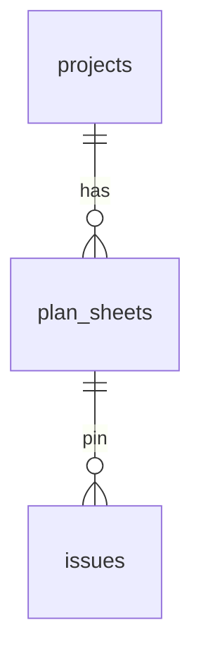
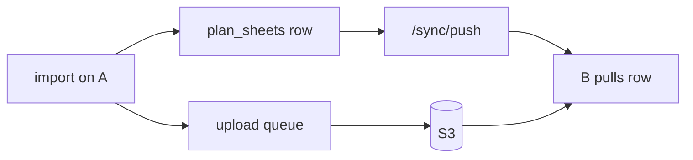

# F11 — Floor plans and pins

<dl><dd>

- Sprint [S6](README.md) · 21h · skeleton guide — full code is added when this feature starts.
- Code in this guide is a teaching example. Check current source and follow [F00 localization rules](../S0-foundation-access/F00-foundation.md#user-facing-text-and-localization) before applying it.

</dd></dl>

## Contents

<dl><dd>

1. [Overview](#overview)
2. [Target structure](#target-structure)
3. [1. Contract — plan sheet row](#1-contract--plan-sheet-row)
4. [2. Domain — plan types and pins](#2-domain--plan-types-and-pins)
5. [3. Fake data — data sources in memory](#3-fake-data--data-sources-in-memory)
6. [4. View models — wire the Plans screens](#4-view-models--wire-the-plans-screens)
7. [5. Local — import, tiles, pins](#5-local--import-tiles-pins)
8. [6. Backend — in site-log-be](#6-backend--in-site-log-be)
9. [7. Sync — plan sheets and plan files](#7-sync--plan-sheets-and-plan-files)
10. [Tests (after the feature works)](#tests-after-the-feature-works)
11. [Feature done](#feature-done)

</dd></dl>

## Overview

<dl><dd>

- **Goal:** import PDF or image plans, view them tiled, pin each issue at one 0…1 point.
- **Demo — offline:** import a real PDF plan, long-press to pin issues; pins survive relaunch.
- **Demo — signed in:** the sheet and its pins appear on the second device; the plan file uploads through F06.
- **Spec:** [11 Floor plans and pins](../../feature-docs/01-field-work.md#11-floor-plans-and-issue-pins)
- **Starts from:** F08 (issues carry `planSheetId`, `pinX`, `pinY`) and the skeleton `Presentation/Plans/`.
- **Steps:** [How every feature runs](../README.md#how-every-feature-runs).
- **File tags:** <b class="tag-new">New</b> create the file · <b class="tag-edit">Edit</b> change only the part shown · <b class="tag-replace">Replace</b> overwrite the whole file.

| Step | Layer | Hours | Status | What |
|---|---|---|---|---|
| [1](#1-contract--plan-sheet-row) | Contract | 1h | not start | `PlanSheetDTO`, plan file key |
| [2](#2-domain--plan-types-and-pins) | Domain | 1h | not start | `PlanSheet`, `Pin`, import / pin / move use cases |
| [3](#3-fake-data--data-sources-in-memory) | Fake data | 1h | not start | Real `PlanRepositoryImpl` over in-memory data sources |
| [4](#4-view-models--wire-the-plans-screens) | View models | 5h | not start | List, viewer, pin preview, import |
| [5](#5-local--import-tiles-pins) | Local | 9h | not start | Hashed plan files, PDFKit tiles, pin persistence |
| [6](#6-backend--in-site-log-be) | Backend | 2h | not start | site-log-be F11: `0008_plan_sheets.sql` |
| [7](#7-sync--plan-sheets-and-plan-files) | Sync | 2h | not start | Sheets syncable; files through the upload queue |



</dd></dl>

## Target structure

<dl><dd>

```text
Packages/
├── DomainLayer/Sources/DomainLayer/Entities/Plans/, UseCases/Plans/     # 2: PlanSheet, Pin (NormalizedPoint)
├── DataLayer/Sources/DataLayer/
│   ├── Models/Remote/PlanSheetDTO.swift                                 # 1
│   ├── Repositories/PlanRepositoryImpl.swift                            # 3: real from the start
│   ├── DataSources/Local/Persistence/PlanSheetLocalDataSource(+Impl)    # 3: in memory · 5: SwiftData
│   └── DataSources/Local/FileStorage/PlanFileLocalDataSource(+Impl)     # 3: bundled PDF · 5: hashed files
└── PlatformKit/Sources/PlatformKit/Rendering/Tiles/                     # 5: PDFKit + CATiledLayer, tile cache (generic)
SiteLog/
└── Presentation/Plans/                                                  # 4: PlanList, PlanViewer, PinPreview, PlanImport
```

</dd></dl>

## 1. Contract — plan sheet row

<dl><dd>

#### Overview

<dl><dd>

- **Goal:** the sheet row and where its file lives in storage.

| Shape | Fields |
|---|---|
| `PlanSheetDTO` | `projectId`, `locationId`, `name`, `pageIndex`, `pixelWidth/Height`, `sha256`, `remoteKey` + sync fields |
| Plan file key | `{uid}/{projectID}/plans/{sheetID}.{ext}` |
| Pin | No table: `planSheetId`, `pinX`, `pinY` on the issue row |



- **Check:** the plan key matches the backend's strict key regex.

</dd></dl>

</dd></dl>

## 2. Domain — plan types and pins

<dl><dd>

#### Overview

<dl><dd>

- **Goal:** one pin per issue, in 0…1 coordinates, moves recorded.

| Action | File | Holds |
|---|---|---|
| <b class="tag-new">New</b> | `Entities/Plans/` | `PlanSheet`, `Pin` (`NormalizedPoint`) |
| <b class="tag-new">New</b> | `UseCases/Plans/` | One file per use case: import, pin, move |
| <b class="tag-new">New</b> | `Repositories/PlanRepository.swift` | Protocol |



- **Check:** ⌘B; a pin outside 0…1 is rejected.

</dd></dl>

</dd></dl>

## 3. Fake data — data sources in memory

<dl><dd>

#### Overview

<dl><dd>

- **Goal:** the real repository; 4 sheets and 6 pins in memory, a bundled PDF as the plan file.

| Action | File | Holds |
|---|---|---|
| <b class="tag-new">New</b> | `DataSources/Local/Persistence/PlanSheetLocalDataSource.swift` + `Impl` | 4 sheets in memory |
| <b class="tag-new">New</b> | `DataSources/Local/FileStorage/PlanFileLocalDataSource.swift` + `Impl` | A bundled PDF |
| <b class="tag-new">New</b> | `Repositories/PlanRepositoryImpl.swift` | Real: sheets, files, pins through F08's issue data source |



- **Check:** dev menu seeds 4 sheets, 6 pins.

</dd></dl>

</dd></dl>

## 4. View models — wire the Plans screens

<dl><dd>

#### Overview

<dl><dd>

- **Goal:** sheets of a project, a viewer with pins and clusters, pin preview, import.

| Action | Skeleton folder | View model work |
|---|---|---|
| <b class="tag-new">New</b> view model · <b class="tag-edit">Edit</b> view | `Presentation/Plans/PlanList/` | M3: sheets of a project |
| <b class="tag-new">New</b> view model · <b class="tag-edit">Edit</b> view | `Presentation/Plans/PlanViewer/` | M4: pins and clusters; long-press drops a pin |
| <b class="tag-new">New</b> view model · <b class="tag-edit">Edit</b> view | `Presentation/Plans/PinPreview/` | M5: issue summary, move, open |
| <b class="tag-new">New</b> view model · <b class="tag-edit">Edit</b> view | `Presentation/Plans/PlanImport/` | Files / photo import |



- **Check:** 60 fps pan and zoom with 50 pins.

</dd></dl>

</dd></dl>

## 5. Local — import, tiles, pins

<dl><dd>

#### Overview

<dl><dd>

- **Goal:** the data source `Impl`s keep their types; inside, hashed plan files, SwiftData sheets and a tiled viewer. Split into tasks: import · tiles · pins.

| Action | File | Holds |
|---|---|---|
| <b class="tag-new">New</b> | `PlatformKit/Rendering/Tiles/` | PDFKit + `CATiledLayer`, tile cache; any PDF or image |
| <b class="tag-replace">Replace</b> | `PlanFileLocalDataSourceImpl.swift` | Files under `media/<project>/plans/`, hashed with `FileHasher` |
| <b class="tag-replace">Replace</b> | `PlanSheetLocalDataSourceImpl.swift` | SwiftData `PlanSheetModel` |



- **Check:** A0 plan peak memory under 150 MB; encrypted or oversized files rejected with a reason.

</dd></dl>

</dd></dl>

## 6. Backend — in site-log-be

<dl><dd>

#### Overview

<dl><dd>

- **Goal:** plan sheets sync; plan files upload under the plan key; pins point at real sheets.
- **Built in:** [F11 Plans](https://github.com/DAMHONGDUC/site-log-be/blob/main/docs/feature-guide/S6-reports-plans/F11-plans.md) — same sprint, separate repository; nothing to write in this repo.
- **API this feature uses:** [§7.1 Keys](../../feature-docs/03-backend.md#71-keys) · [§6.3 Synced tables](../../feature-docs/03-backend.md#63-synced-tables).
- **Run it locally:** [local testing with iOS](https://github.com/DAMHONGDUC/site-log-be/blob/main/docs/feature-guide/local-testing-with-ios.md).

| Backend piece | The app | Check from the app |
|---|---|---|
| Table `plan_sheets` | Push after the project | A sheet imported on A shows on B |
| Plan key `{uid}/{project}/plans/{sheet}.{ext}` | Upload the PDF or image with that key | Upload completes with a code |



- **Check:** a plan sheet and an issue pinned to it sync to the second device.

</dd></dl>

</dd></dl>

## 7. Sync — plan sheets and plan files

<dl><dd>

#### Overview

<dl><dd>

- **Goal:** sheet rows sync; plan files ride the F06 upload queue.

| Action | File | Holds |
|---|---|---|
| <b class="tag-edit">Edit</b> | `PlanSheetLocalDataSourceImpl.swift`, `App/DI/SyncTablesDI.swift` | Syncable; `plan_sheets` after `locations` |
| <b class="tag-edit">Edit</b> | `PlanFileLocalDataSourceImpl.swift` | Enqueue the file in `UploadStoreImpl` when saved |



- **Check:** a sheet imported on A opens on B with its pins.

</dd></dl>

</dd></dl>

## Tests (after the feature works)

<dl><dd>

**4. View models**

- 60 fps pan / zoom with 50 pins

**5. Local**

- Oversized and encrypted imports rejected
- A0 peak memory under 150 MB
- `planPoint` round-trip through zoom / pan
- Sheet delete blocked while pins exist

</dd></dl>

## Feature done

<dl><dd>

| Check | How |
|---|---|
| Demo | Pins on a real floor plan, on both devices |
| Tests | `bundle exec fastlane test` and `npm test` green |
| Roadmap | F11 steps ticked |

</dd></dl>
