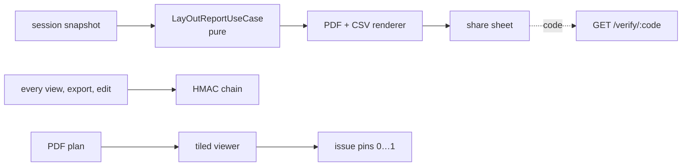

# S6 — Reports and floor plans

<dl><dd>

- Sprint 6 · 2 weeks · 58h · [all sprints](../README.md)

</dd></dl>

## Contents

<dl><dd>

1. [Overview](#overview)
2. [Tasks](#tasks)
3. [Done](#done)
4. [Self-check](#self-check)

</dd></dl>

## Overview

<dl><dd>

- **Goal:** the paid deliverable — a signed, branded PDF and a CSV from a real session, backed by a tamper-evident audit log — and issues pinned on real floor plans.
- **Demo — offline:** import a PDF plan, pin issues; export a signed PDF + CSV and share it in airplane mode; the audit chain verifies at launch.
- **Demo — signed in:** branding and plan sheets reach the second device; a verification code printed in the PDF resolves at `GET /verify/:code`.

| F | Feature | Guide | Hours |
|---|---|---|---|
| F10 | Reports and audit log | [F10-reports.md](F10-reports.md) | 37 |
| F11 | Floor plans and pins | [F11-plans.md](F11-plans.md) | 21 |

</dd></dl>

## Tasks

<dl><dd>

| Task | Step | Layer | Hours | Status |
|---|---|---|---|---|
| F10.1 | Verify response, branding row | Contract | 1 | not start |
| F10.2 | Report types, audit entry, pure pagination | Domain | 3 | not start |
| F10.3 | Repositories + data sources in memory | Fake data | 2 | not start |
| F10.4 | Report flow screens | View models | 4 | not start |
| F10.5 | CSV, PDF, audit chain (split: CSV · layout render · integrity footer · audit chain) | Local | 21 | not start |
| F10.6 | [site-log-be F10](https://github.com/DAMHONGDUC/site-log-be/blob/main/docs/feature-guide/S6-reports-plans/F10-reports-verify.md): `0007_report_branding.sql`, `GET /verify/:code` | Backend | 4 | not start |
| F10.7 | Branding syncs | Sync | 2 | not start |
| F11.1 | Plan sheet row, plan file key | Contract | 1 | not start |
| F11.2 | Plan types and pin use cases | Domain | 1 | not start |
| F11.3 | Repository + data sources in memory | Fake data | 1 | not start |
| F11.4 | Plans screens | View models | 5 | not start |
| F11.5 | Import, tiles, pins (split: import · tiles · pins) | Local | 9 | not start |
| F11.6 | [site-log-be F11](https://github.com/DAMHONGDUC/site-log-be/blob/main/docs/feature-guide/S6-reports-plans/F11-plans.md): `0008_plan_sheets.sql` | Backend | 2 | not start |
| F11.7 | Plan sheets sync, plan files upload | Sync | 2 | not start |

</dd></dl>

## Done

<dl><dd>

- [ ] Offline: signed PDF + CSV shared in airplane mode, before/after pairs included; pins survive relaunch
- [ ] Signed in: `GET /verify/:code` resolves a printed code; plan sheets on both devices
- [ ] Audit chain: an edited entry is found at the right index
- [ ] F10 and F11 tests written and green

</dd></dl>

## Self-check

<dl><dd>

- Why is pagination a Domain use case, while drawing the PDF is PlatformKit?
- What exactly does `/verify` return, and what must it never return?
- A pin lives on the issue row, not in its own table. What does that make simpler?

</dd></dl>
