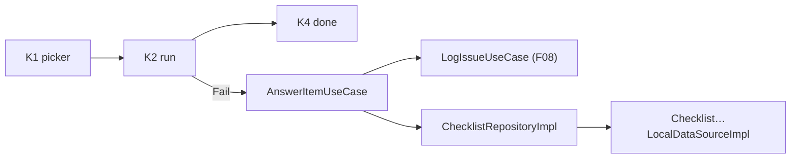
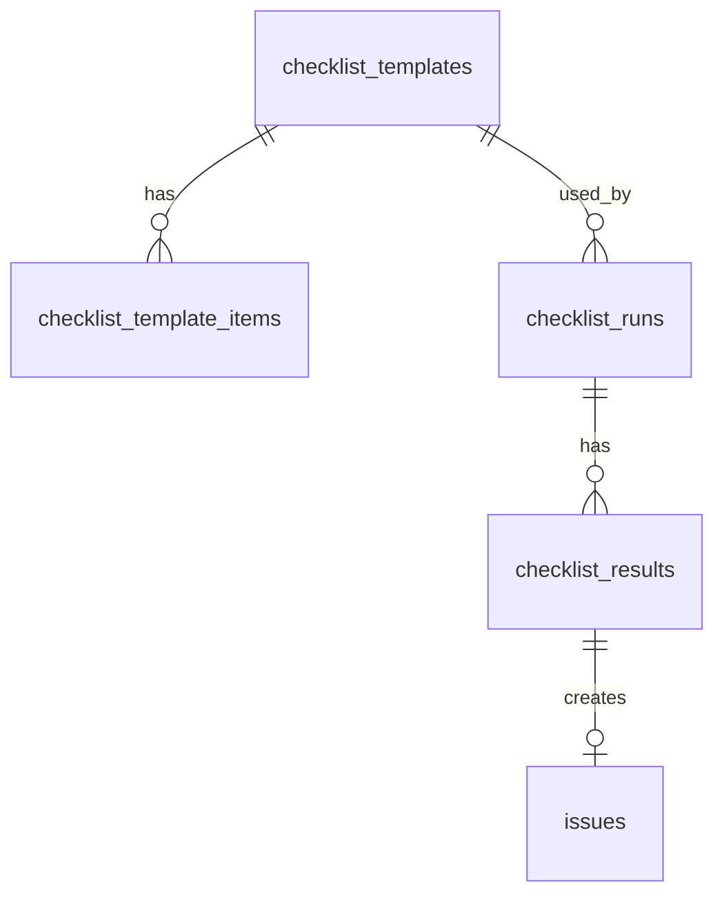
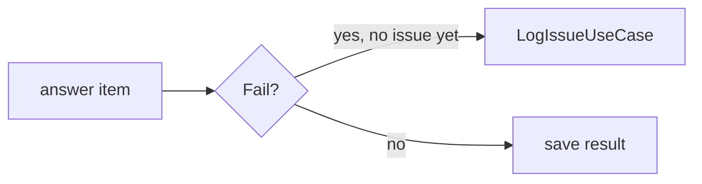
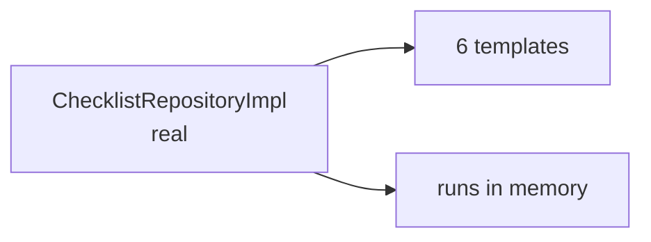
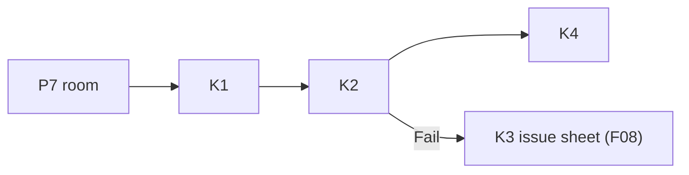
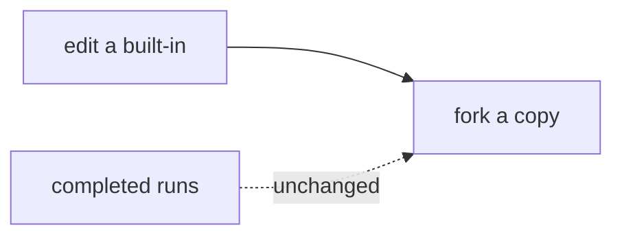
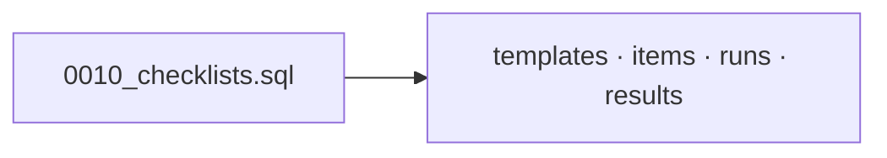
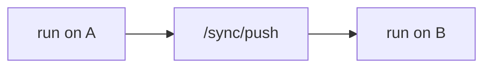

# F12 — Checklists

<dl><dd>

- Sprint [S7](README.md) · 14h · skeleton guide — full code is added when this feature starts.
- Code in this guide is a teaching example. Check current source and follow [F00 localization rules](../S0-foundation-access/F00-foundation.md#user-facing-text-and-localization) before applying it.

</dd></dl>

## Contents

<dl><dd>

1. [Overview](#overview)
2. [Target structure](#target-structure)
3. [1. Contract — checklist rows](#1-contract--checklist-rows)
4. [2. Domain — checklist types](#2-domain--checklist-types)
5. [3. Fake data — data sources in memory](#3-fake-data--data-sources-in-memory)
6. [4. View models — wire the Checklists screens](#4-view-models--wire-the-checklists-screens)
7. [5. Local — templates and results](#5-local--templates-and-results)
8. [6. Backend — checklist tables](#6-backend--checklist-tables)
9. [7. Sync — checklists join the engine](#7-sync--checklists-join-the-engine)
10. [Tests (after the feature works)](#tests-after-the-feature-works)
11. [Feature done](#feature-done)

</dd></dl>

## Overview

<dl><dd>

- **Goal:** pick a template, answer one tap per item, and every Fail opens one prefilled issue.
- **Demo — offline:** “Finishing handover” in a room → “14 of 22” → a Fail creates one issue → done sentence.
- **Demo — signed in:** the run and its results appear on the second device.
- **Spec:** [13 Checklist templates](../../feature-docs/01-field-work.md#13-checklist-templates)
- **Starts from:** F08 (issues) and the skeleton `Presentation/Checklists/`.
- **Steps:** [How every feature runs](../README.md#how-every-feature-runs).
- **File tags:** <b class="tag-new">New</b> create the file · <b class="tag-edit">Edit</b> change only the part shown · <b class="tag-replace">Replace</b> overwrite the whole file.

| Step | Layer | Hours | Status | What |
|---|---|---|---|---|
| [1](#1-contract--checklist-rows) | Contract | 1h | not start | Template, item, run, result DTOs |
| [2](#2-domain--checklist-types) | Domain | 1h | not start | Types; answer use case (Fail → issue) |
| [3](#3-fake-data--data-sources-in-memory) | Fake data | 1h | not start | Real `ChecklistRepositoryImpl` over in-memory data sources |
| [4](#4-view-models--wire-the-checklists-screens) | View models | 4h | not start | Picker, run, done |
| [5](#5-local--templates-and-results) | Local | 4h | not start | Built-ins seeded on SwiftData; results |
| [6](#6-backend--checklist-tables) | Backend | 2h | not start | `0010_checklists.sql` |
| [7](#7-sync--checklists-join-the-engine) | Sync | 1h | not start | Four tables syncable |



</dd></dl>

## Target structure

<dl><dd>

```text
Backend/migrations/0010_checklists.sql                                  # 6
Packages/
├── DomainLayer/Sources/DomainLayer/Entities/Checklists/, UseCases/Checklists/   # 2
├── DataLayer/Sources/DataLayer/
│   ├── Models/Remote/Checklist*DTO.swift                               # 1
│   ├── Repositories/ChecklistRepositoryImpl.swift                      # 3: real from the start
│   └── DataSources/Local/Persistence/ChecklistTemplate…, ChecklistRun… # 3: in memory · 5: SwiftData
SiteLog/
└── Presentation/Checklists/                                            # 4: TemplatePicker, ChecklistRun, ChecklistDone
```

</dd></dl>

## 1. Contract — checklist rows

<dl><dd>

#### Overview

<dl><dd>

- **Goal:** four rows; templates are shared, runs belong to a session.

| Row | Fields |
|---|---|
| Template / template item | `name`, `appliesTo`, `isBuiltIn`, `usageCount` / `ordinal`, `text`, `defaultSeverity`, `requiresPhotoOnFail` |
| Run / result | template, session, location, times / `runId`, `templateItemId`, `outcome`, `note`, `issueId`, `answeredAt` |



- **Check:** one result per `(runId, templateItemId)` on both sides.

</dd></dl>

</dd></dl>

## 2. Domain — checklist types

<dl><dd>

#### Overview

<dl><dd>

- **Goal:** the rule “a Fail creates exactly one prefilled issue” lives in a use case.

| Action | File | Holds |
|---|---|---|
| <b class="tag-new">New</b> | `Entities/Checklists/` | Template, item, run, result |
| <b class="tag-new">New</b> | `UseCases/Checklists/` | One file per use case: start run, `AnswerItemUseCase` (Fail → issue through F08), finish |



- **Check:** ⌘B; answering Fail twice still makes one issue.

</dd></dl>

</dd></dl>

## 3. Fake data — data sources in memory

<dl><dd>

#### Overview

<dl><dd>

- **Goal:** the real repository; “Finishing handover” (22 items) and 5 other templates in memory.

| Action | File | Holds |
|---|---|---|
| <b class="tag-new">New</b> | `DataSources/Local/Persistence/ChecklistTemplateLocalDataSource.swift`, `ChecklistRunLocalDataSource.swift` + `Impl`s | In memory |
| <b class="tag-new">New</b> | `Repositories/ChecklistRepositoryImpl.swift` | Real: map, `catch` → `Result`, log |



- **Check:** dev menu seeds the templates.

</dd></dl>

</dd></dl>

## 4. View models — wire the Checklists screens

<dl><dd>

#### Overview

<dl><dd>

- **Goal:** resume, recent and all templates; one tap per item; a result sentence.

| Action | Skeleton folder | View model work |
|---|---|---|
| <b class="tag-new">New</b> view model · <b class="tag-edit">Edit</b> view | `Presentation/Checklists/TemplatePicker/` | K1: resume, recent, all |
| <b class="tag-new">New</b> view model · <b class="tag-edit">Edit</b> view | `Presentation/Checklists/ChecklistRun/` | K2: one tap per item, “14 of 22” |
| <b class="tag-new">New</b> view model · <b class="tag-edit">Edit</b> view | `Presentation/Checklists/ChecklistDone/` | K4: result sentence, issues sent |



- **Check:** Continue offline: a full run with one Fail.

</dd></dl>

</dd></dl>

## 5. Local — templates and results

<dl><dd>

#### Overview

<dl><dd>

- **Goal:** the data source `Impl`s keep their types; built-ins are seeded once on SwiftData; runs keep their own results.

| Action | File | Holds |
|---|---|---|
| <b class="tag-new">New</b> | `Models/Local/Checklist*Model.swift` | `@Model`; template FKs restrict delete |
| <b class="tag-replace">Replace</b> | `ChecklistTemplate…Impl.swift`, `ChecklistRun…Impl.swift` | SwiftData; built-ins seeded on first open |



- **Check:** a template edit leaves completed runs unchanged; JSON import is validated.

</dd></dl>

</dd></dl>

## 6. Backend — checklist tables

<dl><dd>

#### Overview

<dl><dd>

- **Goal:** the four server tables.

| Action | File | Holds |
|---|---|---|
| <b class="tag-new">New</b> | `Backend/migrations/0010_checklists.sql` | Four tables; template FKs `on delete restrict`; unique `(run_id, template_item_id)` |
| <b class="tag-edit">Edit</b> | `Backend/src/sync/tables.ts`, `routes/account.ts` | Allow in sync; account deletion |



- **Check:** a second result for the same item in a run is rejected.

</dd></dl>

</dd></dl>

## 7. Sync — checklists join the engine

<dl><dd>

#### Overview

<dl><dd>

- **Goal:** checklist rows move like every other table; results merge per `(run, item)`.

| Action | File | Holds |
|---|---|---|
| <b class="tag-edit">Edit</b> | `Checklist…LocalDataSourceImpl.swift`, `App/DI/SyncTablesDI.swift` | Syncable; `checklist_*` last in dependency order |



- **Check:** a run started on A shows its results on B.

</dd></dl>

</dd></dl>

## Tests (after the feature works)

<dl><dd>

**2. Domain**

- Fail creates one issue

**5. Local**

- Template edit leaves completed runs unchanged

</dd></dl>

## Feature done

<dl><dd>

| Check | How |
|---|---|
| Demo | Checklist run; Fail creates one issue; run on both devices |
| Tests | `bundle exec fastlane test` and `npm test` green |
| Roadmap | F12 steps ticked |

</dd></dl>
