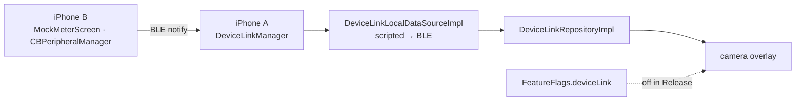
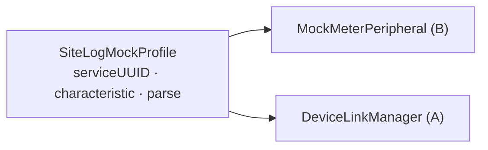
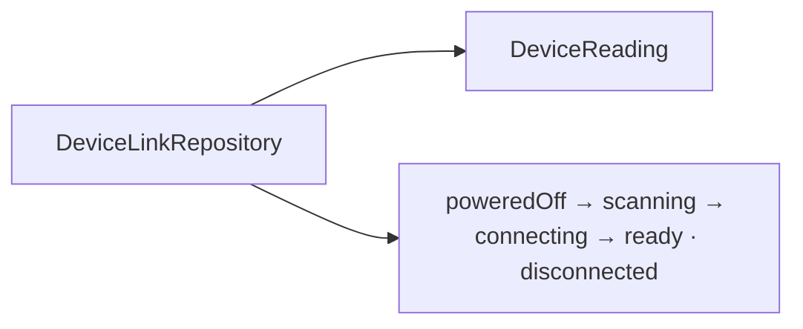
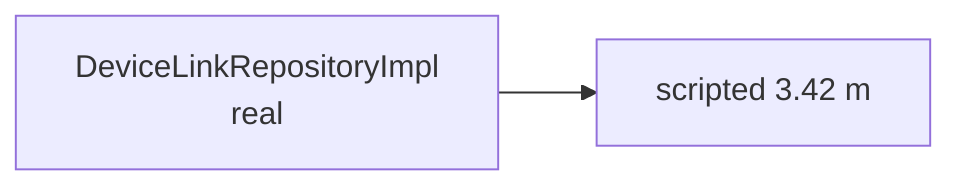
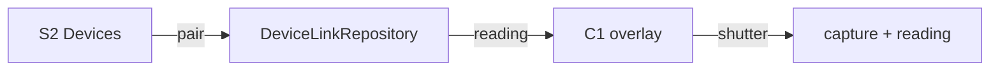
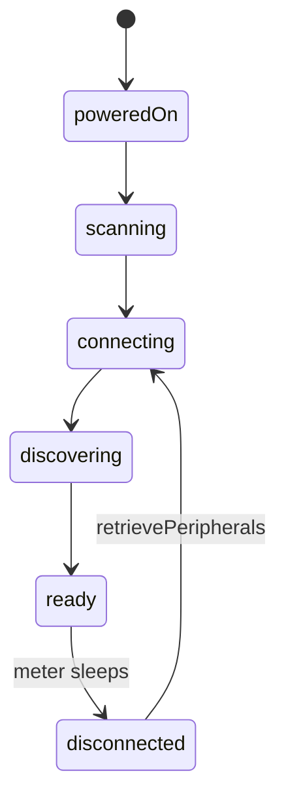
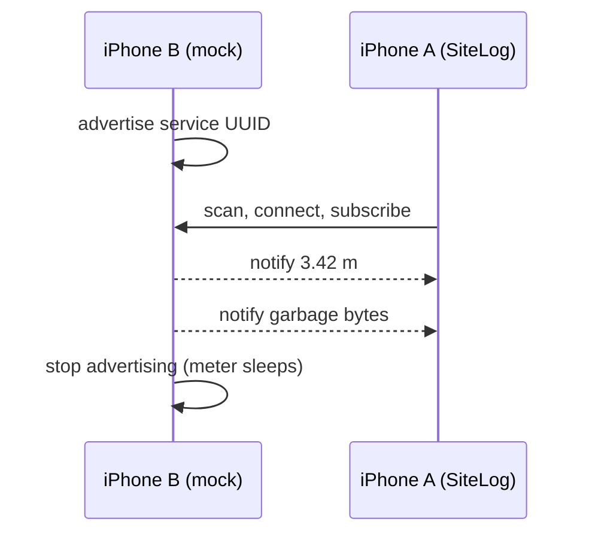
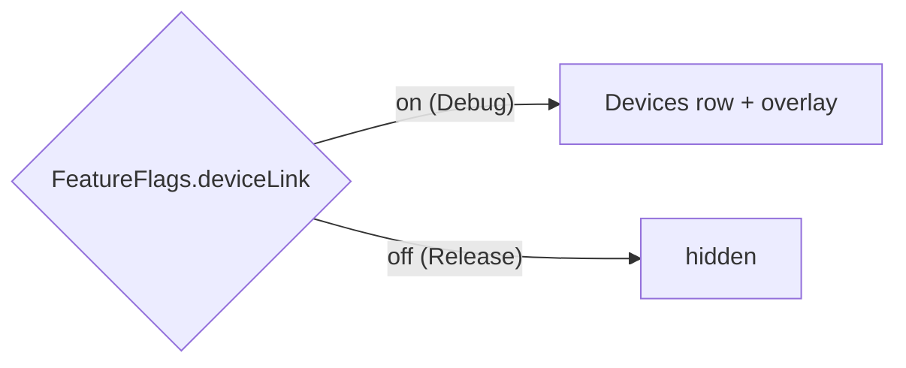

# F13 — DeviceLink (BLE meters)

<dl><dd>

- Sprint [S7](README.md) · 18h · skeleton guide — full code is added when this feature starts.
- Code in this guide is a teaching example. Check current source and follow [F00 localization rules](../S0-foundation-access/F00-foundation.md#user-facing-text-and-localization) before applying it.

</dd></dl>

## Contents

<dl><dd>

1. [Overview](#overview)
2. [Target structure](#target-structure)
3. [1. Contract — mock meter profile](#1-contract--mock-meter-profile)
4. [2. Domain — DeviceLink types](#2-domain--devicelink-types)
5. [3. Fake data — scripted readings](#3-fake-data--scripted-readings)
6. [4. View models — pairing and overlay](#4-view-models--pairing-and-overlay)
7. [5. Local — BLE central inside the data source](#5-local--ble-central-inside-the-data-source)
8. [6. Mock — the second iPhone as a meter](#6-mock--the-second-iphone-as-a-meter)
9. [7. Release — feature flag](#7-release--feature-flag)
10. [Tests (after the feature works)](#tests-after-the-feature-works)
11. [Feature done](#feature-done)

</dd></dl>

## Overview

<dl><dd>

- **Goal:** scan → connect → read a laser or moisture meter → attach the reading to a capture; never block the camera.
- **Demo — offline:** iPhone B runs the Debug mock meter; iPhone A pairs in Settings › Devices; B sends 3.42 m → A's camera shows it → the next photo carries it.
- **Demo — signed in:** the reading travels with the capture row (F05); nothing else syncs.
- **Test hardware:** two iPhones. The mock proves SiteLog's flow, not a vendor's byte format: users get DeviceLink only after one real meter (Bosch GLM, Leica DISTO) passes.
- **Spec:** [06 DeviceLink](../../feature-docs/01-field-work.md#06-devicelink-ble-measuring-tools)
- **Starts from:** F05 (camera) and the skeleton `Settings/Devices/`.
- **Steps:** [How every feature runs](../README.md#how-every-feature-runs). No backend and no sync table: steps 6 and 7 are the mock meter and the release flag.
- **File tags:** <b class="tag-new">New</b> create the file · <b class="tag-edit">Edit</b> change only the part shown · <b class="tag-replace">Replace</b> overwrite the whole file.

| Step | Layer | Hours | Status | What |
|---|---|---|---|---|
| [1](#1-contract--mock-meter-profile) | Contract | 1h | not start | Service, characteristic and byte layout the mock and the app share |
| [2](#2-domain--devicelink-types) | Domain | 1h | not start | `DeviceReading`, `DeviceLinkRepository` |
| [3](#3-fake-data--scripted-readings) | Fake data | 1h | not start | Real `DeviceLinkRepositoryImpl` over a scripted data source |
| [4](#4-view-models--pairing-and-overlay) | View models | 3h | not start | Settings › Devices, camera overlay |
| [5](#5-local--ble-central-inside-the-data-source) | Local | 8h | not start | `DeviceLinkManager`, vendor profiles, data source over them |
| [6](#6-mock--the-second-iphone-as-a-meter) | Mock | 3h | not start | Debug-only peripheral screen on iPhone B |
| [7](#7-release--feature-flag) | Release | 1h | not start | Off for users until a real meter is tested |



</dd></dl>

## Target structure

<dl><dd>

```text
Packages/
├── DomainLayer/Sources/DomainLayer/
│   ├── Entities/DeviceLink/DeviceReading.swift                         # 2
│   └── Repositories/DeviceLinkRepository.swift                         # 2
├── DataLayer/Sources/DataLayer/
│   ├── Repositories/DeviceLinkRepositoryImpl.swift                     # 3: real from the start
│   └── DataSources/Local/Bluetooth/DeviceLinkLocalDataSource(+Impl)    # 3: scripted · 5: DeviceLinkManager
└── PlatformKit/Sources/PlatformKit/Bluetooth/
    ├── DeviceLinkManager.swift (actor)                                 # 5: CBCentralManager
    ├── Profiles/                                                       # 1: SiteLogMockProfile · 5: one file per vendor
    └── Mock/MockMeterPeripheral.swift                                  # 6: CBPeripheralManager, Debug only
SiteLog/
├── App/Config/FeatureFlags.swift                                       # 7
└── Presentation/
    ├── Settings/Devices/                                               # 4: S2 pairing
    ├── Capture/Camera/                                                 # 4: reading overlay, status dot
    └── DevMenu/MockMeter/                                              # 6: Debug only
```

</dd></dl>

## 1. Contract — mock meter profile

<dl><dd>

#### Overview

<dl><dd>

- **Goal:** iPhone B and iPhone A agree on the bytes before either side is written.

| Item | Value |
|---|---|
| Service UUID | One fixed UUID for the SiteLog mock meter |
| Notify characteristic | One reading per notification |
| Bytes | `Float32` value · `UInt8` unit (`m`, `mm`, `%`) · `UInt8` kind (distance, area, moisture), little-endian |



- **Check:** `SiteLogMockProfile.parse` turns the 6 test bytes into 3.42 m; garbage bytes throw.

</dd></dl>

</dd></dl>

## 2. Domain — DeviceLink types

<dl><dd>

#### Overview

<dl><dd>

- **Goal:** what the app knows about a meter, without CoreBluetooth.

| Action | File | Holds |
|---|---|---|
| <b class="tag-new">New</b> | `Entities/DeviceLink/DeviceReading.swift` | `value`, `unit`, `kind`, `measuredAt`, `deviceName` |
| <b class="tag-new">New</b> | `Repositories/DeviceLinkRepository.swift` | Nearby, pair, forget, readings stream, status |



- **Check:** ⌘B; named `DeviceReading` because `Foundation.Measurement` collides.

</dd></dl>

</dd></dl>

## 3. Fake data — scripted readings

<dl><dd>

#### Overview

<dl><dd>

- **Goal:** the real repository (staleness rule, mapping, errors, logs) over a data source that emits 3.42 m every few seconds and a nearby list.

| Action | File | Holds |
|---|---|---|
| <b class="tag-new">New</b> | `DataSources/Local/Bluetooth/DeviceLinkLocalDataSource.swift` + `Impl` | Scripted readings and devices |
| <b class="tag-new">New</b> | `Repositories/DeviceLinkRepositoryImpl.swift` | Real: drops readings older than `measurementStaleAfter`, maps, logs |



- **Check:** the Simulator shows a reading on the camera.

</dd></dl>

</dd></dl>

## 4. View models — pairing and overlay

<dl><dd>

#### Overview

<dl><dd>

- **Goal:** pair from Settings; the reading and a status dot sit on the camera, never an alert.

| Action | Skeleton folder | View model work |
|---|---|---|
| <b class="tag-new">New</b> view model · <b class="tag-edit">Edit</b> view | `Presentation/Settings/Devices/` | S2: my devices, nearby, pair |
| <b class="tag-edit">Edit</b> view model · <b class="tag-edit">Edit</b> view | `Presentation/Capture/Camera/` | Reading overlay and status dot |



- **Check:** the shutter works the same with and without a reading.

</dd></dl>

</dd></dl>

## 5. Local — BLE central inside the data source

<dl><dd>

#### Overview

<dl><dd>

- **Goal:** `DeviceLinkLocalDataSourceImpl` keeps its type; inside it uses `DeviceLinkManager`. Split into tasks: manager · profiles · data source.

| Action | File | Holds |
|---|---|---|
| <b class="tag-new">New</b> | `PlatformKit/Bluetooth/DeviceLinkManager.swift` | Actor around `CBCentralManager`; own reading records |
| <b class="tag-new">New</b> | `PlatformKit/Bluetooth/Profiles/` | One file per vendor; pure `parse` |
| <b class="tag-replace">Replace</b> | `DataSources/Local/Bluetooth/DeviceLinkLocalDataSourceImpl.swift` | Over the manager; maps records |
| <b class="tag-edit">Edit</b> | `App/DI/PlatformDI.swift`, `DataSourcesDI.swift`; `project.yml` | Register the manager; `NSBluetoothAlwaysUsageDescription` |



- **Check:** the repository and view models did not change.

</dd></dl>

#### Steps

<dl><dd>

1. Keep a strong `CBPeripheral` reference; no commands before `.poweredOn`.
2. Check errors on both discover callbacks.
3. Reconnect with `retrievePeripherals(withIdentifiers:)` and backoff from `DeviceLinkConstants`.

</dd></dl>

</dd></dl>

## 6. Mock — the second iPhone as a meter

<dl><dd>

#### Overview

<dl><dd>

- **Goal:** iPhone B, running the Debug build, advertises the mock profile and sends readings on a tap. Replaces a macOS mock: two iPhones are enough.

| Action | File | Holds |
|---|---|---|
| <b class="tag-new">New</b> | `PlatformKit/Bluetooth/Mock/MockMeterPeripheral.swift` | `CBPeripheralManager`: advertise, notify a reading; `#if DEBUG` |
| <b class="tag-new">New</b> | `Presentation/DevMenu/MockMeter/MockMeterScreen.swift`, `MockMeterViewModel.swift` | Value field, unit picker, Send, Send garbage, Disconnect; Debug only |



- **Check:** valid value → shown on A; garbage → ignored and logged; disconnect → A reconnects when B advertises again.

</dd></dl>

#### Steps

<dl><dd>

1. Keep iPhone B's app in the foreground: iOS trims what a background peripheral advertises.
2. Optional for quick tries: the LightBlue app on iPhone B as a virtual peripheral with the same UUIDs.

</dd></dl>

</dd></dl>

## 7. Release — feature flag

<dl><dd>

#### Overview

<dl><dd>

- **Goal:** DeviceLink stays hidden for users until one real meter has passed.

| Action | File | Holds |
|---|---|---|
| <b class="tag-new">New</b> | `App/Config/FeatureFlags.swift` | `deviceLink`: on in Debug, off in Release |
| <b class="tag-edit">Edit</b> | `Settings/Devices/` entry, camera overlay | Hidden when the flag is off |



- **Check:** a Release build shows no Devices row; turning the flag on needs a real-meter test note in the PR.

</dd></dl>

</dd></dl>

## Tests (after the feature works)

<dl><dd>

**1. Contract**

- `parse` on captured bytes: valid, short, garbage

**3. Fake data**

- Stale reading is not attached

**5. Local**

- Reconnect backoff with a fixed clock

**6. Mock**

- Two-iPhone run: send, garbage, disconnect, reconnect

</dd></dl>

## Feature done

<dl><dd>

| Check | How |
|---|---|
| Demo | iPhone B's reading shows on iPhone A's camera; capture never waits |
| Release | Flag off; DeviceLink hidden |
| Tests | `bundle exec fastlane test` green |
| Roadmap | F13 steps ticked |

</dd></dl>
