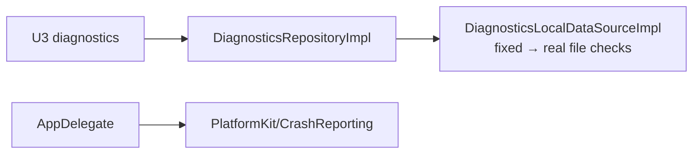
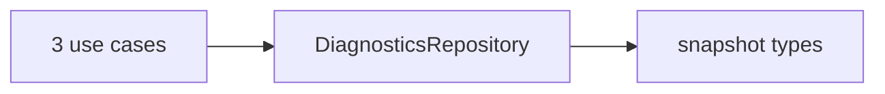
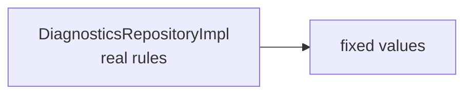
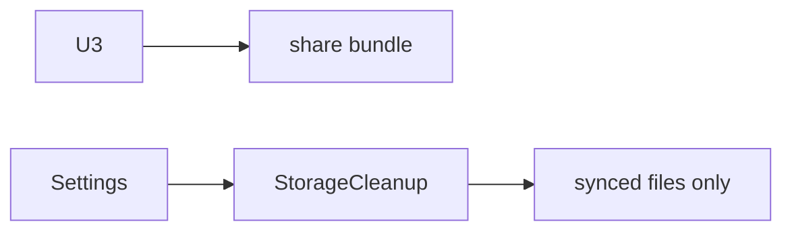
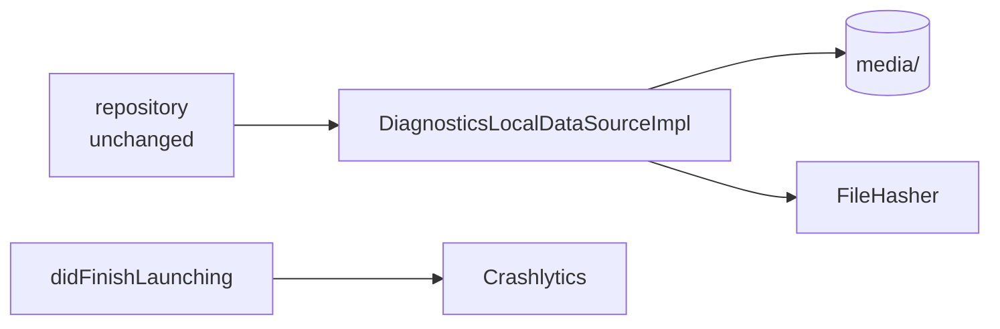
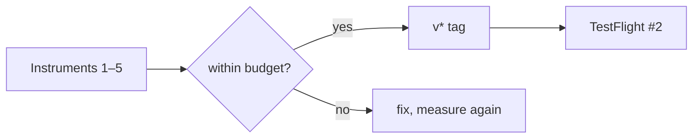

# F14 — Diagnostics · TestFlight #2

<dl><dd>

- Sprint [S7](README.md) · 17h · skeleton guide — full code is added when this feature starts.
- Code in this guide is a teaching example. Check current source and follow [F00 localization rules](../S0-foundation-access/F00-foundation.md#user-facing-text-and-localization) before applying it.

</dd></dl>

## Contents

<dl><dd>

1. [Overview](#overview)
2. [Target structure](#target-structure)
3. [1. Domain — diagnostics snapshot](#1-domain--diagnostics-snapshot)
4. [2. Fake data — fixed values in the data source](#2-fake-data--fixed-values-in-the-data-source)
5. [3. View models — diagnostics and cleanup](#3-view-models--diagnostics-and-cleanup)
6. [4. Local — storage, bundle, Crashlytics](#4-local--storage-bundle-crashlytics)
7. [5. Release — Instruments pass and TestFlight #2](#5-release--instruments-pass-and-testflight-2)
8. [Tests (after the feature works)](#tests-after-the-feature-works)
9. [Feature done](#feature-done)

</dd></dl>

## Overview

<dl><dd>

- **Goal:** integrity checks, synced-only cleanup, a redacted diagnostic bundle, crash reports; second TestFlight build.
- **Demo — offline:** U3 says “All 1,284 photos check out”, shows storage, exports a redacted bundle; cleanup frees only synced files.
- **Demo — signed in:** a test non-fatal shows in the Crashlytics console; TestFlight #2 installs.
- **Spec:** [09 Diagnostics](../../feature-docs/05-platform.md#09-diagnostics-and-observability), [19 Instruments](../../feature-docs/05-platform.md#19-performance-profiling-with-instruments)
- **Starts from:** F05–F07 (media files, upload states) and the skeleton `Diagnostics/`, `Settings/StorageCleanup/`.
- **Steps:** [How every feature runs](../README.md#how-every-feature-runs). Device only: Contract, Backend and Sync are `—`.
- **File tags:** <b class="tag-new">New</b> create the file · <b class="tag-edit">Edit</b> change only the part shown · <b class="tag-replace">Replace</b> overwrite the whole file.

| Step | Layer | Hours | Status | What |
|---|---|---|---|---|
| [1](#1-domain--diagnostics-snapshot) | Domain | 1h | not start | Integrity result, storage breakdown, device flags |
| [2](#2-fake-data--fixed-values-in-the-data-source) | Fake data | 1h | not start | Real `DiagnosticsRepositoryImpl` over fixed values |
| [3](#3-view-models--diagnostics-and-cleanup) | View models | 2h | not start | U3, storage cleanup |
| [4](#4-local--storage-bundle-crashlytics) | Local | 8h | not start | Real checks, cleanup, bundle, Crashlytics |
| [5](#5-release--instruments-pass-and-testflight-2) | Release | 5h | not start | Instruments scenarios, `v*` tag |
| — | Contract · Backend · Sync | — | — | Device only |



</dd></dl>

## Target structure

<dl><dd>

```text
Packages/
├── DomainLayer/Sources/DomainLayer/Entities/Diagnostics/                    # 1
├── DataLayer/Sources/DataLayer/
│   ├── Repositories/DiagnosticsRepositoryImpl.swift                         # 2: real from the start
│   └── DataSources/Local/FileStorage/DiagnosticsLocalDataSource(+Impl)      # 2: fixed values · 4: real checks
└── PlatformKit/Sources/PlatformKit/CrashReporting/                          # 4: protocol + Crashlytics type
SiteLog/
└── Presentation/Diagnostics/DiagnosticExport/, Settings/StorageCleanup/     # 3
```

</dd></dl>

## 1. Domain — diagnostics snapshot

<dl><dd>

#### Overview

<dl><dd>

- **Goal:** what diagnostics can tell the user, in plain types.

| Action | File | Holds |
|---|---|---|
| <b class="tag-new">New</b> | `Entities/Diagnostics/` | Integrity result, storage breakdown, device flags |
| <b class="tag-new">New</b> | `Repositories/DiagnosticsRepository.swift`, `UseCases/Diagnostics/` | Check integrity, clean up, export bundle |



- **Check:** ⌘B.

</dd></dl>

</dd></dl>

## 2. Fake data — fixed values in the data source

<dl><dd>

#### Overview

<dl><dd>

- **Goal:** the real repository (redaction, cleanup rule, errors, logs) over a data source with fixed numbers.

| Action | File | Holds |
|---|---|---|
| <b class="tag-new">New</b> | `DataSources/Local/FileStorage/DiagnosticsLocalDataSource.swift` + `Impl` | “All 1,284 photos check out”, 4.1 / 1.6 / 12 GB |
| <b class="tag-new">New</b> | `Repositories/DiagnosticsRepositoryImpl.swift` | Real: only `synced` files may be cleaned; redact on write |



- **Check:** U3 shows the fixed sentence.

</dd></dl>

</dd></dl>

## 3. View models — diagnostics and cleanup

<dl><dd>

#### Overview

<dl><dd>

- **Goal:** integrity, storage, export; cleanup that can only touch synced files.

| Action | Skeleton folder | View model work |
|---|---|---|
| <b class="tag-new">New</b> view model · <b class="tag-edit">Edit</b> view | `Presentation/Diagnostics/DiagnosticExport/` | U3: integrity, storage, export |
| <b class="tag-new">New</b> view model · <b class="tag-edit">Edit</b> view | `Presentation/Settings/StorageCleanup/` | Synced-only cleanup |



- **Check:** pending and failed files never appear as cleanable.

</dd></dl>

</dd></dl>

## 4. Local — storage, bundle, Crashlytics

<dl><dd>

#### Overview

<dl><dd>

- **Goal:** the data source `Impl` keeps its type; inside it hashes files and measures storage. Crashlytics starts first at launch. Split into tasks: storage · bundle · Crashlytics.
- **Spec:** [09.2–09.3](../../feature-docs/05-platform.md#092-integrity-checks-and-cleanup), [09.4](../../feature-docs/05-platform.md#094-app-wide-logging)

| Action | File | Holds |
|---|---|---|
| <b class="tag-replace">Replace</b> | `DiagnosticsLocalDataSourceImpl.swift` | Re-hash with `FileHasher`, sizes per folder, delete synced files |
| <b class="tag-new">New</b> | `PlatformKit/CrashReporting/` | Protocol + Crashlytics type |
| <b class="tag-edit">Edit</b> | `project.yml`, `App/AppDelegate.swift` | Firebase Crashlytics; first line of `didFinishLaunching`; `GoogleService-Info.plist` written by CI, never committed |



- **Check:** a test non-fatal shows in the console; the redacted bundle has no coordinates or names.

</dd></dl>

</dd></dl>

## 5. Release — Instruments pass and TestFlight #2

<dl><dd>

#### Overview

<dl><dd>

- **Goal:** everything from S5–S7 real on device, measured, shipped to TestFlight.

| Action | File | Holds |
|---|---|---|
| — | Release build on device | Instruments scenarios 1–5 from [05 §19](../../feature-docs/05-platform.md#19-performance-profiling-with-instruments) |
| <b class="tag-edit">Edit</b> | git tag | `v0.x.0` runs `testflight.yml` |



- **Check:** TestFlight #2 installed on a real device.

</dd></dl>

</dd></dl>

## Tests (after the feature works)

<dl><dd>

**2. Fake data**

- Cleanup never touches pending / failed

**4. Local**

- Redacted bundle equals the expected text

</dd></dl>

## Feature done

<dl><dd>

| Check | How |
|---|---|
| TestFlight #2 | Installed on a real device |
| Tests | `bundle exec fastlane test` green |
| Roadmap | F14 steps ticked |

</dd></dl>
