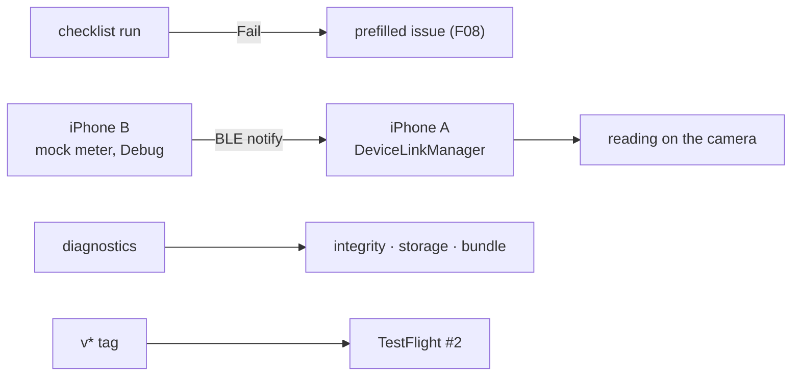

# S7 — Checklists, DeviceLink, diagnostics · TestFlight #2

<dl><dd>

- Sprint 7 · 2 weeks · 49h · [all sprints](../README.md)

</dd></dl>

## Contents

<dl><dd>

1. [Overview](#overview)
2. [Tasks](#tasks)
3. [Done](#done)
4. [Self-check](#self-check)

</dd></dl>

## Overview

<dl><dd>

- **Goal:** checklist runs that turn a Fail into an issue; laser readings over Bluetooth, tested with a second iPhone as the meter; integrity checks, cleanup and crash reports; TestFlight #2.
- **Demo — offline:** run “Finishing handover” in a room, a Fail opens one prefilled issue; iPhone B (mock meter) sends 3.42 m → it shows on iPhone A's camera; diagnostics say “All 1,284 photos check out”.
- **Demo — signed in:** checklist runs and results reach the second device; a test non-fatal shows in Crashlytics.

| F | Feature | Guide | Hours |
|---|---|---|---|
| F12 | Checklists | [F12-checklists.md](F12-checklists.md) | 14 |
| F13 | DeviceLink (BLE meters) | [F13-devicelink.md](F13-devicelink.md) | 18 |
| F14 | Diagnostics · TestFlight #2 | [F14-diagnostics.md](F14-diagnostics.md) | 17 |

</dd></dl>

## Tasks

<dl><dd>

| Task | Step | Layer | Hours | Status |
|---|---|---|---|---|
| F12.1 | Template, item, run, result rows | Contract | 1 | not start |
| F12.2 | Checklist types, Fail → issue use case | Domain | 1 | not start |
| F12.3 | Repository + data sources in memory | Fake data | 1 | not start |
| F12.4 | Checklists screens | View models | 4 | not start |
| F12.5 | Built-in templates and results on SwiftData | Local | 4 | not start |
| F12.6 | `0010_checklists.sql` | Backend | 2 | not start |
| F12.7 | Checklist tables join sync | Sync | 1 | not start |
| F13.1 | Mock meter profile: service, characteristic, bytes | Contract | 1 | not start |
| F13.2 | DeviceLink types | Domain | 1 | not start |
| F13.3 | Repository + data source on scripted readings | Fake data | 1 | not start |
| F13.4 | Pairing and camera overlay | View models | 3 | not start |
| F13.5 | BLE central inside the data source (split: manager · profiles · data source) | Local | 8 | not start |
| F13.6 | Mock meter on the second iPhone | Mock | 3 | not start |
| F13.7 | Feature flag, off for users | Release | 1 | not start |
| F14.1 | Diagnostics snapshot | Domain | 1 | not start |
| F14.2 | Repository + data source with fixed values | Fake data | 1 | not start |
| F14.3 | Diagnostics and cleanup screens | View models | 2 | not start |
| F14.4 | Storage checks, cleanup, bundle, Crashlytics (split: storage · bundle · Crashlytics) | Local | 8 | not start |
| F14.5 | Instruments pass and TestFlight #2 | Release | 5 | not start |

</dd></dl>

## Done

<dl><dd>

- [ ] Offline: a Fail creates exactly one issue; iPhone B's reading shows on iPhone A; capture never waits on Bluetooth
- [ ] Signed in: checklist runs on both devices
- [ ] Release build: DeviceLink hidden by the flag; Instruments scenarios within budget; TestFlight #2 installed
- [ ] F12, F13 and F14 tests written and green

</dd></dl>

## Self-check

<dl><dd>

- A template is edited after three runs used it. What must the old runs still show?
- The mock meter proves SiteLog's flow. What does it not prove about a real Bosch or Leica meter?
- Cleanup may delete which files, and never which?

</dd></dl>
