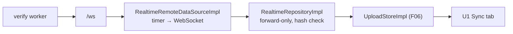
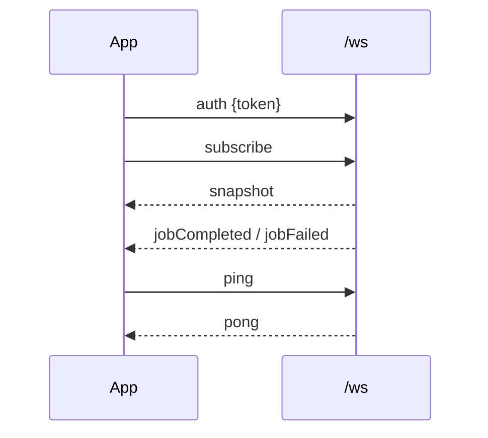
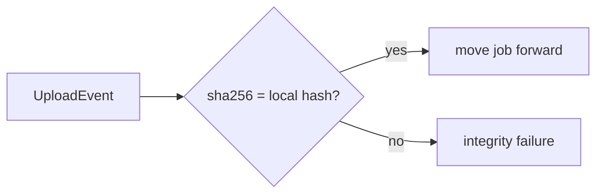
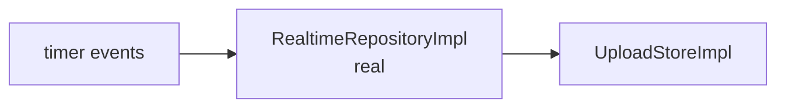
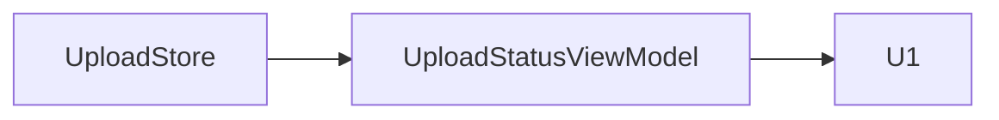
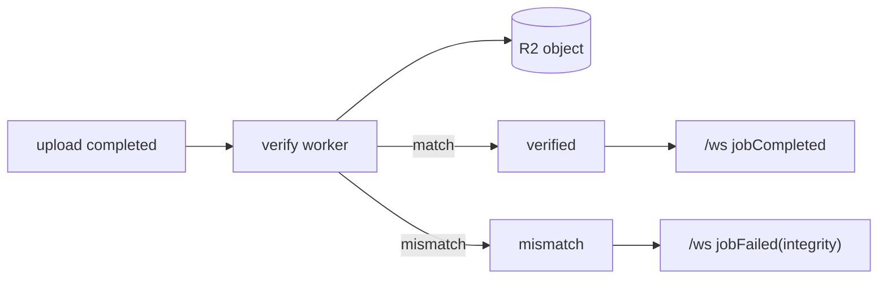
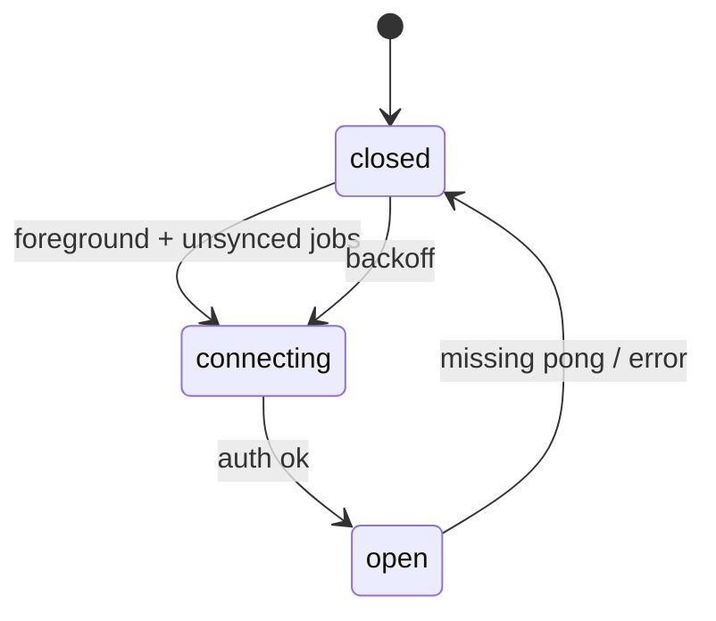

# F15 — Realtime progress and verification

<dl><dd>

- Sprint [S8](README.md) · 21h · skeleton guide — full code is added when this feature starts.
- Code in this guide is a teaching example. Check current source and follow [F00 localization rules](../S0-foundation-access/F00-foundation.md#user-facing-text-and-localization) before applying it.

</dd></dl>

## Contents

<dl><dd>

1. [Overview](#overview)
2. [Target structure](#target-structure)
3. [1. Contract — WebSocket messages](#1-contract--websocket-messages)
4. [2. Domain — upload events](#2-domain--upload-events)
5. [3. Fake data — events on a timer](#3-fake-data--events-on-a-timer)
6. [4. View models — live state on the Sync tab](#4-view-models--live-state-on-the-sync-tab)
7. [5. Backend — channel and verification worker](#5-backend--channel-and-verification-worker)
8. [6. Sync — WebSocket client](#6-sync--websocket-client)
9. [Tests (after the feature works)](#tests-after-the-feature-works)
10. [Feature done](#feature-done)

</dd></dl>

## Overview

<dl><dd>

- **Goal:** an observation-only channel tells the app what the server has confirmed; a worker re-reads every object and flips it to `verified` or `mismatch`.
- **Demo — offline:** no channel: the Sync tab is only slower, never red.
- **Demo — signed in:** uploads turn “verified” as events arrive; a tampered object shows as a mismatch; `/verify` shows the new state.
- **Spec:** [10 Realtime channel](../../feature-docs/02-upload-sync.md#10-realtime-progress-channel), [03-backend §8–9](../../feature-docs/03-backend.md#8-integrity)
- **Starts from:** F06–F07 (upload store) and F10 (`/verify`).
- **Steps:** [How every feature runs](../README.md#how-every-feature-runs). Local is `—`: events only move existing upload jobs forward.
- **File tags:** <b class="tag-new">New</b> create the file · <b class="tag-edit">Edit</b> change only the part shown · <b class="tag-replace">Replace</b> overwrite the whole file.

| Step | Layer | Hours | Status | What |
|---|---|---|---|---|
| [1](#1-contract--websocket-messages) | Contract | 1h | not start | `auth`, `subscribe`, `ping` / `snapshot`, `jobCompleted`, `jobFailed`, `pong` |
| [2](#2-domain--upload-events) | Domain | 1h | not start | `UploadEvent`, `RealtimeRepository` |
| [3](#3-fake-data--events-on-a-timer) | Fake data | 1h | not start | Real `RealtimeRepositoryImpl` over a timer data source |
| [4](#4-view-models--live-state-on-the-sync-tab) | View models | 2h | not start | Live state on U1 |
| [5](#5-backend--channel-and-verification-worker) | Backend | 8h | not start | `/ws`, verify worker, abandoned-upload job |
| [6](#6-sync--websocket-client) | Sync | 8h | not start | `URLSessionWebSocketTask` inside the data source |
| — | Local | — | — | Events update the F06 upload store |



</dd></dl>

## Target structure

<dl><dd>

```text
Backend/src/ws.ts, workers/verify.ts, jobs/abandoned.ts                  # 5
Packages/
├── DomainLayer/Sources/DomainLayer/Entities/Uploads/UploadEvent.swift   # 2
├── DomainLayer/Sources/DomainLayer/Repositories/RealtimeRepository.swift  # 2
├── DataLayer/Sources/DataLayer/
│   ├── Models/Remote/RealtimeMessageDTO.swift                           # 1
│   ├── Repositories/RealtimeRepositoryImpl.swift                        # 3: real from the start
│   └── DataSources/Remote/Realtime/RealtimeRemoteDataSource(+Impl)      # 3: timer · 6: PlatformKit channel
└── PlatformKit/Sources/PlatformKit/Realtime/RealtimeChannel.swift        # 6: actor around URLSessionWebSocketTask
SiteLog/
└── Presentation/Uploads/UploadStatus/                                   # 4
```

</dd></dl>

## 1. Contract — WebSocket messages

<dl><dd>

#### Overview

<dl><dd>

- **Goal:** one message shape per event, both directions.

| Direction | Messages |
|---|---|
| App → server | `auth` (token, first message), `subscribe`, `ping` |
| Server → app | `snapshot`, `jobCompleted` (`jobID`, `sha256`, `verifyState`), `jobFailed` (`reason`), `pong` |



- **Check:** the token is never in the URL.

</dd></dl>

</dd></dl>

## 2. Domain — upload events

<dl><dd>

#### Overview

<dl><dd>

- **Goal:** events as plain Domain values the repository can trust or reject.

| Action | File | Holds |
|---|---|---|
| <b class="tag-new">New</b> | `Entities/Uploads/UploadEvent.swift` | `completed(jobID, sha256, verifyState)`, `failed(jobID, reason)` |
| <b class="tag-new">New</b> | `Repositories/RealtimeRepository.swift` | Start, stop, connection status |



- **Check:** ⌘B.

</dd></dl>

</dd></dl>

## 3. Fake data — events on a timer

<dl><dd>

#### Overview

<dl><dd>

- **Goal:** the real repository (forward-only, hash check, idempotent, logs) over a data source that emits events on a timer.

| Action | File | Holds |
|---|---|---|
| <b class="tag-new">New</b> | `DataSources/Remote/Realtime/RealtimeRemoteDataSource.swift` + `Impl` | Emits `jobCompleted` / `jobFailed` every few seconds |
| <b class="tag-new">New</b> | `Repositories/RealtimeRepositoryImpl.swift` | Real: applies events to `UploadStore` forward only; unknown `jobID` ignored |



- **Check:** applying one event ten times equals applying it once.

</dd></dl>

</dd></dl>

## 4. View models — live state on the Sync tab

<dl><dd>

#### Overview

<dl><dd>

- **Goal:** U1 shows server-confirmed state as events arrive.
- **Spec:** [09.1](../../feature-docs/05-platform.md#091-upload-status-screen)

| Action | Skeleton folder | View model work |
|---|---|---|
| <b class="tag-edit">Edit</b> view model · <b class="tag-edit">Edit</b> view | `Presentation/Uploads/UploadStatus/` | Live “verified”, mismatch flag, channel status |



- **Check:** a closed channel is not an error, only slower — no red.

</dd></dl>

</dd></dl>

## 5. Backend — channel and verification worker

<dl><dd>

#### Overview

<dl><dd>

- **Goal:** the server pushes state; a worker proves each stored object matches its hash. Split into tasks: ws · worker · job.
- **Spec:** [03-backend §8–9](../../feature-docs/03-backend.md#9-websocket)

| Action | File | Holds |
|---|---|---|
| <b class="tag-new">New</b> | `Backend/src/ws.ts` | `@fastify/websocket`; auth in the first message; per-user subscription |
| <b class="tag-new">New</b> | `Backend/src/workers/verify.ts` | Streams the object from R2, recomputes SHA-256, flips `registered` → `verified` / `mismatch` |
| <b class="tag-new">New</b> | `Backend/src/jobs/abandoned.ts` | Aborts `created` uploads older than 7 days |



- **Check:** `vitest`: the worker flips state; `/verify` shows it.

</dd></dl>

</dd></dl>

## 6. Sync — WebSocket client

<dl><dd>

#### Overview

<dl><dd>

- **Goal:** `RealtimeRemoteDataSourceImpl` keeps its type; inside it uses `RealtimeChannel`. Split into tasks: client · reconnect.

| Action | File | Holds |
|---|---|---|
| <b class="tag-new">New</b> | `PlatformKit/Realtime/RealtimeChannel.swift`, `Messages.swift` | Actor around `URLSessionWebSocketTask`; re-arm `receive` after every message; ping and backoff |
| <b class="tag-replace">Replace</b> | `DataSources/Remote/Realtime/RealtimeRemoteDataSourceImpl.swift` | Over the channel; token from F02 |
| <b class="tag-edit">Edit</b> | `App/DI/PlatformDI.swift`, `DataSourcesDI.swift` | Register the channel; registered types stay |



- **Check:** connects only in the foreground with unsynced jobs; nightly CI builds the app with `Realtime` removed.

</dd></dl>

</dd></dl>

## Tests (after the feature works)

<dl><dd>

**3. Fake data**

- Applying one event 10× equals once
- Snapshot applies forward only
- Hash mismatch raises `integrity`

**4. View models**

- View model with a test-double event stream

**5. Backend**

- Worker flips `verified` or raises `integrity`
- `/verify` shows the new state

**6. Sync**

- Decode all types + malformed
- Oversized message closes
- Missing `pong` → backoff; backoff cap and jitter

</dd></dl>

## Feature done

<dl><dd>

| Check | How |
|---|---|
| Demo | Realtime state on the Sync tab; mismatch flagged |
| Tests | `bundle exec fastlane test` and `npm test` green |
| Roadmap | F15 steps ticked |

</dd></dl>
