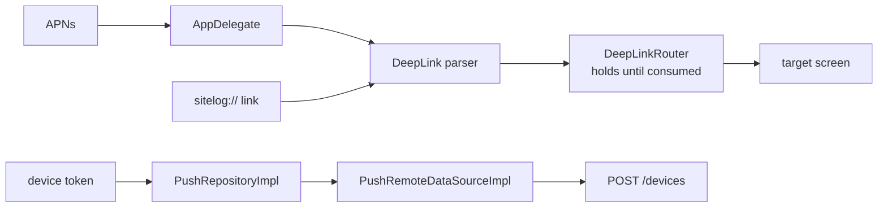
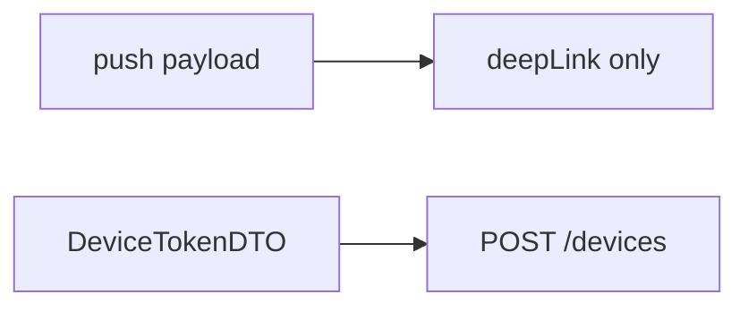
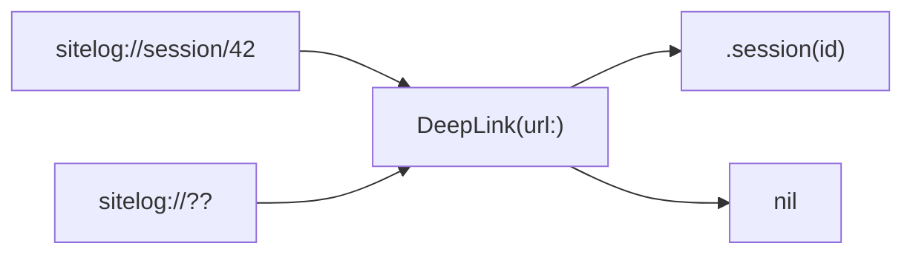
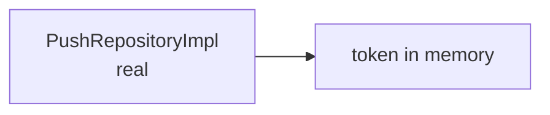
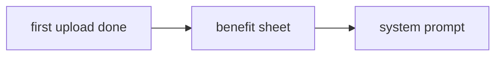
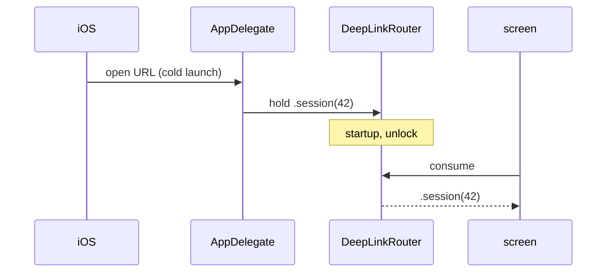
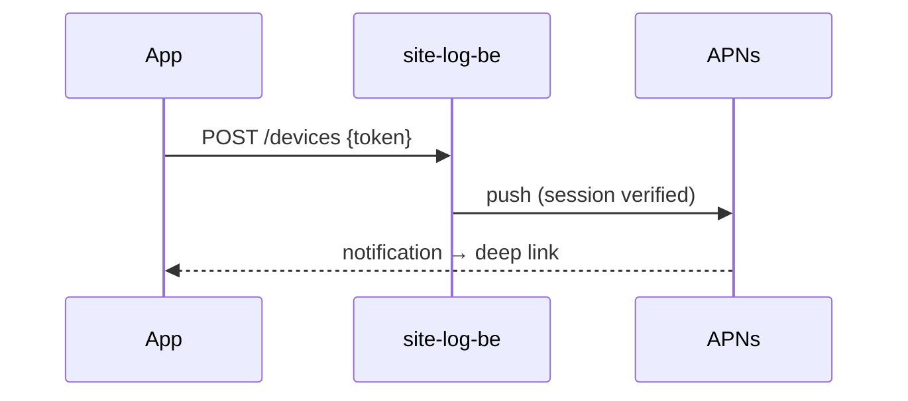
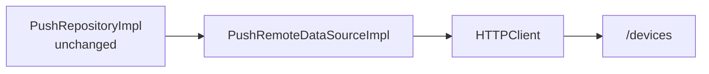

# F16 — Push and deep links

<dl><dd>

- Sprint [S8](README.md) · 14h · skeleton guide — full code is added when this feature starts.
- Code in this guide is a teaching example. Check current source and follow [F00 localization rules](../S0-foundation-access/F00-foundation.md#user-facing-text-and-localization) before applying it.

</dd></dl>

## Contents

<dl><dd>

1. [Overview](#overview)
2. [Target structure](#target-structure)
3. [1. Contract — push payload and device token](#1-contract--push-payload-and-device-token)
4. [2. Domain — deep link parser](#2-domain--deep-link-parser)
5. [3. Fake data — token data source in memory](#3-fake-data--token-data-source-in-memory)
6. [4. View models — permission and settings](#4-view-models--permission-and-settings)
7. [5. Local — push registration and routing](#5-local--push-registration-and-routing)
8. [6. Backend — in site-log-be](#6-backend--in-site-log-be)
9. [7. Sync — token to the backend](#7-sync--token-to-the-backend)
10. [Tests (after the feature works)](#tests-after-the-feature-works)
11. [Feature done](#feature-done)

</dd></dl>

## Overview

<dl><dd>

- **Goal:** a push carries only a destination; `sitelog://<route>/<id>` is parsed once and routed, even after a cold launch; the app works fully with push denied.
- **Demo — offline:** `xcrun simctl openurl booted sitelog://session/42` opens the session; push denied changes nothing else.
- **Demo — signed in:** a verified upload sends a push; tapping it opens the session.
- **Spec:** [18 Push and deep links](../../feature-docs/05-platform.md#18-push-notifications-and-deep-links)
- **Starts from:** F15 (worker events) and the skeleton `Notifications/`, `DeepLinks/`.
- **Steps:** [How every feature runs](../README.md#how-every-feature-runs).
- **File tags:** <b class="tag-new">New</b> create the file · <b class="tag-edit">Edit</b> change only the part shown · <b class="tag-replace">Replace</b> overwrite the whole file.

| Step | Layer | Hours | Status | What |
|---|---|---|---|---|
| [1](#1-contract--push-payload-and-device-token) | Contract | 1h | not start | Payload with `deepLink`; `POST /devices` |
| [2](#2-domain--deep-link-parser) | Domain | 1h | not start | Pure `DeepLink` parser |
| [3](#3-fake-data--token-data-source-in-memory) | Fake data | 1h | not start | Real `PushRepositoryImpl` over an in-memory token data source |
| [4](#4-view-models--permission-and-settings) | View models | 2h | not start | Permission moment, notification row |
| [5](#5-local--push-registration-and-routing) | Local | 4h | not start | Push capability, token, URL scheme, router |
| [6](#6-backend--in-site-log-be) | Backend | 3h | not start | site-log-be F16: `POST /devices`, APNs send |
| [7](#7-sync--token-to-the-backend) | Sync | 2h | not start | Token registered through `HTTPClient` |



</dd></dl>

## Target structure

<dl><dd>

```text
Packages/
├── DomainLayer/Sources/DomainLayer/Entities/DeepLinks/DeepLink.swift     # 2: pure parser
├── DomainLayer/Sources/DomainLayer/Repositories/PushRepository.swift     # 2
├── DataLayer/Sources/DataLayer/
│   ├── Models/Remote/DeviceTokenDTO.swift                                # 1
│   ├── Repositories/PushRepositoryImpl.swift                             # 3: real from the start
│   └── DataSources/Remote/Push/PushRemoteDataSource(+Impl)               # 3: in memory · 7: HTTPClient
└── PlatformKit/Sources/PlatformKit/Push/                                 # 5: permission, registration
SiteLog/
├── App/AppDelegate.swift                                                 # 5: token
└── Presentation/Notifications/, DeepLinks/DeepLinkRouter.swift           # 4–5
```

</dd></dl>

## 1. Contract — push payload and device token

<dl><dd>

#### Overview

<dl><dd>

- **Goal:** what a push may carry and how the app tells the backend where to send it.

| Shape | Fields |
|---|---|
| Push payload | `aps` alert, `deepLink` (`sitelog://session/<id>`), hashed account id — no names, no coordinates |
| `POST /devices` | `token`, `environment` (`sandbox` / `production`) |



- **Check:** a push for another account is ignored by the app.

</dd></dl>

</dd></dl>

## 2. Domain — deep link parser

<dl><dd>

#### Overview

<dl><dd>

- **Goal:** one pure parser; ids are opaque data.

| Action | File | Holds |
|---|---|---|
| <b class="tag-new">New</b> | `Entities/DeepLinks/DeepLink.swift` | `sitelog://<route>/<id>` → route enum; unknown → `nil` |
| <b class="tag-new">New</b> | `Repositories/PushRepository.swift` | Register token, permission status |



- **Check:** routes and rejections are unit-testable without the app.

</dd></dl>

</dd></dl>

## 3. Fake data — token data source in memory

<dl><dd>

#### Overview

<dl><dd>

- **Goal:** the real repository over a data source that keeps the token in memory.

| Action | File | Holds |
|---|---|---|
| <b class="tag-new">New</b> | `DataSources/Remote/Push/PushRemoteDataSource.swift` + `Impl` | Stores the last token in memory |
| <b class="tag-new">New</b> | `Repositories/PushRepositoryImpl.swift` | Real: dedupes, logs the token truncated |



- **Check:** the same token twice is sent once.

</dd></dl>

</dd></dl>

## 4. View models — permission and settings

<dl><dd>

#### Overview

<dl><dd>

- **Goal:** ask at a moment that makes sense, never at first launch; show a notification row in Settings.

| Action | Skeleton folder | View model work |
|---|---|---|
| <b class="tag-new">New</b> view model · <b class="tag-edit">Edit</b> view | `Presentation/Notifications/` | Explain the benefit, then the system prompt |
| <b class="tag-edit">Edit</b> view model | `Presentation/Settings/SettingsHome/` | Notification status row |



- **Check:** denied → everything still works.

</dd></dl>

</dd></dl>

## 5. Local — push registration and routing

<dl><dd>

#### Overview

<dl><dd>

- **Goal:** the capability, the token, the URL scheme and a router that holds the destination until a view takes it.

| Action | File | Holds |
|---|---|---|
| <b class="tag-edit">Edit</b> | `project.yml` | Push capability, `aps-environment`, `remote-notification` mode, `sitelog` URL scheme |
| <b class="tag-new">New</b> | `PlatformKit/Push/` | Permission and registration wrapper |
| <b class="tag-edit">Edit</b> | `App/AppDelegate.swift` | Token → `PushRepository`; re-sent on change |
| <b class="tag-new">New</b> | `Presentation/DeepLinks/DeepLinkRouter.swift` | Holds the destination until consumed; a deleted target lands on a safe screen |



- **Check:** `xcrun simctl push booted app.dd.site.log payload.json` and `xcrun simctl openurl booted sitelog://session/42` both land on the session.

</dd></dl>

</dd></dl>

## 6. Backend — in site-log-be

<dl><dd>

#### Overview

<dl><dd>

- **Goal:** the app registers its APNs token; the server pushes once when a session is fully verified.
- **Built in:** [F16 Push](https://github.com/DAMHONGDUC/site-log-be/blob/main/docs/feature-guide/S8-realtime-push/F16-push.md) — same sprint, separate repository; nothing to write in this repo.
- **API this feature uses:** [§10 Push registration](../../feature-docs/03-backend.md#10-push-registration).
- **Run it locally:** [local testing with iOS](https://github.com/DAMHONGDUC/site-log-be/blob/main/docs/feature-guide/local-testing-with-ios.md).

| Backend piece | The app | Check from the app |
|---|---|---|
| `POST /devices`, `DELETE /devices/:token` | Register after sign-in and on token change (`sandbox` in Debug); remove on sign-out | Row exists for the token |
| Push: `aps.alert`, `deepLink`, `account` | Route `sitelog://session/<id>`; ignore a foreign `account` | Tap opens the session, even from a cold launch |



- **Check:** a real iPhone gets "Uploads verified" and opens the session.

</dd></dl>

</dd></dl>

## 7. Sync — token to the backend

<dl><dd>

#### Overview

<dl><dd>

- **Goal:** `PushRemoteDataSourceImpl` keeps its type; inside it calls `POST /devices` through `HTTPClient`.

| Action | File | Holds |
|---|---|---|
| <b class="tag-replace">Replace</b> | `DataSources/Remote/Push/PushRemoteDataSourceImpl.swift` | `POST /devices` |
| <b class="tag-edit">Edit</b> | `App/DI/DataSourcesDI.swift` | Pass `HTTPClient`; registered type stays |



- **Check:** a real device push arrives from staging.

</dd></dl>

</dd></dl>

## Tests (after the feature works)

<dl><dd>

**2. Domain**

- Parser routes and rejections

**4. View models**

- Permission view model

**5. Local**

- Payload with / without `deepLink`
- Push for another account ignored
- Router holds until consumed
- Cold-launch link survives (UI test)

</dd></dl>

## Feature done

<dl><dd>

| Check | How |
|---|---|
| Demo | Push opens the target; deep link from Safari |
| Tests | `bundle exec fastlane test` and `npm test` green |
| Roadmap | F16 steps ticked |

</dd></dl>
