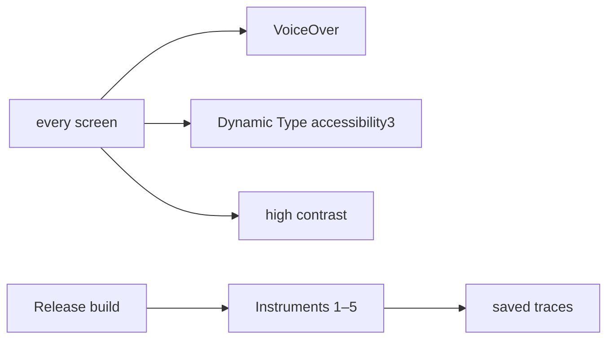
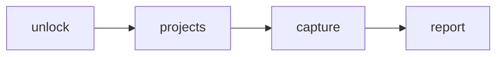
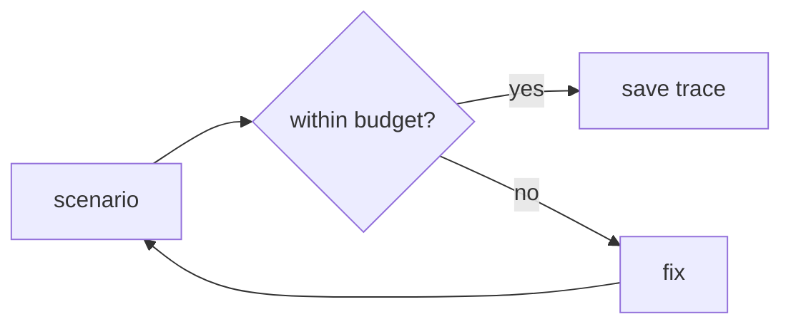

# F17 — Accessibility and performance

<dl><dd>

- Sprint [S8](README.md) · 14h · skeleton guide — full code is added when this feature starts.
- Code in this guide is a teaching example. Check current source and follow [F00 localization rules](../S0-foundation-access/F00-foundation.md#user-facing-text-and-localization) before applying it.

</dd></dl>

## Contents

<dl><dd>

1. [Overview](#overview)
2. [Target structure](#target-structure)
3. [1. Polish — accessibility pass](#1-polish--accessibility-pass)
4. [2. Release — budgets, privacy manifest, feedback](#2-release--budgets-privacy-manifest-feedback)
5. [Tests (after the feature works)](#tests-after-the-feature-works)
6. [Feature done](#feature-done)

</dd></dl>

## Overview

<dl><dd>

- **Goal:** every screen works with Dynamic Type, VoiceOver and high contrast; every Instruments budget is met with a saved trace; TestFlight feedback is closed. Submission is F18.
- **Demo — offline:** VoiceOver walk unlock → projects → capture → report.
- **Demo — signed in:** the same walk with sync running; Instruments scenarios on a Release build.
- **Spec:** [19 Instruments](../../feature-docs/05-platform.md#19-performance-profiling-with-instruments)
- **Steps:** a cross-cutting pass, not the feature template; each step still opens with an overview.

| Step | Layer | Hours | Status | What |
|---|---|---|---|---|
| [1](#1-polish--accessibility-pass) | Polish | 8h | not start | Labels, traits, grouping, focus order, 44 pt targets |
| [2](#2-release--budgets-privacy-manifest-feedback) | Release | 6h | not start | Budgets, `PrivacyInfo.xcprivacy`, feedback |



</dd></dl>

## Target structure

<dl><dd>

```text
SiteLog/PrivacyInfo.xcprivacy      # 2
SiteLog/Presentation/**            # 1: labels, traits, grouping
```

</dd></dl>

## 1. Polish — accessibility pass

<dl><dd>

#### Overview

<dl><dd>

- **Goal:** every screen readable and usable without sight, at large text, without colour. Split into tasks: access + projects · capture + issues · reports + settings.

| Check | Rule |
|---|---|
| VoiceOver | Every control has a label and trait; groups read as one sentence; focus order follows the layout |
| Colour | Severity readable without colour (shapes already in `DSStatusMarker`) |
| Size | Minimum 44 pt targets; usable at `accessibility3` |



- **Check:** the walk above with VoiceOver on, eyes closed; Accessibility Inspector audit clean.

</dd></dl>

</dd></dl>

## 2. Release — budgets, privacy manifest, feedback

<dl><dd>

#### Overview

<dl><dd>

- **Goal:** measured performance, a correct privacy manifest, no open feedback.

| Action | File | Holds |
|---|---|---|
| <b class="tag-new">New</b> | `SiteLog/PrivacyInfo.xcprivacy` | Location, device ID, crash data declared |
| — | Release build on device | Scenarios 1–5 of 05 §19; traces saved |
| — | TestFlight | Every feedback item closed |



- **Check:** every budget met with a recorded trace; no open TestFlight feedback.

</dd></dl>

</dd></dl>

## Tests (after the feature works)

<dl><dd>

**1. Polish**

- Every screen usable at `accessibility3` Dynamic Type
- Xcode Accessibility Inspector audit clean

</dd></dl>

## Feature done

<dl><dd>

| Check | How |
|---|---|
| Demo | VoiceOver walk; budgets met with traces |
| Tests | `bundle exec fastlane test` green |
| Roadmap | F17 steps ticked |

</dd></dl>
