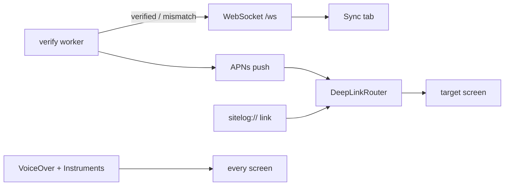

# S8 — Realtime, push, accessibility and performance

<dl><dd>

- Sprint 8 · 2 weeks · 49h · [all sprints](../README.md)

</dd></dl>

## Contents

<dl><dd>

1. [Overview](#overview)
2. [Tasks](#tasks)
3. [Done](#done)
4. [Self-check](#self-check)

</dd></dl>

## Overview

<dl><dd>

- **Goal:** the Sync tab shows server-confirmed state as it happens; a backend worker re-checks every object; pushes and `sitelog://` links open the right screen; every screen passes VoiceOver and every Instruments budget.
- **Demo — offline:** no channel, no push — the app is only slower, never red; VoiceOver walk unlock → projects → capture → report.
- **Demo — signed in:** an upload turns “verified” live; a mismatch is flagged; a push opens its session; a Safari link opens after cold launch.

| F | Feature | Guide | Hours |
|---|---|---|---|
| F15 | Realtime progress and verification | [F15-realtime.md](F15-realtime.md) | 21 |
| F16 | Push and deep links | [F16-push-deeplinks.md](F16-push-deeplinks.md) | 14 |
| F17 | Accessibility and performance | [F17-accessibility-performance.md](F17-accessibility-performance.md) | 14 |

</dd></dl>

## Tasks

<dl><dd>

| Task | Step | Layer | Hours | Status |
|---|---|---|---|---|
| F15.1 | WebSocket messages | Contract | 1 | not start |
| F15.2 | Upload events, realtime repository | Domain | 1 | not start |
| F15.3 | Repository + data source on a timer | Fake data | 1 | not start |
| F15.4 | Live state on the Sync tab | View models | 2 | not start |
| F15.5 | `/ws`, verification worker, abandoned uploads (split: ws · worker · job) | Backend | 8 | not start |
| F15.6 | WebSocket client inside the data source (split: client · reconnect) | Sync | 8 | not start |
| F16.1 | Push payload, device token call | Contract | 1 | not start |
| F16.2 | Deep link parser | Domain | 1 | not start |
| F16.3 | Repository + token data source in memory | Fake data | 1 | not start |
| F16.4 | Permission moment, notification settings | View models | 2 | not start |
| F16.5 | Push registration, URL scheme, router | Local | 4 | not start |
| F16.6 | `0011_devices.sql`, `POST /devices`, APNs send | Backend | 3 | not start |
| F16.7 | Token sent through `HTTPClient` | Sync | 2 | not start |
| F17.1 | Accessibility pass (split: access + projects · capture + issues · reports + settings) | Polish | 8 | not start |
| F17.2 | Instruments budgets, privacy manifest, feedback | Release | 6 | not start |

</dd></dl>

## Done

<dl><dd>

- [ ] Offline: no red anywhere when the channel is closed or push is denied
- [ ] Signed in: live “verified”; mismatch flagged; push and cold-launch link open their target
- [ ] VoiceOver walk passes; every Instruments budget met with a saved trace
- [ ] F15, F16 and F17 tests written and green

</dd></dl>

## Self-check

<dl><dd>

- Why is the auth token sent in the first WebSocket message, never in the URL?
- A `jobCompleted` event arrives with a different hash. What happens, and why?
- What does a push carry, and what must it never carry?

</dd></dl>
