# F18 — UI finish and App Store

<dl><dd>

- Code in this guide is a teaching example. Check current source and follow [F00 localization rules](../S0-foundation-access/F00-foundation.md#user-facing-text-and-localization) before applying it.

- Sprint [S9](README.md) · 54h · skeleton guide — last feature; filled in when it starts.

</dd></dl>

## Contents

<dl><dd>

1. [Overview](#overview)
2. [Target structure](#target-structure)
3. [How to finish a screen](#how-to-finish-a-screen)
4. [1. Components to Figma](#1-components-to-figma)
5. [2. Access to Figma](#2-access-to-figma)
6. [3. Projects to Figma](#3-projects-to-figma)
7. [4. Capture and issues to Figma](#4-capture-and-issues-to-figma)
8. [5. Markup and plans to Figma](#5-markup-and-plans-to-figma)
9. [6. Checklists and reports to Figma](#6-checklists-and-reports-to-figma)
10. [7. Sync and settings to Figma](#7-sync-and-settings-to-figma)
11. [8. Dark mode, states, imagery](#8-dark-mode-states-imagery)
12. [9. Accessibility re-check and submission](#9-accessibility-re-check-and-submission)
13. [10. Optional — Snapshot tests](#10-optional--snapshot-tests)
14. [11. Backend — operations](#11-backend--operations)
15. [Feature done](#feature-done)

</dd></dl>

## Overview

<dl><dd>

- **Goal:** take every screen from the ~30% skeleton to Figma, on real logic, then ship to the App Store.
- **Demo:** every screen matches Figma side by side in light and dark mode; the build is submitted for review.
- Figma board ids (S1–S11) name design boards, not sprints.
- **Specs:** [Design plan](../../design/00-design-plan.md), [mockups](../../design/mockups/index.html), [Figma file](https://www.figma.com/design/3Ru8x4sFZSQwlFI42wqrbH)
- **Starting point:** every screen on real logic (F00–F17), still at the ~30% skeleton look with placeholders.
- **Status:** skeleton — parts, files, order, tests. Filled in when this feature starts.
- **File tags:** <b class="tag-edit">Edit</b> change only the part shown.

| Step | Layer | Hours | Status | What |
|---|---|---|---|---|
| [1](#1-components-to-figma) | UI | 6h | not start | Components to Figma |
| [2](#2-access-to-figma) | UI | 3h | not start | Figma S1: access screens |
| [3](#3-projects-to-figma) | UI | 6h | not start | Figma S2–S3: projects, sessions, rooms |
| [4](#4-capture-and-issues-to-figma) | UI | 6h | not start | Figma S4–S5: camera, capture review, issues |
| [5](#5-markup-and-plans-to-figma) | UI | 5h | not start | Figma S6–S7: markup, stamp, plans |
| [6](#6-checklists-and-reports-to-figma) | UI | 6h | not start | Figma S8–S9: checklists, reports |
| [7](#7-sync-and-settings-to-figma) | UI | 5h | not start | Figma S10–S11: sync, diagnostics, settings |
| [8](#8-dark-mode-states-imagery) | UI | 5h | not start | Dark mode, empty/error/offline states, imagery |
| [9](#9-accessibility-re-check-and-submission) | Release | 6h | not start | Accessibility re-check, listing, submission |
| [10](#10-optional--snapshot-tests) | Tests | 6h | optional | Snapshot tests for `DSGallery` and every screen |
| [11](#11-backend--operations) | Backend | 6h | not start | Production deploy, tombstone purge, backups, alerts |

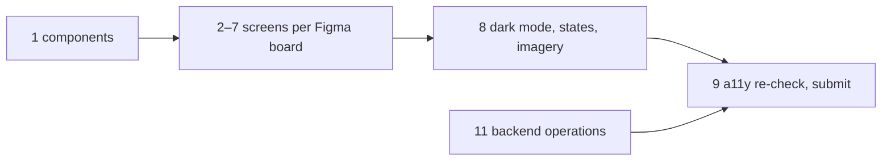

<details open>
<summary><strong>Order</strong></summary>
<dl><dd>

- F18 changes how screens look, never what they do.
- Step 1 first: every screen step uses the finished components.
- Steps 2–7 in any order; 8 after them; 9 and 11 close the roadmap.
- Step 10 is optional: any time after 8; submission does not wait for it.

</dd></dl>
</details>

</dd></dl>

## Target structure

<dl><dd>

```text
Packages/DesignSystem/Sources/DesignSystem/
├── Tokens/                      # 1: tokens checked against Figma variables
└── Components/                  # 1: DSSeverityPicker, DSAnswerRow, DSToggleRow… finished to Figma
SiteLog/
├── App/Resources/Assets.xcassets/    # 2, 8: app mark, real imagery
└── Presentation/
    ├── Components/              # 4–5: SitePhoto, PlanDrawing, CameraControls, CaptureToolbar finished
    ├── Access/ Projects/ Capture/ Issues/ Annotation/ Plans/
    ├── Checklists/ Reports/ Uploads/ Diagnostics/ Settings/   # 2–7: one screen folder at a time
SiteLogTests/Snapshots/          # 10 (optional): one snapshot per screen
fastlane/Fastfile                # 9: release lane waits for processing
```

</dd></dl>

## How to finish a screen

<dl><dd>

| Step | Do |
|---|---|
| 1 | Open the Figma frame and the running screen side by side |
| 2 | Fix spacing, sizes, fonts with tokens only (`DSSpacing`, `DSTextStyle`, `DSColor`…); add a token if Figma needs a new value |
| 3 | Swap placeholders and native controls for the designed ones |
| 4 | Check light + dark, small (SE) and large (Pro Max) iPhone, largest Dynamic Type |
| 5 | Commit per screen |

</dd></dl>

## 1. Components to Figma

<dl><dd>

#### Overview

<dl><dd>

- **Goal:** the shared components match the Foundations & Components page.
- Severity segmented control with marker shapes, Pass/Fail/N/A answer row, toggle row, radio row.

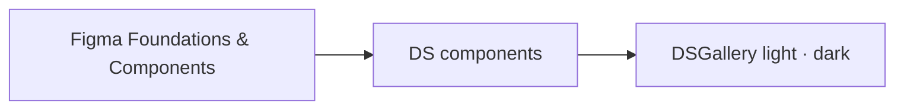

</dd></dl>

#### Build

<dl><dd>

<details open>
<summary><strong>1.1 Done when</strong></summary>
<dl><dd>

- `DSGallery` matches the components page (light + dark)

</dd></dl>
</details>

</dd></dl>

</dd></dl>

## 2. Access to Figma

<dl><dd>

#### Overview

<dl><dd>

- **Goal:** A1 Face ID lock, A2 sign in, A3 passcode, privacy overlay match S1.
- App mark from `docs/design/app-icon/`; passcode dots and number pad as designed.

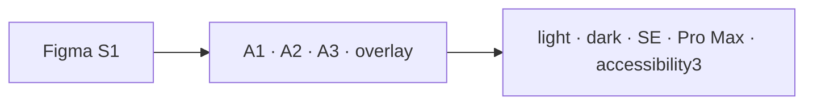

</dd></dl>

#### Build

<dl><dd>

<details open>
<summary><strong>2.1 Done when</strong></summary>
<dl><dd>

- 4 screens match Figma

</dd></dl>
</details>

</dd></dl>

</dd></dl>

## 3. Projects to Figma

<dl><dd>

#### Overview

<dl><dd>

- **Goal:** P1–P7, bulk locations, clone tree, end session (R1) match S2–S3.

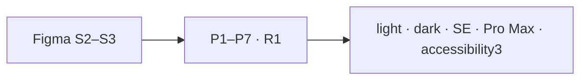

</dd></dl>

#### Build

<dl><dd>

<details open>
<summary><strong>3.1 Done when</strong></summary>
<dl><dd>

- Every Projects screen matches Figma

</dd></dl>
</details>

</dd></dl>

</dd></dl>

## 4. Capture and issues to Figma

<dl><dd>

#### Overview

<dl><dd>

- **Goal:** C1 camera chrome (glass buttons, mode switcher, shutter), capture review, measurement overlay, C2–C6 match S4–S5.

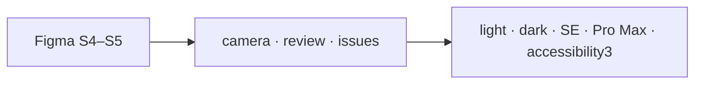

</dd></dl>

#### Build

<dl><dd>

<details open>
<summary><strong>4.1 Done when</strong></summary>
<dl><dd>

- Camera screens checked on device (real viewfinder)

</dd></dl>
</details>

</dd></dl>

</dd></dl>

## 5. Markup and plans to Figma

<dl><dd>

#### Overview

<dl><dd>

- **Goal:** markup editor tools and colours, stamped preview, plan list thumbnails, pins and clusters match S6–S7.

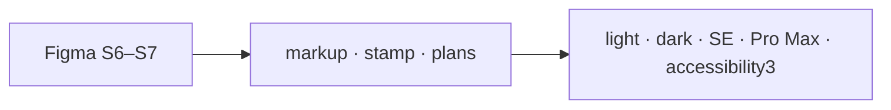

</dd></dl>

#### Build

<dl><dd>

<details open>
<summary><strong>5.1 Done when</strong></summary>
<dl><dd>

- Every Annotation and Plans screen matches Figma

</dd></dl>
</details>

</dd></dl>

</dd></dl>

## 6. Checklists and reports to Figma

<dl><dd>

#### Overview

<dl><dd>

- **Goal:** K1–K4 and R2–R5 match S8–S9; real PDF preview page styling.

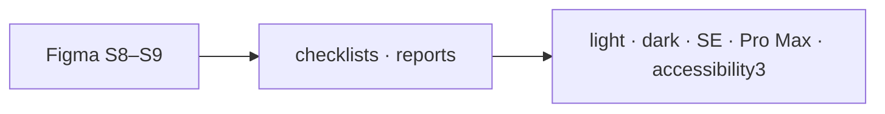

</dd></dl>

#### Build

<dl><dd>

<details open>
<summary><strong>6.1 Done when</strong></summary>
<dl><dd>

- Every Checklists and Reports screen matches Figma

</dd></dl>
</details>

</dd></dl>

</dd></dl>

## 7. Sync and settings to Figma

<dl><dd>

#### Overview

<dl><dd>

- **Goal:** U1–U3, S1–S5, storage cleanup and account match S10–S11.

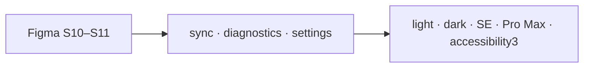

</dd></dl>

#### Build

<dl><dd>

<details open>
<summary><strong>7.1 Done when</strong></summary>
<dl><dd>

- Every Uploads, Diagnostics and Settings screen matches Figma

</dd></dl>
</details>

</dd></dl>

</dd></dl>

## 8. Dark mode, states, imagery

<dl><dd>

#### Overview

<dl><dd>

- **Goal:** dark mode pass on every screen; empty, error and offline states; no placeholder imagery left.

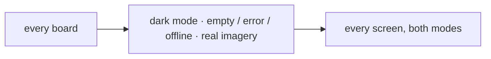

</dd></dl>

#### Build

<dl><dd>

<details open>
<summary><strong>8.1 Done when</strong></summary>
<dl><dd>

- No screen shows a placeholder; every list has its empty and error state; every screen checked in dark mode

</dd></dl>
</details>

</dd></dl>

</dd></dl>

## 9. Accessibility re-check and submission

<dl><dd>

#### Overview

<dl><dd>

- **Goal:** the finished UI still passes the F17 accessibility pass; App Store listing and submission.

| Action | File | Holds |
|---|---|---|
| <b class="tag-edit">Edit</b> | `fastlane/Fastfile` | `release` lane waits for processing |

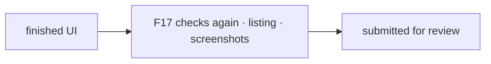

</dd></dl>

#### Build

<dl><dd>

<details open>
<summary><strong>9.1 Steps</strong></summary>
<dl><dd>

1. Repeat the F17 checks (Dynamic Type, VoiceOver, contrast) on the finished screens.
2. Store listing, screenshots from the finished UI, privacy answers; submission stays manual.

</dd></dl>
</details>

<details open>
<summary><strong>9.2 Done when</strong></summary>
<dl><dd>

- Accessibility checks pass on the finished UI
- Build submitted for review

</dd></dl>
</details>

</dd></dl>

</dd></dl>

## 10. Optional — Snapshot tests

<dl><dd>

#### Overview

<dl><dd>

- **Goal:** guard the finished UI against visual regressions; optional, last.
- **Library:** [swift-snapshot-testing](https://github.com/pointfreeco/swift-snapshot-testing) 1.x ([D06](../../feature-docs/00-overview.md#d06--test-libraries)).

| Action | File | Holds |
|---|---|---|
| <b class="tag-edit">Edit</b> | `project.yml` | `SnapshotTesting` package, linked to `SiteLogTests` |
| <b class="tag-new">New</b> | `SiteLogTests/Snapshots/` | `DSGallery` + one test per screen: light, dark, `accessibility3` |
| <b class="tag-edit">Edit</b> | `fastlane/Fastfile` | `test` lane comment: app unit + snapshot tests |

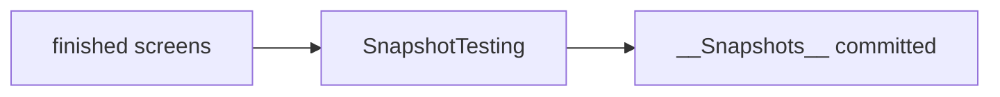

</dd></dl>

#### Build

<dl><dd>

<details open>
<summary><strong>10.1 Steps</strong></summary>
<dl><dd>

1. Add the package in `project.yml`, run `xcodegen generate`.
2. Record on the pinned simulator (iPhone 17 Pro, iOS 26.4): first run records and fails, second run passes.
3. Commit the `__Snapshots__/` references.

</dd></dl>
</details>

<details open>
<summary><strong>10.2 Done when</strong></summary>
<dl><dd>

- Every screen has light, dark and `accessibility3` references; `fastlane test` green

</dd></dl>
</details>

</dd></dl>

</dd></dl>

## 11. Backend — operations

<dl><dd>

#### Overview

<dl><dd>

- **Goal:** the backend is ready for real users: production deploy, nightly purge, backups, alerts.
- **Spec:** [03-backend §11 Operations](../../feature-docs/03-backend.md#11-operations)

| Action | File | Holds |
|---|---|---|
| <b class="tag-new">New</b> | `Backend/src/jobs/purge.ts` | Nightly: tombstones older than 90 days |
| <b class="tag-edit">Edit</b> | `Backend/fly.toml`, `.github/workflows/backend.yml` | Production app; deploy on a `v*` tag after staging |
| — | Host settings | Daily Postgres backup with a restore test; alerts on 5xx rate and `/health` |

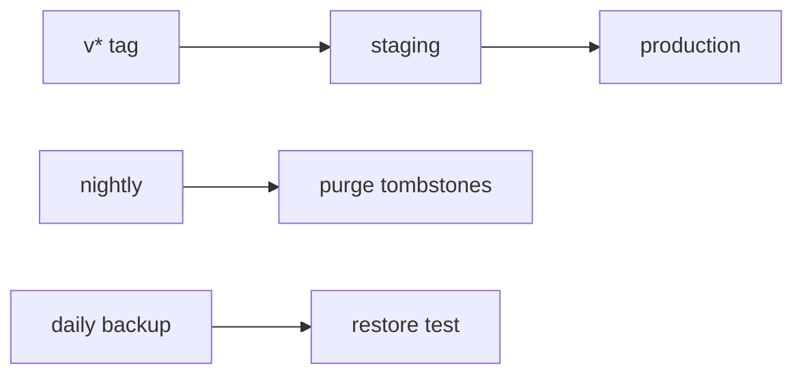

- **Check:** a restore of last night's backup opens; an induced 5xx burst sends an alert.

</dd></dl>

</dd></dl>

## Feature done

<dl><dd>

| Check | How |
|---|---|
| Demo | Every screen next to its Figma frame, light and dark |
| Release | App Store submission sent |
| Backend | Production deployed; purge job, backups and alerts running |
| Roadmap | F18 steps ticked |

</dd></dl>
