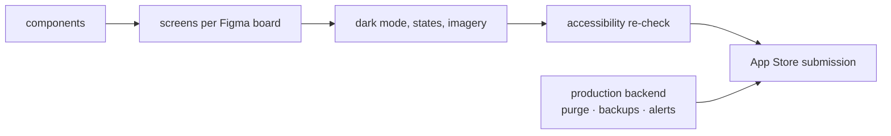

# S9 — UI finish and App Store

<dl><dd>

- Sprint 9 · 2 weeks · 54h · [all sprints](../README.md)

</dd></dl>

## Contents

<dl><dd>

1. [Overview](#overview)
2. [Tasks](#tasks)
3. [Done](#done)
4. [Self-check](#self-check)

</dd></dl>

## Overview

<dl><dd>

- **Goal:** every screen goes from the ~30% skeleton to its Figma frame, on the logic built in S0–S8; the backend runs in production; the build is submitted.
- **Demo — offline:** every screen next to its Figma frame, light and dark, small and large iPhone, largest text, with Continue offline.
- **Demo — signed in:** the same on the production backend; the App Store build is in review.
- Figma board ids (S1–S11) name design boards, not sprints.

| F | Feature | Guide | Hours |
|---|---|---|---|
| F18 | UI finish and App Store (+ backend operations) | [F18-ui-finish.md](F18-ui-finish.md) | 54 |

</dd></dl>

## Tasks

<dl><dd>

| Task | Step | Layer | Hours | Status |
|---|---|---|---|---|
| F18.1 | Components to Figma | UI | 6 | not start |
| F18.2 | Figma S1: access screens | UI | 3 | not start |
| F18.3 | Figma S2–S3: projects, sessions, rooms | UI | 6 | not start |
| F18.4 | Figma S4–S5: camera, capture review, issues | UI | 6 | not start |
| F18.5 | Figma S6–S7: markup, stamp, plans | UI | 5 | not start |
| F18.6 | Figma S8–S9: checklists, reports | UI | 6 | not start |
| F18.7 | Figma S10–S11: sync, diagnostics, settings | UI | 5 | not start |
| F18.8 | Dark mode, empty / error / offline states, imagery | UI | 5 | not start |
| F18.9 | Accessibility re-check, listing, submission | Release | 6 | not start |
| F18.10 | Optional: snapshot tests (not counted) | Tests | 6 | optional |
| F18.11 | [site-log-be F18](https://github.com/DAMHONGDUC/site-log-be/blob/main/docs/feature-guide/S9-release/F18-production.md): production, purge, alarms, backups | Backend | 6 | not start |

</dd></dl>

## Done

<dl><dd>

- [ ] Every screen matches Figma in light and dark
- [ ] Accessibility checks pass on the finished UI
- [ ] Production backend: purge job, backups with a restore test, alerts
- [ ] Build submitted for review

</dd></dl>

## Self-check

<dl><dd>

- F18 changes how screens look. Which kinds of change would mean a step went too far?
- Why does a backup only count after a restore test?

</dd></dl>
